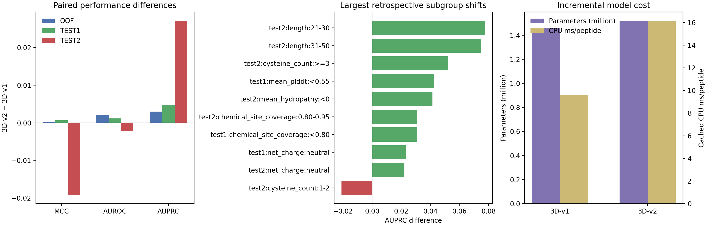
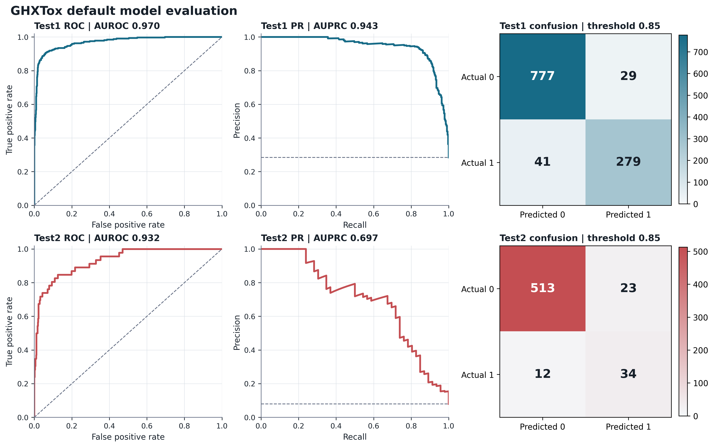

# GHXTox：融合序列与三维化学位点的肽毒性预测

更新时间：2026-08-10

状态：对外预测默认是**组合A 1D与单结构3D的多维融合模型**。1D 序列专家为组合A（LoRA 微调 ProtT5 + 双向 Mamba，3-seed 集成 + 训练 OOF Platt 校准）；3D 专家为 pLDDT 感知 Cα-EGNN + 全原子化学位点分支。二者按训练 OOF 冻结的`0.72/0.28`权重融合，决策阈值为`0.4702`。1D使用pos_weight加权BCE处理类别不平衡，不启用BSMOTE。多构象数据只用于训练集上的扩展研究和受控消融，不是默认模型的输入，也不能表述为当前单结构输出已经吸收了多构象知识。

3D checkpoint继续沿用full2795文件谱系：该文件包含曾在2,795条PepFlow/AF2训练构象上拟合的构象残差模块，但当时单结构空间主干、化学位点支路和基础分类器均被冻结。Test1、Test2和新样本公开预测一律关闭构象残差并读取**单结构`base_logits`**，因此不能把默认预测增益归因于多构象训练。测试集构象缓存、来源感知残差和逐构象集合头不再属于默认模型。公开入口不再接受构象manifest/cache参数；若processed输入意外激活构象字段，程序会直接终止，避免静默改变规范指标。

当前唯一规范产物、入口和配置分别为`runs/default_multidimensional_fusion_single_structure/`、`ghxtox-predict`和`configs/default_multidimensional_fusion.json`。`ghxtox-multidimensional-predict`仅为兼容别名。上一代GHXTox-3D-Chemical-Adapter-Residual和测试集多构象尝试均与公开入口隔离。

导师汇报只保留默认模型测试预测及同数据论文对照，见[导师版报告](reports/mentor_report/REPORT.md)；完整内部统计审计已经合并在本 README 中。

规范单结构推理示例（Test2）：

```powershell
ghxtox-predict predict `
  --processed data\processed\test2_chemical_sites_final_esm2.pt `
  --sequence-records data\processed\test2_lora_mamba_light.pt `
  --output-csv runs\default_multidimensional_fusion_single_structure\test2_predictions.csv `
  --output-metrics runs\default_multidimensional_fusion_single_structure\test2_metrics.json `
  --device cuda
```

### 可选的三状态选择性预测（Selective prediction / Abstention）

当前公开模型已增加一个**默认关闭、显式启用**的后处理层。它不修改模型权重、`0.72/0.28`融合概率、`0.4702225653`二分类阈值或原`prediction`字段；启用后仅追加`uncertainty_score`、`abstained`和`selective_prediction`，其中三状态输出为`Toxic / Non-toxic / Uncertain`。

本功能具体完成了以下工作：

1. 基于队友当前规范版本冻结[`selective_prediction_current_default_oof_v2.json`](configs/selective_prediction_current_default_oof_v2.json)，固定训练OOF数据源、五折划分、候选不确定性特征、coverage网格、5,000次类别分层bootstrap及晋级规则。Test1/Test2标签在策略构建和选择中均被禁止。
2. 从当前规范融合OOF提取决策边界接近度`1-|p-τ|/max(τ,1-τ)`，并对照加入`|p_1D-p_3D|`、三个1D种子的概率标准差、`1-mean_pLDDT`以及构象RMSF/RMSD和接触不确定性。缺失的可选结构特征使用各外层训练分区的中位数处理，不把“缺少构象”错误编码成零波动。
3. 最终`margin_only`直接使用归一化决策边界接近度，不拟合误差分类器，因而其分数定义本身不依赖标签。`deployable_core`与`conformer_extended`仅作为预设对照，在每个外层fold的其余四折上拟合类别平衡逻辑回归，再为held-out fold产生误差排序分数。
4. 离散AURC明确按从1条到6,387条的全部接收集大小上的风险均值计算。`margin_only`的AURC为`0.015373`；`deployable_core`与`conformer_extended`分别为`0.017252`和`0.015883`，均未优于简单边界接近度，因此按预设规则保留`margin_only`。
5. 将冻结策略实现为[`selective_prediction.py`](src/ghxtox/selective_prediction.py)中的独立后处理模块，并接入`ghxtox-predict predict`和CPU `assemble`。策略加载时校验artifact类型、特征、阈值和参数；启用拒识也不会覆盖原`toxicity_probability`和二分类`prediction`。
6. 增加了策略加载、三状态输出、缺失特征处理、CSV兼容性和CLI显式启用测试；保存逐样本交叉拟合分数、risk--coverage表、bootstrap区间、冻结策略和输入SHA256。另生成了可复现的风险--覆盖图代码、SVG/PDF/600-dpi PNG、源数据和英文caption。
7. 在查看随机对照结果前冻结[`selective_prediction_formal_current_default_v2.json`](configs/selective_prediction_formal_current_default_v2.json)，将正式报告点固定为100%、95%、90%、85%和80% coverage；每个点均按`round(coverage × 6387)`确定接收数，并报告accepted error、MCC、BACC、SN和SP。正式实验不重新拟合策略，也不重新选择特征。
8. 增加同接收数的随机拒判对照：使用5,000个均匀随机、跨coverage嵌套的样本排序（种子`20260820`）。区间和方法差值由5,000次类别分层配对bootstrap估计（种子`20260821`）；同一次bootstrap内，两种方法在同一重采样队列上比较，随机方法使用一个嵌套随机排序。未报告p值或显著性星号。
9. 在查看Test1/Test2选择性结果前冻结[`selective_prediction_frozen_threshold_transfer_current_default_v2.json`](configs/selective_prediction_frozen_threshold_transfer_current_default_v2.json)，锁定训练OOF产生的直接`margin_only`分数、`0.4702225653`二分类阈值和`0.47361765874159856`拒判截断。Test1/Test2不重新计算不确定性分位数，也不强制实现90% coverage。
10. 先生成并哈希不含标签的逐样本接收/拒判表，再读取标签计算结果。测试标签只进入事后指标、等接收数随机对照和固定mask bootstrap；dataset identity、标签、样本数、类别比例、测试概率分布及目标coverage均不能进入选择规则。

冻结策略只使用6,387条训练OOF记录，没有读取Test1/Test2标签。预设90% coverage下，OOF accepted error由全覆盖的`5.1198%`降至`2.9228%`（相对降低`42.91%`），accepted MCC由`0.8733`升至`0.9257`；毒性/非毒性真实类别覆盖率分别为`85.97%/91.60%`。该结果说明拒绝靠近决策边界的样本可提高已接收预测的可靠性，但它是训练OOF证据，不是新的外部验证结果。

正式对照实验固定使用最终入选的`margin_only`策略。其唯一输入为融合概率到固定阈值的归一化接近度：`decision_closeness = 1-|p_GHXTox-τ|/max(τ,1-τ)`，其中`τ=0.47022256531284556`。该数值直接用于排序，不经过标签驱动的变换，也不应解释为校准后的逐样本错误概率。表中随机拒判结果为5,000个等coverage随机排序的均值；100% coverage时两种方法完全相同。

| 方法 | 目标coverage | 实际coverage | 接收数 | accepted error | MCC | BACC | SN | SP |
|---|---:|---:|---:|---:|---:|---:|---:|---:|
| 冻结不确定性排序 | 100% | 100.00% | 6,387 | 5.1198% | 0.8733 | 0.9324 | 0.8944 | 0.9705 |
| 随机拒判 | 100% | 100.00% | 6,387 | 5.1198% | 0.8733 | 0.9324 | 0.8944 | 0.9705 |
| 冻结不确定性排序 | 95% | 95.01% | 6,068 | 3.6585% | 0.9082 | 0.9505 | 0.9216 | 0.9795 |
| 随机拒判 | 95% | 95.01% | 6,068 | 5.1194% | 0.8733 | 0.9324 | 0.8944 | 0.9705 |
| 冻结不确定性排序 | 90% | 90.00% | 5,748 | 2.9228% | 0.9257 | 0.9585 | 0.9316 | 0.9854 |
| 随机拒判 | 90% | 90.00% | 5,748 | 5.1203% | 0.8733 | 0.9324 | 0.8943 | 0.9705 |
| 冻结不确定性排序 | 85% | 85.00% | 5,429 | 2.4130% | 0.9387 | 0.9650 | 0.9411 | 0.9889 |
| 随机拒判 | 85% | 85.00% | 5,429 | 5.1200% | 0.8733 | 0.9324 | 0.8944 | 0.9705 |
| 冻结不确定性排序 | 80% | 80.01% | 5,110 | 2.0548% | 0.9481 | 0.9705 | 0.9508 | 0.9903 |
| 随机拒判 | 80% | 80.01% | 5,110 | 5.1196% | 0.8733 | 0.9324 | 0.8944 | 0.9705 |

在预先指定的90% coverage处，随机拒判减去冻结不确定性排序的accepted error差值为`2.1914`个百分点，95%配对bootstrap区间为`1.8089–2.5748`个百分点；在全部四个部分coverage点，冻结排序的accepted error均低于随机拒判均值。因而，性能改善不能仅归因于“少预测了一部分样本”，而是表明冻结分数在训练OOF队列中富集了较难样本。该结论仍不构成Test1/Test2或独立外部数据上的泛化证据。

#### OOF冻结阈值在Test1/Test2上的直接迁移

Test1和Test2严格使用同一个训练OOF策略与拒判截断：`uncertainty_score = decision_closeness <= 0.47361765874159856`时接收，否则输出`Uncertain`。两个测试集均未按自身分布重算分位数，因此实际coverage是冻结规则的观测结果，而不是预先指定的测试集配额。

| 数据集 | 方法 | 实际coverage | 接收数 | accepted error | MCC | BACC | SN | SP |
|---|---|---:|---:|---:|---:|---:|---:|---:|
| Test1 | 完整二分类预测 | 100.00% | 1,126 | 5.2398% | 0.8705 | 0.9323 | 0.8969 | 0.9677 |
| Test1 | OOF冻结阈值接收集 | 88.54% | 997 | 2.7081% | 0.9329 | 0.9629 | 0.9397 | 0.9860 |
| Test1 | 等接收数随机拒判 | 88.54% | 997 | 5.2400% | 0.8705 | 0.9323 | 0.8969 | 0.9677 |
| Test2 | 完整二分类预测 | 100.00% | 582 | 5.3265% | 0.6673 | 0.8618 | 0.7609 | 0.9627 |
| Test2 | OOF冻结阈值接收集 | 86.94% | 506 | 3.1621% | 0.7781 | 0.8983 | 0.8158 | 0.9808 |
| Test2 | 等接收数随机拒判 | 86.94% | 506 | 5.3274% | 0.6670 | 0.8617 | 0.7607 | 0.9627 |

Test1中，完整集合减去冻结接收集的error差值为`2.5317`个百分点，95%固定mask配对bootstrap区间为`1.6203–3.5139`个百分点；相对等接收数随机拒判的差值为`2.5319`个百分点，区间为`1.4881–3.6072`个百分点。Test2对应差值分别为`2.1644`个百分点（`0.9881–3.5182`）和`2.1653`个百分点（`0.7767–3.7402`）。因此两个benchmark均通过结果计算前规定的strong-support判据。

这一结果表明，冻结的不确定性阈值在两个既有benchmark上仍能富集困难样本，且提升不能用“随机少预测相同数量样本”解释。不过，不应把所有子指标都写成确定改善：Test2 sensitivity的点差为`+0.0549`，但95%区间为`-0.0109–0.1368`，仍跨过零。此外，Test1/Test2虽未参与策略选择，却是项目既有benchmark，而不是新收集的独立外部数据；因此本实验支持**固定策略的benchmark迁移**，不等同于全新外部队列验证。

label-blind决策表在读取标签评价前写出，其SHA256为`e6820ffe76688e8fdee6f8e704b1eef0bb5d2f83694aa5f858ead65687ce85a0`。完整结果见[`runs/selective_prediction_frozen_threshold_transfer_current_default_20260810_v2/`](runs/selective_prediction_frozen_threshold_transfer_current_default_20260810_v2/)，评估脚本为[`scripts/evaluate_selective_prediction_test_transfer.py`](scripts/evaluate_selective_prediction_test_transfer.py)，正式图表及源数据见[`paper_figures/output/selective_prediction_frozen_threshold_transfer_current_default_v2/`](paper_figures/output/selective_prediction_frozen_threshold_transfer_current_default_v2/)。

四特征组合（决策边界距离、1D/3D分歧、1D种子离散度和结构置信度）在90% coverage点的error略低（`2.9054%`），但全coverage离散AURC为`0.017252`，劣于更简单的边界距离策略`0.015373`；因此按预先冻结的晋级规则，公开可选策略采用直接边界接近度。包含RMSF、构象RMSD和接触不确定性的扩展策略AURC为`0.015883`，同样未通过主终点，只作为研究对照保留，不进入规范推理或正式图。

启用方式：

```powershell
ghxtox-predict predict `
  --processed data\processed\test2_chemical_sites_final_esm2.pt `
  --sequence-records data\processed\test2_lora_mamba_light.pt `
  --selective-policy runs\selective_prediction_current_default_oof_20260810_v2\selected_policy.json `
  --output-csv runs\selective_predictions\test2_predictions.csv `
  --output-metrics runs\selective_predictions\test2_metrics.json `
  --device cuda
```

若不传`--selective-policy`，CSV列和原二分类行为保持不变。`uncertainty_score`是直接的归一化决策边界接近度，用于样本排序和执行冻结拒绝阈值，而不是校准后的逐样本错误概率。CPU `assemble`子命令也支持同一参数。当前规范输入重建见[`runs/selective_prediction_current_default_input_20260810_v1/`](runs/selective_prediction_current_default_input_20260810_v1/)；策略选择记录见[`runs/selective_prediction_current_default_oof_20260810_v2/`](runs/selective_prediction_current_default_oof_20260810_v2/)；正式五coverage训练OOF对照见[`runs/selective_prediction_formal_current_default_20260810_v2/`](runs/selective_prediction_formal_current_default_20260810_v2/)；冻结阈值的Test1/Test2迁移结果见[`runs/selective_prediction_frozen_threshold_transfer_current_default_20260810_v2/`](runs/selective_prediction_frozen_threshold_transfer_current_default_20260810_v2/)。实现位于[`src/ghxtox/selective_prediction.py`](src/ghxtox/selective_prediction.py)，规范输入构建脚本为[`scripts/prepare_current_default_selective_oof.py`](scripts/prepare_current_default_selective_oof.py)。相应正式图表包位于[`paper_figures/output/selective_prediction_formal_current_default_v2/`](paper_figures/output/selective_prediction_formal_current_default_v2/)和[`paper_figures/output/selective_prediction_frozen_threshold_transfer_current_default_v2/`](paper_figures/output/selective_prediction_frozen_threshold_transfer_current_default_v2/)。旧v1包基于已被替换的重建融合向量，仅保留历史溯源，不再作为当前公开模型的证据。

### 已完成：无需重训的1D--3D专家分歧分析

为明确结构专家究竟补充了哪些序列专家无法正确判别的样本，工程使用当前Test1与Test2逐样本预测开展了只读分析。分析未加载checkpoint、未执行模型前向或重训，也未改变任何概率与阈值。样本正确性由训练侧已冻结的专家阈值定义：1D LoRA--Mamba专家为`0.392`，3D结构专家为`0.677819`，且统一采用`p >= threshold`判为有毒。由此将每个样本唯一划分为`both correct`、`1D expert only correct`、`3D expert only correct`和`both wrong`四组；Test1与Test2分别报告，不合并进行统计推断。

四组样本的组成及预先指定属性如下。连续变量均报告中位数[IQR]；chemical-site coverage定义为有效残基中至少具有一种化学位点标记的比例，而非位点总数除以序列长度；conformer availability仅表示现有元数据中的可用性。

| Test1 group | n（有毒） | Length | Cys count | Mean pLDDT | Chemical-site coverage | Conformer available |
|---|---:|---:|---:|---:|---:|---:|
| Both experts correct | 1032（277） | 33 [23, 41] | 0 [0, 4] | 0.737 [0.634, 0.825] | 0.929 [0.884, 0.960] | 424/1032（41.1%） |
| 1D expert only correct | 29（15） | 25 [18, 40] | 1 [0, 4] | 0.701 [0.573, 0.803] | 0.933 [0.900, 0.975] | 18/29（62.1%） |
| 3D expert only correct | 24（5） | 20 [15, 28.75] | 1 [0, 2] | 0.656 [0.587, 0.763] | 0.935 [0.905, 0.976] | 18/24（75.0%） |
| Both experts wrong | 41（23） | 26 [20, 34] | 1 [0, 4] | 0.647 [0.570, 0.765] | 0.920 [0.846, 0.957] | 26/41（63.4%） |

| Test2 group | n（有毒） | Length | Cys count | Mean pLDDT | Chemical-site coverage | Conformer available |
|---|---:|---:|---:|---:|---:|---:|
| Both experts correct | 529（33） | 31 [17, 41] | 0 [0, 1] | 0.726 [0.645, 0.810] | 0.931 [0.886, 0.968] | 250/529（47.3%） |
| 1D expert only correct | 13（2） | 28 [25, 41] | 2 [0, 4] | 0.694 [0.548, 0.797] | 0.950 [0.900, 0.975] | 7/13（53.8%） |
| 3D expert only correct | 15（1） | 18 [15, 26.5] | 0 [0, 2] | 0.703 [0.593, 0.772] | 0.938 [0.920, 1.000] | 12/15（80.0%） |
| Both experts wrong | 25（10） | 26 [16, 36] | 2 [0, 4] | 0.610 [0.563, 0.693] | 0.913 [0.815, 0.951] | 15/25（60.0%） |

3D专家在全部1D错误样本中分别纠正Test1的`24/65=36.92%`和Test2的`15/40=37.50%`；反向地，1D专家在全部3D错误样本中分别纠正`29/70=41.43%`和`13/38=34.21%`。因此，两位专家存在可重复的双向互补，但没有证据表明其中一位在所有错误样本上占优。更明确的差异出现在类别方向：3D-only-correct样本中，Test1有`19/24`、Test2有`14/15`为无毒样本。按真实类别计算，3D对1D错误的纠正率在无毒样本中为Test1 `51.35%`、Test2 `48.28%`，在有毒样本中仅为`17.86%`和`9.09%`。就当前两个benchmark而言，3D专家的主要贡献因而更接近对假阳性的特异性补偿，而不是稳定提高有毒肽召回。

预先指定的主对比为`3D expert only correct - 1D expert only correct`。连续变量采用Cliff's delta和组内按真实标签分层的5,000次bootstrap区间，显著性由10,000次标签分层置换检验给出；两数据集共10项检验统一进行Benjamini--Hochberg校正。3D-only-correct样本在两个数据集中均较短：Test1中位数`20 vs 25`，delta=`-0.286`，95% CI `[-0.549, 0.000]`，`p=0.0978`，`q=0.4890`；Test2为`18 vs 28`，delta=`-0.523`，95% CI `[-0.831, -0.164]`，`p=0.0156`，`q=0.1560`。该方向具有描述性一致性，但没有一项主对比在BH校正后达到`q<0.05`，因此不得表述为已确认的显著分层。Cys数量、平均pLDDT和chemical-site coverage均未表现出跨数据集稳定的校正后差异；尤其pLDDT方向在两个数据集中相反，不能据此声称3D只在高置信结构上提供增益。

原始结果中3D-only-correct组的conformer availability较高，但这一现象不能解释为多构象带来的因果收益。对全部1,708个样本的预设敏感性审计显示，`conformer_available == (length <= 30)`完全成立且零例外：长度不超过15 aa的样本来自PepFlow，16--30 aa来自AF2，超过30 aa则无构象集合。更重要的是，本分析所用当前规范预测来自单结构`base_logits`，从未使用这些构象字段。故该变量与长度和数据生成流程完全混杂，只能作为覆盖范围描述，不能作为3D纠错机制的独立证据。

冻结协议见[`configs/expert_disagreement_analysis_v1.json`](configs/expert_disagreement_analysis_v1.json)，只读分析代码见[`scripts/analyze_expert_disagreement.py`](scripts/analyze_expert_disagreement.py)，逐样本分组、完整统计量和校验和见[`runs/expert_disagreement_analysis_20260810_v1/`](runs/expert_disagreement_analysis_20260810_v1/)。绘图代码见[`paper_figures/scripts/plot_expert_disagreement_analysis.py`](paper_figures/scripts/plot_expert_disagreement_analysis.py)，可编辑矢量图、600-dpi PNG、caption、精确结果表、panel/input manifest和作图源数据见[`paper_figures/output/expert_disagreement_analysis/`](paper_figures/output/expert_disagreement_analysis/)。这部分当前作为工程证据与论文图表素材保留；本轮没有改动`v1.tex`。

当前规范指标如下；它们来自同一full2795训练checkpoint的单结构`base_logits`，不包含测试集构象信息：

| 数据集 | ACC | BACC | SN | SP | F1 | MCC | AUROC | AUPRC | Brier |
|---|---:|---:|---:|---:|---:|---:|---:|---:|---:|
| Test1 | 0.9476 | 0.9323 | 0.8969 | 0.9677 | 0.9068 | 0.8705 | 0.9811 | 0.9674 | 0.0410 |
| Test2 | 0.9467 | 0.8618 | 0.7609 | 0.9627 | 0.6931 | 0.6673 | 0.9433 | 0.8046 | 0.0436 |

测试集多构象曾在Test1/Test2各改变一个阈值决策，但增益很小、OOF区间跨零，后续来源独立头、融合感知残差和冻结空间集合头也未通过预设门槛。团队因此统一回退到单结构测试协议。机器可读决定见[`decision.json`](experiments/test_multiconformer_archive/decision.json)；关键负消融说明与研究脚本保存在[`experiments/test_multiconformer_archive/`](experiments/test_multiconformer_archive/)，不参与默认导入或运行。

为直接检验“训练期多构象、部署期单结构”的知识迁移，项目又完成了预先冻结的fold0多构象教师→单结构学生pilot。学生只读取单结构`base_logits`，但最终融合BACC/MCC均不变，1,271条留出记录没有任何分类决策变化，AUPRC降低`0.000108`且Brier恶化`0.000021`；实验未读取Test1/Test2，因此按门槛停止，不进入五折，也不修改默认模型。紧凑结果见[`single_structure_distillation_result.json`](experiments/test_multiconformer_archive/results/fold0_rejected_extensions/single_structure_distillation_result.json)。

上述命令默认且严格使用 seed `42/123/2025` 的 LoRA-ProtT5 + 双向 Mamba checkpoint、三份同种子 OOF、纯 3D checkpoint、`0.72/0.28` 权重和 `0.4702225653` 阈值。任一 checkpoint 架构、seed、OOF 样本/标签/fold 或 1D/3D 样本覆盖不一致都会立即终止；只有显式消融才允许加入 `--allow-noncanonical-operating-point`。

CPU 复现已有 Test2 概率融合使用：

```powershell
ghxtox-predict assemble `
  --cal-1d runs\lora_mamba_full\test2_lora_mamba_calibrated.csv `
  --structure-csv runs\single_structure_test_components\test2_structure_predictions.csv `
  --output-csv runs\default_multidimensional_fusion_single_structure\test2_predictions.csv `
  --output-metrics runs\default_multidimensional_fusion_single_structure\test2_metrics.json
```

`ghxtox-multidimensional-predict` 是兼容别名；论文和部署统一使用 `ghxtox-predict`。`ghxtox-structure-predict` 只运行独立 3D 专家。上一代 ProtT5-TextCNN 和混合模型不再安装任何控制台入口，只能通过 `python -m ghxtox._legacy.prott5_default` 或 `python -m ghxtox._legacy.hybrid_default` 显式复现基线。

> 说明：`ghxtox-predict` 现为**当前默认（GHXTox-Multidimensional-Fusion）**入口（`src/ghxtox/multidimensional_default.py`）：`assemble` 子命令从严格对齐的 1D/3D 概率 CSV 复现融合输出（CPU），`predict` 子命令对全新序列做端到端推理（LoRA-ProtT5 三种子 + Platt + 独立 3D 专家，需 GPU，w=0.72/阈值 0.4702，见 `configs/default_multidimensional_fusion.json`）。纯 3D 前向已拆分到`src/ghxtox/structure_inference.py`，当前默认不再导入旧 TextCNN、旧交互适配器或旧 BACC 残差。上一代完整流水线已物理隔离到`src/ghxtox/_legacy/`，没有公开控制台入口，仅可通过`python -m ghxtox._legacy.hybrid_default`显式复现基线。

`--allow-pre-adapter`、`--allow-sequence-fallback`和`--disable-bacc-residual`只属于上一代基线模块；当前默认不接受这些旧接口。纯序列对照也已收入`ghxtox._legacy`命名空间，不能作为默认结果出口。

公开模型名称统一如下；`Phase25/Phase33`仅作为旧文件、CSV字段和哈希合同中的内部阶段ID，不再作为论文或结果表中的模型名：

| 公开名称 | 定位 | 旧内部阶段ID |
|---|---|---|
| GHXTox-Multidimensional-Fusion（组合A 1D + 单结构测试3D） | **唯一对外预测默认**：LoRA微调ProtT5 + 双向Mamba（3-seed集成 + 训练OOF Platt校准）与full2795训练checkpoint的单结构`base_logits`按`0.72/0.28`融合，决策阈值`0.4702`；公开测试和新样本推理禁用构象缓存 | — |
| GHXTox-3D-Chemical-Adapter-Residual | **之前多维融合模型（基线）**：15成员 ProtT5-BSMOTE TextCNN + pLDDT感知Cα-EGNN/全原子化学位点专家 + `0.62/0.38`融合 + ProtT5-to-3D交互残差 + OOF冻结BACC决策残差，阈值`0.60` | Phase25底层资产 |
| 三种子 ProtT5-BSMOTE TextCNN（ProtT5-3Seed） | 显式序列消融和缺失结构时的参考；阈值`0.45`，Test2 BACC/SN仍高于当前默认 | 无 |
| ESM2+ProtT5 BACC 优先融合 | 可选高召回操作点；OOF 选择`0.64/0.36`权重和`0.305`阈值，不替代默认，因为 Test2 MCC 和 precision 较低 | 无 |
| BioEmu-XAttn-DRes | 训练OOF研究扩展；由于尚无完整的未知样本推理资产，不进入公开默认推理 | Phase33 |

## 1D 架构创新线（组合A：LoRA 微调 ProtT5 + 双向 Mamba）【最终定稿，当前默认 1D 线路】

当前默认多维融合模型的 1D 序列专家即**组合A**（LoRA 微调 ProtT5 + 双向 Mamba）；上一代默认的
ProtT5-BSMOTE-TextCNN（15 成员）作为「之前多维融合模型」基线保留。组合A 相对旧 1D 的替换如下：

- 蛋白质大模型模块 → **ProtT5 编码器 + LoRA 低秩任务自适应微调**（基座+嵌入冻结，可训练参数约 1310 万，r=8/α=16）。
- 分类网络模块 → **双向 Mamba（S6 状态空间）序列分类器**（纯 PyTorch，前向/反向选择扫描、掩码均值池化）。
- 多人投票 → **3-seed 全量模型集成**（15 成员 fold 投票经受控验证不优于 3 成员，不采用）。
- 数据增强 → 未启用 BSMOTE（以 pos_weight 处理不平衡）；序列点突变增强经受控实验验证为阴性，不采用。
- 新增环节 → **训练 OOF Platt 概率校准**；融合权重/阈值由训练 OOF 重冻结（w=0.72 / 阈值 0.4702，一致 3D 专家口径）。

**最终结果**（全量 6387、3-seed + 校准）：
- 训练OOF保留full2795多构象训练证据，但不再用其测试集构象残差定义公开指标。融合权重仍为`w=0.72`，阈值仍为`0.4702`。
- Test1（n=1126，单结构测试）：ACC 0.9476、BACC 0.9323、SN 0.8969、SP 0.9677、MCC 0.8705、AUROC 0.9811、AUPRC 0.9674、Brier 0.0410。
- Test2（n=582，单结构测试）：ACC 0.9467、BACC 0.8618、SN 0.7609、SP 0.9627、MCC 0.6673、AUROC 0.9433、AUPRC 0.8046、Brier 0.0436。
- 与同数据集参考论文（ToxMSRC/ToxPLTC）：Test1 6/7 项最高并全面超过 ToxMSRC；Test2 ACC/SP/MCC/AUPRC 最高，
  BACC/SN 低于参考（操作点差异，详见导师报告 3.1）。

**受控负结果（全部预注册、只用训练 OOF）**：
1. 序列点突变增强（2026-08-05）：向正类注入近拷贝合成样本导致过预测正类，SP/Brier 变差 → 不采用。
2. 长度分层阈值/校准（2026-08-05）：分层后层样本方差大，不优于全局操作点 → 不采用（保持全局）。
3. 15 成员 fold 投票（2026-08-05）：每成员仅 4/5 训练数据，个体能力损失大于集成降方差收益 → 不采用（保持 3 成员全量模型）。

**结论**：组合A（3 成员全量模型）为 1D 创新线最终配置；三条"优化"路径经受控验证均不采用，
说明当前瓶颈不是数据量/集成度，模型已到平衡点。该组系统性负结果是报告的方法学亮点。

- 报告：`reports/mentor_report/REPORT.md`（3.1 / 5.2）。
- 复现：`src/ghxtox/lora_mamba_1d.py`、`configs/lora_mamba_1d_autodl.json`、`scripts/run_lora_mamba_full.sh`。
- 结果存档：`runs/lora_mamba_full/`（oof_seed*.json、test 集成/校准 CSV、fusion_refreeze.json、
  test_fusion_metrics.json、paired_bootstrap.json、calibration_report/、length_stratified.json、
  stratified_threshold_experiment.json、protocol_audit.json）；新默认规范产物 `runs/default_multidimensional_fusion/`
  （现为历史目录）；当前规范产物为`runs/default_multidimensional_fusion_single_structure/`。

## 阅读导航与当前结论

- 项目完整实现了1D序列、2D原子图和3D预测结构三条线路；**当前对外默认（更新后的多维融合模型）必须使用完整3D化学位点缓存**。推理入口不会静默把缺失3D的数据伪装成默认结果。
- 当前默认的 1D 序列专家为组合A（LoRA 微调 ProtT5 + 双向 Mamba，pos_weight 加权 BCE 处理不平衡、不启用 BSMOTE）；结构专家使用 ESM2 残基状态、pLDDT 感知 Cα-EGNN、全原子化学位点相互作用和置信度门控。按训练 OOF 冻结 `0.72/0.28` 融合权重与 `0.4702` 决策阈值。上一代默认（ProtT5-BSMOTE TextCNN 15 成员 + 交互适配器 + BACC 决策残差，阈值 `0.60`）作为之前多维融合基线。
> 新默认并非所有指标都优于纯序列对照。Test2上联合默认的MCC/AUPRC/Brier/ECE更优，而纯ProtT5的BACC/SN更高；二者必须在论文中分别标为默认模型和序列消融，不能混用最优单项指标。

### 当前默认模型真实输出（更新后的多维融合模型）

| 数据集 | ACC | BACC | SN | SP | MCC | AUROC | AUPRC | Brier | ECE-10 |
|---|---:|---:|---:|---:|---:|---:|---:|---:|---:|
| Test1 | **0.9476** | **0.9323** | **0.8969** | **0.9677** | **0.8705** | **0.9811** | **0.9674** | **0.0410** | — |
| Test2 | **0.9467** | 0.8618 | 0.7609 | **0.9627** | **0.6673** | 0.9433 | **0.8046** | **0.0436** | — |

当前默认（组合A 1D + full2795训练checkpoint的单结构3D）相对上一代默认仍提高Test1的BACC、SN和MCC，并提高Test2的BACC、MCC与AUPRC；但Test2 AUROC仍低于上一代模型。正式数值只以`runs/default_multidimensional_fusion_single_structure/summary.json`为准。测试集多构象结果只作为消融证据，不得再复制到默认模型表格。

上一代默认（基线）接入的 BACC 决策残差 artifact 为 `runs/bacc_prioritized_decision_residual/deployable_gate.json`，配置项为 `1×16 MLP / 80 epochs / alpha=0.01 / gate=0.9298851979999941`。它由训练-only group-aware OOF 选择，上一代默认入口会输出 `base_prediction`、`bacc_gate_probability`、`bacc_residual_active` 和最终 `prediction` 供审计；该模块不进入当前多维融合默认（见 REPORT 图 1 说明与 3.2）。

ESM2互补召回已按受约束多教师门控完成一次冻结筛查。候选只允许在当时部署基线判阴性且ProtT5或ESM2教师判阳性时追加正类决策，保持原概率不变；晋级门槛为OOF BACC严格提高，同时ACC/MCC/F1最多回退`0.001`、SP最多回退`0.002`。最简线性门控在OOF上将BACC/MCC由`0.927731/0.871982`提高到`0.928669/0.872440`，9条决策中纠正5条、回退4条；但冻结后在Test1和Test2均未激活样本，BACC及其他指标完全不变。由于没有历史迁移增益且会增加ESM2部署依赖，该候选按预定标准停止，未替换当时部署基线；现作为历史消融保留。实现与机器可读结果见[`src/ghxtox/multi_teacher_bacc_residual.py`](src/ghxtox/multi_teacher_bacc_residual.py)和[`runs/multi_teacher_bacc_residual/summary.json`](runs/multi_teacher_bacc_residual/summary.json)。

| DRes特征提取层与训练轮数 | OOF BACC | OOF MCC | 净纠正 | 结论 |
|---|---:|---:|---:|---|
| 1层×16，80轮 | 0.927731 | 0.871982 | +2 | 保留；最简且在最佳BACC的0.001以内 |
| 1层×16，240轮 | **0.928006** | **0.872381** | +3 | OOF仅多0.000275 BACC，未通过复杂度增益门槛 |
| 2层×32/16，80轮 | 0.927456 | 0.871583 | +1 | 不保留 |
| 2层×32/16，240轮 | 0.927456 | 0.871583 | +1 | 加轮数无增益 |
| 3层×64/32/16，240轮 | 0.927181 | 0.871184 | 0 | 深层小样本门控失效 |
- 新论文ToxPLTC路线已完成真实ProtT5验证：三随机种子TextCNN概率平均后，组感知OOF的BACC/MCC/AUROC/AUPRC为`0.9317/0.8586/0.9724/0.9436`，阈值`0.45`只由OOF-BACC平台规则确定。
- 在相同Test1/Test2历史对照上，ProtT5性能候选分别达到BACC/MCC/AUROC/AUPRC `0.9342/0.8598/0.9802/0.9578`和`0.8860/0.6526/0.9588/0.7495`。相对ToxPLTC，Test1全部论文指标超过；Test2灵敏度在论文四位小数上持平`0.8261`，其余指标超过。相对导师ToxMSRC，当前仅Test2 MCC仍低约`0.0024`。
- 原构象能力感知联合基线在训练OOF上的BACC/MCC/AUROC/AUPRC为`0.92746/0.86935/0.97730/0.95360`。在不改变`ProtT5/结构=0.62/0.38`和阈值`0.60`的前提下，新增逐残基非对称交互适配层：冻结ProtT5 token作Query，pLDDT降权后的3D残基状态作Key/Value，12维旋转不变官能团摘要通过局部门控写入结构状态，最后只允许有界、零初始化logit残差修正原联合概率。严格五折OOF达到BACC/MCC/AUROC/AUPRC/Brier `0.92718/0.87118/0.97729/0.95363/0.04449`，MCC提高`0.00184`、Brier降低`0.00017`并在3/5折提高MCC，因此曾升级为底层工程默认；现作为BioEmu-XAttn的非边界精确回退。BACC和AUROC分别微降`0.00028/0.000009`，不能写成全面提升。
- 冻结后Test1的BACC/MCC/AUROC/AUPRC由`0.92355/0.85884/0.98153/0.96492`提高到`0.92512/0.86113/0.98157/0.96497`，少1个假阴性；Test2混淆矩阵和MCC保持不变，AUROC/Brier改善而AUPRC由`0.78514`微降至`0.78493`。这些仍是多次用于历史开发的同数据测试，不是新的独立外部确认。缺少逐残基适配缓存时严格回退原0.62/0.38联合概率；缺少完整化学位点时继续回退纯ProtT5。
- 已按后续价值优先级完成本地可运行的“无PLM几何自监督预训练→残基/空间基序/整肽三级1D–3D融合→1D/3D辅助头”验证。五个几何编码器分别只用另外四折结构训练遮蔽残基、距离和6/8/10 Å接触任务；三级融合OOF的BACC/MCC/AUROC/AUPRC/Brier达到`0.92834/0.87241/0.97735/0.95376/0.04450`，相对当前交互默认同时改善BACC、MCC和排序，并在4/5折提高MCC。但按OOF固定6轮全量重拟合后，历史Test1 MCC降至`0.85426`，Test2 AUROC/AUPRC降至`0.95754/0.78417`；五折几何编码器与五折适配器配对集成仍只有Test1 MCC `0.85655`，未消除迁移回退。因此该路线记为“训练内成立、历史域未迁移”的负消融，不替换默认。固定`1.10`正类损失权重还使OOF SN/MCC从`0.88119/0.87241`降至`0.88009/0.87123`，已停止且不再搜索其他权重。机器可读汇总见[`runs/geometry_ssl_fusion_screen/summary.json`](runs/geometry_ssl_fusion_screen/summary.json)。
- 在此基础上又按迁移价值完成三项3D整合实验。第一项以ESMFold为公共锚点，在每个训练折内让同一肽的ESMFold表示分别与PepFlow或AF2构象对齐，并预测8构象的中位距离和6/8/10 Å接触占有率；它不读取毒性标签，并对两种生成器均衡采样。该候选OOF BACC/MCC/AUROC/AUPRC/Brier为`0.92773/0.87198/0.97732/0.95369/0.04446`，相对当时的3D基线改善MCC、AUPRC和Brier；1–15 aa/PepFlow与16–30 aa/AF2域的MCC分别提高`0.00107/0.00457`，但当时尚无31–50 aa多构象输入的长度域下降`0.00140`。通过OOF最低筛选后只做一次冻结五折配对集成，历史Test1 MCC降至`0.85426`，Test2 AUROC/AUPRC降至`0.95741/0.78381`，因此拒绝升级。第二项以基础几何编码器和跨视图编码器的余弦一致度控制3D残差，虽得到OOF AUPRC/Brier `0.95380/0.04446`，但仅2折提高、1折持平、2折下降；第三项按长度×pLDDT做最坏伪域训练，OOF MCC/AUPRC/Brier只有`0.87084/0.95360/0.04463`。后二者均未查看历史测试并已停止。后续31–50 aa pilot400已单独完成，但仍未解除生成器与长度强耦合；该轮实验结束时保留的是旧`0.62/0.38`、阈值`0.60`基线，现已由本文开头所述`0.72/0.28`、阈值`0.4702`新版默认取代。机器可读汇总见[`runs/geometry_cross_view_screen/summary.json`](runs/geometry_cross_view_screen/summary.json)。
- 另冻结一个不替换主模型的BACC/召回优先操作点：OOF选择ProtT5/ESM2权重`0.64/0.36`和阈值`0.305`，Test1/Test2 BACC提高到`0.9421/0.8993`；但Test2 MCC降至`0.6325`，因此只作为应用侧高召回辅助输出。
- 逐残基ProtT5的`3/5/7 CNN + gated-attention`已完成：单模型OOF BACC/MCC为`0.9260/0.8494`，低于pooled候选；与pooled融合的OOF BACC虽升至`0.9341`，但Test1/Test2仅为`0.9340/0.8776`，没有超过现有主模型或BACC辅助模型，因此不进入默认线路。
- HyPepTox-Fuse启发的传统描述符专家、ESM2–ProtT5逐残基交互和受限三专家融合均已完成严格组感知OOF。传统描述符与交互专家分别达到MCC `0.8036/0.8116`；三专家融合虽把AUPRC提高到`0.9518`，但BACC/MCC降至`0.9277/0.8558`，因此未查看Test1/Test2、不修改默认模型，并禁止在当前数据上重复调权重。
- 队友在HyPepTox-Fuse平衡基准上完成的七模型集成提供了“多成员概率平均、验证阈值与Platt校准”的工程参考。本项目已吸收为通用的组感知OOF集成筛选和单调概率校准工具，但不移植其平衡数据权重，也不用已查看测试集搜索模型；当前新增交互层来自本项目训练OOF，而不是复制其平衡数据集权重。
- 3D置信度机制已按优先级完成固定pLDDT门控、轻量可学习回退门控、8次MC-dropout、3D-v1/v2分歧和双3D-v2 checkpoint集成。严格nested outer-test中最高MCC为`0.8616`，仍低于当时对照基线`0.8666`，因此未更换当时的默认权重，也未读取Test1/Test2继续筛选。
- PepFlow真实构象集合已完成全部可支持短肽的生成与验证：761条不超过15 aa的训练肽（本数据中实际为11–15 aa）、每条8构象，共6088个构象NPZ。250条分层pilot的构象统计残差在固定`0.677819`下将全量OOF BACC/MCC由`0.91325/0.83620`提高到`0.91501/0.83902`，联合ProtT5后MCC由`0.86895`提高到`0.86935`。扩展到761条后，未加权训练仅改善AUROC/AUPRC/Brier至`0.96064/0.92810/0.05936`，固定阈值MCC仍为`0.83620`；按扩展前类别贡献校正后固定阈值MCC降至`0.83550`。因此全量扩展作为负消融保留结论，工程默认仍使用性能更好的250条分层pilot候选。
- AF2/ColabFold全量已经完成并核验：压缩包实际覆盖2034条16–30 aa训练肽，每条从`4 seeds × 5 models`候选中保留8个代表构象，共16272个构象NPZ；它不包含31–50 aa，不能写成16–50 aa增强。与PepFlow的761条1–15 aa集合并后，多构象覆盖达到2795/6387=`43.76%`。来源感知残差用三维one-hot区分PepFlow、AF2与其他生成器，并按验证AUPRC选择checkpoint；在全部6387条固定折OOF上，结构专家的BACC/MCC/AUROC/AUPRC由`0.91325/0.83620/0.96059/0.92800`提高到`0.91357/0.83836/0.96088/0.92898`，AUPRC配对95%区间为正。冻结`ProtT5/结构=0.62/0.38`后，联合MCC/AUROC/AUPRC却只有`0.86776/0.97706/0.95320`，低于当前pilot250联合默认的`0.86935/0.97730/0.95360`，因此全量多来源模型只保留为3D性能候选，不替换多维默认。
- 2026-08-09最终协议：full2795 checkpoint继续作为训练侧3D资产，但Test1、Test2和公开新样本推理统一读取其单结构`base_logits`。此前缓存启用结果以及来源缩放、置信度衰减、残差中心化、独立来源头和空间集合头均降级为负消融/诊断证据；不再存在第二套公开测试入口。
- 在上述全量多来源统计残差之上，已完成“PepFlow/AF2独立残差头 + 逐构象官能团图 + set-attention”五折验证。直接用图分支替换集合统计时MCC/AUROC/AUPRC均下降，因此拒绝替换；把图分支作为第二级小残差后，固定阈值BACC/MCC保持`0.91357/0.83836`，AUROC/AUPRC提高到`0.96092/0.92908`，增量`+0.0000406/+0.0001003`的配对bootstrap 95%区间均高于0，Brier由`0.059359`降至`0.059330`。该结构按门槛保留为新的full2795结构性能候选；冻结ProtT5联合仅达到MCC/AUROC/AUPRC `0.86776/0.97708/0.95322`，仍未超过交互前pilot250多维基线`0.86935/0.97730/0.95360`，故不替换底层结构专家和融合权重。
- 31–50 aa新增包已完成SHA256、400条PDB、每条8构象和3200个构象NPZ审计；它是按标签和`31–35/36–40/41–45/46–50`长度分层的pilot400，不是3592条长肽全量。与原2795条合并后，多构象覆盖达到3195/6387=`50.02%`。来源感知统计摘要相对full2795图候选降低全局MCC/AUROC/AUPRC；在其上完成逐构象图五折后，相对同一1–50摘要模型的AUROC/AUPRC提高`0.000126/0.000263`、Brier降低`0.000493`，但相对最强full2795图候选的固定阈值MCC降低`0.000430`，AUROC/AUPRC降低`0.000501/0.002027`，后二者配对95%区间完全低于0。冻结ProtT5联合只有BACC/MCC/AUROC/AUPRC `0.92565/0.86693/0.97726/0.95333`，未超过当时部署基线，因此作为完整负消融和长肽排序证据保留，未重拟合当时的部署checkpoint。决定见[`decision.json`](runs/conformer_graph_set_1_50_pilot3195_oof/decision.json)。
- 为检验“两专家共享序列语义是否限制互补性”，已完成彻底移除ESM2/ProtT5嵌入的独立结构专家：结构模式不再执行序列Transformer，只保留残基理化属性、pLDDT-aware Cα-EGNN、全原子化学位点图和整肽物化描述符。五折OOF BACC/MCC/AUROC/AUPRC为`0.8992/0.7998/0.9479/0.8997`；与ProtT5的概率相关性由原组合的`0.906`降至`0.881`，但能独自纠正ProtT5错误的样本由152条降为137条，共同错误由218条增为233条。结构权重上限35%的概率/logit留一折融合MCC仅为`0.8557/0.8548`，均低于纯ProtT5的`0.8586`和当前多维默认的`0.8693`。因此隔离方向作为重要负消融保留，不替换默认模型；后续若重启，只允许先做无标签几何/构象预训练以增强独立结构表征，不再直接重复调融合权重。
- 上述后续路线现已实现：无标签、无PLM的几何自监督编码器只读取残基理化属性、结构描述符、Cα坐标和pLDDT，并重建遮蔽残基特征、距离及6/8/10 Å接触；其折外表征可通过门控接入“残基交互→空间基序→整肽上下文”三级融合。三级模型的训练OOF MCC由化学交互默认的`0.87118`提高到`0.87241`，4/5折相对交互前基线不劣，但历史Test1 MCC降至`0.85426`且Test2排序未改善；ESMFold↔PepFlow/AF2跨视图一致性也没有解决迁移回退。因此代码和消融证据保留，工程默认不变，下一次只在新的预冻结外部集或同长度跨生成器重叠数据上复验。
- 在构象残差默认之上又依次复验了样本级质量门控、四成员非负stacking和有符号结构残差。三者的严格nested MCC分别为`0.8614/0.8633/0.8627`，均低于冻结默认`0.8693`；后两类残差虽把SN提高到`0.8889/0.8966`，却因假阳性增加而降低MCC和排序指标，故临时代码与结果已清理。当前停止在同一OOF上继续搜索融合公式。
- 早期序列审计显示train/Test1/Test2中至少含两个Cys的样本比例为`40.52%/39.43%/25.26%`，高Cys拓扑风险比例为`22.84%/21.94%/9.45%`；这些数字只说明潜在适用范围。2026-08-09进一步完成了严格限于训练OOF的结构可行性审计，结论是“有条件开展高Cys定向方法研究”，而不是据Cys数量直接启动全量拓扑模型训练。
- 历史3D-v1 Cα模型保留为无化学位点输入时的自动回退，阈值仍为`0.85`。
- 严格ToxinPred3历史冻结比较中，1D ESM2-BiLSTM的MCC/F1/AUROC/AUPRC均高于2D和3D-v1；3D-v2尚无新的独立外部结论。
- 2D原子图保留为独立对照和化学解释线路；由于它没有在分组验证和已有评估中稳定超过默认3D模型，因此未并入当前分类器。
- 全原子化学位点支路经Pareto checkpoint选择后，在五个训练内同源分组fold上平均MCC/AUROC/AUPRC均为正增益；随后完成8轮全训练集重拟合并成为默认入口。
- 配对统计进一步确认OOF AUROC/AUPRC增益的95%区间均高于0，但OOF MCC、Test1和Test2的MCC增益区间均跨0；当前最可靠的新增证据是训练内排序改善，而不是固定阈值分类显著提升。
- 已完成16条不重复TP/TN/FP/FN案例的序列遮蔽、ESM2积分梯度和化学位点删除归因；这些结果支持个案级模型解释，仍不能代表通用氨基酸毒性规律。
- 项目的完整瓶颈、证据、可解决边界和下一轮主线已经冻结在[附录C](#附录-c完整瓶颈清单与固定标签数据路线2026-07-31)：当前优先处理结构来源/长度混杂，先做诊断和200条BioEmu统一构象pilot；禁止直接启动全量高成本任务。
- 本文件是项目唯一 Markdown 说明，模型、结果、进度、命令和论文表述边界均在此维护。

## 训练 OOF 拓扑可行性审计（2026-08-09）

本轮工作只读取6,387条训练样本的固定折OOF预测、单结构坐标和matched chemical-site OOF，不运行模型、不训练参数，也不读取Test1/Test2用于方向选择。分析定义在查看分组结果前冻结于[`topology_feasibility_audit_v1.json`](configs/topology_feasibility_audit_v1.json)，实现见[`audit_topology_feasibility.py`](scripts/audit_topology_feasibility.py)，正式结果见[`topology_feasibility_audit_20260809_v5`](runs/topology_feasibility_audit_20260809_v5/)。同代码v6重生成的12个文件与v5逐文件SHA256一致。

本轮拓扑工作具体完成了以下内容：

1. 对训练tensor、固定fold清单、当前3D专家OOF和matched chemical-site OOF按`source_index/sample_id/sequence/label/fold`逐条对齐，并记录所有输入路径、大小和SHA256；没有加载checkpoint或重新推理。
2. 从序列重新计算每条肽的Cys数量、比例以及`>=2/3/4/6`分层，并沿用既有严格高风险规则。主分析在看结果前固定为`Cys>=4`，`>=2/3/6`只作预设敏感性分析，避免事后挑选阈值。
3. 从单结构缓存提取全部Cys对的Cα--Cα距离、Cys SG--SG距离、序列间隔、两端最小pLDDT、CB--SG方向对齐和候选近接数量；同时输出逐样本表、29,444行Cys对表和分距离区间统计。所有短距离只称为候选近接，不推断真实二硫键。
4. 使用当前3D专家的冻结阈值计算各Cys分层错误率、MCC、BACC、AUROC、AUPRC和Brier，并以全训练集标签比例计算标准化错误率，控制Cys富集与毒性标签之间的强混杂。
5. 使用同折、同基座的control/chemical逐样本OOF比较chemical-site分支是否已经利用该信号；fold 2按原协议保留预测完全相同的零化学残差回退，同时另报实际启用chemical-site的fold 0/1/3/4。
6. 对主要错误率差、候选SG近接差异和chemical-site增益执行5,000次按fold、label和比较组分层的bootstrap；另外构造SG距离图上的一对一最大匹配，检查全局配对约束本身是否已经产生可分辨标签信号。
7. 输出样本表、配对几何表、分组指标、距离分布、chemical-site增量、bootstrap区间、拓扑匹配摘要、输入manifest、决定文件和checksums。正式v5与独立v6重生成逐文件一致，脚本和JSON均通过语法检查，且输入manifest不含Test1/Test2或checkpoint。

- **样本量充足，但标签混杂很强。** 训练集中2,588条肽含至少2个Cys，1,842条含至少4个，1,303条含至少6个。`Cys>=4`组含1,397条正类和445条负类，正类比例为`75.84%`，而`Cys<4`仅为`9.26%`；优势比为`30.70`（近似95% CI `26.52--35.53`）。因此不得用未按标签校正的原始错误率判断拓扑价值。
- **主分析没有发现一般性的Cys-rich性能缺口。** 当前3D专家在`Cys>=4`和`Cys<4`上的原始错误率分别为`6.460%`和`6.469%`；按全训练集标签比例标准化后，前者相对后者的错误率差为`-0.01227`，5,000次按fold、label和分组分层的bootstrap 95% CI为`[-0.04139, 0.01611]`。预先冻结的`Cys>=4`主终点未通过。
- **真正值得追踪的是`Cys>=6`的少数负类。** 预设敏感性分析中，`Cys>=6`相对其余样本的标签标准化错误率高`0.07013`，95% CI为`[0.03251, 0.11107]`，五折差值方向均为正。该组1,303条样本中有240条负类；当前3D专家对这些负类的错误率为`23.75%`，对1,063条正类仅为`1.41%`。后续目标应明确写成降低高Cys负类假阳性，同时保持高Cys正类召回，而不是笼统声称改善所有多Cys肽。
- **预测结构提供了候选几何，不提供真实连接标签。** 共得到29,444个Cys对，SG距离中位数为`6.413 Å`；9,433对（`32.04%`）不超过`4.5 Å`，但468对（`1.59%`）短于`1.5 Å`，提示侧链坐标存在不应被解释为真实S--S键的几何噪声。含至少2个Cys的肽中`89.84%`至少有一个`SG<=4.5 Å`候选近接，这一“任一近接”比例还受Cys对数量的组合效应影响。
- **现有chemical-site已覆盖大部分局部输入类型。** 当前支路已经显式使用sulfur--sulfur兼容性、原始及尺度归一化距离、CB--SG方向、pLDDT置信度和跨残基消息传递。在`Cys>=4`组中，matched chemical-site候选只将错误率降低`0.00217`（95% CI `[-0.00163, 0.00597]`），MCC提高`0.00584`、AUPRC提高`0.00109`；最小SG距离与Brier改善的Spearman相关仅为`-0.0696`。因此再叠加一个读取相同局部变量的MLP不构成新的拓扑信息。
- **简单全局配对也不够。** 对SG距离图施加一对一最大匹配后，匹配覆盖率在`Cys>=6`组区分正负标签的AUROC仅为`0.493/0.514/0.529`（距离阈值`2.5/3.5/4.5 Å`）。这说明“距离阈值+配对约束”本身尚不能解释困难负类；后续若没有更可靠的几何、连接监督或不确定性建模，预期分类收益有限。

当前决定为`conditional_method_development`：**不立即重训完整3D主干，也不以现有距离伪标签直接上服务器；允许在补齐拓扑证据后做一个轻量、严格OOF的高Cys定向原型。** 真正新增的模块必须包含全局Cys配对竞争、每个Cys至多一个伙伴的软匹配约束，或若干候选拓扑及其置信权重聚合，不能只是第二个无约束局部边MLP。

启动该原型前，优先向数据来源补齐以下字段：每条肽的Cys连接对、连接证据来源及置信等级、未确定连接的mask、是否存在头尾或侧链环化，以及结构是否经过含二硫键约束的几何优化。若只能获得部分标注，应使用unknown mask而不是把未标注Cys对当负例。第一阶段只比较冻结基座与新增小头的五折OOF，主观察量为`Cys>=6`负类FPR，同时要求全量MCC/BACC/AUPRC不恶化；若高Cys负类FPR未稳定下降、4/5折方向不一致，或收益只来自移动阈值，则停止，不访问Test1/Test2继续选择。

## 队友HyPepTox-Fuse方案的吸收与协议修正

队友方案在HyPepTox-Fuse平衡独立集上的七模型集成结果为ACC `0.9085`、SN `0.8958`、SP `0.9212`、F1 `0.9073`、MCC `0.8173`、AUROC `0.9580`。这些是另一个数据协议上的历史点估计：它们说明多随机种子和异构专家的概率平均可以提高阈值附近的决策稳定性，但不能直接替换本项目原数据上的默认权重，也不能证明全面超过HyPepTox-Fuse。相对论文结果，其ACC约高`0.0018`、MCC约高`0.0030`，但SP约低`0.0091`、AUROC约低`0.0044`。

本项目保留并加强了其中三个可迁移部分：

1. **多成员概率集成**：[`src/ghxtox/validated_ensemble.py`](src/ghxtox/validated_ensemble.py)在带同源组fold的OOF预测上执行leave-one-fold-out贪心子集筛选。筛选命令没有测试集参数；输出`frozen_spec.json`后，测试阶段只能应用已经冻结的成员、等权权重和阈值。
2. **验证集阈值与约束**：阈值只根据训练内OOF或专用校准集选择，可按MCC、BACC、F1或ACC优化，并可设置最低SN/SP，避免只提高总体准确率却明显牺牲毒性肽召回或非毒性肽特异度。
3. **概率校准**：[`src/ghxtox/calibrate_predictions.py`](src/ghxtox/calibrate_predictions.py)支持temperature和单调Platt scaling，统一报告Brier和ECE-10。单调Platt只改变概率尺度，不应改变AUROC/AUPRC；代码会对异常的排序指标变化直接报错。

上述工具已在现有训练OOF上完成一次实际筛查。候选为3D-v2、三个ProtT5种子和三个ESM2种子，筛选目标为MCC，约束SN≥`0.875`、SP≥`0.96`，全程没有读取Test1/Test2。多成员cross-fit的MCC/AUROC/AUPRC为`0.86436/0.97661/0.95603`，当前3D-v2/三种子ProtT5默认为`0.86656/0.97719/0.95347`；新集成只提高AUPRC，MCC和AUROC下降，Brier/ECE-10也由`0.04475/0.02478`变为`0.04549/0.02642`。因此它作为“排序互补但综合目标未提升”的消融停止，不替换默认、不再运行历史测试。机器可读结论见[`runs/validated_ensemble_oof_screen/summary.json`](runs/validated_ensemble_oof_screen/summary.json)。

在等权子集失败后，项目按预设优先级继续完成非负stacking，但没有追加Test1/Test2调参。第一阶段在每次四个OOF fold上拟合七个非负且和为1的权重、单调仿射概率尺度和MCC阈值，再评估未参与拟合的第五fold；MCC/AUROC/AUPRC达到`0.86940/0.97754/0.95558`，Brier/ECE-10降到`0.04355/0.01626`，五折中四折MCC提高，满足初始保留门槛。第二阶段进一步使用nested manifest严格分开权重拟合、Platt校准和outer-test：SN由默认`0.87789`提高到`0.90044`，AUROC/AUPRC和Brier/ECE仍改善，但SP降至`0.96236`，MCC为`0.86409`，没有超过默认`0.86656`。这说明七路专家确有排序和概率可靠性互补，但独立校准后的操作点偏向更高召回，尚不能形成综合决策升级。

因此[`src/ghxtox/nonnegative_stacking.py`](src/ghxtox/nonnegative_stacking.py)和小型结果作为正向消融保留；该轮实验的稳定基线是3D-v2/三种子旧ProtT5的`0.38/0.62`融合，当时的公开基线只在它上面增加受控交互适配层。stacking冻结候选只允许在未来预冻结外部集上比较，不再读取当前历史测试来决定是否升级；完整边界见[`runs/nonnegative_stacking_screen/summary.json`](runs/nonnegative_stacking_screen/summary.json)。

针对3D迁移不稳定，项目随后单独检查了置信度机制。现有3D-v2内部`global_gate`在训练OOF上的均值/标准差约为`0.3546/0.0324`；在Test1/Test2上均值又都约为`0.3656`，未显示明显数据域区分；该轮外层基线对所有样本固定使用`0.38`的3D权重。为此新增了以旧ProtT5为安全回退的受限残差公式`p = p_ProtT5 + g(x)(p_3D-p_ProtT5)`，并严格使用nested角色隔离：train拟合门控、validation选择最大3D权重和回退惩罚、calibration拟合Platt与阈值、outer-test只评估。固定pLDDT门控和可学习门控的MCC分别为`0.8548/0.8603`；加入8次MC-dropout后为`0.8605`；加入3D-v1/v2版本分歧后为`0.8593`。进一步使用现有checkpoint做ProtT5+3D-v1/v2非负融合得到本轮最高MCC `0.8616`，含/不含同残基位点边的双3D-v2集成为`0.8597`，均没有超过当时对照基线`0.8666`。

这组负结果说明：pLDDT仍适合在图消息和残基层面对低可信坐标连续降权，但它不是“某条3D毒性预测是否正确”的充分统计量；单checkpoint的dropout方差和相近结构checkpoint之间的分歧也没有形成稳定的样本级路由依据。因此底层质量门控和融合权重保持不变，后续只接受有新信息的残基层交互或新外部结构证据。机器可读结论见[`runs/selective_3d_confidence_screen/final_decision.json`](runs/selective_3d_confidence_screen/final_decision.json)。

得到PepFlow构象残差后，项目按同一保留门槛复验了三种不会移除多维输入的融合方式。第一，使用更新后的结构概率重新训练样本级质量门控，nested BACC/SN由默认`0.9275/0.8812`提高到`0.9289/0.8944`，但MCC/AUROC/AUPRC降至`0.8614/0.9764/0.9513`，只在2/5折提高MCC。第二，对构象3D专家和三个ProtT5种子做非负stacking，MCC为`0.8633`，且MCC、AUROC、AUPRC和折胜数门槛均失败。第三，以当前联合概率为不可移除基线，允许一个强正则有符号结构残差利用专家分歧、ProtT5不确定性、pLDDT、结构门控、长度和构象变化；其SN提高到`0.8966`，但SP降至`0.9632`，最终MCC为`0.8627`，同样只有2/5折胜出。

这轮结果把融合瓶颈定位得更具体：三维专家确实能救回部分毒性假阴性，但现有质量统计不能可靠区分这些获益样本与随之增加的非毒性假阳性。继续加深门控、调整固定权重或在当前OOF上搜阈值，增加的是选择自由度而不是新证据。因此工程默认保留`ProtT5 0.62 + 构象能力感知3D 0.38`。

项目进一步检验了“彻底隔离两个专家”能否增加互补性。独立结构配置将`modality`设为`spatial_only`，把序列和空间两处PLM维度都设为0，并在前向阶段完全跳过序列Transformer；模型从零训练，避免从含ESM2的checkpoint继承偏差。它仍使用确定性的残基理化属性，因为空间图必须知道节点的电荷、疏水、芳香和含硫等化学身份；这里的“隔离”指不使用预训练序列语义和独立分类权重，而不是把残基化学身份也删除。五折最佳epoch为`8/30/8/11/21`，固定0.5时各折MCC为`0.8096/0.8208/0.7853/0.7879/0.7965`，统一OOF阈值`0.498057`下MCC为`0.79975`。

隔离确实让两位专家更不相似：独立结构与ProtT5的OOF概率Pearson相关性为`0.8812`，低于原3D-v2/ProtT5的`0.9055`，预测分歧达到424条。但新增差异没有转化成更可靠的结构证据：ProtT5正确而结构错误287条，结构正确而ProtT5错误仅137条，二者同时错误233条。以ProtT5为不可移除基线、把结构权重限制在35%以内时，五个留一折选出的结构权重为`0.31/0.33/0.30/0.21/0.08`，跨折明显下降；概率空间cross-fit MCC/AUROC/AUPRC为`0.85567/0.97204/0.94574`。改为独立logit尺度融合后AUROC/AUPRC小幅变为`0.97374/0.94607`，MCC进一步降至`0.85477`。全OOF拟合的点估计可达到`0.8622–0.8627`，但这不是未参与选择的结果，且仍低于当时对照基线`0.86935`，因此未用于升级。

这项消融说明，当前共享ESM2并不是多维默认的主要瓶颈。预训练序列语义虽然提高了专家相关性，也为结构图提供了稳定的残基上下文；简单删除它会同时丢失有用信息。下一次只有在新增训练信号后才值得重启隔离路线，例如同一肽多构象对比、遮蔽官能团类型恢复、距离/接触占有率预测或结构来源一致性预训练；完成预训练后再冻结独立结构编码器，并只允许其以有界残差修正ProtT5。当前不继续在相同OOF上搜索结构权重、阈值或校准器。

随后已经把PepFlow覆盖从250条扩展到全部761条支持长度样本。新增511条全部属于非毒性类，因而“样本更多”没有带来新的毒性构象覆盖：未加权五折训练在固定阈值下与基础3D的BACC/MCC完全相同，仅带来极小排序和Brier改善；按`650/139=4.6763`对正类损失校正以恢复pilot时期的相对类别贡献后，固定阈值MCC反而由`0.83620`降到`0.83550`，AUROC/AUPRC/Brier也不再改善。联合ProtT5后，未加权全量候选MCC为`0.86895`，类别校正版虽回到`0.86935`，但AUROC/AUPRC/Brier均低于当时对照基线，因此两者都未通过预设保留门槛。下一轮只接受两类真正的信息增量：独立训练的3D-v2随机种子，以及事先冻结且同时具备正、负构象输入的新验证集。

没有照搬的部分包括：对全部候选反复计算独立测试集指标、看过测试结果后继续搜索集成、用同一验证集同时承担所有模型选择和最终结论、以及把校准带来的Brier/ECE改善描述成ACC/MCC提升。当前Test1/Test2和ToxinPred3标签已经被历史开发查看，仍只能用于冻结历史比较；新的集成筛选必须使用训练内group-aware OOF，最终无偏结论需要新的预冻结外部集。

推荐的无泄漏执行顺序如下。第一步只使用各候选的OOF预测筛选并冻结集成：

```bash
python -m ghxtox.validated_ensemble screen \
  --predictions runs/member_a/oof.csv runs/member_b/oof.csv runs/member_c/oof.csv \
  --member-names member_a member_b member_c \
  --fold-manifest data/folds/train_cdhit080_fallback_folds.csv \
  --output-dir runs/validated_ensemble \
  --objective mcc \
  --threshold-metric mcc \
  --max-members 7
```

第二步把冻结成员应用到nested split中的专用calibration部分；第三步拟合校准器并冻结阈值；最后才一次性应用到预先声明的最终集：

```bash
python -m ghxtox.validated_ensemble apply \
  --spec runs/validated_ensemble/frozen_spec.json \
  --predictions runs/member_a/calibration.csv runs/member_b/calibration.csv runs/member_c/calibration.csv \
  --output runs/validated_ensemble/calibration_ensemble.csv

python -m ghxtox.validated_ensemble apply \
  --spec runs/validated_ensemble/frozen_spec.json \
  --predictions runs/member_a/final.csv runs/member_b/final.csv runs/member_c/final.csv \
  --output runs/validated_ensemble/final_ensemble.csv

python -m ghxtox.calibrate_predictions \
  --calibration runs/validated_ensemble/calibration_ensemble.csv \
  --apply runs/validated_ensemble/final_ensemble.csv \
  --method platt \
  --threshold-metric mcc \
  --output-dir runs/validated_ensemble/calibrated \
  --output-json runs/validated_ensemble/calibration_summary.json
```

若没有专用calibration split，不应直接拿Test1/Test2代替。应先用[`src/ghxtox/nested_folds.py`](src/ghxtox/nested_folds.py)从训练同源组中划出互不重叠的train、validation、calibration和outer-test角色。队友结果在取得逐样本预测、七成员清单、checkpoint哈希和数据划分manifest前，只记录为外部协作参考，不写入本项目默认性能表。

## 摘要

GHXTox 面向肽毒性二分类，使用与导师论文 ToxMSRC 一致的基础数据框架，没有额外引入新的训练数据。项目分别实现并比较三条信息线路：

1. **1D 序列线路**：学习氨基酸顺序、上下文语义和显式理化属性；
2. **2D 原子图线路**：学习原子、化学键及其与残基上下文之间的对应关系；
3. **3D 结构线路**：学习 ESMFold 预测结构中的空间邻域、紧致性和非局部接触，并依据 pLDDT 对不可靠结构信息降权。

当前结构创新子模型是 **ESM2 + 序列 Transformer + pLDDT-aware Cα-EGNN + 全原子化学位点交互残差 + learned-confidence fusion** 的3D-v2。这个名称中的“3D”表示它使用三维结构，并不意味着模型只有结构输入；它同时保留了完整的1D序列分支。训练内五折结果显示，化学位点支路相对匹配3D-v1对照带来稳定但幅度较小的排序改善；Test1略有提升，Test2则表现为AUPRC提高、MCC/F1下降。因此，当前更准确的结论是“化学位点有助于部分样本的概率排序”，而不是“3D-v2在所有数据域上都优于旧模型”。

针对“同数据指标超过ToxPLTC”的目标，项目最终将**更新后的多维融合模型**设为唯一公开默认：1D 序列专家为组合A（LoRA 微调 ProtT5 + 双向 Mamba，3-seed 集成 + 训练 OOF Platt 校准，pos_weight 加权 BCE 处理不平衡），按训练 OOF 冻结的 0.72/0.28 权重与 pLDDT-aware 3D 化学位点专家融合，决策阈值 0.4702。上一代默认 GHXTox-3D-Chemical-Adapter-Residual（三随机种子 pooled ProtT5 + fold内1:1 Borderline-SMOTE + TextCNN、交互适配器与 BACC 决策残差，阈值 0.60）作为之前多维融合基线。纯ProtT5仍保留为高BACC/SN序列消融；ESM2+ProtT5融合是BACC优先辅助输出；2D原子图是独立对照。

本文档把结论分为三个证据等级：

- **已实现并验证**：可以由源码、配置、冻结指标或输出文件直接确认；
- **模型支持的生物学解释**：说明模型使用了哪些与生物化学相关的信号，但不等同于实验因果机制；
- **待验证假说**：需要扩大解释样本、独立数据或湿实验后才能形成生物学结论。

---

## 1. 任务、数据与证据边界

### 1.1 任务定义

输入为线性、标准氨基酸字母表示的肽序列，输出为毒性概率：

\[
p(y=1\mid x)=\sigma(z),
\]

其中 \(x\) 为肽序列及可用的 2D/3D 表征，\(z\) 为分类器 logit，\(y=1\) 表示毒性肽。当前任务是**总体毒性二分类**，不是毒性类型、靶器官、作用机制或剂量-反应预测。

### 1.2 数据组成

当前基础数据与导师论文 ToxMSRC 对应：

| 数据集 | 毒性肽 | 非毒性肽 | 总数 | 当前用途 |
| --- | ---: | ---: | ---: | --- |
| Train | 1818 | 4569 | 6387 | 模型训练与组感知验证 |
| Test1 | 320 | 806 | 1126 | 历史对照 |
| Test2 | 46 | 536 | 582 | 历史对照，正样本很少 |
| ToxinPred3 strict external | 471 | 506 | 977 | 冻结外部迁移评估 |

ToxinPred3 严格外部集经过精确去重和相对当前 Train/Test1/Test2 的 `>=0.8` 同源筛查；原生 CD-HIT 4.8.1 复核确认当前 977 条是更保守的子集。**这些外部样本没有加入训练集，模型参数和阈值也没有根据其标签重新调整。**

### 1.3 评估边界

Test1/Test2 在历史开发中已被多次查看，因此可用于复现和横向历史比较，但不再适合支持新的架构选择或无偏创新主张。3D-v2的模型筛选主要依赖组间同源隔离的group-aware CV和OOF配对统计。ToxinPred3 strict提供历史1D/2D/3D-v1的冻结迁移证据；因为其标签已被查看，不再用它为3D-v2形成新的独立外部主张。

Test2 只有 46 个正样本，少量 TP/FN 的变化即可明显改变召回率、F1 和 MCC。因此，Test2 的小数点后微小差异不能脱离多随机种子方差和置信区间解释。

### 1.4 ToxinPred3 在本项目中的作用、增益与预测支持

#### 1.4.1 核心定位

ToxinPred3 在 GHXTox 中是**严格低同源外部压力测试集**，不是训练数据、模型输入分支或集成专家。它用于回答：当模型、checkpoint 和阈值全部冻结后，1D、2D、3D 三条线路面对另一个数据库来源的肽序列时，是否仍能保持排序、分类和概率可靠性。

| 作用 | ToxinPred3 是否承担 | 具体说明 |
| --- | --- | --- |
| 扩充训练集 | 否 | 471 条毒性肽和 506 条非毒性肽均未加入训练 |
| 模型微调 | 否 | 不更新任何神经网络参数 |
| checkpoint/架构选择 | 否 | 评估前已经冻结 1D、2D、3D 模型 |
| 阈值选择 | 否 | 继续使用1D `0.50`、2D `0.25`、历史3D-v1 `0.85` |
| 外部泛化验证 | 是 | 检查跨数据库和低同源条件下的性能 |
| 外部概率校准检查 | 是 | 报告 Brier 和 ECE-10，但不据此重新校准 |
| 三线路迁移比较 | 是 | 比较序列、原子拓扑和预测结构的跨域稳定性 |
| 部署策略支持 | 是 | 为保留 1D 回退、报告结构质量和处理线路冲突提供证据 |
| 生物学解释外部复核 | 可以 | 仅能在冻结模型上做 TP/TN/FP/FN 分层，不可反向调参 |

ToxinPred3 不会出现在单条样本的前向计算中。模型预测仍然只依赖该样本的序列、ESM2 表征以及相应线路需要的原子图或 ESMFold 结构。ToxinPred3 不提供额外特征、相似样本投票或概率加成，所以它带来的不是“模型数值性能增益”，而是“结果证据和使用策略增益”。

#### 1.4.2 严格集构建和独立性

项目使用 ToxinPred3 官方独立测试来源，先相对当前 Train、Test1、Test2 的完整序列集合执行精确去重，再删除序列一致性 `>=0.8` 的同源样本。筛查后保留 977 条：

| 类别 | 数量 |
| --- | ---: |
| 毒性肽 | 471 |
| 非毒性肽 | 506 |
| 总计 | 977 |

原生 CD-HIT 4.8.1 复核保留 987 条，当前 977 条全部包含在原生结果中；另外 10 条仅被原生方法保留。因此，当前集合是一个更保守的、已经过原生 CD-HIT 验证的外部子集。ToxinPred3 的训练文件只参与重叠审计，不进入 GHXTox 训练。

关键文件：

- `data/external/toxinpred3/strict/strict.fasta`：严格外部序列；
- `data/external/toxinpred3/strict/strict_manifest.csv`：样本、标签与筛查清单；
- `data/external/toxinpred3/strict/audit_summary.json`：去重和同源审计摘要；
- `data/external/toxinpred3/cdhit_audit/native_cdhit_audit.json`：原生 CD-HIT 复核；
- `data/external/toxinpred3/processed/strict_esm2_structure.pt`：冻结 3D 评估数据；
- `runs/external_toxinpred3_1d/`、`runs/external_toxinpred3_2d/`、`runs/external_toxinpred3_3d/`：预测与指标。

#### 1.4.3 对预测结果的直接证据

三条线路均使用训练/验证阶段已经确定的固定阈值，一次性外部评估结果为：

| 路线 | BACC | Precision | Recall | F1 | MCC | AUROC | AUPRC | Brier | ECE-10 |
| --- | ---: | ---: | ---: | ---: | ---: | ---: | ---: | ---: | ---: |
| 1D ESM2-BiLSTM | **0.7780** | 0.8885 | **0.6299** | **0.7369** | **0.5859** | **0.8266** | **0.8673** | **0.1745** | **0.1301** |
| 2D ESM2 + Atom-MPNN | 0.7540 | 0.8911 | 0.5732 | 0.6977 | 0.5488 | 0.7786 | 0.8373 | 0.2160 | 0.2031 |
| 历史3D-v1 pLDDT-aware模型 | 0.7484 | **0.9162** | 0.5428 | 0.6815 | 0.5495 | 0.7629 | 0.8271 | 0.2260 | 0.2208 |

这些结果对预测结论提供了四层支持：

1. **支持 1D 的跨域稳定性。** 1D 的 MCC、F1、AUROC、AUPRC、Brier 和 ECE 均最好，说明不依赖预测结构的 ESM2-BiLSTM 在该外部域上迁移更稳健。
2. **限定历史3D-v1增益的适用范围。** 它在历史Test1/Test2上曾是默认决策模型，但外部MCC/AUPRC没有超过1D，说明结构信息的同域收益没有完整迁移到ToxinPred3。
3. **揭示 3D 的保守预测倾向。** 3D precision 为 0.9162、recall 为 0.5428：一旦报毒通常较可靠，但约 45.7% 的外部毒性肽未达到 0.85 阈值。
4. **揭示概率可靠度偏移。** 2D/3D 的 Brier 和 ECE 明显高于 1D，说明复杂线路在新数据域中的概率置信度发生偏移，不能把域内校准直接当作域外可靠度。

因此，ToxinPred3不支持“3D对所有数据都最好”，而支持更精确的结论：**历史3D-v1具有同域决策优势，1D是该严格外部域中最稳定的迁移和无结构回退模型；3D-v2尚无新的外部集结论。**

#### 1.4.4 ToxinPred3 带来的项目增益

ToxinPred3 没有改变模型参数，所以不能把它描述为训练增益或准确率提升。它带来的实际增益是：

- **独立性增益**：补足 Test1/Test2 已被历史开发多次观察的不足；
- **同源控制增益**：降低因重复或高相似序列造成的性能高估；
- **模型定位增益**：把“默认 3D”修正为条件性最优，而不是普遍最优；
- **部署增益**：为保留 1D 正式回退、结构低可信时降低 3D 依赖提供实证依据；
- **风险识别增益**：识别 3D 高 precision/低 recall 的外部漏检风险；
- **校准证据增益**：证明 OOF 或历史测试域的可靠度不能自动迁移到外部域；
- **论文可信度增益**：可以同时报告正结果、外部退化和模型适用边界，减少选择性报告；
- **解释验证增益**：允许检查残基热点和错误模式是否跨数据源稳定，而不是只解释同域样本。

#### 1.4.5 对实际预测使用的支持方式

ToxinPred3 结果支持以下预测策略，但不直接改变单条样本概率：

| 使用场景 | 建议 |
| --- | --- |
| 有全原子ESMFold/化学位点、pooled与逐残基ProtT5缓存，样本接近训练域 | 使用ProtT5→3D化学交互联合默认，同时报告两位专家、交互前后概率、交互残差与pLDDT |
| 有完整结构但暂未生成ProtT5 | 可单独使用3D-v2结构专家，并明确不是联合默认 |
| 缺少化学位点但已有ProtT5 | 联合入口回退到纯ProtT5候选并标记`fallback_used=1` |
| 无结构且无ProtT5、或上游生成失败 | 使用1D ESM2-BiLSTM回退 |
| 未知数据库或明显分布偏移 | 同时报告 1D/3D 概率、pLDDT 和跨种子不确定性 |
| 1D 与 3D 判断一致 | 作为跨线路一致性支持，但仍不是实验真实性证明 |
| 1D 与 3D 判断冲突 | 标记为高风险样本，不应因 3D 更复杂就自动采信 3D |
| 3D 高概率报毒 | 外部高 precision 提供一定支持，但不能外推为精确的个体后验概率 |
| 3D 低于 0.85 | 不能直接判定安全，因为外部 recall 只有 0.5428，应参考 1D 和人工复核 |

ToxinPred3 最重要的预测支持不是提高某一条预测，而是帮助解释“该预测在什么条件下更可信、什么时候应回退或谨慎”。

#### 1.4.6 后续使用边界

ToxinPred3 的标签和结果现已被查看，因此它不再能用于下一轮无偏模型选择。该数据仍可用于：

- 作为冻结结果的最终报告集；
- 进行不改变模型的 TP/TN/FP/FN 错误分析；
- 进行冻结残基解释和跨数据集稳定性分析；
- 报告 bootstrap 区间、校准和线路差异。

该数据不再适合用于：

- 根据 ToxinPred3 调整 1D/2D/3D 阈值；
- 反复修改架构直到该集合性能提高；
- 使用其标签训练路由器、校准器或残差专家；
- 把其样本加入当前训练集后仍称为独立外部验证；
- 仅凭这一个外部来源宣称跨数据库普遍泛化。

新的泛化或校准创新需要第二个独立数据来源验证。

---

## 2. 项目实现的三个维度与默认用法

“项目实现了几个维度”和“默认模型实际使用几个维度”是两个不同问题。项目层面已经完成1D、2D、3D三条独立线路；当前对外默认联合使用1D ProtT5与3D结构/化学位点，2D原子图仍作为独立消融路线。pooled ProtT5属于1D全局专家，不构成第四个维度。

| 维度 | 项目是否实现 | 对外默认是否使用 | 当前作用 |
| --- | --- | --- | --- |
| 1D序列 | 是 | **是** | 默认使用pooled ProtT5 TextCNN；ESM2-BiLSTM为独立对照/回退 |
| 2D原子图 | 是 | **否** | Atom-MPNN用于检验共价拓扑和局部原子化学，保留为对照与解释专家 |
| 3D预测结构 | 是 | **是** | 默认使用Cα-EGNN、全原子化学位点和pLDDT感知融合；结构专家也可单独作为对照运行 |

2D没有并入默认模型，主要有三个原因。第一，最佳2D模型虽证明原子拓扑具有互补信息，但在Test1、Test2和严格ToxinPred3冻结比较中都没有稳定超过相应保留模型。第二，把2D作为小残差叠加到3D主干后，Test2 MCC/F1下降，说明简单三维度堆叠会带来冗余或过拟合。第三，2D图由线性肽序列确定性生成，无法表示真实非共价空间关系，而当前创新的核心正是三维位点之间的距离和方向。

需要特别区分：**全原子化学位点支路仍属于3D维度**。它使用PDB中的三维坐标、方向向量、原始距离和尺度归一化距离；它不读取RDKit共价键图，所以不应将其计为默认模型中的2D线路。

```text
肽序列
  |
  +-- 共同残基输入
  |     +-- 氨基酸类别嵌入（32D）
  |     +-- 官能团类别嵌入（12D）
  |     +-- 显式残基理化描述符（42D）
  |     +-- ESM2-650M 上下文残基向量（1280D -> 128D）
  |     +-- 全局特征：长度、净电荷、芳香族比例、Cys 比例、平均疏水性
  |
  +-- 1D：BiLSTM -> mean/max pooling -> MLP
  |
  +-- 2D：序列 Transformer <-> Atom-MPNN 残基对齐双向跨注意力
  |        -> mean pooling -> MLP
  |
  +-- 3D：序列 Transformer + pLDDT-aware Cα-EGNN
           + 全原子化学位点方向/距离残差
           -> 残基级门控 + 全局结构门控 + 跨注意力
           -> mean pooling -> MLP
```

三条线路都以残基为对齐单位，但它们回答的问题不同：1D关注序列语义和排列，2D关注共价键连接的局部化学，3D关注序列上可能相距很远的残基在空间中是否靠近。当前3D分支也接收ESM2表征，因此更准确的名称是 **PLM-enhanced geometric branch**，而不是纯几何模型。

上一代公开默认（之前多维融合基线）在上述底层残基模型之后依次使用 ProtT5-to-3D 化学交互适配器和 BACC disagreement-only 决策残差。前者对联合 logit 作有界修正，后者只在序列教师与联合模型分歧且 gate 高置信时修改最终类别，不改变概率。当前默认（组合A 1D + 3D）不含这两级模块（见 REPORT 3.2）。BioEmu-BMoE/BioEmu-XAttn 仅是尚不可用于未知样本的训练 OOF 研究候选，不属于公开默认；2D 也没有重新并入默认。

共同的 42 维显式残基特征覆盖：疏水性、形式化电荷类别、极性、芳香性、含硫性、正/负电类别、转角倾向、相对分子量、长度为 5 的局部窗口电荷/疏水性/官能团比例、相对位置、N/C 端倾向、脂肪族/支链/小残基类别、G/P/C/M 标记、羟基/酰胺/羧酸盐/伯胺/胍基/咪唑/酚/吲哚等官能团，以及由序列构造的理化关联图社区编号、社区比例和加权度。它们使模型可以直接访问可解释的理化信号，但这些人工描述符仍是序列派生量，不是实验测量值。

---

## 3. 1D 序列线路：默认模型的序列基础与无结构回退

### 3.1 实际保留的架构

3D-v2结构专家内部的1D分支是两层序列Transformer；联合默认还增加了三种子pooled ProtT5全局专家。另外，项目保留了一个可独立部署的ESM2-BiLSTM，用于两种默认专家输入都不可用或出现明显域偏移的情况。冻结回退配置见 [`configs/sequence_1d_bilstm.json`](configs/sequence_1d_bilstm.json)，其架构为：

```text
[AA embedding 32D;
 functional-group embedding 12D;
 residue descriptors 42D;
 projected ESM2 128D]
             |
       Linear -> 128D
             |
     positional embedding
             |
   1-layer bidirectional LSTM
   (64D forward + 64D backward)
             |
 masked mean pooling + masked max pooling
             |
      256D peptide vector
             + 5D global features
             |
        MLP: 261 -> 128 -> 64 -> 1
```

代码仍保留核大小3/5/7的多尺度CNN和残差连接，便于复现对照实验；冻结配置中`sequence_use_multiscale=false`、`sequence_use_residual=false`，实际使用的是BiLSTM。多尺度CNN没有在分组验证中稳定超过ESM2-BiLSTM，因此它属于已完成的对照，而非当前模型组成。

训练采用类别自动加权的 BCE，不使用 SMOTE。模型固定阈值为 `0.50`，用于当前 1D 冻结评估。

### 3.2 每一层可对应的生物学含义

#### 氨基酸与官能团嵌入

氨基酸身份决定侧链大小、极性、电离状态、芳香性和构象倾向。官能团类别嵌入进一步把化学性质相近的残基放在可学习空间中。例如 Lys/Arg 的正电性质、Asp/Glu 的负电性质、Phe/Tyr/Trp 的芳香性、Cys/Met 的含硫属性可被模型显式区分。

这条支路支持的解释是：模型能够学习“哪些残基类型及其组合与训练标签相关”。它不直接证明某个残基通过某种受体或膜破坏机制导致毒性。

#### 42 维理化描述符

显式电荷和局部电荷密度可以表示阳离子簇；疏水性和芳香族比例可以表示可能参与膜分配或疏水核心形成的序列片段；Cys 可提示潜在二硫键稳定性；Gly/Pro 与局部柔性和转角倾向相关；N/C 端位置特征允许模型区分相同残基出现在肽链不同位置时的统计作用。

这些关系是合理的生物化学先验，但模型只看到序列派生描述符。比如“正电且疏水”可以与膜活性相关，却不能据此断言样本一定通过细胞膜裂解致毒。

#### ESM2 上下文表示

ESM2-650M 为每个残基提供 1280 维上下文向量，再投影到 128 维。该向量不是单纯的氨基酸类别，而是依赖整条序列的上下文表示，因此同一个 Lys 出现在不同基序、不同端部和不同长程背景时可得到不同表示。

它可以补充人工特征难以穷举的高阶序列模式，例如：

- 带电残基与疏水残基的间隔和组合；
- Cys 的上下文及可能的成对模式；
- 局部基序与远端残基的共同出现；
- 类似已知肽家族的统计“序列语法”。

但 ESM2 表示来自大规模蛋白序列预训练，不能直接等价为毒性机制知识。

#### BiLSTM 与双向依赖

前向 LSTM 按 N 端到 C 端整合信息，后向 LSTM按 C 端到 N 端整合信息。双向输出允许一个残基的表示同时受其上游和下游序列影响，适合描述端部效应、局部片段与远端背景之间的顺序依赖。

BiLSTM 的生物学意义不是模拟肽的物理动力学，而是学习**有方向的序列统计依赖**。它比简单残基计数更能区分组成相近但排列不同的肽。

#### mean/max pooling 与全局描述符

mean pooling 概括全序列的平均模式，max pooling 捕捉最强的局部激活。因此，1D 模型可以同时利用“整体组成倾向”和“少数强基序”。长度、净电荷、芳香族比例、Cys 比例和平均疏水性作为 5 个全局特征直接进入分类器，减少模型必须从局部向量重新推导这些总量的负担。

### 3.3 1D 线路的可解释范围与边界

**可以解释：**

- 哪些序列位置对某一预测起促进或抑制作用；
- 模型是否依赖带电、疏水、芳香、含硫或端部等序列信号；
- 不同随机种子是否对关键位置形成一致判断；
- 无结构场景下，序列信息能否稳定迁移。

**需要结构或实验证据才能进一步解释：**

- 肽在溶液中的真实构象；
- 残基之间是否形成真实空间接触或氢键；
- 二硫键具体配对、质子化微状态和膜结合姿态；
- 具体毒性靶点、剂量和实验因果机制。

### 3.4 当前证据

1D 三随机种子结果为：

| 数据集 | F1 | MCC | AUROC | AUPRC |
| --- | ---: | ---: | ---: | ---: |
| Test1 | 0.8768 ± 0.0039 | 0.8285 ± 0.0036 | 0.9709 ± 0.0021 | 0.9432 ± 0.0032 |
| Test2 | 0.6051 ± 0.0182 | 0.5773 ± 0.0222 | 0.9361 ± 0.0122 | 0.6965 ± 0.0178 |
| ToxinPred3 strict | 0.7369 | **0.5859** | **0.8266** | **0.8673** |

在严格ToxinPred3冻结评估上，1D的MCC、F1、AUROC和AUPRC均高于历史2D和3D-v1。这说明当结构质量或数据域发生变化时，ESM2-BiLSTM学到的序列信号可能更稳健。该结果支持把1D定义为正式部署回退线路，而不只是“去掉结构的消融”。3D-v2尚无新的独立外部评估结论。

---

## 4. 2D 原子图线路：已完成的化学对照，未并入默认模型

### 4.1 实际保留的架构

冻结2D配置见 [`configs/plm_sequence_atom_cross_attention.json`](configs/plm_sequence_atom_cross_attention.json)。这条线路的价值在于回答“共价拓扑和局部原子化学是否能补充序列信息”，而不是为了在默认模型中强行集齐三个维度。架构由两个分支和双向跨注意力组成：

```text
序列分支：
AA/group/42D/ESM2 -> 128D -> 2-layer Transformer (4 heads)
                              |
                              | sequence queries atom residues
                              | atom residues query sequence
                              v
原子分支：
RDKit MolFromSequence
 -> atom features 30D + bond features 11D
 -> 3-layer residual Atom-MPNN (hidden 128D)
 -> attention pooling of atoms within each residue
 -> residue-aligned atom representation
                              |
                  concatenate two 128D residue views
                              |
                       masked mean pooling
                              |
                   + 5D global features -> MLP
```

序列 Transformer 使用两层、四头自注意力，以学习全局上下文。原子图由 RDKit 根据标准线性肽序列确定性构建。每个化学键被展开为两个方向的消息传递边。

### 4.2 原子和化学键具体表示

基础原子节点为 30 维，包含：

- 元素类型：C、N、O、S、P 或其他；
- 原子度数和形式电荷；
- `sp`、`sp2`、`sp3` 或其他杂化类型；
- 芳香性、环属性和手性标签；
- 主链原子身份：N、CA、C、O 或侧链；
- 所属残基的归一化位置；
- Gasteiger 部分电荷。

化学键边为 11 维，包含：

- 单键、双键、三键、芳香键；
- 共轭和成环属性；
- 是否为相邻残基间的肽键；
- 键立体信息。

三层 Atom-MPNN 让每个原子逐层接收邻近原子和化学键信息。随后在同一残基内部进行注意力聚合，把数量不等的原子压缩成与序列位置一一对应的残基级原子表示。

### 4.3 生物学解释线路

#### 局部化学环境

原子图比“氨基酸字母”更直接地表达羰基、胺基、硫原子、芳香体系、形式/部分电荷和共轭结构。消息传递可把单个原子属性与其邻域结合，从而区别相同元素处于不同化学环境中的含义。

因此，2D 模型可以支持以下层面的解释：

- 哪些残基的原子组成和局部键环境与预测相关；
- 模型是否偏向带电、芳香、含硫或特殊主链环境；
- 原子化学表征是否为单纯序列表征提供互补信息。

#### 残基内原子注意力池化

同一残基的不同原子对功能贡献并不等价。注意力池化允许模型对主链、侧链或特定杂原子赋予不同权重，然后将其对齐到对应残基位置。这一步建立了“原子化学—残基序列”的桥梁。

注意力权重反映模型在当前前向计算中如何聚合信息，但不等价于因果重要性。论文级解释应与遮蔽、反事实突变或梯度归因联合使用，不能只展示注意力热图。

#### 双向跨注意力

序列查询原子表示回答“当前上下文残基需要读取哪些局部化学信息”；原子表示查询序列回答“当前化学环境应结合哪些序列背景理解”。双向对齐使模型可以区分：

- 化学组成相似、但序列上下文不同的残基；
- 序列位置相似、但侧链原子和键环境不同的残基；
- 局部原子属性与长程序列语义共同出现的模式。

### 4.4 2D 线路的边界

当前原子图是 `RDKit Chem.MolFromSequence` 产生的**确定性二维共价拓扑图**，不是实验结构，也不是分子动力学构象。因此它不能表示：

- 溶剂、离子、pH 和真实质子化微状态；
- 非共价空间接触、氢键距离和膜结合构象；
- 未在输入中编码的环肽、非天然氨基酸和翻译后修饰；
- 真实二硫键配对及多构象动态。

### 4.5 当前证据

最佳 2D 单检查点 ESM2 + Atom-MPNN cross-attention 的结果为：

| 数据集 | F1 | MCC | AUROC | AUPRC |
| --- | ---: | ---: | ---: | ---: |
| Test1 | 0.8781 | 0.8297 | 0.9719 | 0.9311 |
| Test2 | 0.6429 | 0.6183 | 0.9336 | 0.6622 |
| ToxinPred3 strict | 0.6977 | 0.5488 | 0.7786 | 0.8373 |

2D明显优于atom-graph-only分支，说明“原子化学需要和残基上下文对齐”是有效的。但它没有在已有评估中稳定超过3D主干，严格ToxinPred3上也低于1D回退模型。此外，小权重地将原子图残差叠加到3D后，Test2 MCC由0.6320降至0.5728。这些结果说明2D是有用的化学对照，但当前没有足够证据让它进入默认分类器。

---

## 5. 3D 结构线路：联合默认中的结构创新子模型

### 5.1 实际保留的架构

3D-v2结构专家配置见[`configs/default.json`](configs/default.json)，当前公开联合路线的唯一配置为[`configs/default_multidimensional_fusion.json`](configs/default_multidimensional_fusion.json)；[`configs/default_3d_hybrid.json`](configs/default_3d_hybrid.json)和[`configs/default_toxpltc_hybrid.json`](configs/default_toxpltc_hybrid.json)均只保留为隔离的历史配置。full2795训练checkpoint曾在原3D-v2之上增加构象集合统计残差子路；该子路只用于训练证据和消融，公开测试固定读取其单结构`base_logits`：

```text
序列分支
AA/group/42D/ESM2 -> 128D -> 2-layer Transformer, 4 heads
                                            |
                                            | query
                                            v
空间分支                              pLDDT-aware cross-attention
42D/16D geometry/pLDDT/ESM2                 ^
 -> hybrid graph                            | gated key/value
 -> 3 pLDDT-aware EGNN layers               |
 -> Cα spatial residue representations -----+
             ^
             |
全原子化学位点图
双位点/方向/双尺度RBF/相互作用类型/pLDDT
 -> 2-layer site message passing
 -> zero-initialized residue residual -------+
                                            |
                node gate × global graph gate
                                            |
       concatenate(sequence, gated spatial context)
                                            |
                  masked mean pooling
                                            |
                 + 5D global features
                                            |
                    MLP -> base logit
                           |
PepFlow构象统计（可选）       |
逐残基RMSF/距离方差/接触占有率
 + 整肽RMSD/回转半径/构象数
 -> residue mean/max + global MLP
 -> zero-init gated delta logit --------+
                           |
             base logit + availability_mask × delta
```

序列分支与2D路线相同，使用ESM2增强的两层Transformer。Cα空间主干输入ESMFold预测的Cα坐标、逐残基pLDDT、42维残基属性、16维几何描述符以及ESM2表征，再通过三层等变图消息传递更新残基状态和坐标。化学位点支路从全原子PDB提取侧链功能中心，以零初始化残差写入Cα空间表示。新构象子路不重复对8个构象分别做完整EGNN前向，而是将对齐后构象集合压缩为8维逐残基柔性/接触特征和12维整肽统计，再对base logit做小残差修正。缺少PepFlow统计时`conformer_available=0`，该残差数学上精确为0；缺少化学位点张量时才回退历史3D-v1。

#### 5.1A full2795逐构象官能团图候选

新的full2795结构性能候选不移除上面的集合统计残差，而是在其logit之后增加第二级、零初始化的小残差：

```text
每个样本的8个PepFlow或AF2代表构象
  -> 每个残基最多2个官能团位点节点（8类可重叠化学属性）
  -> 到N端Cα / 全肽Cα几何中心 / C端Cα的距离，以回转半径归一化
  -> 节点间原始Å距离RBF + 回转半径归一化距离RBF
  -> 异号电荷、供体-受体、芳香、含硫、疏水5类相容通道
  -> 两层稠密官能团图注意力
  -> 每个构象得到一个32维向量
  -> learned-query set-attention聚合无序的8构象集合
  -> PepFlow头 / AF2头 / 其他生成器头三套完全独立MLP
  -> source one-hot只选择对应头
  -> availability硬掩码 × 小权重 × delta logit
```

这里的“独立头”指三套输出MLP和三个残差权重不共享；底层官能团几何编码器共享，以避免761条PepFlow样本上的参数量失控。锚点距离先除以每个构象的回转半径，再与原始Å距离并行输入，因此模型同时看到绝对接触尺度和不同肽长之间可比较的相对位置。set-attention把8个构象视为集合而非时间序列，不给构象编号附加虚假的先后含义。没有构象输入时，构象掩码、来源one-hot和可用性掩码共同保证新增残差严格为0。

该候选只冻结并复用已有3D-v2、集合统计残差和ESM2参数，五折中只训练56个新增图分支张量。全量重拟合审计显示旧checkpoint的161个张量逐元素未改变。代码见[`src/ghxtox/models/conformer_graph.py`](src/ghxtox/models/conformer_graph.py)，配置见[`configs/conformer_graph_set_on_summary_residual.json`](configs/conformer_graph_set_on_summary_residual.json)，保留决定见[`decision.json`](runs/conformer_graph_set_on_summary_full2795_oof/decision.json)。

生物学上，这一支路检验的不是“某个单一预测结构是否正确”，而是带电、供受体、芳香、含硫和疏水中心在不同候选构象中的空间组织是否含有集合统计之外的毒性排序信息。PepFlow队列的MCC/AUPRC相对旧统计候选提高`+0.00700/+0.00181`；AF2队列MCC下降`−0.00118`、AUPRC仅提高`+0.000035`。因此目前的分类增益主要来自11–15 aa短肽，AF2 16–30 aa更多体现为极小的排序和校准修正。效应也很稀疏：覆盖队列绝对概率变化的中位数约`1.2×10⁻⁷`、99分位数`0.0131`、最大值`0.2787`，需要新数据检验少数大残差是否稳定。PepFlow NPZ中的`0.7`置信度为全体常数插补，在独立PepFlow头内不能提供样本间质量排序；AF2才使用真实逐残基pLDDT。这些预测位点关系不能写成已确认的氢键、盐桥、膜插入构象或热力学占有率。

#### 5.1B 31–50 aa pilot400完整五折：长肽信号与全局回退

2026-07-30补齐的服务器包包含31–50 aa分层pilot400：正负各200条，四个5 aa长度段各100条；每条从ColabFold候选中保留8个代表构象，共3200个构象文件。它与PepFlow 11–15 aa的761条、AF2 16–30 aa的2034条合并后，使多构象覆盖达到3195/6387=`50.02%`。这里必须写作“31–50 aa pilot400”，不能称为长肽full3592。

本轮严格复用full2795的架构和原训练折：先训练来源感知的构象统计摘要残差，再冻结3D-v2、ESM2和摘要残差，只训练逐构象官能团图、set-attention与来源输出头。上次中断留下的fold 0–2 checkpoint被直接复用，只补跑缺失的fold 3–4。50 aa、8构象、每残基最多2位点会在batch=64时产生约512万条稠密边；实现将逐边MLP改为等价分块计算，保持网络公式和训练batch不变，同时避免8 GB GPU上的cuBLAS峰值显存错误。对应等价性测试见[`tests/test_conformer_features.py`](tests/test_conformer_features.py)。

在同一1–50摘要模型内部，逐构象图使全6387条AUROC/AUPRC从`0.960295/0.926790`提高到`0.960421/0.927054`，Brier从`0.058648`降到`0.058155`；三个差值的配对95%区间均不跨0，说明逐构象官能团空间组织确实包含摘要统计之外的微弱信息。但模型选择必须与此前最强full2795图候选比较：固定阈值`0.677819`下，BACC/MCC由`0.913574/0.838359`降到`0.911256/0.837928`，AUROC/AUPRC由`0.960922/0.929081`降到`0.960421/0.927054`；只有Brier由`0.059330`改善到`0.058155`。因此没有通过“MCC不下降且至少一个BACC/AUROC/AUPRC提高”的预设结构门槛。

长度分层进一步解释了这一冲突。相对full2795候选，新增31–35 aa的AUROC/AUPRC提高`0.0084/0.00952`、Brier降低`0.00822`，但MCC下降`0.03769`；36–40 aa的MCC下降`0.01962`；41–45与46–50 aa的MCC不变，排序只有千分位改善。也就是说，长肽构象更像在重排同一长度段内的风险概率，尚未学成跨长度稳定的分类边界。冻结`ProtT5/结构=0.62/0.38`后，联合MCC只有`0.86693`，低于当前逐残基交互默认的`0.87118`，所以不替换默认模型。

这一结果暴露了当前架构的两面性。优点是：强1D先验提供稳定回退，Cα-EGNN与全原子官能团图覆盖不同空间尺度，set-attention尊重构象集合的无序性，来源独立头和缺失硬掩码避免生成器直接串扰。缺点是：PepFlow只覆盖11–15 aa、AF2覆盖16–50 aa，生成器与长度仍高度混杂；长肽pilot每个长度段只有100条且浅MSA结构置信度有限；稠密位点图计算随长度近似二次增长；冻结小残差保护了基线，却也限制了图分支纠正长肽决策边界的能力。下一步不应继续在相同OOF移动阈值或加深MLP，而应先取得同一长度层的第二种独立构象来源、补足31–50 aa全量或新预冻结外部样本，再检验来源不变表征和长度条件校准。

### 5.2 16 维几何描述符

当前冻结模型实际使用的 16 维 Cα 几何特征为：

1. 当前残基 pLDDT；
2. 低置信标记（pLDDT < 0.55）；
3. 局部窗口 pLDDT 均值；
4. 局部窗口 pLDDT 最小值；
5. 到肽几何中心的归一化径向距离；
6. 6 Å 内接触密度；
7. 8 Å 内接触密度；
8. 10 Å 内接触密度；
9. 指数衰减软接触密度；
10. 近邻平均距离；
11. 最近非局部残基距离；
12. 相邻主链距离；
13. 局部夹角余弦；
14. 局部二面角正弦；
15. 局部二面角余弦；
16. 长度缩放的径向位置。

这些量描述的是预测 Cα 骨架的紧致性、局部弯折、空间中心/表面倾向和序列远隔残基是否靠近。它们没有显式给出完整侧链取向、氢键、溶剂可及面积或静电势。

### 5.3 混合图和边表示

残基作为节点。混合图同时保留：

- 序列相邻边，保证主链连续信息可传播；
- 每个残基的空间 top-10 近邻边，捕获折叠后靠近但序列上可能远隔的残基。

边表示包括 16 个径向基函数距离通道、成对 pLDDT 置信度和序列间隔。空间距离越远，消息通过 `exp(-distance/12)` 衰减；成对置信度近似为两个残基 pLDDT 乘积的平方根，再以幂次 1.5 映射到边权。当前最低边权保留为 0.1，因此低 pLDDT 边被降权而不是完全删除。

### 5.4 pLDDT-aware EGNN

EGNN 在不依赖任意坐标轴方向的前提下，根据节点表征、成对距离和边特征传递信息。旋转或平移输入坐标不应改变毒性判断的物理含义，这比直接把 x/y/z 坐标当普通数值更合理。

每层主要完成：

1. 根据两个残基状态、距离 RBF、成对置信度和序列间隔生成消息；
2. 用图连接、距离衰减和 pLDDT 权重调节消息强度；
3. 聚合邻域消息更新残基表征；
4. 用较小系数更新相对坐标，并重新中心化。

训练时加入标准差 0.12 的坐标扰动，低 pLDDT 位置扰动更强。这相当于告诉模型：对预测不稳定的结构细节不应过度拟合。

### 5.5 两级置信门控与跨注意力

当前 `learned_confidence` 融合不是简单把 1D 和 3D 向量相加，而是设置两个层次的结构使用量：

#### 残基级门控

每个位置的门控由残基理化特征、该位置 pLDDT、pLDDT 相对中心值、平方项和低置信标记共同决定。空间表示先乘残基门控，再作为跨注意力的 key/value。其含义是：模型可以在同一条肽内更多使用高可信结构区域，减少低可信区域的影响。

#### 全局结构门控

整条肽的门控使用平均 pLDDT、最小 pLDDT 和低置信残基比例。跨注意力输出再乘全局门控后与序列表示拼接。其含义是：当整条预测结构整体不稳定时，模型可退回更多序列信息，而不是强制相信 3D。

重要限定：**pLDDT 是结构预测模型的置信度，不是肽自身的生物活性属性。**低 pLDDT 可能来自真实柔性，也可能来自 ESMFold 对短肽缺乏信息；不能把“低 pLDDT”直接解释成“更柔性”“更无序”或“更无毒”。

### 5.6 3D 生物学解释线路

3D 模型能够提出但尚不能直接证明的机制相关假说包括：

- 高接触密度与短非局部距离可能对应更紧致的构象；
- 序列远隔残基在空间上靠近时，模型可以学习协同的局部表面模式；
- 电荷/疏水残基的空间聚集可能比单纯序列组成更有判别力；
- 某些局部弯折或端部靠近模式可能与稳定性、膜接触面或靶标结合倾向相关。

这些只能表述为“模型利用的结构统计关联”或“可供实验验证的机制假说”。仅凭 ESMFold Cα 结构不能声称发现了真实结合口袋、氢键网络、膜插入角度或受体相互作用。

### 5.7 3D-v2结构专家与历史3D-v1

3D-v2使用五折OOF选择的阈值`0.677819`；3D-v1历史结果使用阈值`0.85`：

| 数据集 | 模型 | BACC | F1 | MCC | AUROC | AUPRC |
| --- | --- | ---: | ---: | ---: | ---: | ---: |
| Test1 | 历史3D-v1 | 0.9179 | 0.8885 | 0.8458 | 0.9699 | 0.9426 |
| Test1 | 3D-v2结构专家 | 0.9208 | 0.8896 | 0.8464 | 0.9711 | 0.9474 |
| Test2 | 历史3D-v1 | 0.8481 | 0.6602 | 0.6320 | 0.9316 | 0.6969 |
| Test2 | 3D-v2结构专家 | 0.8453 | 0.6415 | 0.6128 | 0.9295 | 0.7241 |

Test1上3D-v2的MCC提高`+0.0007`、AUPRC提高`+0.0048`；Test2上AUPRC提高`+0.0272`，但MCC降低`-0.0192`。因此默认升级代表项目优先保留训练内五折一致增益和正类概率排序改善，不代表所有历史测试决策指标全面提高。

三随机种子均值：

| 数据集 | F1 | MCC | AUROC | AUPRC |
| --- | ---: | ---: | ---: | ---: |
| Test1 | 0.8678 ± 0.0213 | 0.8195 ± 0.0276 | 0.9669 ± 0.0027 | 0.9336 ± 0.0079 |
| Test2 | 0.6119 ± 0.0449 | 0.5782 ± 0.0499 | 0.9225 ± 0.0099 | 0.6356 ± 0.0557 |

历史3D-v1的高pLDDT测试子集性能明显更高：Test1 MCC从0.8458升至0.8878，Test2 MCC从0.6320升至0.7221。但只用高pLDDT样本训练会降低完整测试域性能，所以当前3D-v2继续采用连续降权和门控，而不是硬删除低置信样本。

ToxinPred3 strict上的历史3D-v1 precision为0.9162、recall为0.5428、MCC为0.5495，表现出很强的保守预测倾向。3D-v2是在查看该外部集之后才完成的，因此不再对同一外部标签追加默认升级评估；新的跨域结论必须来自新独立数据。

### 5.8 化学位点—方向—连续多尺度相互作用图创新尝试

#### 5.8.1 数据基础与默认模型边界

2026-07-16 获得了覆盖 Train、Test1、Test2 和 ToxinPred3 strict 的 ESMFold 全原子 PDB：分别为 6,387、1,126、582 和 977 条，共 9,072 条。压缩包 SHA-256 已核对一致。包内旧格式 NPZ 仍只包含 `coords`、`plddt`、`backbone_coords`、`backbone_mask`、`sequence` 和 `source_pdb`，化学位点必须从保留的全原子 PDB 重新解析。

旧单中心解析在274,141个残基中得到178,795个有效中心，覆盖率为65.22%。最终训练缓存加入脂肪族疏水位点，并把Tyr/Trp等多功能侧链拆为两个位点：训练集201,994个残基中，186,263个残基至少有一个位点，覆盖率提高到92.21%，共得到195,031个位点。Test1/Test2化学位点覆盖率为92.09%和92.28%。**该支路现已融入3D-v2结构专家；联合默认在该专家之上再融合pooled ProtT5，原Cα-only 3D-v1只保留为单独结构入口的历史回退。**

#### 5.8.2 第一轮：单中心、多锚点和固定双尺度图

第一轮把每个残基压缩成一个官能团几何中心，计算其相对本残基 Cα、N 端 Cα、全链 Cα 质心和 C 端 Cα 的位置关系；距离除以 Cα 回转半径，方向以夹角余弦编码，再建立 6 Å 与 12 Å 两张官能团图并残差融合到原始 Cα-EGNN。该实现的主要问题是：一个中心会混合 Tyr 的芳香环与羟基、Trp 的芳香环与供体氮；固定截断使边在阈值处突变；只保留归一化距离还可能抹掉有意义的绝对尺寸。

#### 5.8.3 最后一轮：多化学位点、方向和连续相互作用图

最终候选不再增加锚点或继续调整 6/12 Å，而采用以下冻结设计：

1. 每个残基最多保留两个化学位点，位点具有正电、负电、氢键供体、氢键受体、芳香、疏水、含硫和构象约束八类可重叠属性；
2. Tyr 分为芳香环中心和羟基，Trp 分为芳香环中心和 `NE1`，带平面基团使用环面/胍基/羧酸盐法向，末端单原子基团使用局部键方向；
3. 为 Ala/Val/Leu/Ile/Pro 增加脂肪族疏水位点，避免只建模带电或极性残基而遗漏潜在膜接触斑块；
4. 允许同一残基的两个化学位点先交换信息，再参与跨残基空间传播；这一设计只影响 Tyr/Trp 等双位点残基，使芳香面与羟基/吲哚氮能够形成侧链内部关系；
5. 同时使用 0–16 Å 的 16-bin 原始距离 RBF 和 0–4 回转半径单位的 8-bin 归一化 RBF，由连续核学习多尺度关系，不再手工建立两张截断图；
6. 边显式标记异号电荷、供体–受体、芳香–芳香、阳离子–π、硫–硫和疏水–疏水六类候选相互作用，并加入位点—连线方向余弦、位点间方向余弦和成对 pLDDT 权重；
7. 两层 64 维位点消息网络先聚合到残基，再经零初始化投影写入 128 维 Cα 空间分支；初始候选输出与对照完全一致；
8. 每个候选从同一 fold 的最佳对照 checkpoint 初始化，训练期间冻结 ESM2 序列支路、Cα-EGNN、融合层和分类器，只允许新增化学位点支路学习，直接检验其增量信息。

整个表示只使用距离和方向点积，因此对整体平移和旋转不变；坐标增强对同一残基的 Cα、主链、旧官能团中心和新化学位点施加相同平移，不破坏残基内几何。

#### 5.8.4 从 MCC-only 到 Pareto checkpoint 选择

先在 fold 0 完成结构筛选：第一轮单中心、四锚点、6/12 Å 双图使 MCC 从 0.8616 降至 0.8297；多位点连续相互作用候选把 MCC 提高到 0.8677、AUPRC 提高到 0.9551。随后锁死位点定义、网络、距离核和训练规则，在 CD-HIT 80% 的五个同源分组 fold 上补做 seed 42 配对验证。每个候选都从本 fold 最佳对照 checkpoint 初始化，冻结序列支路、Cα-EGNN、融合层和分类器，只训练化学位点支路。五折验证样本数分别为 1,271、1,229、1,273、1,291 和 1,323；Test1、Test2、ToxinPred3 均未参与选择。

最初按验证 MCC 单目标保存 checkpoint 时，平均 MCC 提高 `+0.0043`，但平均 AUPRC 降低 `-0.0006`。训练历史显示多个 fold 存在“MCC 已不低于对照、AUPRC 却高于 MCC-best epoch”的可行点，因此新增不改变损失和模型的 Pareto 规则：

```text
约束：candidate validation MCC >= matched control validation MCC
目标：在满足约束的 epoch 中最大化 validation AUPRC
```

重新训练并实际保存该 checkpoint 后，排除同残基边的完整化学位点版本得到：

| 指标 | 对照均值 | Pareto 候选均值 | 候选 − 对照 | 正向折数 |
| --- | ---: | ---: | ---: | ---: |
| BACC | 0.9153 | 0.9171 | +0.0018 | 4/5 |
| F1 | 0.8790 | 0.8814 | +0.0023 | 5/5 |
| MCC | 0.8312 | 0.8342 | +0.0030 | 5/5 |
| AUROC | 0.9687 | 0.9691 | +0.0004 | 4/5 |
| AUPRC | 0.9388 | 0.9401 | +0.0013 | 5/5 |

这证明原化学位点支路中存在小幅排序信号，旧结论中的 AUPRC 下降主要与 checkpoint 选择目标不一致有关。但 Pareto 规则是在检查现有训练历史后提出，并仍在相同五折上验证，因此它是**训练内选择策略优化**，不是新的独立泛化证据。

#### 5.8.5 化学位点内部组件消融

所有组件先在固定 fold 0 上筛查，均使用相同冻结对照和 Pareto 规则。完整模型为双位点、含疏水位点、含方向、原始与归一化双距离、显式相互作用类型、pLDDT 权重、零初始化残差且排除同残基边。

| 变体 | 改动 | MCC | ΔMCC vs 完整 | AUPRC | ΔAUPRC vs 完整 | 决定 |
| --- | --- | ---: | ---: | ---: | ---: | --- |
| 完整模型 | 无 | 0.8677 | 0 | 0.9551 | 0 | 五折基线 |
| 单个位点 | 去掉每残基第二位点 | 0.8640 | -0.0037 | 0.9551 | +0.0000 | 未保留 |
| 无疏水位点 | 去掉疏水通道及纯疏水位点 | 0.8658 | -0.0019 | 0.9557 | +0.0007 | 未保留：MCC下降 |
| 无方向 | 去掉方向不变量 | 0.8640 | -0.0037 | 0.9550 | -0.0001 | 未保留 |
| 仅原始距离 | 去掉回转半径归一化 RBF | 0.8618 | -0.0059 | 0.9551 | +0.0000 | 未保留 |
| 仅归一化距离 | 去掉原始 Å 距离 RBF | 0.8619 | -0.0058 | 0.9547 | -0.0004 | 未保留 |
| 无相互作用类型 | 去掉六类显式配对通道 | 0.8620 | -0.0057 | 0.9556 | +0.0006 | 未保留：MCC下降 |
| 无 pLDDT | 去掉位点置信输入和边权 | 0.8620 | -0.0057 | 0.9553 | +0.0002 | 未保留：MCC下降 |
| 随机残差初始化 | 不使用零初始化 | 0.8658 | -0.0019 | 0.9551 | -0.0000 | 未保留 |
| 加入同残基边 | 双位点可在残基内通信 | 0.8677 | 0 | 0.9554 | +0.0003 | 进入五折验证 |

该消融支持以下模型解释：双位点、方向、双距离尺度、pLDDT 和零初始化共同维持分类稳定性；疏水位点与显式相互作用类型可能更偏向修正固定阈值边界，而不是单纯提高全局排序。RankNet 辅助损失也完成 fold 0 筛查，其 MCC/F1/BACC 与无 RankNet 完全相同，但 AUROC/AUPRC 分别低 `0.0000121/0.0000021`，因此没有扩展五折，代码和 checkpoint 已删除。

#### 5.8.6 最终保留实验候选

允许同残基边后，相对“排除同残基边”的 Pareto 完整版本，五折 BACC/F1/MCC 完全相同，平均 AUROC 提高 `+0.0000349`，平均 AUPRC 提高 `+0.0000294`；AUPRC 只在 2/5 折提高，幅度远小于常规实验波动。按“有改进即保留”的项目规则，它成为当前最佳化学位点实验候选；但其主要五折结果仍应相对匹配对照报告：

| Fold | 对照 MCC | 最终候选 MCC | ΔMCC | 对照 AUPRC | 最终候选 AUPRC | ΔAUPRC |
| ---: | ---: | ---: | ---: | ---: | ---: | ---: |
| 0 | 0.8616 | 0.8677 | +0.0061 | 0.9529 | 0.9554 | +0.0024 |
| 1 | 0.7889 | 0.7894 | +0.0005 | 0.9258 | 0.9262 | +0.0004 |
| 2 | 0.8332 | 0.8375 | +0.0043 | 0.9453 | 0.9464 | +0.0011 |
| 3 | 0.8456 | 0.8494 | +0.0038 | 0.9392 | 0.9416 | +0.0023 |
| 4 | 0.8266 | 0.8268 | +0.0003 | 0.9306 | 0.9312 | +0.0005 |

最终五折均值为 BACC `0.9171`、F1 `0.8814`、MCC `0.8342`、AUROC `0.9692`、AUPRC `0.9401`；相对匹配对照分别变化 `+0.0018/+0.0023/+0.0030/+0.0005/+0.0013`。MCC、F1、AUPRC 均为 5/5 折正向，且五折 114 个共享非化学参数逐张量差异均为 0。

根据项目采用的“有可复核增益即保留”准则，该候选使用五折最佳epoch中位数8，在全部6387条训练数据上重拟合为`runs/3d_v2_default/best_model.pt`，阈值为训练内OOF选择的`0.677819`。2026-07-23起，工程默认checkpoint在该冻结主干上增加PepFlow构象统计残差，路径为`runs/3d_v2_conformer_ensemble_candidate/best_model.pt`；无构象数据时输出回退前者。独立泛化能力仍等待新的预冻结外部数据。

#### 5.8.7 生物学解释与证据边界

该支路把模型可读取的空间证据细化为：Lys/Arg 与 Asp/Glu 的异号电荷邻近，正电位点与芳香面的阳离子–π候选关系，芳香/脂肪族位点形成的疏水斑块，供体–受体的极性邻近，以及 Cys/Met 含硫位点的空间聚集。Tyr/Trp 的双位点拆分使“芳香表面”和“羟基/吲哚氮”不再被同一个平均坐标混淆；脂肪族位点提高覆盖率后，模型也能描述不依赖芳香残基的疏水表面。

这些边仍然只是**由预测坐标推导的候选相互作用**，不是已确认的盐桥、氢键、阳离子–π作用、二硫键或膜结合机制。ESMFold 的残基 pLDDT 不是侧链原子级置信度；单一构象没有覆盖短肽柔性和构象集合；固定类型没有表示 pH 依赖质子化；使用绝对方向余弦牺牲了部分有向信息；溶剂、膜、离子和暴露度也未进入模型。新增位点类型仍由残基身份决定，可能与 ESM2 和 42 维理化特征重复。

当前论文可将结果概括为：多化学位点、方向和连续双尺度距离残差支路，在五个训练内同源分组fold上相对冻结对照一致小幅改善MCC、F1和AUPRC；Pareto checkpoint选择缓解了MCC-only选择导致的排序损失，同残基位点边只带来极小的附加排序收益。该结构已成为联合默认中的3D-v2结构专家，其独立数据优势仍有待确认。后续研究可在新的预冻结数据上检验侧链多构象、溶剂暴露和相互作用专属角度，当前已查看的五折、Test1、Test2和ToxinPred3不再承担新结构选择依据。

### 5.9 冻结模型的论文补充验证

在不重新训练、不修改checkpoint和不重新选择阈值的条件下，使用相同样本的3D-v1/3D-v2预测完成5000次分层配对bootstrap和5000次样本内随机化检验。OOF比较使用各自训练内锁定阈值`0.729870/0.677819`，Test1/Test2使用历史锁定阈值`0.85/0.677819`。

| 数据 | 指标 | 3D-v1 | 3D-v2 | Δ(v2-v1) | 配对bootstrap 95% CI | 随机化p |
| --- | --- | ---: | ---: | ---: | ---: | ---: |
| OOF | MCC | 0.83604 | 0.83620 | +0.00016 | [-0.00474, 0.00511] | 0.9970 |
| OOF | AUROC | 0.95847 | 0.96059 | +0.00212 | [0.00139, 0.00285] | 0.00020 |
| OOF | AUPRC | 0.92499 | 0.92800 | +0.00301 | [0.00177, 0.00455] | 0.00020 |
| Test1 | MCC | 0.84575 | 0.84641 | +0.00066 | [-0.00995, 0.01157] | 0.7193 |
| Test1 | AUPRC | 0.94263 | 0.94742 | +0.00479 | [-0.00127, 0.01158] | 0.1894 |
| Test2 | MCC | 0.63196 | 0.61276 | -0.01920 | [-0.04392, 0.00000] | 0.2488 |
| Test2 | AUPRC | 0.69692 | 0.72409 | +0.02717 | [-0.00860, 0.06745] | 0.1958 |

因此，OOF排序增益具有稳定的配对统计支持；OOF MCC和Test1/Test2差异的置信区间跨0，尚未形成稳定的决策指标差异证据。Test1/Test2标签在项目开发中已经被查看，其p值定位为回顾性描述，而非新的独立确认性检验。

进一步按长度、平均pLDDT、净电荷、平均疏水性、半胱氨酸数量和化学位点覆盖率形成32个满足样本量要求的分层。没有任何分层的MCC差异95%区间排除0；AUPRC中只有两个探索性分层排除0：

- Test1平均pLDDT `<0.55`，n=129，ΔAUPRC=`+0.04256`，95% CI `[0.00088, 0.09217]`；
- Test2半胱氨酸数 `>=3`，n=99，ΔAUPRC=`+0.05234`，95% CI `[0.00029, 0.11738]`。

这两个结果可以形成“低结构置信区域可能从序列约束下的侧链化学残差获益”和“富Cys肽的含硫/空间位点可能改善正类排序”的后续假说，但分层是在已查看数据上完成，不能写成预注册确认性结论。

在相同CPU、缓存ESM2/ESMFold特征、batch size 32和128条平衡样本条件下，3D-v1/3D-v2分别包含`1,461,618/1,517,106`个分类器参数；新增化学位点支路为`55,488`个参数，仅增加约3.8%的下游参数。缓存特征推理中位耗时为`4.46/8.64 ms·peptide⁻¹`，3D-v2约为1.94倍。该时间不包含ESM2嵌入和ESMFold结构生成，不能作为完整端到端部署耗时。

汇总图：



### 5.10 前沿多肽3D方法的价值排序与当前尝试

现有3D-v2把每条肽压缩成一个ESMFold静态结构。对于短肽，这会把构象柔性、接触的出现频率和侧链位点暴露变化都折叠到一次预测中。结合当前结构迁移不稳定和单一pLDDT门控未提升nested MCC的结果，后续3D优化不再优先增加EGNN层数，而按信息增量排序如下：

| 优先级 | 前沿方法 | 本项目的使用方式 | 当前状态 |
| ---: | --- | --- | --- |
| 1 | PepFlow全原子构象集合 | 每条肽8个构象；计算6/8/10 Å接触占有率、残基RMSF、构象RMSD、回转半径及成对距离均值/方差，以可用性硬掩码的小logit残差融入3D-v2 | **761条/6088构象均已生成并完成五折OOF；250条分层pilot候选仍是性能最优的能力感知结构checkpoint** |
| 2 | PepFlow覆盖扩展 | 使用冻结的相同8构象与统计协议，把训练覆盖从250条扩展到全部761条3–15 aa样本；不改变Test1/Test2阈值 | **已完成；新增511条全为负类，未加权与类别校正训练均未超过250条pilot，作为负消融结束** |
| 3 | 逐构象官能团图与set-attention | 每个构象单独建立官能团—三锚点双尺度图，集合注意力聚合8个构象，PepFlow/AF2使用独立残差头 | **已完成五折；替换统计分支失败，叠加为第二级残差后AUROC/AUPRC小幅提高并保留为full2795结构候选，不替换多维默认** |
| 4 | 预冻结构象验证集 | 在查看标签指标前先冻结样本、构象生成器、融合权重、阈值和保留门槛，并保证短肽正负类均有构象输入 | 当前没有；完成后才允许决定多维默认是否真正超过同数据论文 |
| 5 | BioEmu平衡态采样 | 作为独立构象来源验证PepFlow结论，并用于模型间/生成器间分歧；不把蛋白质单体上的论文性能直接外推到短肽 | 接口兼容，尚未生成；用于检验PepFlow改善是否跨生成器稳定 |
| 6 | AF3/Boltz跨模型静态共识 | 在同一pilot上与ESMFold比较接触图、官能团位置和分类概率分歧；用于结构可靠性，不把多次扩散sample直接称为热力学平衡态 | Boltz可作为开源入口，尚无本地缓存 |
| 7 | AfCycDesign/PepFlow约束采样 | 只对有实验或数据库拓扑标注的环肽/二硫键肽显式加入闭环或共价约束 | 已完成序列可见风险审计；缺少真实连接标签，暂不生成伪拓扑 |
| 8 | AlphaFold约束MD、MDGen或短程物理精修 | 只处理构象分歧高、序列/结构专家冲突或拟进入湿实验的少量样本 | 高成本后续项，不用于当前全量筛查 |

当前实际完成的拓扑审计见[`runs/peptide_topology_audit/summary.json`](runs/peptide_topology_audit/summary.json)。PepFlow官方实现硬限制长度不超过15 aa，训练集6387条中有761条长度为3–15 aa，而不是旧文档中的3–30 aa/2795条。首轮pilot为250条，实际长度11–15 aa，并已用`source_index`排除重复后生成剩余511条的[`FASTA`](data/pepflow_pilot/train_remaining_511_le15.fasta)和[`清单`](data/pepflow_pilot/train_remaining_511_le15.csv)。现在两批均已完成：761条样本、6088个构象NPZ、761个集合统计NPZ，清单无重复且每条均为8构象。标签审计显示pilot为111正/139负，新增511条全部为负，合并后为111正/650负；这也是覆盖扩展没有提高分类指标的关键限制。2588条至少含两个Cys，1459条达到预设高Cys风险规则；这些仍只是序列风险审计，不是二硫键或成环连接标签。

第一轮pilot严格限制在训练数据内部：[`data/pepflow_pilot/train_pilot_250_le15.fasta`](data/pepflow_pilot/train_pilot_250_le15.fasta)由固定CD-HIT fold、标签和拓扑风险分层，实际覆盖27个非空fold×标签×风险组合。旧模型的直接构象均值在固定阈值下0次翻转，只使Brier/ECE小幅变好，说明旧Cα-EGNN对这些坐标扰动近乎不变。因此新模型改为显式柔性残差：每折只用其余四折pilot样本学习15个新张量，旧主干全部冻结，再预测held-out fold和全部6387条。

在pilot上，固定旧阈值`0.677819`时BACC/MCC由`0.73521/0.51615`提高到`0.76583/0.57218`，AUROC/AUPRC由`0.81885/0.82234`提高到`0.82112/0.82484`，Brier/ECE-10由`0.20460/0.19846`降为`0.20128/0.19599`。在全量OOF上，同一阈值的BACC/MCC由`0.91325/0.83620`提高到`0.91501/0.83902`，AUROC/AUPRC由`0.96059/0.92800`提高到`0.96069/0.92817`。配对bootstrap虽为六个指标给出同向区间，但方案参数仍来自同一训练OOF开发过程，只能称为内部探索性改善。

覆盖扩展采用相同fold、相同冻结3D-v2主干、相同15个可训练构象张量和相同固定阈值。未加权761条训练的固定阈值BACC/MCC仍为`0.91325/0.83620`，AUROC/AUPRC由基础值小幅升到`0.96064/0.92810`，Brier从`0.05953`降到`0.05936`；与250条候选相比，MCC低`0.00282`。由于新增511条均为负类，预先限定的唯一优化是按`650/139=4.6763`恢复pilot时期正负类对损失的相对贡献；该版本固定阈值BACC/MCC为`0.91320/0.83550`，AUROC/AUPRC/Brier为`0.96058/0.92789/0.05987`，未通过MCC、BACC、排序和校准保留门槛。该结果说明瓶颈是毒性短肽构象覆盖不足，而不是训练轮数或网络深度不足。

PepFlow或BioEmu生成的PDB没有ESMFold pLDDT。本轮缓存明确标记`confidence_imputed=1`；构象统计子路不把该伪置信度当作pLDDT，仍由原ESMFold主干提供单结构质量，PepFlow只提供跨构象的方差和占有率。生成器物理可靠性仍未标定，下一步不是继续在同一OOF上放大残差，而是用BioEmu/短程MD或新外部集检验跨生成器一致性。

### 5.11 ProtT5主导的逐残基序列—3D化学交互适配层

彻底隔离结构专家降低相关性却同时损失有效纠错，说明当前瓶颈不是“两支路不够独立”，而是最强pooled ProtT5专家只在概率末端接触3D信息。默认模型因此保留原两位专家和冻结融合概率，并在其上增加受控的非对称残基交互：

```text
逐残基ProtT5（1024D，冻结） --Query--+
                                      +--> 单向cross-attention --> mean/max/乘积交互池化
3D-v2残基状态（128D，折外） --Key/Value-+                           |
       ^                                                          v
       +-- pLDDT连续降权 + 官能团局部语义门控       原联合logit + 有界交互残差
```

官能团输入不是新的2D分支，而是从同一全原子PDB按残基汇总的12维旋转不变量：8类位点占有率、有效位点数、位点到Cα的平均/最大半径和同残基双位点间距。局部门控读取`ProtT5 token × 官能团表示`，学习“某类序列语义在当前空间化学环境中是否应被结构证据修正”。pLDDT继续作用于3D Key/Value和样本级质量门控；最终残差经`tanh`、可学习小权重和最大logit幅度约束，输出层零初始化。适配层只有292,123个可训练参数，不微调ProtT5、ESM2或3D主干；训练时25%结构模态dropout保证缺失结构严格回到原联合概率，而不是由全零结构产生任意预测。

协议上，每条训练样本的3D状态只来自没有见过该样本的fold checkpoint，基础概率也是原模型的OOF概率。第一阶段不显式加入官能团局部门控时，OOF MCC/AUPRC/Brier为`0.87044/0.95364/0.04456`；加入官能团门控后为`0.87118/0.95363/0.04449`，相对原联合基线的MCC/Brier改善更大，因此保留官能团版。五折最佳epoch为`1/6/8/16/5`，使用中位数6轮在全部OOF特征上重拟合轻量适配器。该结果支持“序列语义需要条件化解释三维位点关系”，但增益很小且BACC略降，不能表述为强耦合全面优于晚期融合。

### 5.12 无标签几何自监督与三级1D–3D融合

[`src/ghxtox/geometry_pretrain.py`](src/ghxtox/geometry_pretrain.py)实现了不读取毒性标签、也不读取ESM2/ProtT5嵌入的几何编码器。每个OOF折只使用其余四折结构训练，目标包括遮蔽残基理化特征恢复、残基对距离回归以及6/8/10 Å接触预测；held-out fold只做冻结编码，因此毒性验证样本不会通过预训练进入本折参数。编码后的逐残基表征写入适配缓存的`geometry_ssl_embeddings`，原缓存偏移、序列和样本顺序必须完全一致。

适配器新增的三级融合依次执行：

1. **残基层**：将ProtT5 token、pLDDT降权的3D状态、逐元素乘积和绝对差映射为局部交互；
2. **空间基序层**：用固定数量的可学习query从残基交互中聚合无序基序；
3. **整肽层**：用全局序列query读取基序，并与序列/结构辅助分类头共同约束表示。

最终分类仍是原`0.62/0.38`联合logit上的零初始化有界残差。未启用`--use-geometry-ssl`时模型配置和旧行为不变；启用后缺少几何缓存会立即报错，不会静默使用零张量。无结构可用时的硬回退、化学位点门控和可选多构象残差继续保留。

训练OOF的最小复现顺序为：

```bash
python -m ghxtox.geometry_pretrain \
  --mode oof \
  --processed data/processed/train_chemical_sites_final_esm2.pt \
  --fold-manifest data/folds/train_cdhit080_fallback_folds.csv \
  --adapter-feature-cache data/processed/train_prott5_structure_oof_adapter_multisource.pt \
  --output-cache data/processed/train_prott5_structure_oof_geometry_ssl.pt \
  --output-dir runs/geometry_ssl_oof \
  --device cuda

python -m ghxtox._legacy.cross_modal_adapter train-oof \
  --feature-cache data/processed/train_prott5_structure_oof_geometry_ssl.pt \
  --output-dir runs/prott5_structure_hierarchical_ssl_oof \
  --device cuda \
  --use-chemical-sites \
  --use-geometry-ssl \
  --hierarchical-fusion \
  --auxiliary-weight 0.05
```

三级模型在固定阈值`0.60`下的OOF BACC/MCC/AUROC/AUPRC为`0.92834/0.87241/0.97735/0.95376`，相对当时化学交互基线的MCC提高`0.00123`。但完整重拟合后的历史Test1 MCC仅为`0.85426`，低于当时对照基线`0.86113`；Test2 AUROC/AUPRC也没有改善。进一步加入ESMFold与PepFlow/AF2跨视图一致性后，OOF MCC为`0.87198`，历史迁移仍回退。结论是：几何自监督与层级融合在训练域内有小幅表征收益，但目前没有形成可部署的跨域升级。

机器可读结论见[`geometry_ssl_fusion_screen/summary.json`](runs/geometry_ssl_fusion_screen/summary.json)、[`geometry_cross_view_screen/summary.json`](runs/geometry_cross_view_screen/summary.json)和[`prott5_structure_hierarchical_ssl_oof/summary.json`](runs/prott5_structure_hierarchical_ssl_oof/summary.json)。这些文件只保留紧凑指标和协议，不包含中间缓存、checkpoint、日志或PID。

---

## 6. 三条线路的互补关系与当前部署定位

| 线路 | 主要回答的问题 | 核心优势 | 核心风险 | 当前定位 |
| --- | --- | --- | --- | --- |
| 1D | “序列顺序和上下文像不像毒性肽？” | 无需结构、计算较低、外部迁移最好 | 缺少显式原子和空间关系 | 正式回退模型；外部优先参考 |
| 2D | “局部原子化学和共价拓扑提供了什么额外信息？” | 化学粒度高、原子到残基可对齐 | 无真实构象；外部增益不足 | 化学解释/消融专家 |
| 3D | “预测空间邻域、侧链化学和结构质量是否改变判断？” | Cα非局部接触与全原子化学位点互补 | ESMFold误差、全原子缓存成本、外部迁移未确认 | 3D-v2为联合默认的结构专家；3D-v1历史回退 |

三条线路在现有Test1/Test2上的集中结果如下。1D为三随机种子均值，2D和3D-v2为当前冻结检查点，因此该表用于说明线路特性，不把小数点差异当作统计显著性。

| 数据集 | 线路 | F1 | MCC | AUROC | AUPRC | 主要解读 |
| --- | --- | ---: | ---: | ---: | ---: | --- |
| Test1 | 1D ESM2-BiLSTM | 0.8768 | 0.8285 | 0.9709 | 0.9432 | 序列排序稳定，无需结构 |
| Test1 | 2D ESM2+Atom-MPNN | 0.8781 | 0.8297 | **0.9719** | 0.9311 | 原子化学有互补信息，但AUPRC较低 |
| Test1 | 3D-v2 | **0.8896** | **0.8464** | 0.9711 | **0.9474** | 当前同域综合结果最好 |
| Test1 | 三种子pooled ESM2-BSMOTE TextCNN（阈值0.36） | 0.8950 | 0.8523 | 0.9807 | 0.9594 | ToxPLTC路线的ESM2机制筛查 |
| Test1 | 三种子pooled ProtT5-BSMOTE TextCNN（阈值0.45） | **0.9002** | 0.8598 | 0.9802 | 0.9578 | 高BACC/SN序列消融；ToxPLTC同源改进 |
| Test1 | ESM2/ProtT5 BACC辅助操作点（阈值0.305） | **0.9015** | **0.8616** | **0.9826** | **0.9648** | BACC为0.9421；不替换综合主模型 |
| Test1 | GHXTox-3D-Chemical-Adapter-Residual（阈值0.60） | 0.8995 | **0.8611** | 0.9816 | 0.9650 | 之前公开默认（基线）；BACC决策残差在Test1净改变为0 |
| Test1 | 逐残基ProtT5多尺度CNN（阈值0.5195） | 0.8948 | 0.8534 | 0.9761 | 0.9552 | 局部建模未超过pooled候选；已停止 |
| Test1 | pooled/逐残基ProtT5融合（阈值0.30） | 0.8909 | 0.8465 | 0.9804 | 0.9615 | OOF冻结融合未超过现有主模型或BACC辅助 |
| Test2 | 1D ESM2-BiLSTM | 0.6051 | 0.5773 | **0.9361** | 0.6965 | 排序能力较稳，决策指标偏低 |
| Test2 | 2D ESM2+Atom-MPNN | **0.6429** | **0.6183** | 0.9336 | 0.6622 | 阈值指标略高于3D-v2，但AUPRC较低 |
| Test2 | 3D-v2 | 0.6415 | 0.6128 | 0.9295 | **0.7241** | 正类排序最好，MCC/F1没有保持历史3D-v1水平 |
| Test2 | 三种子pooled ESM2-BSMOTE TextCNN（阈值0.36） | 0.6500 | 0.6337 | 0.9455 | 0.7367 | ToxPLTC路线的ESM2机制筛查 |
| Test2 | 三种子pooled ProtT5-BSMOTE TextCNN（阈值0.45） | 0.6726 | 0.6526 | **0.9588** | 0.7495 | 高BACC/SN序列消融 |
| Test2 | ESM2/ProtT5 BACC辅助操作点（阈值0.305） | 0.6452 | 0.6325 | 0.9559 | **0.7634** | BACC提高到0.8993，但MCC明显下降 |
| Test2 | GHXTox-3D-Chemical-Adapter-Residual（阈值0.60） | **0.6863** | **0.6603** | 0.9578 | **0.7849** | 之前公开默认（基线）；决策残差纠正1个假阴性 |
| Test2 | 逐残基ProtT5多尺度CNN（阈值0.5195） | 0.6476 | 0.6190 | 0.9293 | 0.6960 | 局部模式迁移明显弱于pooled候选 |
| Test2 | pooled/逐残基ProtT5融合（阈值0.30） | 0.6230 | 0.6047 | 0.9548 | 0.7483 | OOF BACC增益未迁移；拒绝替换 |

这张表说明真实ProtT5预训练均值表征、折内边界增强和多随机种子平均形成稳定序列专家；上一代公开默认（基线）进一步加入3D化学专家、逐残基ProtT5-to-3D适配器和BACC disagreement-only决策残差，当前默认以组合A 1D 专家替换 ProtT5-TextCNN 后再与 3D 融合（见组合A最终结果）。单独的逐残基ProtT5局部CNN没有形成额外泛化收益。

### 6.1 当前预测结果怎样解读

3D-v2相对3D-v1的改善主要发生在概率排序而非固定阈值决策。训练内OOF AUROC由0.95847提高到0.96059，AUPRC由0.92499提高到0.92800，配对bootstrap区间均高于0；OOF MCC只由0.83604变为0.83620，区间跨0。这意味着化学位点支路更擅长调整样本的相对顺序，尚未显示出稳定的决策边界跃升。

Test1上，3D-v2的MCC为0.8464，相对3D-v1的0.8458略有提高，AUPRC由0.9426提高到0.9474。Test2上，AUPRC由0.6969提高到0.7241，但MCC由0.6320降至0.6128，F1由0.6602降至0.6415。因此，Test2说明位点信息可能改善少数正类样本的排序，同时也改变了阈值附近的错误结构。这一取舍已在README和机器可读结果中完整保留。

当前将3D-v2作为结构专家，将三种子pooled ProtT5作为冻结全局序列专家，并以逐残基ProtT5—3D化学适配器建模两维度的条件关联；最后一级BACC残差只对两专家分歧且高gate置信的样本修改类别。专家权重、阈值、适配层和决策gate均只由同源分组OOF确定。这个选择不代表联合默认已在新独立外部数据确认，也不代表它全面超过纯ProtT5候选。论文应同时报告交互适配的小效应量、决策残差只改变极少样本以及跨数据集不完全一致。

### 6.2 实际部署时的线路选择

输入同时具有完整全原子ESMFold/化学位点张量、pooled ProtT5特征和逐残基适配缓存时，使用完整联合默认。只有前两者时精确回退原`0.62/0.38`联合概率，并记录`interaction_adapter_applied=0`；化学位点张量缺失时进一步回退纯ProtT5并记录`fallback_used=1`。单独复现结构专家时仍可使用3D-v2入口；结构生成失败、整体置信度很低或数据域明显变化时，应报告ProtT5概率、结构概率、交互前后概率、交互残差与回退状态。

历史三通路动态路由改善了校准和风险分层，但它基于3D-v1完成，且在Test2的MCC/F1上没有超过冻结3D模型。因此它保留为不确定性和分诊工具，不参与默认分类决策。

---

## 7. 已实现的残基级生物学解释

解释模块现已同时覆盖历史3D-v1和当前3D-v2。3D-v2论文案例同时包含序列/ESM2归因、Cα空间诊断和化学位点删除干预。三条线路可对应的生物学问题如下：

| 线路或模块 | 模型直接使用的信号 | 可以支持的生物学解读 | 解读边界 |
| --- | --- | --- | --- |
| 1D序列 | 残基排列、ESM2上下文、电荷、疏水性、芳香性、Cys、端部位置 | 识别阳离子/疏水片段、Cys模式、端部与长程序列组合，可用于提出膜亲和性或家族模式假说 | 没有真实构象，不能由序列归因确定膜破坏、受体结合或二硫键配对 |
| 2D原子图 | 元素、杂化、形式/部分电荷、芳香性、共轭、环和肽键 | 区分相同残基类别中的局部化学环境，分析原子拓扑是否补充序列语义 | 图表示共价拓扑而非溶液构象，不包含真实氢键、溶剂、膜环境和非共价接触 |
| 3D Cα主干 | 空间近邻、序列远隔接触、紧致性、局部弯折和pLDDT | 分析序列上相距较远的残基是否在预测结构中形成聚集表面或空间协同模式 | Cα骨架是ESMFold预测，pLDDT只表示预测置信度，不是柔性、无序或毒性的实验测量 |
| 3D化学位点 | 带类型的侧链中心、方向、绝对/归一化距离和候选相互作用类型 | 描述异号电荷、供体—受体、芳香—芳香、阳离子—π、含硫和疏水位点的候选空间邻近 | 这些是从单一预测构象推导的候选关系，不等于已观测的盐桥、氢键、二硫键或膜插入机制 |
| 置信门控与融合 | 残基和整肽pLDDT、低置信比例、序列/空间上下文 | 解释模型在哪些残基或哪些肽上更依赖3D，以及何时更多依赖序列 | 门控是模型使用量，不是残基的生物学重要性或因果强度 |

这些解释可以用来组织后续实验假说，但在没有实验结构、分子模拟或湿实验之前，论文中宜使用“模型依赖的信号”、“候选空间关系”和“可验证假说”等表述。

### 7.1 固定上下文单残基遮蔽

逐位置遮蔽氨基酸身份、官能团、42 维显式特征和该位置 ESM2 向量，并保持几何与全局描述符不变。记录原始 logit 与遮蔽后 logit 的差：

\[
\Delta z_i = z(x)-z(x_{\setminus i}).
\]

- \(\Delta z_i>0\)：该位置的当前序列/PLM 信息促进毒性预测；
- \(\Delta z_i<0\)：该位置的当前信息抑制毒性预测。

这是“固定结构上下文下的模型干预”，不是完整生物突变。真实突变还可能改变全局描述符和三维结构。

### 7.2 ESM2 通路 Integrated Gradients

以肽内 ESM2 向量均值重复到各位置作为基线，用 Integrated Gradients 分配 ESM2 输入通路对 logit 的贡献。默认命令使用32步；本轮16条论文案例使用16步。除Test1 `peptide_850`和Test2 `sequence_77_77`外，大多数案例相对completeness error低于约2.2%；这两条分别约6.6%和29.1%，论文图中应标记积分近似不稳定，不宜依赖其IG幅度做机制解释。

### 7.3 注意力与门控诊断

输出残基级结构门控、全局 3D 门控和跨注意力。它们用于判断模型是否读取某段结构信息。它们是**模型使用诊断**，不能单独当作因果重要性。

### 7.4 空间热点聚集

取综合归因绝对值较高的残基，比较热点间平均 Cα 距离与全部残基平均距离，并检查 8 Å 接触和最小序列间隔。若热点在空间上显著更近，可提出“模型重要残基形成空间簇”的假说；若不更近，则不应声称存在结构热点。

### 7.5 随机种子一致性边界

历史3D-v1解释可以同时使用seed 42、123、2025三个冻结检查点。当前3D-v2只有全数据重拟合的seed 42默认checkpoint，因此本轮3D-v2案例不能声称跨种子归因稳定。若论文需要跨种子化学位点归因，必须重新进行完整的3D-v2多种子全量训练；在此之前应把当前热图称为“冻结默认模型案例解释”。

### 7.6 3D-v2化学位点删除归因

对每条案例分别执行：

1. 删除全部化学位点，计算完整模型与无位点模型的logit差；
2. 逐残基删除该残基的化学位点，得到375个残基级位点贡献；
3. 分别删除携带正电、负电、供体、受体、芳香、疏水、含硫或构象约束标记的位点，得到128个类型级干预结果。

正的`full_logit - ablated_logit`表示被删除的位点在当前样本中支持毒性预测，负值表示其抑制毒性预测。16条案例中10条的全部位点净效应为正、6条为负；删除全部位点造成2条样本跨越决策阈值：

- Test1 `peptide_762`本身是假阳性，化学位点把概率从约0.499提高到0.729，说明该支路也可能放大错误毒性证据；
- Test2 `sequence_77_77`本身是真阴性，化学位点把无位点概率约0.770压低到0.524，说明该支路可以提供抑制毒性的校正。

因此化学位点分支不是单向增加毒性分数的规则模块，而是根据空间上下文进行双向残差修正。类型标记可以重叠，例如一个Cys位点同时携带供体、疏水和含硫属性；删除某一类型会同时删除携带该类型的完整位点，不能把类型结果解释为纯净、彼此独立的物理相互作用效应。

### 7.7 已生成文件与正确解读

本轮论文输出目录为 [`runs/paper_validation/`](runs/paper_validation/)：

- `paired_comparison.json`：OOF、Test1、Test2的配对置信区间和随机化p值；
- `stratified_metrics.csv`：32个长度、pLDDT和理化性质分层；
- `case_sample_summary.csv`：16条不重复TP/TN/FP/FN案例；
- `case_residue_chemical_attribution.csv`：375个具有化学位点的残基删除结果；
- `case_site_type_attribution.csv`：128个类型级位点删除结果；
- `sequence_interpretation_test1/`和`sequence_interpretation_test2/`：共398个残基的固定上下文遮蔽、ESM2 IG、门控和空间热点；
- `figures/`：16张化学位点案例图；
- `efficiency.json`和`paper_validation_summary.png`：参数量、缓存推理耗时与汇总图。

案例按每个数据集的TP/TN/FP/FN分别选择“最高置信”和“最接近阈值”的样本，并在Test1/Test2之间按序列去重。因此它覆盖正确与错误预测，也减少了只展示成功案例的选择偏差。但是16条仍是案例级材料，不能用来总结“某种氨基酸普遍促进/抑制毒性”，类型级均值也不能替代群体统计或湿实验。

论文正文适合展示1—2个正确案例和1—2个失败案例，并把其余案例放入补充材料。所有位点归因都应使用“模型证据”“候选空间关系”或“删除干预效应”等措辞，不能使用“已确认结合位点”或“真实盐桥/氢键”等措辞。

### 7.8 已实现但尚未执行的反事实突变

代码支持在重算突变后的氨基酸描述符和 ESM2 表征时，固定原始 ESMFold 几何进行突变扫描。由于当前本机没有可直接使用的 ESM2-650M 权重缓存，现有预计算 `.npz/.pt` 也不能生成任意突变序列的 ESM2 表征，所以本次输出中 `num_mutations=0`。

即使未来执行，该结果也只能叫“固定几何近似下的反事实序列效应”。高影响突变仍应重新预测结构，最好再通过分子模拟或实验验证。

### 7.9 后续扩大生物学分析的固定规则

本轮已经完成TP/TN/FP/FN均衡案例选择、化学位点干预和长度/pLDDT/理化性质分层。若后续需要把案例解释扩大成群体级模型关联，应继续遵循以下固定规则：

1. 先训练并冻结至少三个完整3D-v2随机种子，再对全部评估样本输出概率、遮蔽、IG、门控、化学位点删除和接触信息；
2. 继续按TP、TN、FP、FN报告，避免只解释预测正确或最漂亮的案例；
3. 在每个标签内比较促进/抑制热点的电荷、疏水性、芳香性、Cys 和端部富集；
4. 对热点空间聚集比、长程接触数和 pLDDT 做分层 bootstrap；
5. 检查 1D 与 3D 热点是否一致：一致表示序列证据主导，3D 特有热点才可能代表空间补充；
6. 获得新的预冻结外部集后重复同一分析，区分同域规律与跨域稳定规律；
7. 只把跨数据集、跨种子且置信区间不跨零的关联写成稳定模型发现；
8. 正文保留少量TP、FN和FP案例，分别展示成功证据、漏检机制和伪相关风险，其余放入补充材料。

---

## 8. 创新点及参考论文来源

本项目的贡献不在于重新发明ESM2、EGNN、原子图或跨注意力，而在于把毒性预测参考工作和最新多肽构象建模工作中分散的序列、原子化学、等变几何、多尺度建模、不平衡学习、构象集合与拓扑约束思路，组织成一个能够显式处理结构置信度、能够回退、也能被消融检验的框架。其中，“多化学位点—方向—连续双尺度相互作用残差”和“构象占有率—柔性统计残差”都已进入能力感知默认结构专家；前者覆盖所有有全原子ESMFold缓存的样本，后者已生成761条PepFlow输入，但依据OOF保留门槛仍使用250条分层pilot训练得到的残差权重，其余样本硬回退3D-v2。

| 本项目组成 | 主要思想来源 | 原论文做法 | 本项目的具体改造或新增 |
| --- | --- | --- | --- |
| ESM2 + ESMFold + 几何图 | PeptiTox | ESM2-650M、ESMFold、多原子几何特征和图模型 | 拆分序列/空间支路，用pLDDT调节边消息、残基门控和整肽门控，并对低置信坐标施加更强扰动 |
| 原子级化学与跨模态对齐 | ToxiPep | BiGRU/Transformer 序列支路、原子级表示、多尺度 2D CNN、cross-attention | 用 ESM2 Transformer + 三层 Atom-MPNN；先聚合到残基，再做双向序列↔原子跨注意力 |
| PLM + ESMFold + EGNN | StrucToxNet | ProtT5、ESMFold、EGNN和结构质量分析 | ProtT5对照后保留ESM2；实测高pLDDT硬筛选不利于完整数据后，改用连续降权和门控 |
| 序列局部/长程建模与突变解释 | 导师论文 ToxMSRC | Word2Vec、3/5/7 多尺度 CNN、BiLSTM、残差、SMOTE、位置突变 | 实际测试多尺度 CNN 后因无提升停止；保留 ESM2-BiLSTM 回退；使用 `pos_weight` 而非 SMOTE；解释扩展为遮蔽+IG+种子一致性+空间聚集 |
| 预训练均值表征与边界少数类增强 | ToxPLTC（JCIM 2026） | ProtT5-XL-UniRef50 1024维均值向量、Borderline-SMOTE、4/5/6窗口TextCNN | 实现pooled-PLM TextCNN；合成样本严格限制在每个训练折内；完成真实ProtT5、1:1增强和三种子消融，并将最终专家按留一同源组折OOF冻结权重接入3D-v2联合默认 |
| 多PLM交互与传统描述符补充 | HyPepTox-Fuse（JPA 2025） | ESM-1/ESM-2/ProtT5逐残基交互、Transformer融合、40类描述符排序与LightGBM筛选、BCE+NT-Xent | 只迁移当前数据可验证的部分：AAC/DPC/CKSAAP/ASDC折内筛选，以及已有ESM2/ProtT5缓存的双向交互；两者都带来排序互补但降低留一折BACC/MCC，故作为负消融而非默认模块 |
| 多化学位点、方向与连续多尺度相互作用图 | 本项目提出；受 PeptiTox 多原子几何、ToxiPep 原子化学和 StrucToxNet EGNN 启发 | 三篇工作分别提供多原子几何、原子级化学或等变图思想，但没有采用本项目这一组合 | 从全原子 PDB 拆分芳香/极性/电荷/疏水等位点，加入键方向或平面法向，以原始 Å 距离和回转半径归一化距离的连续 RBF 编码六类候选相互作用，经零初始化残差并入 Cα-EGNN；Pareto checkpoint 五折 MCC/AUPRC 均为正增益，同残基位点边提供极小附加排序增益，但仍未在新独立数据上确认 |
| 全原子构象集合与接触占有率 | PepFlow；BioEmu和MDGen作为后续独立来源 | PepFlow直接采样多肽全原子构象；BioEmu近似蛋白单体平衡分布；MDGen生成动力学轨迹 | 不把8个构象当成8条样本；将对齐后的RMSF、距离方差、接触占有率、RMSD和回转半径编码为可用性硬掩码的logit残差。761条真实PepFlow样本已完成泄漏隔离OOF；250条分层pilot有效，而仅增加负类的全覆盖版本未通过门槛，提示构象数据也需要标签覆盖而非只追求数量 |
| 跨结构模型一致性 | AlphaFold 3与Boltz-1 | 扩散式全原子结构/复合物预测，可产生多个结构sample | 把AF3/Boltz作为ESMFold之外的结构来源，用接触图与分类概率分歧估计可靠度；不把多个扩散sample解释为平衡构象集合 |
| 环肽与二硫键拓扑感知 | AfCycDesign；PepFlow macrocyclization约束 | 循环相对位置编码或显式原子距离/成键约束 | 先审计Cys与显式header注释；只有连接关系可追溯时才加入闭环/二硫键，不从序列Cys数量猜测连接 |

### 8.1 残基对齐的多层次比较框架

三条线路都以残基位置为共同坐标：序列token、原子聚合后的残基表示和Cα空间节点可以逐位置对齐。这一设计使1D、2D和3D能在相同残基粒度上被比较和解释。它并不要求最终模型同时使用全部三个维度；实验结果决定哪些线路进入默认组合。

### 8.2 让预测结构质量进入模型计算

项目不只在结果分析时报告 pLDDT，而是让 pLDDT 参与：

- EGNN 边消息权重；
- 残基级结构门控；
- 整肽级全局结构门控；
- 低置信区域更强的训练坐标扰动；
- 结果分层和解释可信度判断。

相较“删除所有低 pLDDT 样本”，连续质量建模保留了样本覆盖，并允许同一条肽内高低可信区域被不同对待。

### 8.3 由负结果形成的可回退部署方式

严格ToxinPred3评估中，1D的迁移结果高于历史2D/3D。项目没有把这个结果隐去，而是将其转化为部署策略：全原子化学位点不齐时回退3D-v1，结构整体不可用或域偏移明显时优先参考1D。这样既保留了3D在当前数据上的优势，也不忽视预测结构的适用边界。

### 8.4 同时解释“模型依赖什么”和“这个解释有多稳定”

本项目把固定上下文遮蔽、ESM2 IG、跨种子一致性、pLDDT/门控和 Cα 空间聚集联合起来。这样可以区分：

- 序列输入真正改变输出的位置；
- PLM 上下文贡献的位置；
- 模型读取但未必因果重要的注意力/门控；
- 可能形成空间簇的热点；
- 对随机种子或结构质量不稳定的解释。

### 8.5 以分组验证和完整负结果降低选择性报告

项目建立了 group-aware OOF、nested group CV、三随机种子、bootstrap 区间、Brier/ECE 校准、pLDDT 分层和严格外部同源筛查。多尺度 CNN、旧3D内ProtT5替换、SupCon、Focal BCE、高 pLDDT 子集训练、增强 2D 特征、局部坐标系、全主链几何、官能团多锚点双尺度图、HyPepTox-Fuse式传统描述符/双PLM交互、残差专家、动态路由、选择性风险和 conformal 等未达到门槛的路线均被记录或停止；pooled ProtT5-TextCNN则作为不同架构的新序列候选保留。化学位点支路进一步完成九项内部组件消融和 RankNet 负对照；无提升 checkpoint 已清理，只保留机器可读汇总以防重复。

### 8.6 多化学位点—方向—连续双尺度残差

这一结构假说来自三方面的组合：PeptiTox说明预测结构中的多原子几何值得建模；ToxiPep说明局部原子化学与序列上下文具有互补性；StrucToxNet说明EGNN可以在不依赖任意坐标轴的情况下学习空间关系。本项目在此基础上，将侧链拆成正/负电、供体/受体、芳香、疏水、含硫和构象约束等可重叠位点，再组合方向不变量、原始Å距离、回转半径归一化距离和pLDDT边权。

项目先测试了单中心、多锚点和固定6/12 Å双图，这些方案没有提升。最终版本改用双位点、脂肪族疏水覆盖、连续RBF、显式候选相互作用类型和零初始化残差。Pareto checkpoint选择后，匹配五折MCC由0.8312提高到0.8342，AUPRC由0.9388提高到0.9401，两项均为5/5折正向。同残基位点边又带来约`+0.00003`的平均AUPRC，幅度很小，但按预先确定的项目规则保留。因此，这一创新的主要价值是将生物化学构想形式化、运行化并通过消融找到有效边界；其独立数据优势仍有待新数据确认。

### 8.7 已完成的核心消融如何支持当前设计

| 消融或替代路线 | 关键结果 | 对当前模型的含义 |
| --- | --- | --- |
| ESM2 Transformer → ESM2-BiLSTM | OOF MCC `0.8365 → 0.8408`，AUPRC `0.9139 → 0.9247` | BiLSTM保留为独立1D回退；默认3D内部仍使用Transformer以便和空间分支做残基对齐 |
| ESM2 → ProtT5 | Test1 MCC `0.8177 → 0.8234`，但Test2未提升且AUPRC降至0.6953 | 保留ESM2，不因单一数据集的局部改善替换PLM |
| 多尺度CNN/残差序列分支 | 分组验证未稳定超过ESM2-BiLSTM | 保留ToxMSRC的多尺度思路作为已验证对照，不写入当前架构 |
| pooled ESM2 TextCNN：无增强 → fold内1:1 Borderline-SMOTE | OOF BACC `0.9133 → 0.9171`、MCC `0.8216 → 0.8275`、AUPRC `0.9203 → 0.9267`，AUROC `0.9631 → 0.9623` | 边界增强改善少数类识别和PR排序，但未改善全局ROC排序；仅作ProtT5机制筛查 |
| Borderline-SMOTE目标正负比 `0.75` | OOF BACC/MCC/AUROC/AUPRC为`0.9163/0.8218/0.9603/0.9071` | 弱化增强反而明显损害AUPRC，失败checkpoint已删除，仅保留汇总防止重复 |
| 1:1 Borderline-SMOTE TextCNN单种子 → 三种子概率平均 | OOF-MCC操作点的MCC/AUROC/AUPRC由`0.8275/0.9623/0.9267`提高到`0.8472/0.9698/0.9408` | 随机种子之间存在强互补；三种子版本成为同数据性能候选，单种子不再作为最终结果 |
| pooled ProtT5 TextCNN：无增强 → fold内1:1 Borderline-SMOTE | OOF BACC/MCC/AUROC/AUPRC由`0.9211/0.8286/0.9624/0.9167`提高到`0.9215/0.8377/0.9657/0.9254` | 增强的主要贡献是改善MCC和概率排序，保留1:1增强 |
| 三种子ESM2 → 三种子ProtT5 | OOF BACC/MCC/AUROC/AUPRC由`0.9239/0.8306/0.9698/0.9408`提高到`0.9317/0.8586/0.9724/0.9436` | 真实ProtT5替换ESM2代理并成为同数据性能候选 |
| pooled ProtT5 → 逐残基ProtT5多尺度CNN | 单种子逐残基OOF BACC/MCC/AUROC/AUPRC为`0.9260/0.8494/0.9627/0.9383`；Test1为`0.9255/0.8534/0.9761/0.9552`，Test2为`0.8462/0.6190/0.9293/0.6960` | 局部残基窗口没有稳定超过全局pooled表征；不做多种子，不替换默认模型 |
| 逐残基少数类表征增强 | 在每个训练折内补齐正类，重复副本使用5% token dropout和`0.01`高斯扰动；OOF BACC/MCC降至`0.9245/0.8372`，AUROC/AUPRC升至`0.9675/0.9432` | 扰动改善排序平滑性但破坏阈值分类，拒绝保留 |
| pooled/逐残基ProtT5 BACC融合 | 留一折OOF冻结pooled/token=`0.65/0.35`、阈值`0.30`，交叉拟合BACC为`0.9341`；Test1/Test2 BACC仅`0.9340/0.8776` | OOF互补未迁移，且低于现有ESM2/ProtT5 BACC辅助的`0.9421/0.8993`；拒绝替换 |
| 三种子ESM2 + 三种子ProtT5 OOF凸融合 | 留一折交叉拟合MCC为`0.8544`，低于纯ProtT5的`0.8586`；AUROC/AUPRC提高到`0.9766/0.9531` | 排序互补但权重和阈值跨折不稳定；未查看融合测试结果，拒绝融合默认化 |
| HyPepTox-Fuse式传统描述符专家 | AAC、分组AAC、DPC、CKSAAP间隔1–4和ASDC共2428维；每折内部按树重要性保留887维；OOF BACC/MCC/AUROC/AUPRC为`0.9026/0.8036/0.9575/0.9227` | 描述符本身有效，但与ProtT5留一折融合后MCC降至`0.8539`；仅AUPRC升至`0.9455`，不进入默认 |
| HyPepTox-Fuse式ESM2–ProtT5交互 | 冻结逐残基ESM2/ProtT5经双向cross-attention、紧凑Transformer和`BCE+0.05×NT-Xent`；OOF BACC/MCC/AUROC/AUPRC为`0.8995/0.8116/0.9555/0.9065` | 与ProtT5融合后AUROC/AUPRC为`0.9732/0.9475`，但BACC/MCC降至`0.9256/0.8515`；不继续搜索对比损失权重 |
| ProtT5+描述符+交互受限三专家融合 | 两个辅助专家各不超过20%、合计不超过30%；留一折OOF BACC/MCC/AUROC/AUPRC为`0.9277/0.8558/0.9732/0.9518` | 排序提高但决策指标未超过纯ProtT5；冻结选择退化为ProtT5/描述符/交互=`0.90/0.10/0.00`，未查看Test1/Test2并停止 |
| BACC主目标的ESM2/ProtT5融合 | 留一折BACC由纯ProtT5约`0.9317`提高到`0.9324`，冻结权重ProtT5/ESM2=`0.64/0.36`；Test1/Test2 BACC为`0.9421/0.8993`，但Test2 MCC为`0.6325` | 保留为BACC/召回优先辅助操作点，不替换阈值`0.45`的综合主模型 |
| 温度校准logit平均 | 相同交叉拟合下BACC/MCC由原始概率平均`0.9321/0.8591`降至`0.9272/0.8452` | 概率尺度改善没有转化为分类收益；不新增正式实现 |
| 三种子非负权重 | 全OOF表面BACC仅`+0.0001`，留一折BACC/MCC反降至`0.9299/0.8520` | 维持三种子等权平均 |
| 每epoch最大BACC checkpoint选择 | seed 42 OOF BACC/MCC降至`0.9191/0.8139` | 验证阈值与epoch联合选择过拟合；代码已回退、checkpoint已删除，仅留summary |
| ProtT5均值特征的平衡Logistic/LinearSVM | 严格嵌套外层BACC为`0.8968/0.8971` | 与TextCNN差距明显，不继续RBF核搜索 |
| BACC最大化且MCC下降不超过0.002的受约束融合 | 留一折BACC/MCC为`0.9307/0.8511` | 约束在训练折成立但未迁移到留出折；停止 |
| 三种子pooled ESM2 TextCNN + 3D-v2 OOF凸融合 | 交叉拟合MCC/AUROC/AUPRC为`0.8449/0.9707/0.9448`，但冻结Test2 MCC在MCC/BACC/折中三操作点均未稳定优于三种子序列候选 | ESM2专家与3D主干信息重复较多；融合改善排序但阈值迁移不稳定，停止 |
| 三种子pooled ProtT5 + 3D-v2 OOF融合 | MCC主目标交叉拟合BACC/MCC/AUROC/AUPRC为`0.9257/0.8666/0.9772/0.9535`；冻结ProtT5/3D权重`0.62/0.38`、阈值`0.60`后，Test1/Test2 MCC为`0.8588/0.6456`、AUPRC为`0.9649/0.7851` | 上一代公开默认（基线）的交互前底层融合消融；后续适配器和BACC决策残差均以它为冻结基线 |
| 原联合概率 + ProtT5→3D逐残基单向注意力 | 固定阈值OOF MCC/AUPRC/Brier由`0.86935/0.95360/0.04466`变为`0.87044/0.95364/0.04456`，3/5折MCC提高 | 证明序列—结构条件交互比彻底隔离更有效；保留为官能团耦合的直接消融 |
| 上述交互 + 官能团局部语义门控 | 固定阈值OOF BACC/MCC/AUROC/AUPRC/Brier为`0.92718/0.87118/0.97729/0.95363/0.04449`；Test1 MCC提高到`0.86113`，Test2 MCC不变且AUPRC微降 | 存档结构交互消融；BACC/AUROC并非全面改善 |
| SupCon | Test1/Test2 MCC `0.8143/0.5709` | 额外表征约束未带来决策收益，停止 |
| Focal BCE | Test2 AUPRC `0.7273`，但MCC `0.6171` | 对排序有帮助，但不满足默认决策模型的综合标准 |
| Atom-MPNN only → 序列—原子跨注意力 | 对齐后2D明显改善，最佳Test1/Test2 MCC为`0.8297/0.6183` | 原子化学有互补信息，但必须结合残基上下文 |
| 2D小残差并入3D | Test2 MCC降至`0.5728` | 不采用“1D+2D+3D全部堆叠”作为默认模型 |
| Cα局部坐标系 / 全主链几何 | Test2 MCC为`0.4770/0.5497` | 更复杂几何输入未自然转化为更好泛化，保留Cα-EGNN主干 |
| 只用高pLDDT样本训练 | Test1/Test2 MCC `0.7232/0.5593` | 硬筛选损失覆盖，因此改用连续降权、门控和坐标噪声 |
| 单中心、多锚点、6/12 Å固定双图 | fold 0 MCC从`0.8616`降至`0.8297` | 简单的官能团中心和硬距离边不足以表达侧链化学 |
| 最终多位点连续交互支路 | 五折MCC/F1/AUPRC均`5/5`正向，平均分别`+0.0030/+0.0023/+0.0013` | 支持将其作为3D-v2增量支路 |
| RankNet辅助损失 | fold 0 AUROC/AUPRC略降 | 排序目标并非越多越好，不扩展五折 |
| 残差专家 / 动态路由 | 残差专家平均MCC `-0.0030`；路由校准改善但Test2 MCC未超过冻结3D | 保留为可靠度分析，不替换默认分类器 |
| PepFlow构象逐个前向后等权均值 | 250条pilot概率相关`0.99981`、平均绝对变化`0.00204`、阈值翻转`0` | 旧单构象主干未显式使用跨构象占有率；不保留多次昂贵前向作为默认 |
| PepFlow构象统计残差 | pilot固定阈值BACC/MCC `+0.03062/+0.05604`；全量OOF `+0.00176/+0.00282`，AUROC/AUPRC/Brier同向 | 保留为可选3D子路；无构象数据硬回退3D-v2，新外部集前只称探索性改善 |
| PepFlow覆盖扩展到761条 | 新增511条全为负类；未加权固定阈值MCC与基础3D同为`0.83620`，类别校正版为`0.83550`；联合ProtT5后前者`0.86895`、后者`0.86935`，但均未同时守住排序与校准门槛 | 拒绝替换250条pilot默认；说明关键瓶颈是新增毒性短肽构象，而不是单纯增加负类构象数量 |
| 逐构象官能团图直接替换集合统计 | 相对full2795统计候选BACC/MCC/AUROC/AUPRC分别变化`−0.00077/−0.00051/−0.00008/−0.00076`，仅Brier改善 | 拒绝替换；单构象局部图不能取代跨构象RMSF、接触占有率和距离方差 |
| 集合统计 + 独立来源逐构象图 + set-attention | 固定阈值BACC/MCC不变，AUROC/AUPRC `+0.0000406/+0.0001003`且配对95%区间为正；PepFlow子队列MCC `+0.00700` | 保留为full2795结构性能候选；增益很小且冻结ProtT5联合仍低于pilot250默认，不升级工程默认 |
| 构象残差后的质量门控/非负stacking/有符号结构残差 | 严格nested MCC分别为`0.8614/0.8633/0.8627`，均低于构象能力感知默认`0.8693`；有符号残差SN升至`0.8966`但SP降至`0.9632` | 三维能救回部分假阴性，但现有质量特征无法抑制新增假阳性；三项均拒绝，不再在当前OOF搜索融合公式 |

这些消融共同支持的不是“模型越复杂越好”，而是三个更具体的选择：序列信息始终作为基础；结构信息需要根据置信度连续降权；侧链化学只以小残差方式修正Cα空间表示，避免破坏已稳定的主干。

### 8.8 从单结构置信度升级为构象集合证据

前一轮选择性3D门控已经说明，pLDDT、MC-dropout和相近checkpoint分歧不足以判断“这条肽的3D证据是否真的带来分类收益”。新的构象集合路线不再继续拟合门控公式，而是增加上游信息：对同一序列直接采样多个全原子构象，观察某个非局部接触、带电/疏水位点邻近或含硫位点聚集在多少构象中出现。

本项目将单构象的“距离小于阈值”改写为跨构象占有率，并把残基RMSF、构象概率标准差和结构生成器分歧保留为不确定性。生物学上，持续高占有率的接触比单个预测坐标中的偶然接触更接近稳定空间倾向；高构象方差则提示该位点关系依赖构象选择。它们仍然不是溶液NMR、膜环境MD或实验成键证据，因此当前只能作为待验证的模型结构统计量。

实验结果进一步限定了这个创新的作用位置：把每个PepFlow坐标直接送入原3D-v2后做概率平均，平均绝对概率变化只有`0.00204`且无阈值翻转；说明单构象主干并不会自动学到“哪个接触在多少构象中出现”。显式集合统计残差在250条分层pilot固定阈值下使MCC提高`0.0560`，折算到全量OOF仍提高`0.00282`。但把输入扩到761条后，由于新样本全部为负类，增益没有继续扩大；这支持“柔性和接触占有率是单结构之外的条件信息”，同时说明该证据依赖正负类构象覆盖，不能把样本数量增长解释为普遍性增强。

---

## 9. 核心参考论文与前沿3D方法的具体关系

### 9.1 PeptiTox

论文：Wang 等，*Integrating Protein Language Models and Geometric Deep Learning for Peptide Toxicity Prediction*，J. Chem. Inf. Model. 2025，DOI: 10.1021/acs.jcim.5c01073。项目内文件：[`2025PeptiTox.docx`](2025PeptiTox.docx)。

PeptiTox 使用冻结 ESM2-650M 残基向量、ESMFold 结构和较完整几何 featurizer，残基图边按约 15 Å Cα 距离构建，并利用主链/侧链几何信息。该论文为本项目的 ESM2 + 预测结构 + 几何图主线提供最直接启发。

不同点：PeptiTox使用不同的平衡数据和随机拆分，报告ACC 0.9444、MCC 0.8888，不能与当前不平衡Test1/Test2直接比较。本项目更强调结构质量的连续降权、序列与空间分支分离、严格外部迁移和校准；3D-v2虽已加入侧链化学位点，但仍不是PeptiTox式完整多原子主链/侧链几何featurizer。

### 9.2 ToxiPep

论文：Guan 等，*ToxiPep: Peptide toxicity prediction via fusion of context-aware representation and atomic-level graph*，Computational and Structural Biotechnology Journal 27 (2025) 2347–2358。项目内文件：[`2025ToxiPep.docx`](2025ToxiPep.docx)。

ToxiPep 的核心是上下文序列表示、原子级图/张量、多尺度二维卷积和跨注意力。它还整合了多个数据来源。该论文启发本项目建立原子级化学分支以及序列—原子对齐。

不同点：本项目没有新增训练数据；原子侧使用消息传递网络而非多尺度 2D CNN；先把原子聚合到残基位置，再进行双向跨注意力。ToxiPep 论文中的 C 富集、L/V/I 差异或特定位置结论属于其数据统计，不能直接搬到本项目；必须用当前完整数据重新检验。

### 9.3 StrucToxNet

论文：Jiao 等，*Integration of pre-trained protein language models with equivariant graph neural networks for peptide toxicity prediction*，BMC Biology 23, 229 (2025)，DOI: 10.1186/s12915-025-02329-1。项目内文件：[`StrucToxNet 论文`](<Jiao, S., Ye, X., Sakurai, T. et al. Integration of pre-trained protein language models with equivariant graph neural networks for peptide toxicity prediction. BMC Biol 23, 229 (2025)..docx>)。

StrucToxNet 使用与当前 Test1 对应的数据框架，组合 ProtT5、ESMFold 和 EGNN，并系统讨论 pLDDT。它是当前 3D 架构和质量意识最接近的参考工作。

该论文报告Test1 BACC 0.9318、AUROC 0.968、MCC 0.852；当前3D-v2为BACC 0.9208、AUROC 0.9711、MCC 0.8464。即当前AUROC略高，但BACC/MCC仍较低，不能声称总体超过StrucToxNet。StrucToxNet的高pLDDT筛选实验可进一步提高其结果；本项目实测只用高pLDDT训练会降低完整域性能，因此改为连续质量感知，而非复制硬筛选。

### 9.4 导师论文 ToxMSRC

论文：Zhang、Ren、Liang，*An innovative peptide toxicity prediction model based on multi-scale convolutional neural network and residual connection*。项目内文件：[`2025ToxMSRC.docx`](2025ToxMSRC.docx)。

ToxMSRC 使用 CBOW Word2Vec、SMOTE、多尺度 CNN（核 3/5/7）、BiLSTM、残差连接和 MLP。其数据与当前基础数据一致，并未依赖新增训练数据，因此是最重要的直接基准。

本项目借鉴了局部多尺度、顺序长程依赖和突变解释思路，但没有机械复现最终结构：多尺度 CNN/残差路线已经测试且没有超过 ESM2-BiLSTM；类别不平衡使用损失权重而不是 SMOTE；序列表示由 Word2Vec 升级为上下文化 ESM2；解释从单位置突变扩展到多方法、跨种子和空间质量联合分析。

### 9.5 ToxPLTC（JCIM 2026）

论文：*ToxPLTC: Peptide Toxicity Prediction by Integrating a Pre-Trained T5 Protein Language Model and Text Convolutional Neural Network*。它与本项目使用相同的Train、Test1和Test2样本，报告Test1的ACC/BACC/MCC/AUROC/AUPRC为`0.9378/0.9302/0.8496/0.9709/0.9426`，Test2为`0.9261/0.8804/0.6197/0.9295/0.7353`，因此可以直接作为当前必须超过的同数据基准。

该方法先对ProtT5-XL-UniRef50逐残基输出取均值，得到每条肽的1024维预训练向量，再用Borderline-SMOTE补齐边界少数类，最后经过`1024→128`投影、BatchNorm、ReLU、窗口`4/5/6`的TextCNN、全局最大池化和全连接层分类。项目已经实现同构分类器，并将增强改为“每个固定训练折内部单独拟合和合成”。这是关键的协议修正：作者公开脚本先对完整训练特征执行Borderline-SMOTE，再从增强后的数据构造交叉验证批次，可能使相近合成向量跨越训练/验证边界；本项目不会沿用这一做法。

机制筛查先复用已有ESM2-650M均值特征。固定五折结果表明，1:1 Borderline-SMOTE相对无增强提高BACC、MCC和AUPRC；0.75增强强度更差。服务器生成的真实ProtT5训练特征经样本、标签、序列、维度和数值范围检查后，与论文Test1/Test2特征一致。ProtT5无增强到折内1:1 Borderline-SMOTE使OOF MCC/AUROC/AUPRC由`0.8286/0.9624/0.9167`提高到`0.8377/0.9657/0.9254`。随后完成seed 42、123、2025三组固定同源分组五折训练；三种子概率平均的OOF BACC/MCC/AUROC/AUPRC为`0.9317/0.8586/0.9724/0.9436`。BACC最大值在`0.44`，按预先沿用的“最大BACC下降不超过0.0005时取最大阈值”规则冻结为`0.45`，没有使用测试标签移动阈值。

阈值`0.45`的三种子ProtT5性能候选与ToxPLTC直接比较如下。加粗只表示同一数据集同一指标更高，不表示统计显著：

| 数据集 | 模型 | ACC | BACC | Sn | Sp | MCC | AUROC | AUPRC |
| --- | --- | ---: | ---: | ---: | ---: | ---: | ---: | ---: |
| Test1 | ToxPLTC | 0.9378 | 0.9302 | 0.9125 | 0.9479 | 0.8496 | 0.9709 | 0.9426 |
| Test1 | 本项目三种子ProtT5-BSMOTE TextCNN | **0.9423** | **0.9342** | **0.9156** | **0.9529** | **0.8598** | **0.9802** | **0.9578** |
| Test2 | ToxPLTC | 0.9261 | 0.8804 | 0.8261 | 0.9347 | 0.6197 | 0.9295 | 0.7353 |
| Test2 | 本项目三种子ProtT5-BSMOTE TextCNN | **0.9364** | **0.8860** | 0.8261 | **0.9459** | **0.6526** | **0.9588** | **0.7495** |

这组表格记录的是纯ProtT5序列消融与ToxPLTC的阶段性比较，不是当前公开默认主表。该序列消融在论文报告精度上Test1全部指标更高，Test2灵敏度同为`0.8261`且其余指标更高；但不能把四舍五入后的持平解释为严格胜出，也不能据此宣称统计显著。当前公开默认（组合A 多维融合）的同论文比较见第11节和导师报告 3.1/3.2。

项目还曾把三种子pooled ProtT5专家作为冻结全局先验与3D-v2做概率级门控。MCC主目标的留一同源组折选择在五个held-out fold上给出ProtT5权重`0.54–0.64`，全OOF冻结为ProtT5/3D-v2=`0.62/0.38`、阈值`0.60`。交叉拟合OOF MCC由纯ProtT5的`0.8586`提高到`0.8666`，但历史测试的BACC和灵敏度低于纯ProtT5主模型；该路线现仅作为联合结构消融保留。

在AutoDL的项目根目录运行下列脚本即可生成并打包这个唯一缺失文件；若模型已下载到本地目录，则通过`MODEL_PATH`避免再次联网：

```bash
# 直接从Hugging Face模型名加载
bash scripts/generate_prott5_pooled_autodl.sh

# 或使用服务器已有的本地模型目录
MODEL_PATH=/root/autodl-tmp/models/prot_t5_xl_half_uniref50-enc \
  bash scripts/generate_prott5_pooled_autodl.sh
```

脚本输出`data/prott5_train_official_mean.tar.gz`及SHA256；把压缩包放回本地项目的`data/`目录后，在项目根目录执行`tar -xzf data/prott5_train_official_mean.tar.gz`，应得到`data/processed/train_prott5_official_mean.pt`。后续训练严格复用固定的`data/folds/train_cdhit080_fallback_folds.csv`，不会重新划分数据。

### 9.6 HyPepTox-Fuse（JPA 2025）

论文：Tran 等，*HyPepTox-Fuse: An interpretable hybrid framework for accurate peptide toxicity prediction fusing protein language model-based embeddings with conventional descriptors*，Journal of Pharmaceutical Analysis 15 (2025) 101410，DOI: `10.1016/j.jpha.2025.101410`。论文使用不同的平衡数据：序列不超过35 aa，训练集包含4414条毒性肽和4414条非毒性肽，独立集各1104条；因此其独立集MCC `0.8143`、AUC `0.9624`不能与本项目不平衡Test1/Test2作直接高低比较。

该方法的核心是三层互补信息：首先从ProtT5、ESM-1和ESM-2提取逐残基表示，统一维度后对三个PLM对分别做多头交叉注意力；随后把交互序列与`[CLS]`送入Transformer；并行地从iFeatureOmega的40类传统描述符中先保留单类交叉验证AUC大于0.85的13类，再用LightGBM删除零重要性维度并逐步选择到887维。最终分类器拼接Transformer的`[CLS]`与筛选描述符，并以BCE加温度`0.1`的NT-Xent辅助损失训练。论文消融支持PLM交互、Transformer融合和传统描述符在其平衡数据上的互补性，但这不保证迁移到本项目的小样本不平衡协议。

本项目按“先便宜、后复杂、只看训练OOF”的顺序完成了三项迁移。第一项使用AAC、分组AAC、DPC、CKSAAP和ASDC构造2428维传统描述符，每个训练折内部独立排序并保留887维；单专家OOF MCC/AUPRC为`0.8036/0.9227`，与当前ProtT5融合后为`0.8539/0.9455`。第二项复用现有逐残基ESM2与ProtT5缓存，以双向cross-attention、四个池化模态/交互token、单层Transformer和`BCE+0.05×NT-Xent`训练；单专家OOF MCC/AUPRC为`0.8116/0.9065`，与ProtT5融合后为`0.8515/0.9475`。第三项限制两个辅助专家各不超过20%、总辅助权重不超过30%，留一同源组折三专家融合得到BACC/MCC/AUROC/AUPRC `0.9277/0.8558/0.9732/0.9518`。它提高了排序指标，但没有超过纯ProtT5的BACC/MCC `0.9317/0.8586`；全OOF冻结选择还把交互权重压到0。因此这些模块不进入默认模型，且没有查看Test1/Test2为其重新调参。完整机器可读记录见[`runs/hypeptox_fuse_transfer_screen/summary.json`](runs/hypeptox_fuse_transfer_screen/summary.json)。

### 9.7 PepFlow：当前第一优先级的多肽构象集合

论文：Abdin 与 Kim，[*Direct conformational sampling from peptide energy landscapes through hypernetwork-conditioned diffusion*](https://www.nature.com/articles/s42256-024-00860-4)，Nature Machine Intelligence 6, 775–786 (2024)；[官方代码](https://gitlab.com/oabdin/pepflow)。PepFlow以扩散训练和等价flow进行可迁移的全原子多肽构象采样，并支持macrocyclization约束。它直接针对短肽柔性，比“换一个静态结构预测器”更贴近本项目单ESMFold构象的局限。

本项目不复现PepFlow训练，只调用官方冻结参数生成构象。现已对全部761条受支持短肽生成每条8个构象，并完成三阶段验证：首先证明旧模型的等权构象概率聚合几乎不改变排序；随后在250条分层pilot上将接触占有率、RMSF、RMSD、回转半径和距离方差显式编码为零初始化logit残差，五折泄漏隔离OOF取得小幅同向改善；最后在全部761条上复训未加权和类别校正版本。由于新增511条均为负类，两个全覆盖版本均未同时超过pilot的MCC、排序和校准指标。因此默认仍保留pilot训练得到的构象残差，只在输入实际附带相应构象统计时生效，无数据样本严格回退原3D-v2。

### 9.7A AF2/ColabFold：16–30 aa的预测不确定性结构增强

16–30 aa超出PepFlow官方实现的长度上限，但仍处于已有AlphaFold2短肽基准覆盖的10–40 aa范围。两项短肽研究分别在557条和588条肽上评估了AF2/ColabFold：结果支持它对部分α螺旋、β-hairpin和二硫键丰富肽产生有价值的候选结构，同时指出短肽类别差异、主链二面角/二硫键配对误差，以及“最高pLDDT不一定最接近实验构象”的限制（[McDonald等，2024](https://pmc.ncbi.nlm.nih.gov/articles/PMC11642853/)；[Alderson等，2023](https://pmc.ncbi.nlm.nih.gov/articles/PMC9883802/)）。因此本项目不再取单一rank-1结构，也不把多seed输出称为真实平衡态构象。

当前已实现并完成pilot验证的协议如下：

1. 训练集中共有2034条16–30 aa肽，其中670条毒性、1364条非毒性；先固定400条近似平衡pilot（197/203），不读取Test1/Test2选择结构方案。
2. 每条肽用AlphaFold2-ptm、浅MSA `16:32`、4个随机seed和5个模型生成20个未松弛候选；3次recycle、不使用模板、dropout或`--save-all`。该设置是对短肽论文“16 seeds × 5 models=80”的四分之一成本pilot，若结构覆盖不足可在不改变评估协议的前提下补到16 seeds。
3. 先检查序列/残基/原子完整性；mean pLDDT `<50`只在高质量候选不足8个时作为低可信回退。其余候选按N/CA/C主链Kabsch对齐RMSD做确定性k-medoids聚类，保留8个代表构象，而不是按pLDDT或rank截取8个近重复结构。
4. 8个代表构象复用现有全原子化学位点与构象统计接口，得到逐构象NPZ、RMSF、构象RMSD、回转半径、成对距离均值/方差和6/8/10 Å接触占有率；真实AF2 pLDDT来自PDB B-factor列，不使用PepFlow的插补置信度。
5. 集合统计仍通过零初始化、小权重、`conformer_available`硬掩码的logit残差接入3D-v2。无AF2数据时严格回退ESMFold 3D-v2，因此该实验增加结构能力但不移除ESM2序列、全原子化学位点或ProtT5联合维度。

pilot压缩包经SHA256校验后得到400条、正负`197/203`、每条8构象、共3200个NPZ，序列错配为0；五折样本量为`80/84/80/78/78`。构象pLDDT在缓存中归一化到0–1，中位数`0.731`；样本平均RMSF中位数`1.35 Å`，说明所选集合同时覆盖较刚性和较柔性的候选，不是8份近重复rank结构。

固定阈值`0.677819`的覆盖队列结果如下。该阈值和保留规则均在查看本轮结果前冻结：

| 模型 | BACC | F1 | MCC | AUROC | AUPRC | Brier | ECE-10 |
| --- | ---: | ---: | ---: | ---: | ---: | ---: | ---: |
| 原3D-v2五折OOF | 0.7765 | 0.7588 | 0.5585 | 0.8519 | 0.8524 | 0.1839 | 0.1757 |
| + AF2 16–30 aa构象残差 | **0.7914** | **0.7726** | **0.5903** | **0.8596** | **0.8588** | **0.1734** | **0.1665** |
| 差值 | +0.0149 | +0.0138 | +0.0318 | +0.00765 | +0.00644 | −0.01048 | −0.00924 |

配对bootstrap中AUROC差值95%区间为`[0.00345, 0.01280]`、AUPRC为`[0.00137, 0.01198]`、Brier为`[-0.02039, -0.00180]`，对应随机置换p值约为`0.001/0.027/0.027`；MCC区间`[-0.00789, 0.07313]`仍跨0。因此可靠结论是“排序和概率误差已有pilot支持”，而不是“固定阈值分类已显著提高”。固定阈值下新支路纠正12条原错误，同时使6条原正确转错，净纠正6条。

按长度作事后描述时，16–20、21–25、26–30 aa的MCC差值分别为`+0.0802/+0.0420/+0.0030`，三个长度层的AUROC、AUPRC和Brier均同向改善。构象平均RMSF与概率改变量绝对值的Spearman相关仅`0.124`，mean pLDDT与绝对改变量为`-0.121`：模型更倾向修正柔性较高或置信度较低的样本，但效应较弱，不能据此在pilot后重新设计长度权重或门控。

把该候选放回全部6387条训练OOF时，只有400条具有AF2统计，其余5987条在CSV输出最大`1.2×10⁻⁷`的浮点误差内回退原3D-v2。即便覆盖率只有`6.26%`，总体MCC仍由`0.83620`升至`0.83846`，AUROC/AUPRC由`0.96059/0.92800`升至`0.96095/0.92858`，Brier由`0.05953`降至`0.05887`。与冻结ProtT5按`0.62/0.38`融合后，BACC/MCC保持`0.92746/0.86935`，AUROC/AUPRC由现默认的`0.97730/0.95360`提高到`0.97741/0.95391`，Brier由`0.04466`降至`0.04441`。这说明新结构信号目前主要改善概率排序与可靠性，没有改变联合模型固定阈值混淆矩阵。

五折最佳epoch为`18/44/2/34/1`，中位数为18；已用全部400条pilot重拟合仅15个新增构象张量，得到[`runs/af2_16_30_pilot400_residual_candidate/best_model.pt`](runs/af2_16_30_pilot400_residual_candidate/best_model.pt)。审计确认原主干142个张量逐元素未改变。该checkpoint只作为full到达前的候选和复现产物，不替换当前默认模型。

预先声明的保留门槛为：group-aware OOF中MCC不得下降，并且BACC、AUROC或AUPRC至少一项提高。pilot与2034条full均已完成；full单独训练改善MCC/Brier但损失AUPRC，因此随后与PepFlow 761条合并成2795条来源感知集合，并改用验证AUPRC选择checkpoint。最终统计残差候选通过结构门槛，逐构象官能团图作为第二级残差后又在不改变固定阈值MCC的条件下提高AUROC/AUPRC。完整结论见[`runs/conformer_graph_set_on_summary_full2795_oof/decision.json`](runs/conformer_graph_set_on_summary_full2795_oof/decision.json)。AF2多seed频率仍不能解释为构象占有率或自由能，膜环境、pH、受体结合态、非天然残基和真实二硫键拓扑仍是该路线的主要生物学边界。

### 9.7B AF2/ColabFold：31–50 aa缺失长度pilot

2026-07-30导入并校验服务器归档`af2_ensemble_31_50_pilot_split_20260730.tar.gz`（归档完成导入后已清理），SHA256为`160de5f14477455c621129551ab9647a0e46d33d1b3a95f32741e409eab0a6f7`。归档包含400条预先固定的平衡训练样本（200/200），长度31–50 aa四个5-aa区间各100条；每条从20个候选中按多样性保留8个构象，共3200条构象清单、400个集合摘要和400个代表PDB。全部缓存转换成功，序列错配为0。该pilot使用与16–30 aa实验相同的基础五折、冻结阈值`0.677819`、构象残差配置和保留门槛，不读取Test1/Test2。

覆盖队列固定阈值结果如下：

| 模型 | BACC | MCC | AUROC | AUPRC | Brier | ECE-10 |
| --- | ---: | ---: | ---: | ---: | ---: | ---: |
| 同折3D-v2基线 | 0.85250 | 0.70607 | 0.89725 | 0.87840 | 0.13494 | 0.12545 |
| + AF2 31–50 aa构象残差 | 0.84750 | 0.69647 | **0.90295** | **0.88401** | **0.12755** | **0.11717** |
| 差值 | -0.00500 | -0.00960 | +0.00570 | +0.00560 | -0.00738 | -0.00829 |

AUROC差值的配对bootstrap 95%区间为`[0.00198, 0.01023]`，随机置换`p=0.0370`；AUPRC区间为`[0.00111, 0.01094]`，但随机置换`p=0.1019`；Brier区间为`[-0.01397, -0.00149]`，随机置换`p=0.0240`。固定阈值下候选纠正4条基线错误，同时使6条基线正确样本转错，MCC差值区间`[-0.03942, 0.01986]`。分层后31–35和41–45 aa的MCC分别下降`0.02094/0.01955`，36–40和46–50 aa持平；四层AUROC和Brier均同向改善。

放回全部6387条训练OOF后，只有400条启用新残差：AUROC/AUPRC/Brier改善`+0.000287/+0.000562/-0.000462`，但固定阈值MCC下降`0.000816`。因此该pilot没有通过“MCC不下降且至少一个BACC/AUROC/AUPRC提高”的预设门槛；流水线在门槛处停止，没有生成全数据refit、ProtT5融合候选或剩余3192条长肽结构。机器可读结论见[`runs/af2_31_50_pilot400_residual_oof/decision.json`](runs/af2_31_50_pilot400_residual_oof/decision.json)，复现入口为：

```powershell
powershell -ExecutionPolicy Bypass -File scripts/evaluate_colabfold_31_50_oof.ps1 `
  -Python D:\anaconda\envs\pytorch_env\python.exe `
  -Device cuda `
  -Resume
```

### 9.8 BioEmu：独立的平衡态构象来源

论文：Lewis 等，[*Scalable emulation of protein equilibrium ensembles with generative deep learning*](https://pubmed.ncbi.nlm.nih.gov/40638710/)，Science (2025)；[官方代码](https://github.com/microsoft/bioemu)。BioEmu从序列采样近似蛋白质单体平衡分布，可快速生成大量相互独立结构。

它在本项目中的价值是验证PepFlow得到的柔性和接触占有率是否依赖单一生成器，而不是直接替换默认结构。BioEmu主要按蛋白质单体开发和验证，短肽适用性必须先在同一pilot检查；其backbone-frame输出还需侧链重建后才能进入现有全原子化学位点支路。

### 9.9 MDGen：生成式动力学轨迹

论文：Jing 等，[*Generative Modeling of Molecular Dynamics Trajectories*](https://arxiv.org/abs/2409.17808)（2024）；[官方代码](https://github.com/bjing2016/mdgen)。MDGen生成分子动力学轨迹、过渡路径和时间分辨构象，在四肽等体系完成验证。

它比独立构象更适合研究状态转变，但与当前11–50 aa为主的数据范围、全量成本和工程接口存在距离。因此只作为高不确定样本的第三阶段研究工具，不排在PepFlow/BioEmu之前。

### 9.10 AlphaFold 3与Boltz：跨预测器结构共识

论文：Abramson 等，[*Accurate structure prediction of biomolecular interactions with AlphaFold 3*](https://www.nature.com/articles/s41586-024-07487-w)，Nature (2024)；Wohlwend 等，[*Boltz-1: Democratizing Biomolecular Interaction Modeling*](https://www.biorxiv.org/content/10.1101/2024.11.19.624167v2)，[官方代码](https://github.com/jwohlwend/boltz)。这类扩散式全原子模型适合生成独立于ESMFold的静态结构来源。

本项目计划在PepFlow pilot上计算ESMFold与AF3/Boltz的接触图、官能团位置和3D分类概率分歧。模型间一致可以增强某些空间关系的可信度，分歧则作为风险特征；但多次diffusion sample不等于经过热力学标定的平衡构象集合，不能替代PepFlow/BioEmu。

### 9.11 AfCycDesign：显式环肽拓扑

论文：Rettie 等，[*Cyclic peptide structure prediction and design using AlphaFold2*](https://www.nature.com/articles/s41467-025-59940-7)，Nature Communications 16, 4730 (2025)。AfCycDesign通过循环相对位置编码让模型认识首尾相连，并建议下游同时检查多个输出模型，而不是只取最高pLDDT结构。

本项目审计显示Cys富集样本比例很高，但原FASTA没有可靠的首尾环化或二硫键配对字段。AfCycDesign因此只用于未来有明确拓扑来源的样本；把所有多Cys肽按某一种连接方式生成结构会引入不可验证的标签和几何偏差。

### 9.12 AlphaFold-Metainference：AI结构作为动力学先验

论文：Brotzakis 等，[*AlphaFold prediction of structural ensembles of disordered proteins*](https://www.nature.com/articles/s41467-025-56572-9)，Nature Communications 16, 1632 (2025)。该工作把AlphaFold派生距离作为metainference/动力学约束，核心启发是“AI结构作为采样先验，而非唯一真值”。

本项目只计划在构象分歧高、序列与结构专家冲突或进入湿实验候选的少量样本上采用约束MD；不对全部6387条训练肽直接运行高成本动力学，也不把真空或水相短程MD当作膜毒性机制证明。

这些论文在项目中的作用并不对称。ToxMSRC和ToxPLTC提供相同数据背景和直接比较基准；PeptiTox、StrucToxNet和ToxiPep塑造现有序列—原子—结构主线；HyPepTox-Fuse提供多PLM与描述符负消融；PepFlow/BioEmu/MDGen推动3D从单结构升级到构象集合；AF3/Boltz提供跨模型共识；AfCycDesign与AlphaFold-Metainference分别提供拓扑感知和物理采样边界。前沿方法只有在真实结构缓存和预先声明的OOF协议完成后，才可能成为本项目的新实证创新点。

---

## 10. 预测指标的详细解释

设 TP 为正确预测的毒性肽，TN 为正确预测的非毒性肽，FP 为被误报为毒性的非毒性肽，FN 为被漏检的毒性肽。

### 10.1 Accuracy

\[
Accuracy=\frac{TP+TN}{TP+TN+FP+FN}.
\]

表示总体预测正确比例。当前 Test2 非毒性肽远多于毒性肽，即使模型偏向预测非毒，也可能得到较高 Accuracy，因此不能作为唯一指标。

### 10.2 Sensitivity / Recall

\[
Recall=\frac{TP}{TP+FN}.
\]

表示真实毒性肽中被检出的比例。毒性筛查中，低Recall意味着漏检风险高。历史3D-v1外部Recall 0.5428，说明约45.7%的外部毒性样本未达到其冻结阈值。

### 10.3 Specificity

\[
Specificity=\frac{TN}{TN+FP}.
\]

表示真实非毒性肽中被正确排除的比例。高 Specificity 可减少把安全候选误报为有毒。

### 10.4 Precision 与 FDR

\[
Precision=\frac{TP}{TP+FP}, \qquad FDR=\frac{FP}{TP+FP}=1-Precision.
\]

Precision表示所有“预测有毒”样本中真正有毒的比例。历史3D-v1外部Precision 0.9162很高，但与较低Recall同时出现，说明其阈值下非常保守：一旦报毒通常可靠，但漏掉较多毒性肽。

### 10.5 F1

\[
F1=\frac{2\cdot Precision\cdot Recall}{Precision+Recall}.
\]

F1 是 Precision 和 Recall 的调和平均，对正类检测有意义，但不直接使用 TN，因此仍需与 MCC/BACC 配合。F1 依赖具体阈值。

### 10.6 Balanced Accuracy

\[
BACC=\frac{Recall+Specificity}{2}.
\]

BACC 给正负类同等权重，适合当前类别不平衡数据。导师论文与当前项目的 BACC 在相同 Test1/Test2 上可以直接作历史比较。

### 10.7 Matthews Correlation Coefficient

\[
MCC=\frac{TP\cdot TN-FP\cdot FN}
{\sqrt{(TP+FP)(TP+FN)(TN+FP)(TN+FN)}}.
\]

MCC 同时考虑四个混淆矩阵元素，范围为 -1 到 1：1 表示完全正确，0 接近随机/无相关，-1 表示完全相反。它对类别不平衡较稳健，是本项目最重要的阈值决策指标之一。

### 10.8 AUROC

AUROC 衡量随机抽取一个毒性肽和一个非毒性肽时，模型把毒性肽排在更高分的概率。它综合所有阈值，反映排序能力，不保证某一固定阈值下的 Precision/Recall。正类稀少时，AUROC 可能在实际阳性检索仍不理想的情况下保持较高。

### 10.9 AUPRC

AUPRC 是 Precision-Recall 曲线下面积，更聚焦正类检出。在毒性肽相对稀少时，它通常比 AUROC 更敏感。AUPRC 的基线受正类比例影响，不同正类比例的数据集不能只根据绝对 AUPRC 大小简单排名。

### 10.10 Brier score

\[
Brier=\frac{1}{N}\sum_{i=1}^{N}(p_i-y_i)^2.
\]

Brier 同时惩罚错误概率和过度自信，越低越好。一个分类正确但概率极端失真的模型仍可能有较差 Brier。它评估的是概率质量，不是单纯分类边界。

### 10.11 Expected Calibration Error

ECE 把预测概率分箱，比较每箱平均置信度与实际正确率/阳性率的差异，再按箱样本量加权。越低表示概率越接近可解释频率。ECE 依赖分箱数和样本量，本项目报告 ECE-10，并与 Brier、可靠性图联合解释。

### 10.12 阈值、随机种子和置信区间

AUROC/AUPRC是阈值无关的排序指标；BACC、MCC、F1、Precision和Recall都依赖阈值。不同实验阈值不同，不能只抄指标而忽略阈值来源。当前对外联合默认阈值为`0.60`，BACC决策残差的ProtT5教师阈值为`0.45`；结构专家3D-v2单独阈值为`0.677819`，历史3D-v1阈值为`0.85`，1D BiLSTM为`0.50`，2D为`0.25`。BACC辅助融合阈值`0.305`及ProtT5/ESM2权重`0.64/0.36`也完全由训练OOF冻结；它提高召回与BACC，但不应与综合默认混为一谈。

神经网络结果还受初始化、批次和优化过程影响。单个 seed 42 可用于复现冻结检查点，三随机种子均值更接近期望性能。bootstrap 置信区间描述样本抽样不确定性，跨种子标准差描述训练不确定性，两者回答的问题不同。

---

## 11. 当前模型与导师论文的直接比较

### 11.1 相同 Test1/Test2 的指标差异

| 数据集 | 模型 | BACC | MCC | AUROC |
| --- | --- | ---: | ---: | ---: |
| Test1 | 导师 ToxMSRC | **0.9217** | **0.8520** | 0.9650 |
| Test1 | 3D-v2结构专家 | 0.9208 | 0.8464 | **0.9711** |
| Test1 | 上一代 GHXTox-3D-Chemical-Adapter-Residual 默认（基线） | 0.9251 | 0.8611 | **0.9816** |
| Test1 | ProtT5-3Seed 序列消融 | **0.9342** | **0.8598** | 0.9802 |
| Test1 | 上一代默认减导师 | +0.0034 | +0.0091 | +0.0166 |
| Test2 | 导师 ToxMSRC | **0.8689** | **0.6550** | **0.9430** |
| Test2 | 3D-v2结构专家 | 0.8453 | 0.6128 | 0.9295 |
| Test2 | 上一代 GHXTox-3D-Chemical-Adapter-Residual 默认（基线） | 0.8608 | **0.6603** | **0.9578** |
| Test2 | ProtT5-3Seed 序列消融 | **0.8860** | 0.6526 | 0.9588 |
| Test2 | 上一代默认减导师 | -0.0081 | +0.0053 | +0.0148 |

上表是上一代默认（之前多维融合基线）与导师 ToxMSRC 的对比：Test1 的 BACC/MCC/AUROC 更高；Test2 的 MCC/AUROC 更高，但 BACC 仍低 `0.0081`。当前公开默认（更新后的多维融合模型，组合A 1D + 3D）相对导师 ToxMSRC：Test1 六项指标全面更高；Test2 的 ACC/SP/MCC/AUPRC 更高、AUROC 与 ToxMSRC 基本持平、BACC/SN 低于参考（操作点差异，详见导师报告 3.1）。ProtT5-3Seed 只作为序列消融。这反映了跨域分类边界和正类样本量的限制，不能宣称所有指标全面超过。考虑到 Test1/Test2 已被历史开发多次查看，所有这些结果只能作为同数据历史对照；新的显著性或泛化主张仍需要预冻结外部集。

### 11.2 当前项目相对导师论文的优势

1. **表征层次更完整**：项目建立了ESM2上下文、2D原子拓扑和3D质量感知几何三类对照；当前默认模型使用其中的1D和3D。
2. **长程上下文更强**：ESM2 和 Transformer/BiLSTM 能表达上下文化序列关系，不限于相邻氨基酸对。
3. **合成样本边界清晰**：3D-v2结构专家只通过`pos_weight`调整损失；联合默认中的ProtT5专家使用Borderline-SMOTE，但严格限制在每个训练折内部，避免验证泄漏。
4. **显式处理预测结构不确定性**：pLDDT 同时进入边权、门控、扰动和分层分析。
5. **验证更完整**：有组感知 OOF、nested CV、三随机种子、bootstrap、校准和严格外部同源筛查。
6. **负结果透明**：没有因复杂模块未提升而隐去结果。
7. **解释维度更完整**：不仅做位置变化，还联合遮蔽、IG、种子一致性、结构质量和空间热点。
8. **具有无结构回退能力**：1D 在严格外部域表现最好，适合服务器结构不可得或结构低可信时使用。

### 11.3 当前项目相对导师论文的不足

1. **尚未全面超过导师论文**：三种子ProtT5性能候选的Test2 MCC为`0.6526`，仍略低于ToxMSRC的`0.6550`。
2. **计算与存储成本明显增加**：需要 ESM2 表征、ESMFold 结构和图网络推理。
3. **系统更复杂**：数据缓存、模型分支和质量控制增加复现与部署难度。
4. **3D-v2缺少新的外部迁移证据**：严格ToxinPred3结果只覆盖历史3D-v1，且该模型低于1D回退线路。
5. **生物学解释仍是案例级证据**：已完成16条去重TP/TN/FP/FN案例和398个残基的序列/ESM2解释，但尚未形成跨数据集、跨种子的群体统计结论。
6. **没有湿实验验证**：所有解释仍是模型关联或计算假说。

### 11.4 导师论文仍然具有的优势

ToxMSRC 架构更简洁、推理更快，在相同 Test1/Test2 上有较强的 BACC/MCC，且位置突变分析直观。对计算资源有限或只需要快速序列筛查的场景，简单模型具有现实价值。

但其位置突变热点也可能部分反映训练集中氨基酸位置频率，而不是通用生物机制；Word2Vec 对长程上下文表达有限，模型主要适用于论文设定的 11–50 aa 范围；缺少原子/结构信息、严格外部迁移、概率校准和多随机种子不确定性分析。

---

## 12. 当前项目总体优缺点

### 12.1 优点

- 已形成从序列、原子拓扑到预测空间几何的完整多维建模框架；
- pLDDT 不是只作为筛选阈值，而是进入模型内部的质量感知计算；
- 有可独立部署的 1D 回退线路，避免结构失败导致系统不可用；
- 同时报告决策、排序、校准、随机种子和 bootstrap 不确定性；
- 历史1D/2D/3D-v1在ToxinPred3 strict上完成冻结评估和同源审计；
- 已建立可追溯到残基、种子、门控和接触的解释流水线；
- 保留未提升结果，降低重复试验和选择性报告风险；
- 已直接比较pooled与逐残基ProtT5两种预训练表征粒度，明确当前数据更支持全局语义而非额外局部卷积；
- 与六篇毒性预测核心论文及新增前沿3D方法的继承关系和差异能够明确定位。

### 12.2 缺点与风险

- 当前没有证据支持“普遍达到 SOTA”或“显著超过所有参考论文”；
- 历史 Test1/Test2 已参与开发观察，独立性有限；
- Test2 只有 46 个正样本，决策指标方差较大；
- 当前3D-v2没有新的预冻结独立外部集；ToxinPred3只支持历史1D/2D/3D-v1的冻结迁移结论；
- ESMFold 对短肽、柔性肽和多构象体系可能不稳定；
- 当前3D-v2已加入侧链化学位点，但仍不能完整表达真实氢键、溶剂作用、膜环境、质子化状态和构象集合；
- PepFlow已覆盖全部761/6387条受支持的3–15 aa训练样本（11.91%），但其中仅111条为毒性肽，新增511条全部为非毒性肽；Test1/Test2或新独立集仍没有对应构象，内部OOF结果不能外推为全数据域稳定增益；
- 当前 2D 图没有独立的结构质量分数，也没有真实构象；
- 逐残基ProtT5缓存额外占用约498 MiB，但局部CNN没有超过pooled候选，更高存储和局部建模成本尚未转化为泛化收益；
- 只处理标准线性序列，对环肽、非天然残基和翻译后修饰支持不足；
- 只预测总体毒性，不能区分溶血、细胞毒、神经毒等亚型或剂量；
- 模型解释可能受到训练分布、标签噪声和 PLM 先验影响；
- 当前3D-v2解释覆盖16条去重TP/TN/FP/FN案例，适合案例分析，样本规模仍不足以形成群体生物学结论；
- 当前3D-v2案例解释只有一个全量重拟合checkpoint，尚未形成跨种子化学位点归因稳定性结论；
- 没有实验结构、分子动力学或湿实验验证。

---

## 13. 论文表述建议与证据边界

### 13.1 建议使用的表述

- “本项目构建了残基对齐的 1D 序列、2D 原子图和 3D 预测结构三条线路。”
- “项目实现三个维度，当前对外默认模型联合使用1D ProtT5与3D结构/化学位点；2D原子图保留为独立对照与解释线路。”
- “3D-v2 及 ProtT5→3D 化学交互构成上一代默认；当前默认 1D 专家为组合A（LoRA-ProtT5 + 双向 Mamba）并与 3D 融合；单独 3D-v2 和纯 ProtT5 分别作为结构专家与序列消融报告。”
- “3D-v2在训练内五折相对匹配3D-v1对照一致小幅改善MCC、F1和AUPRC；完整重拟合后Test1略有提高，Test2表现为AUPRC提高但MCC/F1下降。”
- “在严格ToxinPred3集上，1D ESM2-BiLSTM的冻结迁移性能高于历史2D和3D-v1；3D-v2尚无新的独立外部结论。”
- “高 pLDDT 子集性能更好，但硬筛选高 pLDDT 训练样本没有改善完整测试域，因此采用连续质量感知。”
- “多化学位点、方向和连续双尺度距离残差支路经MCC约束的AUPRC Pareto checkpoint选择后，在五个训练内同源分组fold上一致小幅改善MCC、F1和AUPRC，并已成为联合默认中的3D-v2结构专家。”
- “对761条受支持训练短肽均已生成PepFlow全原子构象集合；250条正负分层pilot上的RMSF、成对距离方差和接触占有率残差改善了组感知OOF结构指标，而新增全为负类的511条没有进一步提高MCC，因此默认保留pilot权重，该结论仍属于训练内探索证据。”
- “配对分析支持训练内OOF AUROC/AUPRC提高，但不支持OOF MCC或Test1/Test2 MCC已经显著提高。”
- “16条去重TP/TN/FP/FN案例显示化学位点残差可双向修正毒性logit；该干预属于模型解释，不是物理相互作用的实验确认。”
- “已完成长度、pLDDT、净电荷、疏水性、Cys数量和位点覆盖率分层；低pLDDT Test1与富Cys Test2的AUPRC改善属于探索性假说。”

### 13.2 建议避免的过度表述

- “本项目已达到普遍 SOTA。”
- “当前模型显著超过导师论文、StrucToxNet 或所有参考方法。”
- “3D 信息在所有数据域都优于序列信息。”
- “当前 3D 分支是纯几何模型。”
- “pLDDT 是肽柔性、无序程度或毒性的直接实验指标。”
- “注意力最高的残基就是毒性因果位点。”
- “少量案例的氨基酸汇总已经揭示通用毒性规律。”
- “动态路由或残差专家已经稳定改善最终分类性能。”
- “当前3D-v2已经在新的独立外部数据上证明全面、显著或稳定优于3D-v1。”
- “化学位点图中的相互作用边证明了真实盐桥、氢键、阳离子–π作用、二硫键或膜结合机制。”
- “模型已经证明某条肽通过膜破坏、受体结合或特定分子机制致毒。”

---

## 14. 关键项目资产与复现入口

| 内容 | 文件或目录 |
| --- | --- |
| 1D 冻结配置 | [`configs/sequence_1d_bilstm.json`](configs/sequence_1d_bilstm.json) |
| 2D 冻结配置 | [`configs/plm_sequence_atom_cross_attention.json`](configs/plm_sequence_atom_cross_attention.json) |
| 上一代多维融合基线配置（仅`python -m ghxtox._legacy.hybrid_default`显式复现） | [`configs/default_3d_hybrid.json`](configs/default_3d_hybrid.json) |
| 上一代默认（隔离基线）推理入口 | [`src/ghxtox/_legacy/hybrid_default.py`](src/ghxtox/_legacy/hybrid_default.py) |
| 纯ProtT5序列消融配置 | [`configs/default_prott5.json`](configs/default_prott5.json) |
| BACC优先辅助融合 | [`runs/plm_textcnn_esm2_prott5_fusion_bacc/decision.json`](runs/plm_textcnn_esm2_prott5_fusion_bacc/decision.json) |
| 存档旧联合配置 | [`configs/default_toxpltc_hybrid.json`](configs/default_toxpltc_hybrid.json) |
| 当前BACC决策残差筛选与部署artifact | [`runs/bacc_prioritized_decision_residual/summary.json`](runs/bacc_prioritized_decision_residual/summary.json)、[`deployable_gate.json`](runs/bacc_prioritized_decision_residual/deployable_gate.json) |
| BioEmu-BMoE实现与结果 | [`src/ghxtox/bioemu_boundary_moe.py`](src/ghxtox/bioemu_boundary_moe.py)、[`runs/bioemu_boundary_moe_oof/summary.json`](runs/bioemu_boundary_moe_oof/summary.json) |
| 决策保护跨维注意力实现 | [`src/ghxtox/cross_dimension_attention.py`](src/ghxtox/cross_dimension_attention.py) |
| 上一代3D联合默认（隔离基线）推理入口 | [`src/ghxtox/_legacy/hybrid_default.py`](src/ghxtox/_legacy/hybrid_default.py) |
| 组合A 1D 创新线（当前默认 1D）复现 | [`src/ghxtox/lora_mamba_1d.py`](src/ghxtox/lora_mamba_1d.py)、[`configs/lora_mamba_1d_autodl.json`](configs/lora_mamba_1d_autodl.json)、[`scripts/run_lora_mamba_full.sh`](scripts/run_lora_mamba_full.sh) |
| 组合A 融合重冻结与评估 | [`scripts/refreeze_lora_mamba_fusion.py`](scripts/refreeze_lora_mamba_fusion.py)、[`scripts/evaluate_lora_mamba_fusion.py`](scripts/evaluate_lora_mamba_fusion.py)、[`runs/lora_mamba_full/fusion_refreeze.json`](runs/lora_mamba_full/fusion_refreeze.json) |
| 历史0.62/0.38联合OOF筛选 | [`runs/3d_v2_prott5_global_mcc_oof/summary.json`](runs/3d_v2_prott5_global_mcc_oof/summary.json) |
| 上一代ProtT5→3D交互适配器实现与训练入口 | [`src/ghxtox/_legacy/cross_modal_adapter.py`](src/ghxtox/_legacy/cross_modal_adapter.py) |
| 无标签几何自监督与跨视图预训练入口 | [`src/ghxtox/geometry_pretrain.py`](src/ghxtox/geometry_pretrain.py) |
| 几何自监督、三级融合及历史迁移决定 | [`runs/geometry_ssl_fusion_screen/summary.json`](runs/geometry_ssl_fusion_screen/summary.json)、[`runs/geometry_cross_view_screen/summary.json`](runs/geometry_cross_view_screen/summary.json) |
| 无显式官能团门控的交互消融 | [`runs/prott5_structure_cross_attention_oof/summary.json`](runs/prott5_structure_cross_attention_oof/summary.json) |
| 底层官能团交互模型的五折OOF | [`runs/prott5_structure_chemical_cross_attention_oof/summary.json`](runs/prott5_structure_chemical_cross_attention_oof/summary.json) |
| 底层官能团交互模型的全数据checkpoint | [`runs/prott5_structure_chemical_cross_attention_candidate/best_model.pt`](runs/prott5_structure_chemical_cross_attention_candidate/best_model.pt) |
| 3D-v2结构专家配置 | configs/default.json；由 configs/default_3d_hybrid.json 作为上一代公开联合默认（基线）调用 |
| 历史3D-v1回退配置 | [`configs/default_3d_v1.json`](configs/default_3d_v1.json) |
| 历史3D-v2单结构完整训练checkpoint | [`runs/3d_v2_default/best_model.pt`](runs/3d_v2_default/best_model.pt) |
| 当前3D-v2构象统计残差checkpoint | [`runs/3d_v2_conformer_ensemble_candidate/best_model.pt`](runs/3d_v2_conformer_ensemble_candidate/best_model.pt) |
| 上一代ToxPLTC同构分类器、ProtT5提取和多种子集成入口 | [`src/ghxtox/_legacy/plm_textcnn.py`](src/ghxtox/_legacy/plm_textcnn.py) |
| 逐残基ProtT5分片生成与完整性校验 | [`src/ghxtox/prott5_tokens.py`](src/ghxtox/prott5_tokens.py) |
| 逐残基ProtT5完整消融与停止决定 | [`runs/prott5_token_multiscale/summary.json`](runs/prott5_token_multiscale/summary.json) |
| HyPepTox-Fuse迁移筛查与停止决定 | [`runs/hypeptox_fuse_transfer_screen/summary.json`](runs/hypeptox_fuse_transfer_screen/summary.json) |
| 双专家OOF交叉拟合与冻结应用入口 | [`src/ghxtox/oof_fusion.py`](src/ghxtox/oof_fusion.py) |
| 无PLM独立结构专家配置与五折入口 | [`configs/independent_structure_spatial_chemical.json`](configs/independent_structure_spatial_chemical.json)、[`scripts/evaluate_independent_structure_oof.ps1`](scripts/evaluate_independent_structure_oof.ps1) |
| 无PLM独立结构OOF、互补分析与停止决定 | [`runs/independent_structure_spatial_chemical_isolated_oof/`](runs/independent_structure_spatial_chemical_isolated_oof/) |
| 三种子pooled ESM2-BSMOTE TextCNN候选 | [`runs/plm_textcnn_esm2_bsmote_multiseed_plateau/`](runs/plm_textcnn_esm2_bsmote_multiseed_plateau/) |
| 三种子候选OOF汇总 | [`runs/plm_textcnn_esm2_bsmote_multiseed/oof_predictions.metrics.json`](runs/plm_textcnn_esm2_bsmote_multiseed/oof_predictions.metrics.json) |
| 三种子候选阈值与保留决定 | [`runs/plm_textcnn_esm2_bsmote_multiseed/decision.json`](runs/plm_textcnn_esm2_bsmote_multiseed/decision.json) |
| TextCNN与3D-v2交叉拟合汇总 | [`runs/plm_textcnn_esm2_bsmote_3d_fusion_oof/summary.json`](runs/plm_textcnn_esm2_bsmote_3d_fusion_oof/summary.json) |
| 三种子ProtT5-BSMOTE当前性能候选 | [`runs/plm_textcnn_prott5_bsmote_multiseed/`](runs/plm_textcnn_prott5_bsmote_multiseed/) |
| ProtT5候选阈值与保留决定 | [`runs/plm_textcnn_prott5_bsmote_multiseed/decision.json`](runs/plm_textcnn_prott5_bsmote_multiseed/decision.json) |
| ESM2/ProtT5严格OOF融合筛选 | [`runs/plm_textcnn_esm2_prott5_fusion_oof/summary.json`](runs/plm_textcnn_esm2_prott5_fusion_oof/summary.json) |
| BACC辅助融合OOF筛选 | [`runs/plm_textcnn_esm2_prott5_fusion_bacc_oof/summary.json`](runs/plm_textcnn_esm2_prott5_fusion_bacc_oof/summary.json) |
| BACC辅助融合冻结结果与决定 | [`runs/plm_textcnn_esm2_prott5_fusion_bacc/`](runs/plm_textcnn_esm2_prott5_fusion_bacc/) |
| 失败的max-BACC checkpoint筛查汇总 | [`runs/plm_textcnn_prott5_bsmote_maxbacc_seed42/summary.json`](runs/plm_textcnn_prott5_bsmote_maxbacc_seed42/summary.json) |
| 历史3D-v1回退checkpoint | [`runs/plm_fusion_esm2_geometry_confidence/best_model.pt`](runs/plm_fusion_esm2_geometry_confidence/best_model.pt) |
| 全原子 ESMFold PDB（9,072 条） | [`data/esmfold_fullatom/pdb/`](data/esmfold_fullatom/pdb/) |
| PepFlow训练内250条分层pilot | [`data/pepflow_pilot/train_pilot_250_le15.fasta`](data/pepflow_pilot/train_pilot_250_le15.fasta)、[`data/pepflow_pilot/train_pilot_250_le15.csv`](data/pepflow_pilot/train_pilot_250_le15.csv) |
| PepFlow已完成的511条去重扩展集 | [`data/pepflow_pilot/train_remaining_511_le15.fasta`](data/pepflow_pilot/train_remaining_511_le15.fasta)、[`data/pepflow_pilot/train_remaining_511_le15.csv`](data/pepflow_pilot/train_remaining_511_le15.csv)、`data/pepflow_pilot/cache_remaining_le15/` |
| PepFlow可断点批量生成入口 | [`src/ghxtox/pepflow_batch.py`](src/ghxtox/pepflow_batch.py) |
| multi-model PDB与构象统计缓存 | [`src/ghxtox/conformer_cache.py`](src/ghxtox/conformer_cache.py) |
| fold-specific构象集合OOF评估 | [`src/ghxtox/conformer_ensemble_eval.py`](src/ghxtox/conformer_ensemble_eval.py) |
| PepFlow统计挂接与维度定义 | [`src/ghxtox/conformer_features.py`](src/ghxtox/conformer_features.py) |
| 构象统计残差配置 | [`configs/conformer_ensemble_residual_calibrated.json`](configs/conformer_ensemble_residual_calibrated.json) |
| 构象残差五折与全量OOF结果 | [`runs/conformer_ensemble_residual_oof/`](runs/conformer_ensemble_residual_oof/) |
| 逐构象官能团图与set-attention编码器 | [`src/ghxtox/models/conformer_graph.py`](src/ghxtox/models/conformer_graph.py) |
| full2795统计 + 逐构象图二级残差配置 | [`configs/conformer_graph_set_on_summary_residual.json`](configs/conformer_graph_set_on_summary_residual.json) |
| full2795逐构象图保留决定与分层分析 | [`decision.json`](runs/conformer_graph_set_on_summary_full2795_oof/decision.json)、[`multisource_analysis.json`](runs/conformer_graph_set_on_summary_full2795_oof/multisource_analysis.json) |
| full2795逐构象图全数据checkpoint | [`best_model.pt`](runs/conformer_graph_set_on_summary_full2795_candidate/best_model.pt) |
| 31–50 aa分层pilot400构象与清单 | [`data/af2_ensemble_31_50/cache_pilot_split/`](data/af2_ensemble_31_50/cache_pilot_split/)、[`train_pilot_400.csv`](data/af2_ensemble_31_50/train_pilot_400.csv) |
| 1–50 aa pilot3195逐构象图配置 | [`configs/conformer_graph_set_on_summary_1_50_pilot3195.json`](configs/conformer_graph_set_on_summary_1_50_pilot3195.json) |
| 1–50 aa pilot3195五折OOF、配对比较与拒绝决定 | [`runs/conformer_graph_set_1_50_pilot3195_oof/`](runs/conformer_graph_set_1_50_pilot3195_oof/) |
| 761条全覆盖训练与类别校正负消融 | [`runs/conformer_full761_screen/decision.json`](runs/conformer_full761_screen/decision.json) |
| AF2/ColabFold 16–30 aa任务清单 | [`data/af2_ensemble_16_30/task_summary.json`](data/af2_ensemble_16_30/task_summary.json) |
| ColabFold多模型收集、质量检查与RMSD medoid缓存 | [`src/ghxtox/colabfold_ensemble_cache.py`](src/ghxtox/colabfold_ensemble_cache.py) |
| AutoDL安装、生成与本地OOF入口 | [`scripts/install_colabfold_autodl.sh`](scripts/install_colabfold_autodl.sh)、[`scripts/run_colabfold_16_30_autodl.sh`](scripts/run_colabfold_16_30_autodl.sh)、[`scripts/evaluate_colabfold_16_30_oof.ps1`](scripts/evaluate_colabfold_16_30_oof.ps1) |
| 新结构专家与ProtT5冻结融合OOF | [`runs/3d_v2_conformer_prott5_frozen_oof/`](runs/3d_v2_conformer_prott5_frozen_oof/) |
| 成环/二硫键序列风险审计 | [`src/ghxtox/peptide_topology_audit.py`](src/ghxtox/peptide_topology_audit.py)、[`runs/peptide_topology_audit/summary.json`](runs/peptide_topology_audit/summary.json) |
| 官能团中心与主链几何解析 | [`src/ghxtox/esmfold_cache.py`](src/ghxtox/esmfold_cache.py) |
| 多化学位点定义与全原子解析 | [`src/ghxtox/chemical_sites.py`](src/ghxtox/chemical_sites.py) |
| 连续多尺度化学相互作用支路 | [`src/ghxtox/models/chemical_sites.py`](src/ghxtox/models/chemical_sites.py) |
| 历史 MCC-only 化学位点配置 | [`configs/chemical_site_interaction_final.json`](configs/chemical_site_interaction_final.json) |
| Pareto 化学位点配置 | [`configs/chemical_site_interaction_pareto.json`](configs/chemical_site_interaction_pareto.json) |
| 当前最佳实验候选配置 | [`configs/chemical_site_interaction_pareto_same_residue.json`](configs/chemical_site_interaction_pareto_same_residue.json) |
| 最终实验训练缓存 | [`data/processed/train_chemical_sites_final_esm2.pt`](data/processed/train_chemical_sites_final_esm2.pt) |
| Test1化学位点缓存 | [`data/processed/test1_chemical_sites_final_esm2.pt`](data/processed/test1_chemical_sites_final_esm2.pt) |
| Test2化学位点缓存 | [`data/processed/test2_chemical_sites_final_esm2.pt`](data/processed/test2_chemical_sites_final_esm2.pt) |
| 五折匹配对照与历史 MCC-only checkpoint | `runs/chemical_site_final_control_fold0..4/`、`runs/chemical_site_interaction_final_fold0..4/` |
| 当前最佳实验候选五折 checkpoint | `runs/chemical_site_ablation_include_same_residue_fold0..4/` |
| 历史 MCC-only 五折汇总 | [`runs/chemical_site_interaction_cv/summary.json`](runs/chemical_site_interaction_cv/summary.json) |
| Pareto 五折汇总（中间 checkpoint 已由最终候选继承并清理） | [`runs/chemical_site_interaction_pareto_cv/summary.json`](runs/chemical_site_interaction_pareto_cv/summary.json) |
| 化学位点组件消融汇总 | [`runs/chemical_site_component_ablation/summary.json`](runs/chemical_site_component_ablation/summary.json) |
| 当前最佳实验候选五折汇总 | [`runs/chemical_site_include_same_residue_cv/summary.json`](runs/chemical_site_include_same_residue_cv/summary.json) |
| 3D-v2默认OOF阈值与聚合结果 | [`runs/3d_v2_default/oof_summary.json`](runs/3d_v2_default/oof_summary.json) |
| 3D-v1匹配OOF对照 | [`runs/3d_v1_control_oof/summary.json`](runs/3d_v1_control_oof/summary.json) |
| RankNet 负结果筛查 | [`runs/chemical_site_ranknet_screen/summary.json`](runs/chemical_site_ranknet_screen/summary.json) |
| 共同残基特征 | [`src/ghxtox/features.py`](src/ghxtox/features.py) |
| 2D 原子图构建 | [`src/ghxtox/atom_graph.py`](src/ghxtox/atom_graph.py) |
| Atom-MPNN | [`src/ghxtox/models/atom_graph.py`](src/ghxtox/models/atom_graph.py) |
| 序列、EGNN 与 pLDDT 融合层 | [`src/ghxtox/models/layers.py`](src/ghxtox/models/layers.py) |
| 三种模态总模型 | [`src/ghxtox/models/dual_modal.py`](src/ghxtox/models/dual_modal.py) |
| 3D 几何描述符 | [`src/ghxtox/geometry_features.py`](src/ghxtox/geometry_features.py) |
| 生物学解释实现 | [`src/ghxtox/biological_interpretation.py`](src/ghxtox/biological_interpretation.py) |
| 论文补充验证实现 | [`src/ghxtox/paper_validation.py`](src/ghxtox/paper_validation.py) |
| 配对统计、分层、案例归因和效率输出 | [`runs/paper_validation/`](runs/paper_validation/) |
| 历史解释冒烟输出 | [`runs/biological_interpretation/smoke_test1/`](runs/biological_interpretation/smoke_test1/) |
| 1D 外部结果 | [`runs/external_toxinpred3_1d/`](runs/external_toxinpred3_1d/) |
| 2D 外部结果 | [`runs/external_toxinpred3_2d/`](runs/external_toxinpred3_2d/) |
| 3D 外部结果 | [`runs/external_toxinpred3_3d/`](runs/external_toxinpred3_3d/) |

本项目本地 Python 解释器应使用 Conda 环境 `D:\anaconda3\envs\dachuang-26\python.exe`。

### 14.1 最终化学位点实验复现

现有派生缓存已经生成；如需从全原子 PDB 重建，可执行：

```powershell
$env:PYTHONPATH = "src"
D:\anaconda3\envs\dachuang-26\python.exe -B -m ghxtox.attach_chemical_sites `
  --processed data\processed\train_cached_func_esm2.pt `
  --pdb-dir data\esmfold_fullatom\pdb\train `
  --output data\processed\train_chemical_sites_final_esm2.pt
```

五折匹配对照与当前最佳实验候选依次运行：

```powershell
foreach ($fold in 0..4) {
  D:\anaconda3\envs\dachuang-26\python.exe -B -m ghxtox.train `
    --train data\processed\train_chemical_sites_final_esm2.pt `
    --fold-manifest data\folds\train_cdhit080_fallback_folds.csv `
    --fold $fold `
    --config configs\default_groupfold_control.json `
    --output-dir "runs\chemical_site_final_control_fold$fold" `
    --device cuda

  D:\anaconda3\envs\dachuang-26\python.exe -B -m ghxtox.train `
    --train data\processed\train_chemical_sites_final_esm2.pt `
    --fold-manifest data\folds\train_cdhit080_fallback_folds.csv `
    --fold $fold `
    --config configs\chemical_site_interaction_pareto_same_residue.json `
    --output-dir "runs\chemical_site_ablation_include_same_residue_fold$fold" `
    --device cuda
}
```

每个候选会按 `--fold` 自动从 `runs/chemical_site_final_control_fold{fold}/best_model.pt` 初始化，并只训练 `chemical_site_branch.*`。删除或移动对照目录后，需同步修改候选配置中的 `initial_checkpoint` 模板。

重新汇总五折并审计冻结参数：

```powershell
D:\anaconda3\envs\dachuang-26\python.exe -B -m ghxtox.chemical_site_report `
  --candidate-pattern "runs/chemical_site_ablation_include_same_residue_fold{fold}/best_model.pt" `
  --output runs/chemical_site_include_same_residue_cv/summary.json
```

组件消融通过 `python -B -m ghxtox.chemical_site_ablation --variant <name> --fold 0 --device cuda` 执行。无提升变体的大 checkpoint 已按项目清理规则删除；完整数值保留在组件汇总 JSON 和本 README 中。

完整训练集默认模型重拟合：

```powershell
D:\anaconda3\envs\dachuang-26\python.exe -B -m ghxtox.train `
  --train data\processed\train_chemical_sites_final_esm2.pt `
  --config configs\3d_v2_default_refit.json `
  --output-dir runs\3d_v2_default `
  --full-data-epochs 8 `
  --device cuda
```

默认评估不再需要显式指定checkpoint或阈值：

```powershell
D:\anaconda3\envs\dachuang-26\python.exe -B -m ghxtox.evaluate `
  --processed data\processed\test1_chemical_sites_final_esm2.pt `
  --output runs\3d_v2_default\test1_metrics.json `
  --device cuda
```

默认入口会读取checkpoint中的`0.677819`阈值。若输入没有附加`chemical_site_*`张量，会自动改用历史3D-v1 checkpoint与`0.85`阈值，并在指标JSON或预测CSV中写入`model_checkpoint`和`fallback_used`。

### 14.2 论文补充验证复现

该命令不训练模型，只读取冻结checkpoint、预测CSV和现有化学位点缓存：

```powershell
$env:PYTHONPATH = "src"
D:\anaconda3\envs\dachuang-26\python.exe -B -m ghxtox.paper_validation `
  --output-dir runs\paper_validation `
  --bootstrap-iterations 5000 `
  --permutation-iterations 5000 `
  --stratum-bootstrap-iterations 1000 `
  --benchmark-samples 128 `
  --device cpu
```

16条案例的序列遮蔽和ESM2积分梯度通过`ghxtox.biological_interpretation`对`summary.json`中的两组`selected_sample_ids`执行；该分析针对3D-v2结构专家，使用其checkpoint、阈值`0.677819`和16步IG，不应误写成对联合概率的端到端归因。联合默认额外提供3D与ProtT5专家概率，可用于解释两位专家的一致与冲突。完整命令与输出分别保存在`runs/paper_validation/sequence_interpretation_test1/`和`sequence_interpretation_test2/`对应的`summary.json`中。

---

## 15. 最终结论

GHXTox 当前最有价值的贡献不是单一指标上的绝对领先，而是把肽毒性预测从单一序列模型扩展为**残基对齐、结构质量感知、可回退且可审计**的多维系统：

- 1D序列是默认模型和无结构回退的共同基础；
- 2D线路补充原子与化学键层面的局部化学环境，但当前作为独立对照和解释专家，没有并入默认分类器；
- 3D-v2在pLDDT约束下联合使用1D序列、Cα空间邻域、全原子化学位点和可用时的PepFlow构象统计，因此当前默认模型使用的是1D+3D两个维度；
- ToxPLTC启发的pooled ProtT5、折内Borderline-SMOTE、TextCNN和三种子集成已通过留一同源组折OOF接入3D-v2；冻结权重为ProtT5/3D-v2=`0.62/0.38`，形成当前工程默认；
- 在冻结联合概率之上，ProtT5主导的逐残基3D化学交互适配层进一步将OOF MCC由`0.86935`提高到`0.87118`，并保持AUPRC、改善Brier；它以官能团局部语义门控和pLDDT降权表达两维度的条件关联，现为完整默认的最后一级；
- 化学位点支路经Pareto checkpoint后在五折上稳定小幅改善MCC、F1和AUPRC；同残基位点边提供极小附加排序增益，随后完成8轮全训练集重拟合；
- PepFlow构象子路表明，直接平均单构象预测不足以利用柔性，而显式RMSF/接触占有率残差可在正负分层pilot OOF上同时改善阈值指标、排序和概率误差；761条全覆盖负消融进一步表明，仅增加非毒性构象不会继续提高分类性能；
- 5000次配对分析确认训练内OOF AUROC/AUPRC增益，但MCC和现有Test1/Test2差异没有形成统计确认；
- 严格外部结果显示复杂结构信息并非总能迁移，因此项目保留1D回退并报告结构质量；
- 生物学解释已扩展为16条去重TP/TN/FP/FN案例的遮蔽、IG、门控、空间热点和化学位点删除干预，同时明确保留单checkpoint与无湿实验限制；
- 逐残基ProtT5的局部`3/5/7`卷积、门控注意力、折内正类扰动和pooled/token融合均已完成消融；其OOF局部互补未迁移到Test1/Test2，因此没有进入默认线路；
- 32个分层和缓存推理效率已经补齐，可直接用于论文结果、讨论和补充材料。

论文可将项目定位为：**建立一个残基对齐的1D/2D/3D肽毒性比较与解释框架，在1D+3D联合默认中先融合ToxPLTC启发的ProtT5全局专家与结构质量感知的全原子化学位点/构象统计3D专家，再以ProtT5主导的逐残基非对称交互学习序列语义与空间化学的条件关联，并通过同源分组OOF、完整消融和能力感知回退说明预训练语义、单结构化学与构象柔性的条件性互补。**

---

## 16. 环境、运行命令与验证

### 环境

项目使用以下解释器：

```powershell
$py = "D:\anaconda3\envs\dachuang-26\python.exe"
$env:PYTHONPATH = "src"
```

已验证环境为 Python 3.10、PyTorch 2.7.1+cu128，CUDA 可用。IDE 配置位于 `.vscode/settings.json`。

### 对外默认的训练与推理

3D-v2单结构主干按原协议训练：

```powershell
& $py -B -m ghxtox.train `
  --train data\processed\train_chemical_sites_final_esm2.pt `
  --config configs\3d_v2_default_refit.json `
  --output-dir runs\3d_v2_default `
  --full-data-epochs 8 `
  --device cuda
```

纯ProtT5序列消融只读取 pooled ProtT5 特征和三组固定五折 checkpoint：

```powershell
& $py -B -m ghxtox._legacy.prott5_default `
  --config configs\default_prott5.json `
  --features data\processed\test2_prott5_official_mean.pt `
  --output runs\default_prott5\test2_predictions.csv `
  --metrics runs\default_prott5\test2_metrics.json `
  --device cuda
```

安装项目后，`ghxtox-predict`（`ghxtox.multidimensional_default`）为当前默认入口：`assemble` 子命令（CPU）从 `runs/lora_mamba_full/*calibrated.csv` + `structure_probability` 复现融合输出；`predict` 子命令（GPU）对全新序列端到端推理（LoRA-ProtT5 三种子 + OOF Platt + 3D 专家，w=0.72/阈值 0.4702）。上一代默认（基线）完整流水线已隔离在 `src/ghxtox/_legacy/hybrid_default.py`（阈值 `0.60`，`python -m ghxtox._legacy.hybrid_default`）；纯ProtT5 序列消融代码在 `src/ghxtox/_legacy/prott5_default.py`（`python -m ghxtox._legacy.prott5_default`）。这两条旧路线均不安装控制台入口。

需要优先召回毒性肽时，使用存档的 BACC 辅助结果和已冻结的`0.64/0.36` ESM2/ProtT5 权重、`0.305`阈值；该输出必须单独标记为“BACC-priority”，不能与综合默认结果混报。

服务器压缩包解压后，在本地挂接构象统计、五折训练和全量OOF预测的完整命令为：

```powershell
& $py -B -m ghxtox.conformer_features `
  --processed data\processed\train_chemical_sites_final_esm2.pt `
  --conformer-manifest data\pepflow_pilot\cache_le15\conformer_manifest.csv `
  --cache-root data\pepflow_pilot\cache_le15 `
  --output data\processed\train_chemical_sites_final_esm2_pepflow.pt `
  --pilot-output data\processed\train_chemical_sites_final_esm2_pepflow_pilot250.pt `
  --pilot-fold-manifest data\folds\pepflow_pilot250_folds.csv `
  --source-fold-manifest data\folds\train_cdhit080_fallback_folds.csv

foreach ($fold in 0..4) {
  & $py -B -m ghxtox.train `
    --train data\processed\train_chemical_sites_final_esm2_pepflow_pilot250.pt `
    --fold-manifest data\folds\pepflow_pilot250_folds.csv `
    --fold $fold `
    --config configs\conformer_ensemble_residual_calibrated.json `
    --output-dir "runs\conformer_ensemble_residual_calibrated_fold$fold" `
    --device cuda
}

$checkpoints = 0..4 | ForEach-Object {
  "runs/conformer_ensemble_residual_calibrated_fold$_/best_model.pt"
}
& $py -B -m ghxtox.oof `
  --checkpoints $checkpoints `
  --processed data\processed\train_chemical_sites_final_esm2_pepflow.pt `
  --fold-manifest data\folds\train_cdhit080_fallback_folds.csv `
  --output-csv runs\conformer_ensemble_residual_oof\full_calibrated_predictions.csv `
  --output-json runs\conformer_ensemble_residual_oof\full_calibrated_summary.json `
  --metric mcc `
  --device cuda

& $py -B -m ghxtox.train `
  --train data\processed\train_chemical_sites_final_esm2_pepflow_pilot250.pt `
  --config configs\conformer_ensemble_residual_calibrated.json `
  --initial-checkpoint runs\3d_v2_default\best_model.pt `
  --output-dir runs\3d_v2_conformer_ensemble_candidate `
  --full-data-epochs 12 `
  --device cuda
```

五折候选只用于OOF评估；`runs/3d_v2_conformer_ensemble_candidate/best_model.pt`才是用全250条pilot重拟合的工程checkpoint。其中仅新增构象子路可训练，原3D-v2主干冻结；12轮取自五折最佳epoch `23/18/9/12/1`的中位数。

### AF2/ColabFold 16–30 aa多构象（AutoDL）

服务器只负责结构生成与NPZ转换，不需要上传本地训练`.pt`、checkpoint、ESM2或ProtT5缓存。上传最新的`af2_colabfold_16_30_server_inputs_20260726.tar.gz`及`.sha256`到`/root/autodl-tmp/`，按以下顺序执行：

```bash
cd /root/autodl-tmp
sha256sum -c af2_colabfold_16_30_server_inputs_20260726.tar.gz.sha256
mkdir -p GHXTox
tar -xzf af2_colabfold_16_30_server_inputs_20260726.tar.gz -C GHXTox

# pixi隔离安装，不修改GHXTox的Conda环境，也不下载约940 GB本地MSA数据库
cd /root/autodl-tmp/GHXTox
bash scripts/install_colabfold_autodl.sh

# 先2条smoke，成功后才运行400条pilot
bash scripts/run_colabfold_16_30_autodl.sh smoke
bash scripts/run_colabfold_16_30_autodl.sh pilot
```

长任务建议放入`screen`；日志位于`runs/af2_ensemble_16_30_{scope}/`。脚本可在同一路径重跑并复用已有MSA/预测，完成后自动生成`/root/autodl-tmp/af2_ensemble_16_30_{scope}_YYYYMMDD.tar.gz`及校验文件。smoke/pilot应分别得到`2/400`条集合和`16/3200`个构象NPZ。本地可以让脚本同时校验、解压并运行pilot：

```powershell
powershell -ExecutionPolicy Bypass -File scripts/evaluate_colabfold_16_30_oof.ps1 `
  -Scope pilot `
  -Archive .\af2_ensemble_16_30_pilot_20260727.tar.gz
```

pilot已通过，`runs/af2_16_30_pilot400_residual_oof/decision.json`中`retained=true`。full压缩包也已完成SHA256核验，实际得到2034条集合、16272个构象NPZ；压缩包返回项目根目录后可以执行：

```powershell
powershell -ExecutionPolicy Bypass -File scripts/evaluate_colabfold_16_30_oof.ps1 `
  -Scope full `
  -Archive .\af2_ensemble_16_30_full_YYYYMMDD.tar.gz
```

脚本会先验证同名`.sha256`（若存在），审计样本数和每条8构象，再生成`full2034`增强数据、五折checkpoint、覆盖队列/6387条总体OOF、配对统计、结构分层和冻结ProtT5融合结果；若通过门槛，还会自动按五折最佳epoch中位数生成单一全数据候选checkpoint。pilot和full使用独立文件前缀，不会互相覆盖。安装和运行脚本保留ColabFold帮助、协议、MSA/预测/缓存日志、收集清单与真实pLDDT，便于论文复现。

#### 已完成：PepFlow ≤15 aa、AF2 16–30 aa全量与31–50 aa pilot联合

两个生成器使用不同物理近似，不能把同一数值的RMSF或接触占有率无条件视为同分布特征。联合版因此在原来的8维逐残基构象统计和12维肽级统计之外增加生成器来源条件：PepFlow、AF2/ColabFold和其他来源编码为三维one-hot，经独立小型编码器后与ESM2/EGNN结构表征、构象池化表征共同输入零初始化残差头。未获得多构象的样本保持全零来源向量和`conformer_available=false`，残差被硬掩码为零，预测与原3D-v2逐位一致。

全量数据审计与训练结果如下。第一阶段“全量”仅指当时现有生成数据的全部，即PepFlow 761条≤15 aa样本（实际长度11–15 aa）加AF2 2034条16–30 aa样本；当前训练集没有需要PepFlow处理的1–10 aa记录。第二阶段另加入31–50 aa分层平衡pilot400，使实验覆盖由2795提高到3195条，但它未通过全局MCC门槛、未并入full2795默认覆盖，剩余3192条仍由ESMFold单结构3D-v2处理。

| 版本 | 增强覆盖 | checkpoint选择 | 固定阈值BACC | 固定阈值MCC | AUROC | AUPRC | Brier | 结论 |
| --- | ---: | --- | ---: | ---: | ---: | ---: | ---: | --- |
| 原3D-v2 | 0 | 原冻结模型 | 0.91325 | 0.83620 | 0.96059 | 0.92800 | 0.05953 | 结构基线 |
| PepFlow pilot250 | 250 | 验证BCE | 0.91501 | 0.83902 | 0.96069 | 0.92817 | 0.05940 | 存档结构候选 |
| PepFlow full761 | 761 | 验证BCE | 0.91325 | 0.83620 | 0.96064 | 0.92810 | 0.05936 | 负消融 |
| AF2 pilot400覆盖队列 | 400 | 验证BCE | 0.79137 | 0.59027 | 0.85957 | 0.85880 | 0.17340 | pilot正结果，不与6387条总体横比 |
| AF2 full2034覆盖队列 | 2034 | 验证BCE | 0.88479 | 0.78573 | 0.94131 | 0.91279 | 0.08291 | MCC/Brier改善，AUPRC下降 |
| 多来源full2795，验证BCE选择 | 2795 | 验证BCE | 0.86975 | 0.76298 | 0.92825 | 0.88522 | 0.08320 | 覆盖队列排序下降，不保留 |
| 多来源full2795，排序稳定版 | 2795 | 验证AUPRC | 0.87270 | 0.76694 | 0.92940 | 0.88966 | 0.08433 | 通过结构专家门槛 |
| full2795统计 + 逐构象图二级残差 | 2795 | 验证AUPRC | 0.87270 | 0.76694 | 0.92958 | 0.89001 | 0.08426 | 固定阈值分类不变，排序与Brier改善，保留 |
| 1–50 aa pilot3195，统计摘要 | 3195 | 验证AUPRC | 0.86886 | 0.76146 | 0.92575 | 0.88134 | 0.08924 | 长肽排序有信号，全局不保留 |
| 1–50 aa pilot3195，摘要 + 逐构象图 | 3195 | 验证AUPRC | 0.86874 | 0.76283 | 0.92615 | 0.88204 | 0.08826 | 图内改善，但仍低于full2795候选 |

最后一行在全部6387条OOF上的固定阈值BACC/MCC为`0.91357/0.83836`，AUROC/AUPRC为`0.96088/0.92898`。相对原3D-v2，覆盖队列AUROC/AUPRC分别增加`0.00104/0.00278`，配对95%区间均高于0；全部样本AUPRC增加`0.00098`，区间同样高于0。来源分层显示AF2队列MCC/AUPRC分别增加`0.00515/0.00323`，PepFlow队列MCC增加`0.00520`但AUPRC下降`0.00221`；长度26–30 aa的MCC仍下降`0.00262`。五折中主要增益集中在fold 1，fold 4的MCC反而下降`0.00410`，说明提升尚未达到跨同源组稳定。

结构候选通过了“MCC不下降且至少一个BACC/AUROC/AUPRC提高”的预设门槛，并按五折最佳epoch中位数6轮生成全数据checkpoint：

- `runs/multisource_1_30_full2795_rank_stable_candidate/best_model.pt`
- `runs/multisource_1_30_full2795_rank_stable_oof/decision.json`
- `runs/multisource_1_30_full2795_rank_stable_oof/multisource_analysis.json`

逐构象图直接替换集合统计时相对上述候选的MCC/AUROC/AUPRC均下降，因此没有保留替代版。第二级残差版在固定阈值下维持BACC/MCC `0.91357/0.83836`，把全6387条AUROC/AUPRC提高到`0.96092/0.92908`，Brier降到`0.059330`；AUROC/AUPRC差值的2000次配对bootstrap 95%区间分别为`[0.00000397, 0.00007923]`与`[0.00001372, 0.00018985]`。五折最佳epoch为`22/3/1/2/1`，中位数2；已完成只训练56个新增张量的全2795重拟合：

- `runs/conformer_graph_set_on_summary_full2795_candidate/best_model.pt`
- `runs/conformer_graph_set_on_summary_full2795_oof/decision.json`
- `runs/conformer_graph_set_on_summary_full2795_oof/multisource_analysis.json`

但它没有通过更高一级的多维默认替换门槛。以冻结权重融合ProtT5后，BACC/MCC/AUROC/AUPRC/Brier为`0.92653/0.86776/0.97706/0.95320/0.04473`，均未整体超过当前pilot250联合默认的`0.92746/0.86935/0.97730/0.95360/0.04466`。对新结构概率重新进行留一折融合筛选，cross-fit MCC也只有`0.85727`，因此不继续在同一OOF搜索权重或阈值。

本地完整复现入口为：

```powershell
powershell -ExecutionPolicy Bypass -File scripts/evaluate_multisource_conformer_oof.ps1 `
  -Python D:\anaconda3\envs\dachuang-26\python.exe `
  -Device cuda
```

现阶段不足与下一步边界：

1. 多构象实验覆盖已由250条扩大到3195条，但工程默认的全量覆盖仍是full2795；31–50 aa只有分层pilot400且未通过MCC门槛，剩余3192/6387条仍只能使用单结构，不能把pilot改名为full3592。
2. PepFlow短肽队列只有111个正类、650个负类，且其置信度是填充值；扩充样本没有带来新的正类构象覆盖，AUPRC反而下降。
3. AF2多seed集合表达的是预测不确定性，不是热力学平衡采样；浅MSA肽、环化、二硫键配对和翻译后修饰仍可能与真实构象偏离。
4. 逐构象官能团图已经接入；相对同一1–50摘要模型有万分位排序和校准改善，但相对full2795图候选的MCC与排序下降。瓶颈已从“没有逐构象交互”转为“预测构象质量、长度—生成器混杂、长肽覆盖规模和外部证据不足”。
5. 结构专家增益进入ProtT5融合后消失，说明两位专家的纠错样本高度重叠，且原`0.38`结构权重不再适配新的概率尺度；继续在当前OOF调权重会增加选择偏差。
6. Test1/Test2没有对应的PepFlow/AF2集合，也已经被历史开发查看；当前只能证明训练内组感知排序改善，不能证明外部泛化或全面超过论文。

下一轮只有三类工作具有新增证据价值：先为预冻结的新外部集生成同协议多构象；在独立数据上检验31–50 aa的排序/校准收益能否转化为MCC收益；在同一长度层取得第二种生成器或实验/MD构象，以检验来源不变表征和独立来源头能否稳定迁移。除非出现明确新增证据，否则不继续生成当前训练集剩余3192条；继续增加共享MLP深度、训练轮数或在当前OOF移动阈值也不属于优先方向。

### PepFlow构象集合pilot（AutoDL）

PepFlow官方环境较旧且与GHXTox环境不同：用`pepflow_env`运行官方采样器，用项目环境`dachuang_26`运行批处理、缓存转换和OOF评估。先在服务器安装一次：

```bash
cd /root/autodl-tmp
git clone https://gitlab.com/oabdin/pepflow.git PepFlow
cd PepFlow
conda env create -f pepflow_env.yml
conda run -n pepflow_env pip install torch-scatter \
  -f https://data.pyg.org/whl/torch-1.13.1+cu117.html
conda run -n pepflow_env pip install ml-collections==0.1.1 .

mkdir -p params
wget -c -O params.tar.gz http://pepflow.ccbr.proteinsolver.org/params.tar.gz
tar -xzf params.tar.gz
find params -maxdepth 2 -name 'full_model.pth' -print
```

回到GHXTox，先生成250条固定训练内pilot；命令可断点续跑，已有非空PDB会标记为`cached`：

```bash
cd /root/autodl-tmp/GHXTox
export PYTHONPATH="$PWD/src${PYTHONPATH:+:$PYTHONPATH}"

# 先生成25条冒烟；确认PDB和显存后去掉--limit继续全部250条
conda run -n dachuang_26 python -B -m ghxtox.pepflow_batch \
  --fasta data/pepflow_pilot/train_pilot_250_le15.fasta \
  --sample-id-mode header \
  --pepflow-root /root/autodl-tmp/PepFlow \
  --full-model /root/autodl-tmp/PepFlow/params/full_model.pth \
  --output-root data/pepflow_pilot/raw/train \
  --python /root/miniconda3/envs/pepflow_env/bin/python \
  --num-samples 8 \
  --chunk-size 4 \
  --limit 25

# 冒烟通过后继续；前25条自动跳过
conda run -n dachuang_26 python -B -m ghxtox.pepflow_batch \
  --fasta data/pepflow_pilot/train_pilot_250_le15.fasta \
  --sample-id-mode header \
  --pepflow-root /root/autodl-tmp/PepFlow \
  --full-model /root/autodl-tmp/PepFlow/params/full_model.pth \
  --output-root data/pepflow_pilot/raw/train \
  --python /root/miniconda3/envs/pepflow_env/bin/python \
  --num-samples 8 \
  --chunk-size 4
```

现有250条完成后，扩展阶段只上传并运行已经排除旧样本的511条文件。必须使用`header`模式，保证目录名继续采用训练集的`peptide_*`标识；输出到独立目录，避免覆盖第一批结果：

```bash
conda run -n dachuang_26 python -u -B -m ghxtox.pepflow_batch \
  --fasta data/pepflow_pilot/train_remaining_511_le15.fasta \
  --sample-id-mode header \
  --pepflow-root /root/autodl-tmp/PepFlow \
  --full-model /root/autodl-tmp/PepFlow/params/full_model.pth \
  --output-root data/pepflow_pilot/raw_remaining_le15 \
  --python /root/autodl-tmp/venvs/pepflow_pip/bin/python \
  --num-samples 8 \
  --chunk-size 4 \
  --no-energies \
  --on-error continue

conda run -n dachuang_26 python -u -B -m ghxtox.conformer_cache \
  --fasta data/pepflow_pilot/train_remaining_511_le15.fasta \
  --sample-id-mode header \
  --pdb-root data/pepflow_pilot/raw_remaining_le15 \
  --output-root data/pepflow_pilot/cache_remaining_le15 \
  --source pepflow \
  --confidence-mode imputed \
  --imputed-confidence 0.7 \
  --max-conformers 8

tar -czf pepflow_remaining_511_results.tar.gz \
  data/pepflow_pilot/raw_remaining_le15 \
  data/pepflow_pilot/cache_remaining_le15
sha256sum pepflow_remaining_511_results.tar.gz \
  > pepflow_remaining_511_results.tar.gz.sha256
```

若服务器的Conda根目录不是`/root/miniconda3`，先用`conda run -n pepflow_env which python`替换`--python`路径。生成后把multi-model PDB转为每构象NPZ与集合统计，再运行fold-specific OOF；`confidence-mode base`明确沿用原ESMFold逐残基pLDDT，不把PepFlow PDB的B-factor冒充pLDDT：

```bash
conda run -n dachuang_26 python -B -m ghxtox.conformer_cache \
  --fasta data/pepflow_pilot/train_pilot_250_le15.fasta \
  --sample-id-mode header \
  --pdb-root data/pepflow_pilot/raw/train \
  --output-root data/pepflow_pilot/cache/train \
  --source pepflow \
  --confidence-mode imputed \
  --imputed-confidence 0.7 \
  --max-conformers 8

conda run -n dachuang_26 python -B -m ghxtox.conformer_ensemble_eval \
  --processed data/processed/train_chemical_sites_final_esm2.pt \
  --conformer-manifest data/pepflow_pilot/cache/train/conformer_manifest.csv \
  --fold-manifest data/folds/train_cdhit080_fallback_folds.csv \
  --checkpoint-pattern 'runs/chemical_site_ablation_include_same_residue_fold{fold}/best_model.pt' \
  --output-dir runs/pepflow_pilot_oof \
  --threshold 0.677819 \
  --confidence-mode base \
  --max-conformers 8 \
  --device cuda

tar -czf data/pepflow_pilot_250_results.tar.gz \
  data/pepflow_pilot/raw/train \
  data/pepflow_pilot/cache/train \
  runs/pepflow_pilot_oof
sha256sum data/pepflow_pilot_250_results.tar.gz \
  > data/pepflow_pilot_250_results.tar.gz.sha256
```

这一步只产生训练OOF探索结果，不读取Test1/Test2。若pilot未达到5.10的扩展门槛，停止全量PepFlow和BioEmu；若通过，再生成全部可支持训练样本并训练真正的set/attention聚合器，最后才进入Boltz跨模型共识。

### ToxinPred3 strict 数据重建

重新生成严格集：

```powershell
& $py -B -m ghxtox.prepare_toxinpred3 `
  --train-positive data\external\toxinpred3\raw\train_pos.csv `
  --train-negative data\external\toxinpred3\raw\train_neg.csv `
  --test-positive data\external\toxinpred3\raw\test_pos.csv `
  --test-negative data\external\toxinpred3\raw\test_neg.csv `
  --reference-manifests data\cdhit\input\train_manifest.csv data\cdhit\input\test1_manifest.csv data\cdhit\input\test2_manifest.csv `
  --output-dir data\external\toxinpred3\strict `
  --identity-threshold 0.8
```

### 冻结模型的生物学解释

`ghxtox.biological_interpretation` 在不改变 checkpoint、阈值、训练数据和结构缓存的条件下，跨三个冻结随机种子生成：

- 固定上下文的逐残基遮蔽效应；
- 以肽内平均 ESM2 向量为基线的 Integrated Gradients；
- 归因方向的随机种子一致性和双方法一致性；
- residue-level pLDDT、3D node gate、attention received；
- C-alpha 接触数、长程接触数和热点空间聚集；
- 残基归因表、样本摘要、氨基酸汇总和代表性图。

快速检查两个样本：

```powershell
& $py -B -m ghxtox.biological_interpretation `
  --processed data\processed\test1_cached_func_esm2.pt `
  --output-dir runs\biological_interpretation\test1 `
  --max-samples 2 `
  --device cuda
```

由于 Test1 按标签顺序保存，做小规模正负对照时应使用 `--max-samples-per-label 10`，而不是只用 `--max-samples`。完整 Test1 只需移除样本数量参数。输出中的正 `occlusion_delta_logit` 表示该位置在固定上下文下支持毒性预测；attention 和 gate 只表示模型的信息使用情况，不能单独解释为生物因果。

可选固定几何突变扫描会重新生成突变序列的理化特征和 ESM2 表示，只扫描每条肽归因最高的三个位置：

```powershell
& $py -B -m ghxtox.biological_interpretation `
  --processed data\processed\test1_cached_func_esm2.pt `
  --output-dir runs\biological_interpretation\test1_mutation `
  --max-samples 4 `
  --mutation-scan `
  --device cuda
```

突变扫描继续使用原 ESMFold 几何，因此只能作为候选突变筛选，不能替代突变体结构预测或湿实验验证。

### 验证

```powershell
$env:MPLBACKEND = "Agg"
& $py -B -m pytest tests -q -p no:cacheprovider
```

项目目录只长期保留冻结主线、辅助专家、OOF/置信度结果、论文报告和可复现的数据审计资产。

---

## 附录 A：已完成实验的机器结果摘要

以下保留各随机种子、bootstrap、路由、消融和同源控制的原始数值，作为论文制表和复核依据。其中部分英文说明为当时运行记录的原文，模型定位和论文表述以前文中文正文为准。

### A.1 ToxinPred3 strict 冻结评估：1D、2D与历史3D-v1

No training data or model parameters were changed. The official ToxinPred3 independent split was screened against the complete current train/Test1/Test2 sequence set. Exact matches were removed first, followed by the explicitly labeled Biopython global-alignment fallback at identity `>=0.8`. A subsequent native CD-HIT 4.8.1 audit retained 987 samples and confirmed that all 977 fallback-retained samples were also native-retained; the 10 disagreements were native-only. The existing 977-sample set is therefore kept as the more conservative native-verified subset: 471 toxic and 506 non-toxic. All three previously trained ESM2-BiLSTM checkpoints were evaluated once at the frozen threshold `0.50`.

| Seed | Accuracy | BACC | Precision | Recall | F1 | MCC | AUROC | AUPRC |
| ---: | ---: | ---: | ---: | ---: | ---: | ---: | ---: | ---: |
| 42 | 0.7779 | 0.7720 | 0.8994 | 0.6072 | 0.7250 | 0.5801 | 0.7845 | 0.8445 |
| 123 | 0.7973 | 0.7924 | 0.8980 | 0.6539 | 0.7568 | 0.6122 | 0.8503 | 0.8830 |
| 2025 | 0.7748 | 0.7698 | 0.8680 | 0.6285 | 0.7291 | 0.5656 | 0.8451 | 0.8744 |

Hierarchical seed-then-stratified-sample bootstrap, 5000 iterations:

| Metric | Three-seed mean | 95% CI |
| --- | ---: | ---: |
| BACC | 0.7780 | [0.7485, 0.8107] |
| Precision | 0.8885 | [0.8427, 0.9251] |
| Recall | 0.6299 | [0.5732, 0.6858] |
| F1 | 0.7369 | [0.6959, 0.7819] |
| MCC | 0.5859 | [0.5268, 0.6461] |
| AUROC | 0.8266 | [0.7624, 0.8706] |
| AUPRC | 0.8673 | [0.8288, 0.8972] |
| Brier | 0.1745 | [0.1489, 0.2057] |
| ECE-10 | 0.1301 | [0.1054, 0.1739] |

The frozen model is conservative on this shifted external domain: precision remains high while toxic-peptide recall is only about 0.63. This result is retained as external generalization evidence and must not be used to retune the threshold. Machine-readable outputs are under `runs/external_toxinpred3_1d/`; the data audit is `data/external/toxinpred3/strict/audit_summary.json`.

The existing best 2D ESM2 + 30D Atom-MPNN cross-attention checkpoint was then evaluated once at its frozen validation threshold `0.25`. No atom-graph training or architecture selection was repeated.

| Frozen 2D metric | Point estimate | 95% stratified bootstrap CI |
| --- | ---: | ---: |
| BACC | 0.7540 | [0.7292, 0.7791] |
| Precision | 0.8911 | [0.8567, 0.9236] |
| Recall | 0.5732 | [0.5287, 0.6178] |
| F1 | 0.6977 | [0.6597, 0.7343] |
| MCC | 0.5488 | [0.5003, 0.5958] |
| AUROC | 0.7786 | [0.7480, 0.8091] |
| AUPRC | 0.8373 | [0.8143, 0.8600] |
| Brier | 0.2160 | [0.1955, 0.2360] |
| ECE-10 | 0.2031 | [0.1833, 0.2267] |

The frozen 2D route does not improve transfer over the frozen 1D route on this external set and is less well calibrated. This is a frozen external comparison, not a new ablation; the result is retained under `runs/external_toxinpred3_2d/` and no 2D retuning is allowed.

The three existing pLDDT-aware ESM2 + ESMFold C-alpha geometry checkpoints were evaluated at their frozen threshold `0.85`. The 977 server-generated structure caches were checked for complete ID coverage, sequence-length consistency, finite coordinates/pLDDT, and alignment with the strict manifest before evaluation. No checkpoint, fusion weight, or threshold was changed.

| Seed | Accuracy | BACC | Precision | Recall | F1 | MCC | AUROC | AUPRC |
| ---: | ---: | ---: | ---: | ---: | ---: | ---: | ---: | ---: |
| 42 | 0.7697 | 0.7629 | 0.9184 | 0.5732 | 0.7059 | 0.5728 | 0.7924 | 0.8459 |
| 123 | 0.7574 | 0.7499 | 0.9270 | 0.5393 | 0.6819 | 0.5559 | 0.7681 | 0.8305 |
| 2025 | 0.7400 | 0.7323 | 0.9033 | 0.5159 | 0.6568 | 0.5197 | 0.7283 | 0.8048 |

Hierarchical seed-then-stratified-sample bootstrap, 5000 iterations:

| Frozen 3D metric | Three-seed mean | 95% CI |
| --- | ---: | ---: |
| BACC | 0.7484 | [0.7142, 0.7811] |
| Precision | 0.9162 | [0.8768, 0.9506] |
| Recall | 0.5428 | [0.4820, 0.6072] |
| F1 | 0.6815 | [0.6269, 0.7329] |
| MCC | 0.5495 | [0.4848, 0.6076] |
| AUROC | 0.7629 | [0.7040, 0.8153] |
| AUPRC | 0.8271 | [0.7869, 0.8625] |
| Brier | 0.2260 | [0.1962, 0.2543] |
| ECE-10 | 0.2208 | [0.1928, 0.2497] |

The 3D route is highly precise but has the lowest toxic-peptide recall of the three frozen routes. It does not improve external transfer over 1D and is not used to start another structure ablation or to retune `0.85`. This does not invalidate the historically frozen default on Test1/Test2; it shows that the no-structure 1D backup transfers better to this shifted external domain. Predictions and bootstrap statistics are retained under `runs/external_toxinpred3_3d/`.

### A.2 Nested group CV 残差专家筛选

A new five-outer-fold protocol separates group-disjoint train, validation, calibration, and outer-test roles. Each sample is outer test exactly once; calibration is never used for gradient updates or checkpoint selection. The current Test1/Test2 sets were not used to select this architecture.

| Nested outer-fold result | MCC mean +/- SD | AUROC mean +/- SD | AUPRC mean +/- SD | MCC wins |
| --- | ---: | ---: | ---: | ---: |
| ESM2-BiLSTM 1D base | 0.8179 +/- 0.0120 | 0.9661 +/- 0.0048 | 0.9308 +/- 0.0171 | -- |
| 1D base + 2D/3D residual experts | 0.8149 +/- 0.0252 | 0.9684 +/- 0.0052 | 0.9349 +/- 0.0135 | 2/5 |

The residual architecture changed mean MCC by `-0.0030` and mean AUPRC by `+0.0041`. It improved ranking but increased MCC variance and failed the predeclared requirements of at least `+0.005` mean MCC and wins on at least three outer folds. It is rejected as the foundation for the proposed benefit router. Dependent gain-routing, OOD, corruption-training, and conformal experiments were therefore not run. Machine-readable results are in `runs/nested_p1/summary.json`; the nested split audit is in `data/folds/train_nested_groupcv.json`.

### A.3 三线路置信路由

A leakage-controlled meta study combined the frozen architecture families for the 1D ESM2-BiLSTM expert, the 2D ESM2-Atom-MPNN cross-attention expert, and the 3D PLDDT-aware geometry expert. Five group-aware OOF checkpoints per route produced deterministic probabilities, five-sample MC Dropout uncertainty, and route-specific quality features. Temperature scaling, reliability regression, and routing were cross-fitted across the five folds. Test1/test2 labels were not used for router fitting or threshold selection.

| OOF system | MCC | AUROC | AUPRC | Brier | ECE-10 |
| --- | ---: | ---: | ---: | ---: | ---: |
| 1D | 0.8408 | 0.9595 | 0.9201 | 0.0573 | 0.0328 |
| 2D | 0.8414 | 0.9590 | 0.9248 | 0.0569 | 0.0185 |
| 3D | 0.8357 | 0.9542 | 0.9199 | 0.0578 | 0.0270 |
| Uniform calibrated mean | **0.8516** | **0.9705** | **0.9445** | 0.0495 | 0.0327 |
| Dynamic confidence router | 0.8514 | 0.9696 | 0.9424 | **0.0486** | **0.0138** |

The dynamic router beat the strongest single route by 0.0099 MCC and won on three of five held-out folds. It essentially tied the uniform mean on MCC, while improving Brier score and ECE. Selective accuracy rose from 0.9391 at full coverage to 0.9691 at 80% coverage and 0.9872 at 50% coverage, supporting the usefulness of the confidence score for abstention/triage.

Frozen external evaluation used the OOF-selected threshold `0.545`:

| Dataset | Accuracy | BACC | F1 | MCC | AUROC | AUPRC |
| --- | ---: | ---: | ---: | ---: | ---: | ---: |
| Test1 | 0.9378 | 0.9142 | 0.8871 | 0.8451 | 0.9751 | 0.9505 |
| Test2 | 0.9416 | 0.8292 | 0.6531 | 0.6227 | 0.9356 | 0.7111 |

The fallback interaction behaved as intended in OOF: mean 1D weight increased from 0.319 in the joint high-2D/high-3D confidence group to 0.406 in the joint low-confidence group. External confidence shift weakened this effect. Since frozen Test2 MCC/F1 did not exceed the 3D default (`0.6320/0.6602`), the router is **not adopted as the default classifier** and is not retuned on test labels. It is retained for uncertainty reporting and as a documented negative result. Machine-readable artifacts are under `runs/triroute_confidence_oof/` and `runs/triroute_confidence_final/`.

### A.4 历史冻结3D-v1

The following table is the historical C-alpha-only 3D-v1 record retained for comparison and automatic fallback. It is no longer the current default when chemical-site tensors are available.

- Checkpoint: `runs/plm_fusion_esm2_geometry_confidence/best_model.pt`
- Config: `configs/default_3d_v1.json`
- Seed: 42
- Checkpoint selection: validation MCC
- Decision threshold: 0.85
- Per-model checkpoints and thresholds were selected from training/validation data. Historical architecture development did inspect test1/test2 repeatedly, so these sets are not treated as pristine model-development-independent data in the new one-dimensional study.

| Dataset | N | Positive | Accuracy | BACC | Precision | Recall | F1 | MCC | AUROC | AUPRC |
| --- | ---: | ---: | ---: | ---: | ---: | ---: | ---: | ---: | ---: | ---: |
| Test1 | 1126 | 320 | 0.9378 | 0.9179 | 0.9058 | 0.8719 | 0.8885 | 0.8458 | 0.9699 | 0.9426 |
| Test2 | 582 | 46 | 0.9399 | 0.8481 | 0.5965 | 0.7391 | 0.6602 | 0.6320 | 0.9316 | 0.6969 |

Confusion matrices at threshold 0.85:

| Dataset | TN | FP | FN | TP |
| --- | ---: | ---: | ---: | ---: |
| Test1 | 777 | 29 | 41 | 279 |
| Test2 | 513 | 23 | 12 | 34 |



The vector version is `reports/figures/default_model_evaluation.pdf`; raw ROC and PR points are stored beside it.

### A.5 多随机种子复现性

The default architecture was trained with seeds 42, 123, and 2025. Every run used the same fixed threshold 0.85. Values are mean +/- sample standard deviation.

| Dataset | Accuracy | BACC | F1 | MCC | AUROC | AUPRC |
| --- | ---: | ---: | ---: | ---: | ---: | ---: |
| Test1 | 0.9278 +/- 0.0107 | 0.8999 +/- 0.0174 | 0.8678 +/- 0.0213 | 0.8195 +/- 0.0276 | 0.9669 +/- 0.0027 | 0.9336 +/- 0.0079 |
| Test2 | 0.9341 +/- 0.0060 | 0.8086 +/- 0.0349 | 0.6119 +/- 0.0449 | 0.5782 +/- 0.0499 | 0.9225 +/- 0.0099 | 0.6356 +/- 0.0557 |

Test2 contains only 46 positive peptides, and its decision metrics show meaningful seed variance. The seed-42 result is the frozen single-run result, while the three-seed mean is the more conservative expected result.

### A.6 Bootstrap 置信区间

Five thousand class-stratified hierarchical bootstrap iterations were used. Each replicate samples a model seed and then resamples positive and negative test examples separately.

| Dataset | MCC (95% CI) | F1 (95% CI) | AUROC (95% CI) | AUPRC (95% CI) |
| --- | --- | --- | --- | --- |
| Test1 | 0.8195 [0.7611, 0.8703] | 0.8678 [0.8239, 0.9063] | 0.9669 [0.9551, 0.9774] | 0.9336 [0.9078, 0.9557] |
| Test2 | 0.5782 [0.4419, 0.7109] | 0.6119 [0.4854, 0.7312] | 0.9225 [0.8766, 0.9599] | 0.6356 [0.4842, 0.7885] |

### A.7 核心消融汇总

The table uses each experiment's documented, validation-selected protocol. Thresholds are shown because not every historical branch used 0.85.

| Experiment | Threshold | Test1 MCC | Test1 AUPRC | Test2 F1 | Test2 MCC | Test2 AUPRC | Decision |
| --- | ---: | ---: | ---: | ---: | ---: | ---: | --- |
| Historical 3D-v1 learned-confidence fusion | 0.85 | 0.8458 | 0.9426 | 0.6602 | 0.6320 | 0.6969 | Retained fallback |
| 3D-v2 chemical-site structure expert | 0.677819 | 0.8464 | 0.9474 | 0.6415 | 0.6128 | 0.7241 | Structure innovation submodel; mixed historical-test trade-off |
| Pre-adapter 3D-v2 conformer-capable + pooled ProtT5 hybrid | 0.60 | 0.8588 | 0.9649 | 0.6733 | 0.6456 | 0.7851 | Retained exact fallback when residue-aligned adapter features are unavailable |
| ProtT5-query 3D chemical interaction hybrid, pre-BACC residual | 0.60 | 0.8611 | 0.9650 | 0.6733 | 0.6456 | 0.7849 | Historical probability backbone of the previous-generation baseline |
| GHXTox-3D-Chemical-Adapter-Residual | 0.60 | 0.8611 | 0.9650 | **0.6863** | **0.6603** | 0.7849 | Previous-generation baseline; no longer the public default |
| Three-seed pooled ESM2 + fold-local BSMOTE TextCNN | 0.36 | 0.8523 | 0.9594 | 0.6500 | 0.6337 | 0.7367 | Retained ToxPLTC mechanism-screening ablation |
| Three-seed pooled ProtT5 + fold-local BSMOTE TextCNN | 0.45 | 0.8598 | 0.9578 | 0.6726 | 0.6526 | 0.7495 | Historical same-data sequence candidate; OOF-frozen threshold |
| ESM2/ProtT5 BACC-priority auxiliary | 0.305 | 0.8616 | 0.9648 | 0.6452 | 0.6325 | 0.7634 | Retained auxiliary: higher BACC/recall, not the comprehensive default |
| ESM2 sequence-only | 0.85 | 0.8177 | 0.9367 | 0.6038 | 0.5709 | 0.7077 | Strong single branch; lower decision metrics |
| ProtT5 fusion | 0.85 | 0.8234 | 0.9426 | 0.6038 | 0.5709 | 0.6953 | ESM2 retained |
| Supervised contrastive loss | 0.85 | 0.8143 | 0.9303 | 0.6038 | 0.5709 | 0.6427 | Rejected |
| Focal BCE | 0.85 | 0.8159 | 0.9419 | 0.6471 | 0.6171 | 0.7273 | Ranking-oriented auxiliary result |
| Chemical structure features | 0.85 | 0.8037 | 0.9398 | 0.6383 | 0.6067 | 0.7243 | Ranking-oriented auxiliary result |
| ESM2 + atom-graph cross-attention | 0.25 | 0.8297 | 0.9311 | 0.6429 | 0.6183 | 0.6622 | Best atom-graph branch; below default |
| Small atom residual on default 3D | 0.43 | 0.8241 | 0.9339 | 0.6018 | 0.5728 | 0.6339 | Rejected |
| C-alpha local-frame geometry | 0.50 | 0.7953 | 0.9265 | 0.5200 | 0.4770 | 0.6440 | Rejected |
| Full-backbone geometry | 0.85 | 0.7626 | 0.9225 | 0.5814 | 0.5497 | 0.6641 | Rejected |
| High-pLDDT-only training | 0.85 | 0.7232 | 0.8925 | 0.5854 | 0.5593 | 0.5923 | Rejected |

The three-seed ProtT5 TextCNN candidate exceeds the standalone 3D-v2 expert on test1/test2 MCC, F1, AUROC and AUPRC at its OOF-selected BACC-plateau threshold. The then-current baseline kept the OOF-frozen 0.62/0.38 fusion and added a bounded ProtT5-query residue interaction adapter. Test1 improved slightly; test2 had the same confusion matrix, a better AUROC/Brier and a slightly lower AUPRC. This historical route is now the previous-generation baseline; the public default is the LoRA-BiMamba + pure-3D 0.72/0.28 fusion described at the start of this README.

### A.8 结构质量分层

The frozen default model performs better on samples with mean pLDDT >= 0.70:

| Evaluation subset | N | F1 | MCC | AUROC | AUPRC |
| --- | ---: | ---: | ---: | ---: | ---: |
| Test1 full | 1126 | 0.8885 | 0.8458 | 0.9699 | 0.9426 |
| Test1 high-pLDDT | 671 | 0.9146 | 0.8878 | 0.9807 | 0.9633 |
| Test2 full | 582 | 0.6602 | 0.6320 | 0.9316 | 0.6969 |
| Test2 high-pLDDT | 333 | 0.7368 | 0.7221 | 0.9575 | 0.8022 |

Filtering training data to high-pLDDT samples reduced full-test performance, so confidence is used for analysis and dynamic fusion rather than hard training exclusion.

### A.9 CD-HIT 0.80 同源控制

Native CD-HIT 4.8.1 reduced training data from 6387 to 5183 representatives. Corrected train+test combined clustering produced strict sets of 771 test1 peptides and 425 test2 peptides.

| Model | Evaluation set | F1 | MCC | AUROC | AUPRC |
| --- | --- | ---: | ---: | ---: | ---: |
| Full-data default | Test1 strict | 0.8456 | 0.7925 | 0.9543 | 0.9064 |
| CD-HIT 0.80 retrained | Test1 strict | 0.8118 | 0.7562 | 0.9454 | 0.8852 |
| Full-data default | Test2 strict | 0.6279 | 0.5941 | 0.9274 | 0.6606 |
| CD-HIT 0.80 retrained | Test2 strict | 0.5278 | 0.4843 | 0.8950 | 0.5421 |

The full-data model remains stronger on identical strict subsets. CD-HIT retraining is retained as a protocol-alignment experiment and does not replace the default.

### A.10 无结构1D回退

A leakage-controlled study used five fixed stratified sequence-group folds and compared the existing ESM2 Transformer sequence branch against multi-scale CNN and BiLSTM alternatives. The retained backup is ESM2-650M residue embeddings plus BiLSTM; multi-scale CNN variants were rejected.

| Model | OOF threshold | OOF MCC | OOF AUROC | OOF AUPRC | Decision |
| --- | ---: | ---: | ---: | ---: | --- |
| ESM2 Transformer | 0.5594 | 0.8365 | 0.9537 | 0.9139 | Control |
| ESM2 BiLSTM | 0.5000 | 0.8408 | 0.9629 | 0.9247 | Retained backup |

Frozen three-seed BiLSTM results:

| Dataset | F1 | MCC | AUROC | AUPRC |
| --- | ---: | ---: | ---: | ---: |
| Test1 | 0.8768 +/- 0.0039 | 0.8285 +/- 0.0036 | 0.9709 +/- 0.0021 | 0.9432 +/- 0.0032 |
| Test2 | 0.6051 +/- 0.0182 | 0.5773 +/- 0.0222 | 0.9361 +/- 0.0122 | 0.6965 +/- 0.0178 |

The backup does not replace the 3D default because test2 MCC/F1 do not improve. It is retained because it requires no ESMFold inference, has stronger test2 ranking metrics, and performs comparatively well on low-pLDDT samples. The retained checkpoints and machine-readable external predictions are under `runs/sequence_1d_bilstm_full_seed*/` and `runs/external_toxinpred3_1d/`.

### A.11 结果报告建议

- Use the three-seed mean +/- standard deviation as the primary reproducibility result.
- Show the frozen seed-42 result as the selected single-run checkpoint, not as the expected performance of every run.
- Report AUROC and AUPRC together with MCC/F1 because test2 is highly imbalanced.
- Include bootstrap intervals and CD-HIT strict results when comparing against papers with redundancy-controlled protocols.
- Do not claim direct superiority over published models unless datasets and split protocols are identical.

Machine-readable supporting results are retained under `runs/bootstrap_ci/`, `runs/sequence_similarity/`, `runs/complementarity/`, `runs/external_toxinpred3_*/`, and the corresponding frozen checkpoint directories. This document is the single consolidated result record; superseded result Markdown files have been removed.


---

## 附录 B：已尝试路线、停止决定与后续优先级

以下进度记录用于防止重复实验。所有新工作必须遵守“不再根据 Test1/Test2 调参”的边界。

### B.1 当前可继续推进的方向

残差专家P1没有达到预设的MCC提升标准，因此暂不在该架构上继续叠加复杂收益路由。后续工作分为“现有数据上可完成”和“获得新外部数据后再开始”两类。

#### 已执行：ToxPLTC边界增强、真实ProtT5、多种子稳定化与OOF融合

- 无增强、1:1 Borderline-SMOTE、0.75 Borderline-SMOTE均已完成；只保留1:1。
- ESM2和真实ProtT5的seed 42、123、2025三组group-aware五折均已完成；ProtT5三种子概率平均保留为当前同数据性能候选。
- 3D-v2与单种子TextCNN的MCC主目标、BACC主目标和等权折中OOF融合均已完成；排序改善，但Test2阈值指标不稳定，因此不作为最终候选。
- 在上述ESM2代理负结果之后，曾使用三种子真实pooled ProtT5专家重新筛查；MCC主目标留一折OOF冻结ProtT5/3D-v2=`0.62/0.38`、阈值`0.60`，现作为公开3D联合默认的基础融合层；逐残基化学交互适配器是其最后一级。相关无适配器结果仍作为消融保留。
- ProtT5无增强、fold内1:1 Borderline-SMOTE、三种子集成均已完成；阈值在OOF-BACC平台规则`0.45`处冻结。
- ESM2/ProtT5融合的全OOF拟合排序更高，但留一折交叉拟合MCC低于纯ProtT5；未查看融合测试结果，停止该融合路线。
- BACC主目标融合冻结为ProtT5/ESM2=`0.64/0.36`、阈值`0.305`；Test1/Test2 BACC为`0.9421/0.8993`，但Test2 MCC降至`0.6325`，因此只作为BACC/召回辅助输出。
- 温度校准logit平均、三种子非负权重、MCC受约束融合、每epoch最大BACC checkpoint选择、平衡Logistic/LinearSVM均未通过训练内门槛；失败checkpoint已清理，禁止重复。
- Test1/Test2已查看，不再移动阈值。即使后续某个测试阈值能让Test2 MCC超过导师论文，也不能再把它当成无偏选择。

#### 已执行：逐残基ProtT5多尺度局部建模

服务器生成的train/test1/test2逐残基ProtT5缓存已经通过样本顺序、标签、长度、1024维度和有限值检查。模型先将冻结的逐残基ProtT5向量投影到128维，再由窗口`3/5/7`的卷积同时检测短程、中程和较长局部残基组合；三个尺度融合后，通过`tanh × sigmoid`门控注意力给残基分配权重，并与掩码均值池化拼接。门控注意力偏向少数判别性局部模式，均值池化保留整条肽的整体语义，二者共同避免只依赖单个最大激活。

固定同源分组五折的单种子OOF BACC/MCC/AUROC/AUPRC为`0.9260/0.8494/0.9627/0.9383`，没有超过三种子pooled ProtT5的`0.9317/0.8586/0.9724/0.9436`。折内正类补齐加5% token dropout与`0.01`高斯扰动后，BACC/MCC进一步降至`0.9245/0.8372`；这说明简单扰动能平滑概率排序，却不能可靠地产生保留毒性机制的少数类新样本。

逐残基与pooled概率在留一折OOF中表现出互补，冻结权重为pooled/token=`0.65/0.35`、阈值`0.30`，交叉拟合BACC达到`0.9341`。但冻结后Test1/Test2 BACC只有`0.9340/0.8776`，分别不及综合主模型的`0.9342/0.8860`，更不及现有BACC辅助的`0.9421/0.8993`。因此不做多随机种子放大，不替换任何默认入口。

生物学上，这项负结果不表示局部残基模式不存在，而是说明在当前短肽数据规模和固定分组协议下，ProtT5的全局均值已包含大部分可稳定迁移的毒性语义；额外局部卷积更容易学习训练域中的位置或基序偏好。若未来获得新的预冻结外部集或更大训练集，可重新研究局部表征；在当前数据上继续调卷积宽度、注意力头数或测试阈值不再具有可靠证据价值。

项目已提供可断点续跑的[`src/ghxtox/prott5_tokens.py`](src/ghxtox/prott5_tokens.py)和AutoDL入口[`scripts/generate_prott5_tokens_autodl.sh`](scripts/generate_prott5_tokens_autodl.sh)。它对train、test1和test2使用同一个冻结ProtT5编码器，删除EOS与padding，只保存与真实氨基酸一一对齐的1024维向量。磁盘格式按256条肽分片；每个分片将不同长度表征拼成`[总残基数,1024]`的FP16张量，并保存`offsets`、样本ID、原序列和标签。这样既没有padding浪费，也不会在中断后重算已完整写入的分片。

当前本地缓存已经生成并校验完成，位于`data/processed/prott5_tokens/{train,test1,test2}/`，共33个特征分片和3个manifest，实际占用约498.6 MiB。原始压缩包在SHA256一致、解压和逐分片校验通过后已删除，避免重复占用空间。以下命令只用于缓存损坏、改变ProtT5模型或需要从服务器重新复现时执行，不是当前待办：

```bash
cd /root/autodl-tmp/GHXTox
conda activate dachuang_26

MODEL_PATH=/root/autodl-tmp/models/prot_t5_xl_half_uniref50-enc \
  BATCH_SIZE=1 SHARD_SIZE=256 \
  bash scripts/generate_prott5_tokens_autodl.sh

# 脚本已经自动检查三套缓存；也可单独复查
export PYTHONPATH="$PWD/src${PYTHONPATH:+:$PYTHONPATH}"
python -B -m ghxtox.prott5_tokens validate \
  --fasta data/cdhit/input/train.fasta \
  --input-dir data/processed/prott5_tokens/train \
  --model-path /root/autodl-tmp/models/prot_t5_xl_half_uniref50-enc
sha256sum -c data/prott5_tokens_fp16.tar.gz.sha256
```

三套FASTA共有8095条肽、254929个残基。若未来重新生成，服务器会输出`data/prott5_tokens_fp16.tar.gz`和对应`.sha256`，模型权重不会装入压缩包；仍必须同时生成train、test1和test2，不能将新逐残基训练特征与论文提供的pooled测试CSV混用。

#### 已执行：HyPepTox-Fuse描述符、多PLM交互与受限融合

- 第一篇新PDF `2026JCIM.pdf`是已实现的ToxPLTC正式论文。其ProtT5均值、Borderline-SMOTE、窗口4/5/6 TextCNN和五折集成均已有更严格的折内增强版本，因此本轮只核对方法、数据和消融，没有重复训练。
- 第二篇HyPepTox-Fuse使用不同的平衡数据，不能把其绝对指标直接作为当前Test1/Test2基准；可迁移的新点是传统描述符筛选、逐残基多PLM交互、Transformer融合和辅助NT-Xent。
- 描述符专家使用AAC、分组AAC、DPC、CKSAAP与ASDC共2428维，重要性排序和887维选择均限制在各训练折内部。OOF BACC/MCC/AUROC/AUPRC为`0.9026/0.8036/0.9575/0.9227`；与ProtT5留一折融合只有AUPRC提高到`0.9455`，BACC/MCC降至`0.9259/0.8539`。
- 双PLM专家复用现有ESM2-650M和ProtT5逐残基缓存，经双向cross-attention、紧凑Transformer及`BCE+0.05×NT-Xent(τ=0.1)`训练。OOF BACC/MCC/AUROC/AUPRC为`0.8995/0.8116/0.9555/0.9065`；与ProtT5融合后AUROC/AUPRC小幅提高，但BACC/MCC降至`0.9256/0.8515`。
- 受限三专家融合把两个辅助权重分别限制在20%以内，总辅助权重不超过30%。留一折OOF为`0.9277/0.8558/0.9732/0.9518`，仍未同时超过纯ProtT5的`0.9317/0.8586/0.9724/0.9436`；冻结解为ProtT5/描述符/交互=`0.90/0.10/0.00`。
- 结论：两种信息都能提高部分排序指标，但不能稳定改善当前最关键的BACC/MCC。未查看Test1/Test2，不修改默认模型；临时代码、预测表和PDF渲染文件已清理，只保留[`runs/hypeptox_fuse_transfer_screen/summary.json`](runs/hypeptox_fuse_transfer_screen/summary.json)防止重复。

#### 已执行：冻结分类器的风险感知与选择性预测

针对队友提出的`种子不确定性 + |p1D-p3D| + pLDDT + 构象方差 + |p-τ|`拒识方案，已在**当前默认模型**上重新完成无泄漏本地复核。实验冻结ProtT5-BiMamba三随机种子与full2795 3D的`0.72/0.28`融合、阈值`0.4702225653`以及全部毒性概率，仅用其余四折拟合错误风险，再预测留出折；Test1/Test2标签均未参与。

- 单独使用`|p-τ|`排序的AURC为`0.015373`（越低越好）；加入种子方差、1D/3D分歧和单结构pLDDT后的交叉拟合复合分数为`0.016607`，反而恶化`8.03%`，只在`1/5`个留出折胜出。
- 再加入训练集构象RMSF、构象RMSD和接触不确定性后，AURC回升至`0.015732`，相对不含构象项的复合分数改善`5.27%`，但仍比简单阈值距离差`2.33%`。而且当前测试协议只使用单构象，这组三维构象方差在部署端缺失，不能据此建立主接口。
- 简单阈值距离已经具备清晰的风险分层：覆盖率从`100%`降至`95%/90%/80%`时，保留样本的MCC由`0.8733`升至`0.9082/0.9257/0.9481`，错误率由`5.12%`降至`3.66%/2.92%/2.05%`。这些数字是选择性预测结果，不能与全覆盖分类器MCC直接混写成模型性能提升。

因此不把复合不确定性学习器接入默认模型，也不改变二分类输出；预测概率、融合权重和阈值保持不变。若应用端允许拒识，可直接把`|p-τ|`较小的样本标为`low-confidence / requires review`，同时必须报告coverage。队友完成的初步机器可读复核见[`runs/selective_abstention_current_default/summary.json`](runs/selective_abstention_current_default/summary.json)；本次迁移在完全相同的current-default融合向量上进一步冻结了可部署policy、等接收数随机对照、Test1/Test2固定阈值迁移及作图包，正式证据链以本README开头所列v2目录为准。

以下为更早期三通路模型上的历史实验，参考模型不同，不能与上述数值混用。

执行结果：学习风险分数的 AURC 为 `0.018917`，弱于现有三通路置信度的 `0.018631`，相对变化 `-1.54%`。虽然 5 折中有 3 折获胜，且 80% 覆盖率下准确率较高，但没有达到“相对最强基线 AURC 至少提高 5%”的预设标准。该实现和运行目录已删除，不继续调参。

该历史实验当时不修改其冻结分类器，只学习：

```text
这个样本是否可信？
模型是否应该拒绝预测？
```

候选可靠度特征：

- 预测概率和熵；
- 多随机种子或 MC Dropout 方差；
- mean/min pLDDT；
- 低 pLDDT 残基比例；
- 与训练集最近序列的一致性；
- ESM2 embedding kNN 距离；
- 序列长度和组成异常度；
- 1D、2D、3D 预测分歧。

这一方向不改变原始毒性概率，只输出：

```text
accepted prediction
low-confidence warning
abstain / requires review
```

优势：

- 不会因为路由权重错误降低默认 MCC；
- 可以利用当前动态路由已证明有效的 Brier/ECE 和风险分层能力；
- 相对参考论文更容易形成“风险可控预测”的创新；
- 可以在 nested calibration 中完成，不需要继续查看 Test1/Test2。

#### 已执行：Conformal 最终预测集合

执行结果：90% 目标下总体覆盖率 `0.8907`，非毒/毒性覆盖率 `0.8858/0.9032`，singleton rate `0.9789`，但空预测集率 `0.02114` 超过预设上限 `0.02`。未根据结果事后放宽门槛；实现和运行目录已删除。

该历史实验对当时冻结的3D-v1或冻结三模型均值进行 conformal calibration，输出：

- `{toxic}`；
- `{non-toxic}`；
- `{toxic, non-toxic}`，表示不确定；
- 极端 OOD 警告。

主要评价：

- 90% 目标覆盖率下的实际覆盖率；
- 固定覆盖率下的错误率；
- AURC；
- 高/低同源性分层覆盖；
- 高/低 pLDDT 分层覆盖。

这比继续追求小幅 MCC 提升更符合毒性预测的安全属性。

#### 获得更多独立外部集后：重新设计边际收益专家

当前残差模型训练时序列基础和残差分支共同更新，可能导致基础表示被残差训练干扰。新的版本可采用：

1. 先冻结训练完成的一维基础模型；
2. 固定 `z_1D`；
3. 只训练 `delta_2D` 和 `delta_3D`；
4. 对残差施加零均值、稀疏和正交约束；
5. 使用 leave-one-modality-out 收益作为监督；
6. 仅在新的 nested 协议和更多独立来源外部集上选择。

只有该残差基础稳定非劣，才继续边际收益路由。

#### 已完成pilot：PepFlow多构象不确定性

- 已完成前沿方法检索和价值排序，PepFlow全原子多肽构象集合排在第一，BioEmu独立平衡态来源、AF3/Boltz跨模型共识、拓扑约束和MD精修依次后置。
- 已完成250条训练内pilot，按固定CD-HIT fold、标签和拓扑风险覆盖27个非空分层；严格限制到PepFlow官方支持的3–15 aa，实际样本为11–15 aa。
- 已实现官方PepFlow断点批处理、multi-model PDB解析、逐构象全原子化学位点缓存、6/8/10 Å接触占有率、残基RMSF、回转半径和距离分布统计。
- 已完成250×8个真实PepFlow构象、逐构象等权OOF和显式集合统计残差OOF。前者无阈值翻转；后者在固定旧阈值下使pilot MCC提高`0.05604`、全量OOF MCC提高`0.00282`。
- 已将新子路在全250条pilot上重拟合12轮，默认checkpoint改为`runs/3d_v2_conformer_ensemble_candidate/best_model.pt`。无构象统计时硬掩码回退原3D-v2。
- 下一项有效验证不是继续在同一OOF调参，而是为预冻结外部样本生成构象，或用BioEmu/短程MD复核PepFlow的接触占有率。

#### 数据创新优先于继续加深模型

如果目标是超过参考论文，最重要的改进之一不是增加网络层，而是建立新的独立外部验证集：

- 按文献来源或发布时间切分；
- 按实验平台切分；
- 按物种或毒性测定方式切分；
- 保证与训练集低同源；
- 保留足够正样本；
- 在任何模型开发前冻结标签和评估脚本。

---

### B.2 后续优先级

#### 第一优先级：新增外部证据与缺失长度

1. 冻结当前公开默认、其ProtT5→3D化学交互概率主干、交互前0.62/0.38回退和full2795结构候选；1–50 aa pilot3195已完成但未过门槛，不再使用Test1/Test2搜索结构权重、交互幅度或BACC gate；
2. 在模型开发前冻结新的外部集，并为其生成与训练一致的PepFlow/AF2多构象；
3. 31–50 aa平衡pilot400已单独生成和审计但未通过MCC门槛；当前不继续生成剩余3192条，改在新的预冻结外部集检验长度外推，若将来有明确新增证据再扩展，并始终与16–30 aa full2034分开报告；
4. 新外部集同时报告ProtT5专家、当前单结构测试默认和隔离的full2795构象消融，不因结果选择性省略；
5. 只有外部MCC不下降且排序指标改善，才讨论替换默认。
6. 本地无PLM几何自监督、三级1D–3D融合、正类损失权重和五折配对集成均已完成并因历史域迁移回退停止；下一项尚未执行的高价值架构工作是ProtT5顶部层LoRA，但它需要服务器实时加载预训练主干，本轮按资源约束跳过。
7. ESMFold↔PepFlow/AF2跨视图一致性、基础/跨视图编码器一致度门控、长度×pLDDT伪域鲁棒训练以及31–50 aa pilot逐构象图均已完成；它们改善了部分OOF域，但没有通过冻结历史迁移或全局结构门槛。后续3D工作的前置条件改为：在相同长度层内取得至少两种生成器的重叠构象、扩大长肽质量可审计覆盖，并预先冻结一个从未参与开发的新外部集；在这些条件满足前，不再搜索新的融合头、门控阈值或OOF损失权重。

#### 第二优先级：论文与结果可信度

1. 明确区分历史冻结默认结果和 nested 创新筛选结果；
2. 报告多随机种子和 bootstrap 区间；
3. 不直接比较不同数据集上的 PeptiTox/ToxiPep 数值；
4. 固化已完成的 ToxinPred3 历史冻结验证结果；
5. 将逐残基ProtT5、表征扰动和pooled/token融合等负结果纳入论文消融和讨论；
6. 明确当前综合候选、BACC辅助操作点和3D结构创新主线是三种不同定位。

#### 已完成审计：ToxinPred3严格外部验证

1. 使用 ToxinPred3 官方独立集，不使用其训练集扩充当前训练；
2. 排除与当前 train、Test1、Test2 的精确重复和 `>=0.8` 同源序列；
3. [已完成] 在原生 CD-HIT 4.8.1 环境复核当前 Biopython 回退筛查；
4. [已完成] 冻结评估 1D、2D、3D，未根据外部标签调阈值；
5. [已完成] 无论结果好坏均报告完整指标和 bootstrap 区间。

该部分只作为历史冻结外部证据，不再用于选择逐残基ProtT5、移动阈值或改变融合权重。新的泛化结论仍需要另一套在模型开发前预冻结的外部数据。

#### 已完成：逐构象官能团图与分头路由

1. 已保留共享的8维残基/12维全局统计作为轻量底座；
2. 已对每个代表构象构建官能团—N端/中心/C端锚点双尺度图，并用set-attention聚合8个构象；
3. PepFlow与AF2已使用独立输出残差头，仅共享底层几何编码器；
4. 组感知OOF只支持极小排序改善，固定阈值总体MCC不变，AF2子队列MCC略降；
5. 下一步只在新增BioEmu/Boltz/AF3或预冻结外部集后检查跨生成器复现，不在当前OOF继续调头权重。

#### 已完成：残基层多构象耦合与抗回退筛选

在已有样本级质量门控、非负堆叠和有符号残差均未超过默认模型后，本轮没有继续搜索新的概率融合公式，而是把多构象信息前移到逐残基交互层。该上一代消融实现位于[`src/ghxtox/_legacy/cross_modal_adapter.py`](src/ghxtox/_legacy/cross_modal_adapter.py)：8维逐残基构象动态描述符在ProtT5-query/3D-key-value cross-attention前通过学习门控注入，12维全局构象统计和3维结构来源编码用于条件化构象残差。只有2,795/6,387条样本具有多构象输入（43.7608%）；其余样本使用全零描述符和硬可用性掩码。

为避免部分覆盖导致完整适配器回退，最终筛选采用两级结构：先冻结已经复现的化学位点交互适配器，再训练零初始化的构象专用残差头。未覆盖样本相对化学适配器的概率变化严格为0，训练损失也只在具有构象的样本上反向传播。主要训练入口为：

```powershell
$env:PYTHONPATH="src"

python -B -m ghxtox._legacy.cross_modal_adapter train-oof `
  --feature-cache data/processed/train_prott5_structure_oof_adapter_multisource.pt `
  --output-dir runs/prott5_structure_chemical_conformer_residual_oof `
  --device cuda --epochs 40 --batch-size 64 `
  --learning-rate 3e-4 --weight-decay 5e-4 --patience 7 `
  --threshold 0.60 --structure-dropout 0 --delta-l1 0.01 --seed 42 `
  --use-chemical-sites --use-conformer-features `
  --initial-checkpoint-pattern "runs/prott5_structure_chemical_cross_attention_reproduced_oof/fold{fold}/best_model.pt" `
  --freeze-base-adapter --conformer-only-loss
```

严格组感知OOF结果如下。这里的“主干”是同缓存重新训练并保存五折checkpoint的化学交互概率基线；其MCC、ACC、SN和SP与残差接入前结果完全一致。

| 候选 | MCC | AUPRC | Brier | ECE-10 | 折MCC胜/平/负 | 决定 |
| --- | ---: | ---: | ---: | ---: | ---: | --- |
| 化学交互主干 | 0.871184 | 0.953639 | 0.044464 | 0.026192 | - | 保留为上一代默认的概率主干 |
| 化学+构象联合重训 | 0.870828 | 0.953643 | 0.044535 | 0.025639 | 3/0/2（相对交互前基线） | 未超过化学主干 |
| 函数级冻结主干+构象残差，seed 42 | 0.871583 | 0.953651 | 0.044434 | 0.025902 | 1/4/0 | 聚合改善但未达预设3折胜门槛 |
| 函数级冻结三种子固定平均 | 0.871583 | 0.953629 | 0.044437 | 0.025854 | 1/4/0 | AUPRC略降，不替换默认 |

因此该阶段保留ProtT5-query、pLDDT-gated 3D和化学位点局部门控作为概率主干。多构象残差属于有正向聚合信号、具备严格缺失回退、但折间决策增益不足的消融分支；不使用Test1/Test2继续调其权重、阈值或种子。当前公开默认在该概率主干之后另有冻结的BACC决策残差。机器可读结果见[`runs/prott5_structure_chemical_conformer_residual_evalfreeze_seed42_oof/summary.json`](runs/prott5_structure_chemical_conformer_residual_evalfreeze_seed42_oof/summary.json)和[`runs/prott5_structure_chemical_conformer_residual_evalfreeze_multiseed_oof/summary.json`](runs/prott5_structure_chemical_conformer_residual_evalfreeze_multiseed_oof/summary.json)。参数冻结但主干Dropout仍处于训练态的早期结果只保留作开发审计，不作为论文报告值。

#### 已完成：必须训练控制与固定四组消融

针对多构象只覆盖11–30 aa、PepFlow/AF2来源及类别不平衡、残差几乎不改变阈值决策三个问题，已在同一适配器中补齐以下训练控制：

1. 以固定阈值0.60的logit为中心加入非对称边界损失，阳性惩罚倍率为1.5；
2. 加入零初始化的rank-8来源/长度条件残差，旧checkpoint加载及未覆盖样本输出保持不变；
3. 只在每个训练折内部按label、结构来源和长度区间逆频率采样，权重比上限固定为5；
4. checkpoint和OOF summary记录全部开关、损失参数及每折采样分层计数。

四组配置在查看新OOF结果前固定。公共配置与上一节相同；各候选只增加下列参数：

```powershell
# Margin-only
--decision-margin-weight 0.10 --decision-margin 0.15 `
--positive-margin-multiplier 1.5

# Source-length-only
--source-specific-rank 8

# Combined
--source-specific-rank 8 `
--decision-margin-weight 0.10 --decision-margin 0.15 `
--positive-margin-multiplier 1.5 `
--balanced-conformer-sampling --sampling-max-weight-ratio 5
```

固定组感知OOF结果如下，比较主干均为同一组五折化学交互checkpoint。保留门槛不变：MCC高于主干、AUPRC不低于主干、Brier不高于主干且至少3/5折MCC提高。

| 候选 | SN | SP | MCC | AUPRC | Brier | ECE-10 | 折胜/平/负 | 通过 |
| --- | ---: | ---: | ---: | ---: | ---: | ---: | ---: | --- |
| 化学交互主干 | 0.878438 | 0.975925 | 0.871184 | 0.953639 | 0.044464 | 0.026192 | - | 上一代默认的残差前概率主干 |
| Control构象残差 | 0.878988 | 0.975925 | 0.871583 | 0.953651 | 0.044434 | 0.025902 | 1/4/0 | 否 |
| Margin-only | 0.879538 | 0.975925 | **0.871982** | 0.953654 | 0.044456 | 0.026119 | 2/3/0 | 否 |
| Source-length-only | 0.878988 | 0.975925 | 0.871583 | 0.953670 | **0.044429** | 0.025904 | 1/4/0 | 否 |
| Combined | **0.881738** | 0.974830 | 0.871658 | **0.953672** | 0.044625 | 0.026854 | 3/1/1 | 否 |

Margin-only取得最高MCC但只有2折提高；Combined达到3折提高并改善SN/AUPRC，但Brier回退且有1折MCC下降。因此四组均不升级为论文主模型，也不继续追加种子、全数据refit或Test1/Test2调参。化学交互主干继续作为后续公开默认的概率基线；Margin与Combined作为“决策灵敏度和概率可靠性存在权衡”的消融结果保留。

统一汇总可复现为：

```powershell
python -B -m ghxtox._legacy.cross_modal_adapter summarize-ablation `
  --runs `
    control=runs/required_coupling_ablation/control/summary.json `
    margin=runs/required_coupling_ablation/margin/summary.json `
    source_length=runs/required_coupling_ablation/source_length/summary.json `
    combined=runs/required_coupling_ablation/combined/summary.json `
  --output-json runs/required_coupling_ablation/matrix_summary.json `
  --output-csv runs/required_coupling_ablation/matrix_summary.csv
```

机器可读结果见[`matrix_summary.json`](runs/required_coupling_ablation/matrix_summary.json)。这轮筛选没有读取Test1/Test2标签；临时 CSV 已在汇总后清理。

#### 已完成：双向一致性门控的1D–3D残基耦合

现有默认适配器由ProtT5残基状态作Query、pLDDT降权的3D状态作Key/Value，信息流主要是`1D→3D`单向读取。为增强两种模态在残基层的直接耦合，工程新增了一个默认关闭的保守双向残差分支：

```text
ProtT5 token --Query--> 3D Key/Value ----> forward context
3D state    --Query--> 1D Key/Value ----> reverse context
                                      |
                 cosine agreement × learned gate × pLDDT
                                      |
                      zero-initialized bounded logit residual
```

正向和反向上下文按残基对齐后，局部表示同时读取token、3D状态、两个方向的上下文、逐元素乘积和绝对差；余弦一致度只允许相互支持且结构置信度较高的残基形成较大门值。新增残差头独立于原化学交互残差，最后一层全零初始化，权重初值为`0.05`，并继续受`tanh`、样本级pLDDT质量门和最大logit幅度约束。未启用`--bidirectional-coupling`时配置和旧checkpoint行为不变；结构硬掩码为0时新残差严格归零。

首轮只验证“双向交互本身”，不同时叠加几何SSL、三级融合或多构象支路。每折加载当前化学交互默认checkpoint，冻结全部旧参数，只训练反向注意力、一致度门控和双向残差头；`--bidirectional-only-loss`使L1约束只作用于新增残差。OOF输出额外记录`bidirectional_interaction_delta`、`mean_mutual_gate`和`mean_mutual_agreement`，用于后续按标签、长度、pLDDT和专家冲突分层分析。

固定运行入口为：

```powershell
powershell -ExecutionPolicy Bypass -File scripts/evaluate_bidirectional_coupling_oof.ps1

# 中断后复用已经完成的fold checkpoint
powershell -ExecutionPolicy Bypass -File scripts/evaluate_bidirectional_coupling_oof.ps1 -Resume
```

AutoDL/Linux使用同一固定协议：

```bash
bash scripts/evaluate_bidirectional_coupling_oof.sh

# SSH中断或实例重连后
bash scripts/evaluate_bidirectional_coupling_oof.sh --resume
```

参数在查看结果前固定为seed `42`、40轮、batch size `64`、学习率`3e-4`、weight decay `5e-4`、patience `7`、阈值`0.60`、结构dropout `0.25`和新增残差L1 `0.01`。候选必须同时满足MCC严格高于`0.871184`、AUPRC不低于`0.953639`、Brier不高于`0.044464`、至少3/5折MCC提高且最多1折下降，才允许全数据重拟合并一次性查看Test1/Test2；否则只作为双向耦合消融保留。

固定五折OOF结果为：

| 模型 | BACC | MCC | AUROC | AUPRC | Brier | ECE-10 | 折MCC胜 |
| --- | ---: | ---: | ---: | ---: | ---: | ---: | ---: |
| BACC残差接入前的化学交互基线 | 0.927181 | **0.871184** | **0.977317** | **0.95363945** | 0.044464 | 0.026192 | - |
| 双向一致性门控 | 0.926522 | 0.870001 | 0.977288 | 0.95363907 | **0.044418** | **0.025063** | 0/5 |

双向候选的MCC下降`0.001183`、BACC下降`0.000659`，AUROC和AUPRC也轻微下降；Brier改善`0.0000466`、ECE-10改善`0.001128`，但没有任何一折提高MCC。新增残差均值为`-0.01120`、平均绝对值为`0.02102`，表明分支确实改变了预测而不是保持零输出；平均互信息门值为`0.2080`、正反向上下文平均余弦一致度为`0.4954`，说明当前一致性信号不能可靠判断3D修正方向。混淆矩阵相对默认少2个真正例并多1个假正例，整体压低毒性概率且同时损害SN/SP。

因此该候选**未通过预设门槛，停止全数据重拟合，也没有读取Test1/Test2进行后续选择**。它作为“更强双向耦合改善校准但不改善分类”的负消融保留；当前公开默认继续使用单向ProtT5-query、pLDDT-gated 3D化学交互概率主干，并在其后使用冻结BACC决策残差。机器可读结果见[`summary.json`](runs/prott5_structure_bidirectional_agreement_oof/summary.json)、[`decision.json`](runs/prott5_structure_bidirectional_agreement_oof/decision.json)和[`oof_predictions.csv`](runs/prott5_structure_bidirectional_agreement_oof/oof_predictions.csv)。

#### 第四优先级：新数据条件下重做收益专家

1. 冻结一维基础；
2. 独立训练 2D/3D 增量；
3. 收益监督；
4. OOD 感知启用；
5. conformal 收益下界。

#### 第五优先级：有真实拓扑或高价值候选后的高成本几何

1. 对有数据库/实验连接标注的环肽使用AfCycDesign或PepFlow约束采样；
2. 对高构象分歧、专家冲突或湿实验候选运行AlphaFold-Metainference/短程MD；
3. 研究构象不确定性向最终概率和拒识决策的传播；
4. 不从Cys数量猜测二硫键配对，不对全量数据直接运行高成本MD。

---

### B.3 当前可用于论文的创新表述

在不夸大结果的前提下，可以将当前工作的贡献概括为：

1. 构建了结合 PLM 序列、原子拓扑和预测三维几何的多层次肽毒性预测框架；
2. 引入 pLDDT-aware 几何融合，并系统分析结构质量对预测性能的影响；
3. 建立无结构一维备份和二维原子图对照，分析多模态错误互补；
4. 构建 group-aware OOF 和严格 nested group CV，分离训练、模型选择、校准和外层测试；
5. 对pooled和逐残基ProtT5进行同协议比较，并验证局部多尺度建模的收益具有数据域依赖性；
6. 系统报告动态路由、残差专家和多种结构/训练改进的正负结果；
7. 配对结果显示多模态信息可以小幅改善排序，同时决策指标存在明显分布依赖；
8. 为后续风险可控、可拒识的多肽毒性预测提供实验基础。
9. 完成PepFlow 1–15 aa与AF2/ColabFold 16–30 aa的来源感知多构象联合建模，在6387条组感知OOF上验证结构专家AUPRC小幅但配对稳定的增益，同时给出该增益未能传递到ProtT5联合默认的负结果。
10. 完成31–50 aa分层pilot400、逐构象官能团图和set-attention五折验证，揭示“长度段内排序/校准改善”与“全局固定阈值性能回退”可以同时发生，并据预设门槛拒绝默认升级。

现有证据尚不足以支持：

- 已达到普遍 SOTA；
- 已显著超过所有参考论文；
- Test1/Test2 是从未参与开发的独立测试集；
- 当前 3D 分支是纯几何模型；
- 动态路由或残差专家已经稳定提升最终分类性能。

---

### B.4 附录结论

当前项目已经完成从1D序列基线到2D原子图、3D几何、多通路可靠度、nested验证、ToxinPred3历史冻结评估、全原子化学位点消融、ToxPLTC路线接入以及HyPepTox-Fuse迁移筛查的完整探索。当前唯一对外默认是更新后的多维融合模型：组合A 1D 序列专家（LoRA 微调 ProtT5 + 双向 Mamba，3-seed 集成 + OOF Platt 校准，pos_weight 处理不平衡）与 pLDDT 感知 3D 化学位点专家按 `0.72/0.28` 融合、阈值 `0.4702`；上一代默认 GHXTox-3D-Chemical-Adapter-Residual（ProtT5-BSMOTE TextCNN 15 成员 + 交互适配器 + BACC 决策残差，阈值 `0.60`）作为之前多维融合基线。纯ProtT5保留为序列消融，ESM2+ProtT5 BACC融合保留为高召回辅助输出。单独3D-v2和BioEmu路线保留为结构创新、解释和消融证据；BioEmu研究残差不属于公开默认。新增无PLM几何自监督、残基—空间基序—整肽三级融合以及ESMFold↔PepFlow/AF2跨视图一致性虽然在训练OOF有过小幅增益，但历史重拟合或折模型集成没有稳定迁移到Test1/Test2，因此均不进入默认。后续提升重点应放在新的预冻结外部集和减少 Test2 小样本方差，而不是继续在已查看测试集上调决策头。

在此基础上，工程还实现了fold-pure无标签几何自监督、残基—空间基序—整肽三级融合和ESMFold↔PepFlow/AF2跨视图一致性。它们在训练OOF上出现过小幅MCC/排序增益，但完整重拟合或折模型集成均降低历史Test1 MCC，且没有改善Test2排序，因此都作为负迁移消融保留，不替换当前默认。这进一步说明现阶段瓶颈主要是长度—生成器混杂、同长度缺少跨生成器重叠和新预冻结外部证据，而不是融合头容量不足。

当前论文阶段不再继续微调 Test1/Test2。已经形成并应在论文中凝练的证据链是：

```text
冻结的历史1D/2D/3D-v1
+ ToxinPred3 严格低同源集
+ 已完成的原生 CD-HIT 复核
+ 已完成的 1D/2D/3D 一次性外部评估
+ 论文结果可信度
```

原生CD-HIT复核、1D/2D/历史3D-v1冻结外部评估、化学位点Pareto五折、内部组件消融、3D-v2完整训练重拟合、配对统计、分层评估、案例归因和效率分析均已完成。现有严格外部集显示1D优于历史2D/3D-v1；因为该标签已被查看，不再用于3D-v2调参或升级判断。在没有新外部数据的条件下，当前可完成的论文验证链条已经补齐；后续工作应转入论文图表整理、文字撰写和答辩材料，获得新的预冻结独立数据后再检验3D-v2相对3D-v1的MCC/AUPRC收益能否同时保持。

---

## 附录 C：完整瓶颈清单与固定标签数据路线（2026-07-31）

### C.0 项目完整瓶颈总表

这里的“瓶颈”不是泛指模型还可以继续加层，而是已经由当前机器结果、数据协议或实验条件定位的限制。后续任何新实验都应明确自己处理的是哪一个瓶颈，避免重复增加模型自由度。

| 编号 | 瓶颈 | 当前证据 | 对结果的影响 | 当前可解决程度 | 优先级 |
| --- | --- | --- | --- | --- | ---: |
| B1 | 缺少新的预冻结独立外部证据 | Test1/Test2已被历史开发多次观察；ToxinPred3 strict只冻结验证了历史1D/2D/3D-v1，尚未验证3D-v2 | 无法把当前小幅内部提升表述为稳定泛化或普遍SOTA | 当前只能冻结协议、停止测试集调参；真正解决需要新标签集 | 最高证据优先级 |
| B2 | 长度与结构生成器来源混杂 | PepFlow覆盖11-15 aa，AF2主要覆盖16-30 aa；多构象覆盖2795/6387且来源与长度绑定；31-50 aa AF2 pilot未通过MCC门槛 | 3D分支可能学习生成器和长度差异，而不是稳定毒性构象信号 | 可在不改变标签的情况下，用统一生成器和统一构象数处理 | 当前算法第一优先级 |
| B3 | 预测结构的物理真实性和拓扑不完整 | ESMFold/PepFlow/AF2不能完整表达溶剂、膜环境、质子化、真实氢键、环化、二硫键、非天然残基和翻译后修饰；FASTA不能确定Cys配对 | 错误拓扑或环境会使3D特征系统性偏离真实毒性机制 | 可用物理过滤、跨生成器一致性和少量MD部分缓解；真实解决需要结构/拓扑标注 | 高 |
| B4 | 3D专家判别力和互补性不足 | 独立spatial-only结构专家MCC仅`0.79975`；降低与ProtT5相关性后，结构独立纠错反而减少；当前3D常救回FN的同时增加FP | 三维信息存在，但不能可靠判断何时应覆盖强1D专家 | 可通过统一构象、局部接触占据率、自监督预训练和有界残差继续处理 | 高 |
| B5 | 排序、校准和固定阈值决策存在权衡 | 多个候选改善AUROC/AUPRC/Brier/ECE，却降低MCC；31-50 aa pilot排序改善但净多错2条；双向耦合校准改善但0/5折MCC获胜 | “概率更平滑”不等于“分类更正确”，很难同时提高SN、SP、MCC和校准 | 可用固定OOF门槛、局部不确定性门控和双操作点报告部分处理 | 高 |
| B6 | 标签噪声和任务粒度有限 | 当前只预测总体二分类毒性，没有毒性亚型、剂量、实验平台、环境条件和作用机制标签；结构子集还存在类别覆盖不平衡 | 模型可能把不同机制压成同一个标签，上限受监督信号限制 | 当前不可根治；只能做稳健损失、分层分析和避免过度生物学解释 | 中高，依赖新标签 |
| B7 | 统计功效有限且存在重复选择风险 | Test2只有46个正样本；多个MCC增益的bootstrap区间跨0；已完成大量候选筛查 | 极小点估计差异可能来自抽样波动；继续调参会增加选择性偏差 | 可用group-aware OOF、nested CV、多种子、bootstrap和预注册停止规则控制 | 最高方法学优先级 |
| B8 | 生物学解释仍缺少群体与实验验证 | 当前解释主要来自16条TP/TN/FP/FN案例、398个残基和单个全量checkpoint；没有实验结构、MD基准或湿实验 | 只能提出计算假说，不能证明毒性机制或因果关系 | 可扩大跨折/跨种子统计并做少量物理复核；真正解决需要湿实验 | 中 |
| B9 | 计算、存储、部署和复现成本较高 | 需要ProtT5/ESM2缓存、ESMFold/PepFlow/AF2结构、多分支checkpoint和图推理；逐残基ProtT5缓存约498.6 MiB且未超过pooled候选 | 增加服务器时间、环境故障、数据同步和部署难度，收益可能小于成本 | 可通过缓存清单、校验和、断点续跑、统一脚本和严格回退处理 | 持续工程优先级 |
| B10 | 论文可比性和新颖性受限 | HyPepTox-Fuse、ToxMSRC、ToxPLTC等使用的数据、划分或报告指标不同；当前复杂模块多为小幅或负增益 | 不能仅靠跨论文点估计宣称全面超过；新颖性必须由方法和完整消融支撑 | 可通过同协议基线、消融、配对统计、负结果和清晰贡献边界处理 | 论文阶段高 |

#### B1：独立外部证据瓶颈

这是项目最重要、但当前无法靠代码彻底解决的瓶颈。现有Test1/Test2已经被历史模型开发反复查看，因此只能作为同数据历史对照。后续必须遵守：

1. 不再用Test1/Test2选择权重、阈值、构象数、生成器、随机种子或模块；
2. 新候选先在固定group-aware OOF或nested outer-test上判断；
3. 获得新外部集后，在查看标签前冻结序列、结构生成、阈值、指标和停止规则；
4. 新外部集应控制训练集同源性，并保留足够毒性正样本；
5. 没有新外部集时，只能写“内部组感知验证改善”，不能写“稳定外部泛化提升”。

#### B2：长度与生成器来源混杂

这是固定标签数据条件下最值得优先处理的算法瓶颈，也是本附录后续路线的重点。核心目标不是增加样本标签，而是让同一批已有序列获得来源一致、数量一致、过滤一致的无标签构象集合。

#### B3：物理真实性与拓扑瓶颈

当前结构表示仍缺少：

- 显式溶剂和离子环境；
- 膜环境及界面作用；
- 可靠质子化状态；
- 真实二硫键配对和环化拓扑；
- 非天然氨基酸与翻译后修饰；
- 剂量、温度、pH和实验体系；
- 与靶标、膜或受体结合后的诱导构象。

因此不能从Cys数量直接推断二硫键，也不能把高pLDDT等同于生物环境中的唯一真实构象。当前只允许把BioEmu/ESMFlow作为构象假设来源，把OPES/短程MD作为少量物理复核。

#### B4：3D判别力和互补性瓶颈

已有实验表明“让结构专家与ProtT5更独立”并不会自然产生更好的互补。真正问题是：

```text
3D能够纠正一部分ProtT5假阴性
但当前质量特征无法识别哪些修正可信
因此通常同时引入更多假阳性
```

后续应增强结构证据本身，并限制其修正幅度，而不是继续扩大结构权重。优先信号为接触占据率、构象分歧、有效构象比例、局部空间邻域和物理过滤结果。

#### B5：多指标权衡瓶颈

平衡数据的主论文表可不强调BACC，但模型开发仍需同时观察SN、SP、MCC、AUROC、AUPRC、Brier和ECE-10。当前常见失败模式为：

- SN提高但SP下降，最终MCC下降；
- AUROC/AUPRC提高但固定阈值混淆矩阵不变或变差；
- Brier/ECE改善但排序和MCC下降；
- 在某个测试阈值上看起来更好，但该阈值不能无偏选择。

因此模型升级必须通过预设的联合门槛，不能只挑有利指标。高召回操作点可以作为辅助输出，但不能替代综合主模型。

#### B6：标签与任务定义瓶颈

当前标签无法区分：

- 溶血毒性；
- 一般细胞毒性；
- 神经毒性；
- 器官或物种特异毒性；
- 剂量依赖效应；
- 实验平台和环境条件；
- 毒性来源于序列本身还是聚集、膜破坏或特定靶标结合。

在标签暂时不能改变的条件下，模型只能预测“现有数据定义下的总体毒性概率”。论文不得把该输出解释成特定机制或安全剂量。

#### B7：统计功效与选择偏差瓶颈

本项目已经完成大量路线筛选，后续继续在同一OOF上微调会逐渐把OOF变成隐式验证集。控制规则为：

1. 每轮只允许预先固定少量候选；
2. 结果查看后不得追加相邻参数搜索；
3. 报告五折胜负、多随机种子和bootstrap区间；
4. 区分探索性点估计与预注册确认性结果；
5. 失败路线保留机器可读decision，防止换名字重复实验；
6. Test2正样本少，不能把1-2个样本翻转包装成稳定显著提升。

#### B8：解释与实验验证瓶颈

当前遮蔽、积分梯度、化学位点删除和空间热点属于模型归因，不是生物学因果证明。可继续完成的低成本工作包括：

- 在五折模型和多个随机种子上统计归因一致性；
- 按TP/TN/FP/FN、长度、pLDDT和拓扑风险分层；
- 检查重要残基是否形成稳定构象接触；
- 对少量代表肽使用BioEmu/OPES/短程MD复核；
- 将结论写成“模型依赖”或“待验证假说”。

真正的机制结论仍需实验结构、突变实验、细胞实验或其他湿实验。

#### B9：工程成本与复现瓶颈

模型复杂度已经高于多数序列基线，因此每个新增模块必须证明其收益超过部署成本。工程要求：

- 大文件不进入Git；
- 所有服务器产物带SHA256和manifest；
- 训练、缓存生成和结构生成支持断点续跑；
- checkpoint记录代码版本、数据清单、fold、种子和阈值；
- 缺少结构或构象缓存时必须确定性回退，不允许静默使用零填充冒充真实结构；
- 新模型若只改善极小排序指标，却显著增加模型数量和存储，不升级为默认。

#### B10：论文可比性与新颖性瓶颈

论文中的主要价值不能只依赖“某一项指标比另一篇论文高一点”。应建立以下证据：

1. 相同协议下的1D、2D、单结构3D、多构象3D和联合模型；
2. 单因素消融和失败路线；
3. group-aware OOF、nested验证、配对统计和校准；
4. 统一构象来源带来的机制性改进；
5. 局部1D-3D耦合相对全局双向耦合的差异；
6. 计算成本、结构失败和无结构回退；
7. 不同论文只做协议对齐后的谨慎比较。

本项目更有希望形成的新颖性主线是：

```text
统一来源的肽构象集合
+ 接触占据率和构象不确定性
+ 局部、受置信约束的一维三维耦合
+ 严格回退和完整负消融
```

而不是继续增加普通Transformer、CNN或更大的全局融合头。

### C.0A 当前能做、部分能做和暂时不能做

| 状态 | 对应瓶颈 | 当前行动 |
| --- | --- | --- |
| 当前可直接处理 | B2、B4、B5、B7、B9、B10 | 统一生成器pilot、局部构象建模、固定OOF门槛、机器可读决策和复现实验 |
| 当前只能部分缓解 | B3、B8 | 物理过滤、跨生成器一致性、少量OPES/MD和跨种子解释稳定性 |
| 必须等待新数据或实验 | B1、B6，以及B8的因果确认 | 新预冻结独立标签集、毒性亚型/剂量/平台标签、实验结构和湿实验 |

### C.1 新对话接手摘要

当前标签数据集暂时不能增加或替换。完整瓶颈见C.0。下一阶段不再把重点放在扩大融合头、继续搜索ProtT5/结构权重或反复查看Test1/Test2，而是优先处理当前仍可通过无标签结构视图改善的B2、B4和B5：

1. PepFlow只覆盖11-15 aa，AF2/ColabFold主要覆盖16-30 aa，二者与长度区间高度绑定；
2. 同一长度缺少同一条肽的跨生成器重叠，模型可能学习生成器和长度差异，而非稳定毒性结构信号；
3. 单一预测结构不能充分表示短肽的柔性构象分布；
4. 更强的全局双向1D-3D耦合已经在固定OOF中失败，说明当前问题不是融合头容量不足；
5. 标签数据保持不变，但允许为每条已有序列增加无标签结构视图，这属于结构视图增强，不改变监督任务。

本阶段后续3D实验的概率基线继续冻结为化学交互主干（当前公开默认在其后另接BACC决策残差）：

| 指标 | 当前固定OOF |
| --- | ---: |
| BACC | 0.927181 |
| MCC | 0.871184 |
| AUROC | 0.977317 |
| AUPRC | 0.953639 |
| Brier | 0.044464 |
| ECE-10 | 0.026192 |

任何候选只有同时满足以下条件，才允许进入全数据重拟合：

- MCC严格高于`0.871184`；
- AUPRC不低于`0.953639`；
- Brier不高于`0.044464`；
- 至少3/5折MCC提高；
- 最多1折MCC下降；
- 模型选择期间不读取Test1/Test2标签。

### C.2 前沿研究怎样处理重点瓶颈B2

前沿结构建模已经从“一条序列对应一个PDB”转向“同一序列对应一个构象分布”。对于本项目，最重要的不是增加毒性标签，而是让全部长度区间使用同一种构象采样协议，再从构象集合中提取稳定证据。

#### 统一的序列条件构象生成

- [PepFlow](https://www.nature.com/articles/s42256-024-00860-4)使用扩散/流模型直接进行肽的全原子构象采样，适合短肽，但当前工程版本不能统一覆盖11-50 aa。
- [BioEmu](https://github.com/microsoft/bioemu)从序列采样近似平衡态构象，官方示例包含10 aa Chignolin，默认过滤原子碰撞和链断裂；`v1.2`加入扩展MD与折叠自由能训练信息，是当前最值得先验证的统一生成器。
- [ESMFlow](https://github.com/bjing2016/alphaflow)是ESMFold的flow-matching构象集合版本，推理不要求MSA，可通过`--samples`为同一序列产生多个结构；若BioEmu在短肽上失败，它是第二选择。
- [Mac-Diff](https://www.nature.com/articles/s42256-026-01198-9)直接使用ESM-2序列条件和局部模态对齐，避免完全依赖结构预测模型偏向的单一主构象表示。当前优先借鉴其局部耦合思想，不在本项目中从头训练Mac-Diff。

#### 局部模态对齐而非全局双向注入

Mac-Diff的LAMA思想强调：一个三维残基应重点读取其空间相互作用邻居对应的一维token，而不是与全部序列token做无约束全局交互。对本项目的直接改造是：

```text
3D residue/query
    -> 只读取构象集合中高接触占据率的1D邻居token
    -> 形成局部跨模态上下文
    -> 通过置信门控产生有界logit残差
    -> 加到冻结的1D主干logit上
```

这与已经失败的全局双向一致性门控不同。后者改善了Brier和ECE-10，却使五折MCC全部下降；下一轮不得重复相同的全局双向结构。

#### 物理反馈和结构过滤

- BioEmu默认过滤链断裂和原子碰撞，首先保证生成样本具备基本物理可用性。
- [Energy-based Alignment](https://arxiv.org/abs/2505.24203)使用物理能量反馈校准生成构象的相对权重，当前仍属于预印本路线，可借鉴为后处理而非立即复现。
- [物理势引导的肽构象生成](https://pubs.acs.org/doi/10.1021/acs.jpclett.5c02567)表明预训练生成模型可在不重新训练的情况下由显式物理势约束。
- [OPES多温增强采样](https://www.nature.com/articles/s41467-026-73067-3)已经覆盖15-71 aa的肽和无序蛋白，但显式溶剂成本高，只适合少量代表样本的物理复核，不适合直接覆盖6387条序列。
- [AFsample2](https://www.nature.com/articles/s42003-025-07791-9)通过MSA随机遮蔽、dropout和多随机种子增加构象多样性，但短肽通常缺少稳定MSA，因此只作为消融对照，不作为主生成器。

### C.3 构象集合的固定建模方式

若统一生成器pilot通过，不把每个PDB当作独立有标签样本。对于同一条肽的`K`个构象，至少计算：

- 残基对距离均值和方差；
- 6/8/10 Å接触占据率；
- 接触熵；
- 回转半径均值和方差；
- 构象级3D编码均值与分歧；
- 有效构象比例和物理过滤淘汰率。

接触占据率定义为：

```text
occupancy(i, j) = mean_k [distance_k(i, j) < cutoff]
```

推荐的最终结构为：

```text
sequence_logit
  + uncertainty_gate(
        conformer disagreement,
        valid conformer ratio,
        pLDDT,
        contact stability
    )
  * clipped_local_3D_residual
```

新增无标签训练信号按下列顺序加入：

1. 同一条肽不同构象的预测一致性；
2. 遮蔽接触占据率重建；
3. 一维token与稳定空间邻域的局部对比学习；
4. 随机构象dropout；
5. 构象不确定性向最终门控和拒识决策传播。

### C.4 按时间、计算成本和预期收益的价值排序

以下收益范围以当前OOF MCC `0.871184`为参照，是工程估计而非结果承诺，各项收益不能直接相加。

| 排名 | 任务 | 开发时间 | RTX 4090估计成本 | 估计收益 | 综合价值 |
| ---: | --- | ---: | ---: | --- | --- |
| 1 | BioEmu统一生成器200条pilot | 0.5-1.5天 | 2-8 GPU小时 | 暂不产生正式指标，决定整条3D路线是否可行 | 极高 |
| 2 | 长度/来源分层诊断 | 0.5天 | CPU即可 | 不直接提升，确认3D有效区间和混杂程度 | 极高 |
| 3 | 有界3D残差与不确定性门控 | 1-2天 | 6-15 GPU小时 | MCC约`+0.002`至`+0.008`，更可能改善Brier/ECE | 高 |
| 4 | 全数据统一BioEmu构象集合 | 3-7天 | 1-4 GPU天 | MCC约`+0.005`至`+0.020`，取决于pilot | 高，有前置条件 |
| 5 | 接触占据率图与构象集合聚合 | 2-3天 | 1-2 GPU天 | MCC约`+0.004`至`+0.012` | 高 |
| 6 | Mac-Diff式局部1D-3D耦合 | 2-4天 | 1-3 GPU天 | 在统一构象基础上约`+0.003`至`+0.012` | 中高，论文价值最高 |
| 7 | 构象一致性与遮蔽几何预训练 | 2-4天 | 1-3 GPU天 | MCC约`+0.002`至`+0.008` | 中高 |
| 8 | ESMFlow统一构象pilot | 1-3天部署 | 0.5-2 GPU天 | 可能接近BioEmu，但环境更复杂 | 中，作为备选 |
| 9 | AFsample2随机MSA/dropout | 1-2天 | 1-3 GPU天 | 预计`0`至`+0.005` | 较低 |
| 10 | OPES/显式溶剂物理复核 | 3-7天部署 | 1-3 GPU周 | 直接指标可能仅`0`至`+0.003` | 指标价值低，论文验证价值高 |
| 11 | 完整复现或训练Mac-Diff | 1-3周以上 | 多GPU天至数周 | 不确定，且目标不是毒性分类 | 当前不做 |

### C.5 冻结的实际执行顺序

#### 阶段0：低成本诊断

先完成来源和长度分层，不训练新模型：

1. 分别报告11-15、16-30、31-50 aa上的现有1D、3D和联合OOF指标；
2. 检查结构特征是否可以高准确率预测生成器来源或长度区间；
3. 比较PepFlow和AF2覆盖区间中的标签比例、pLDDT、构象分歧及错误类型；
4. 输出机器可读JSON/CSV，不读取Test1/Test2标签。

#### 阶段1：200条BioEmu可行性pilot

只从训练集按标签和长度分层抽取约200条：

- 覆盖11-15、16-30和31-50 aa；
- 每条请求32个构象；
- 保持默认物理过滤；
- 不用毒性标签选择构象；
- 固定随机种子、BioEmu版本、MSA协议、过滤规则和输出格式。

pilot继续条件：

- 至少90%的序列获得不少于8个有效构象；
- 三个长度区间均可稳定生成；
- 没有系统性链断裂、残基错配或极端碰撞；
- 构象具有非零多样性，但不是无约束坍缩或随机展开；
- 计算时间和存储成本允许扩展到全部6387条。

任一关键条件不满足，则停止BioEmu全量生成并切换ESMFlow小规模pilot。不得因个别漂亮结构直接进入全量任务。

#### 阶段2：全量统一构象与简单集合基线

pilot通过后：

1. 全部样本先统一生成16个构象，而不是直接生成32个；
2. 冻结生成器、过滤和构象选择协议；
3. 第一版只使用距离统计、接触占据率和构象编码均值；
4. 完成固定五折OOF；
5. 只有简单集合基线达到保留门槛，才进入局部耦合。

#### 阶段3：局部耦合和无标签约束

按单因素顺序消融：

1. 单结构；
2. 多构象均值；
3. 接触占据率图；
4. 集合注意力；
5. 局部1D-3D耦合；
6. 物理过滤权重；
7. 一致性与遮蔽几何损失。

不得同时加入多个新模块后只报告最终最好结果。

#### 阶段4：论文物理复核

仅在统一构象模型通过OOF门槛后，从训练集选择20-30条代表肽进行OPES或短程MD：

- 覆盖TP/TN/FP/FN；
- 覆盖不同长度和构象分歧；
- 比较接触占据率、回转半径和主要构象簇；
- 只用于结构合理性和机制讨论，不用于测试集调参。

### C.6 当前禁止事项

- 不继续在相同OOF上搜索更多ProtT5/结构融合权重；
- 不重新开启已经失败的全局双向一致性门控；
- 不直接对6387条启动BioEmu、ESMFlow或显式溶剂MD；
- 不把同一条肽的多个构象当作多个独立标签样本；
- 不按毒性标签选择“最好看的”构象；
- 不使用Test1/Test2选择生成器、构象数、门控幅度、阈值或随机种子；
- 不把不同数据协议论文的点估计直接当作本项目显著性证据；
- 不把上述预期收益范围写成已经获得的实验结果。

### C.7 下一次工程对话的第一项任务

新对话应先完整阅读本README，重点阅读C.0瓶颈总表、附录B停止决定和附录C执行协议。第一项工程任务固定为：

```text
实现“现有OOF的长度/生成器来源分层诊断”
+ 生成200条训练集BioEmu pilot清单和可复现服务器脚本
+ 只做smoke与可行性判断
+ 暂不全量生成
```

完成后应把以下内容写回README：

- pilot样本清单和分层计数；
- BioEmu版本、模型名、依赖和随机种子；
- 每个长度区间的生成成功率；
- 有效构象数、过滤原因和平均耗时；
- 存储量估计；
- `继续BioEmu`、`切换ESMFlow`或`停止统一生成器路线`的机器可读决定。

### C.8 已优先完成：BioEmu 200条pilot工程包（2026-07-31）

按用户指定顺序，GPU侧BioEmu pilot先于CPU侧OOF分层诊断执行。该任务现已在AutoDL RTX 4090上完成：冻结的6条smoke通过全部门槛，随后同一冻结清单的200条pilot全部以返回码0完成。机器可读结论见[`runs/bioemu_pilot_200/decision.json`](runs/bioemu_pilot_200/decision.json)：`bioemu_200_pilot_feasible`，但`full_generation_authorized=false`，因此该结果只证明200条pilot工程可行，不授权直接生成全部6387条。

冻结的训练集pilot为[`data/bioemu_pilot/train_pilot_200.csv`](data/bioemu_pilot/train_pilot_200.csv)：标签严格平衡为`100/100`，五个group-aware fold各`40`条，长度分层为11–15 aa `67`条、16–30 aa `67`条、31–50 aa `66`条；30个“长度×fold×标签”单元各取`6–7`条。六条smoke见[`data/bioemu_pilot/smoke_6.csv`](data/bioemu_pilot/smoke_6.csv)，三个长度区间各2条、正负标签各3条。选择协议和计数见[`data/bioemu_pilot/selection_summary.json`](data/bioemu_pilot/selection_summary.json)。

复现协议固定为Linux、Python 3.11、`bioemu==1.4.1`、`huggingface-hub==0.36.0`、模型`bioemu-v1.2`、基础种子`20260731`、每条请求32个构象、BioEmu内置ColabFold/MMseqs2默认MSA和`filter_samples=True`物理过滤。服务器实测环境为PyTorch `2.13.0+cu130`、CUDA 13.0和NVIDIA GeForce RTX 4090。安装、断点续跑、评估与SHA256入口分别为[`scripts/install_bioemu_autodl.sh`](scripts/install_bioemu_autodl.sh)和[`scripts/run_bioemu_pilot_autodl.sh`](scripts/run_bioemu_pilot_autodl.sh)。

首次smoke失败于Hugging Face/Google Storage下载基础设施，并未进入采样，故没有作为质量失败计入。最终运行将`HF_HOME`固定到AutoDL数据盘、离线复用预下载的`microsoft/bioemu` checkpoint/config，并把3.4 GiB AlphaFold2参数解压到数据盘支持的`~/.cache/colabfold/params`；修正后的启动器也会自动发现本地BioEmu模型文件，避免再次请求远端模型列表。修正版服务器输入包仍为`bioemu_pilot_200_server_inputs_20260731.tar.gz`，SHA256为`2e3812743c48bafdca4fb68d657bc89cfaf7d3a406bc143f00b9509e157d8cff`。

```bash
cd /root/autodl-tmp
sha256sum -c bioemu_pilot_200_server_inputs_20260731.tar.gz.sha256
mkdir -p GHXTox
tar -xzf bioemu_pilot_200_server_inputs_20260731.tar.gz -C GHXTox
cd GHXTox
bash scripts/install_bioemu_autodl.sh

export HF_HOME=/root/autodl-tmp/cache/huggingface
export HF_HUB_OFFLINE=1

# 第一阶段只允许6条smoke
bash scripts/run_bioemu_pilot_autodl.sh smoke

# 仅当runs/bioemu_pilot_200/smoke_feasibility.json决定为
# continue_bioemu_200_pilot时，才允许继续同一冻结清单的200条
GHXTOX_ALLOW_BIOEMU_PILOT=1 bash scripts/run_bioemu_pilot_autodl.sh pilot
```

smoke固定检查：至少90%序列获得不少于8个有效构象，三个长度区间均达到90%，序列和残基数匹配，无大于0.50 nm的相邻Cα链断裂，Cα RMSD具有非零且有界多样性，并且外推6387条后的GPU时间不超过96小时、存储不超过500 GB。smoke达到`100%`严格可用率后才启动200条。

200条pilot共请求`6400`个构象，物理过滤后保留`5683`个；每条最少`12`个、中位数`29`个、平均`28.41`个有效构象。严格可用样本为`198/200=99.0%`：

| 长度区间 | 样本数 | 严格可用 | 成功率 | 平均有效构象数 |
|---|---:|---:|---:|---:|
| 11–15 aa | 67 | 65 | 97.01% | 30.30 |
| 16–30 aa | 67 | 67 | 100.00% | 28.76 |
| 31–50 aa | 66 | 66 | 100.00% | 26.15 |

两条严格不可用样本均成功生成且拥有足量有效帧：`peptide_9`的中位Cα RMSD为`0.049746 nm`，略低于冻结的`0.05 nm`多样性下限；`peptide_876`的中位回转半径为`1.079936 nm`，略高于短肽`1.0 nm`上限。不存在序列/残基错配、运行失败或系统性链断裂。

实际200条总耗时为`3.062 GPU小时`，单条中位耗时`50.545秒`。按中位耗时外推6387条为`89.675 GPU小时`，低于96小时门槛；按每条平均`358714`字节外推结果存储为`2.291 GB`，低于500 GB门槛。回传压缩包为`17,469,312`字节，SHA256为`f1c10dbba383c9df3bd62ac0614bb1cd87520d18834175883ba14acd63339cfc`；独立导入审计确认200个轨迹、200个拓扑、200个批次NPZ和200个零返回码状态与冻结manifest逐条一致。

下一优先项不是全量BioEmu生成，而是完成原定的训练集OOF长度/生成器来源分层诊断，并在不读取Test1/Test2标签的前提下评估这200条统一生成器构象是否提供新的、可迁移的结构信息。只有该阶段给出新的预注册收益证据，才允许讨论扩大生成范围。

### C.9 已完成：训练OOF长度/生成器来源诊断（2026-07-31）

固定诊断现已完成，机器可读全量摘要和停止决定分别为[`summary.json`](runs/oof_length_source_diagnostics/summary.json)与[`decision.json`](runs/oof_length_source_diagnostics/decision.json)。输入只包含6387条训练集group-aware OOF：ProtT5 1D阈值固定为`0.45`，校准3D阈值固定为`0.677819`，保留联合模型阈值固定为`0.60`；没有读取Test1/Test2标签，也没有按分层结果重新选择权重或阈值。

现有多构象覆盖为`3195/6387`。在已覆盖样本中，生成器来源与长度层完全绑定（Cramér’s V=`1.0`）：PepFlow的761条全部位于11–15 aa，AF2 full2034全部位于16–30 aa，AF2 long-pilot400全部位于31–50 aa。使用单结构质量与多构象统计预测生成器来源的五折最近质心balanced accuracy为`0.64539`，高于三分类随机水平；这说明来源痕迹可被结构特征识别。由于三个来源没有任何同长度重叠，旧结果无法把“生成器差异”与“长度差异”因果分离。

| 长度区间 | 样本/正例 | 1D MCC | 3D MCC | 联合MCC | 联合AUPRC | 联合Brier |
|---|---:|---:|---:|---:|---:|---:|
| 11–15 aa | 761 / 111 | 0.594277 | 0.650427 | 0.649187 | 0.708727 | 0.071559 |
| 16–30 aa | 2034 / 670 | 0.813335 | 0.781225 | 0.827701 | 0.947277 | 0.062446 |
| 31–50 aa | 3592 / 1037 | 0.915097 | 0.891905 | 0.919805 | 0.970070 | 0.028542 |

相对固定1D决策，联合模型在全训练集改变`2.552%`的决策，纠正101条、新增错误62条，净纠正39条；分层净纠正分别为11–15 aa `+15`、16–30 aa `+15`、31–50 aa `+9`。但31–50整体优势主要来自未被long-pilot覆盖的容易样本：在标签均衡的AF2 long-pilot400上，联合MCC仅`0.740333`，低于1D的`0.756600`，且纠正9条、破坏12条，净变化`-3`。这再次确认不能用“31–50总体联合MCC略高”推翻此前长肽pilot的负停止决定。

诊断结论为`length_generator_confounding_confirmed`，当时未授权改变部署默认模型、阈值或直接生成全部训练集。下一步只允许把已完成的同一BioEmu生成器200条跨长度pilot转换成对齐描述符，检验统一来源下的长度可辨识性和旧来源可辨识性是否下降；仍不得读取Test1/Test2标签。

### C.10 已完成：BioEmu跨长度描述符与同样本来源检验（2026-07-31）

200条过滤后XTC轨迹已全部转换为与现有3D流水线对齐的ensemble summary，逐条核对FASTA、Cα残基数和有效帧数，共保留`5683`个构象。转换器显式把mdtraj读取的nm坐标乘以10，再复用原有Å单位的6/8/10 Å接触与集合描述符，避免单位混用。机器可读结果见[`summary.json`](runs/bioemu_source_analysis/summary.json)，冻结决定见[`decision.json`](runs/bioemu_source_analysis/decision.json)。

统一BioEmu来源下，四个固定集合描述符预测长度层的五折balanced accuracy为`0.729685`，说明长度仍会通过回转半径、构象RMSD等物理量自然体现。200条中有143条同时具备旧PepFlow/AF2构象；在严格同样本、同fold配对后，四个描述符区分BioEmu与旧生成器的balanced accuracy仍为`0.870629`。因此统一生成器消除了“来源=长度层”的完全绑定，但BioEmu与旧来源仍存在强domain shift，不能直接把BioEmu特征送入按旧来源训练的3D部件。

训练集毒性信号采用固定五折标准化最近质心分类器，不搜索参数。总体balanced accuracy为`0.620`；在每个canonical fold和长度层内置换标签1000次后，单侧`p=0.000999`。分层结果如下：

| 长度区间 | 样本数 | BioEmu描述符BACC | 分层置换p值 |
|---|---:|---:|---:|
| 11–15 aa | 67 | 0.507130 | 0.512488 |
| 16–30 aa | 67 | 0.655971 | 0.015984 |
| 31–50 aa | 66 | 0.818182 | 0.000999 |

这说明BioEmu集合统计在中长肽上含有非随机训练信号，但尚未证明对现有1D主干有增量收益。同一200条上，固定阈值`0.45`的1D OOF正确`172/200`，BioEmu描述符分类器正确`124/200`；两者分歧66条时，BioEmu纠正9条1D错误，却新增57条错误，净变化`-48`。该比较没有拟合融合权重，也没有读取Test1/Test2。

最终决定为`hold_bioemu_full_generation`：保留200条pilot、转换缓存和分析代码作为可复现实验资产，但不授权约90 GPU小时的6387条全量生成，未改变当时默认模型或阈值。只有预先冻结的有界融合方法在训练OOF上证明相对1D主干的增量收益，且继续保持Test1/Test2封存，才可重新讨论扩大生成范围。

### C.11 已完成：200条BioEmu有界融合检验（2026-07-31）

按照C.10的下一授权阶段，只运行了一个预先冻结的CPU候选。结构分支固定为四个BioEmu集合描述符、训练折内`StandardScaler`和L2 logistic regression（`C=1`、`class_weight=balanced`、`solver=liblinear`、seed `20260731`）。每个canonical外折的结构概率只由其余四折拟合；结构模型不读取1D OOF概率，从而避免训练二级融合器引入跨折嵌套泄漏。

融合公式在查看结果前固定为：

```text
logit(p_final)
  = logit(p_1d)
  + 0.25 * (valid_conformers / 32) * clip(logit(p_3d), -1, 1)
```

1D阈值继续固定为`0.45`，没有搜索残差权重、裁剪范围、特征或阈值。完整报告和停止决定分别见[`summary.json`](runs/bioemu_bounded_fusion_200/summary.json)与[`decision.json`](runs/bioemu_bounded_fusion_200/decision.json)。

| 指标 | 冻结1D | 有界BioEmu候选 | 候选减1D |
|---|---:|---:|---:|
| MCC | 0.727161 | 0.718125 | -0.009037 |
| AUPRC | 0.922592 | 0.922792 | +0.000200 |
| Brier | 0.140379 | 0.140219 | -0.000160 |
| ECE-10 | 0.145288 | 0.144629 | -0.000659 |
| Accuracy / BACC | 0.860 / 0.860 | 0.855 / 0.855 | -0.005 / -0.005 |

候选只改变`1/200`个决策：正例`peptide_800`的1D概率为`0.453088`，结构残差把它降至`0.449308`，跨过固定阈值后由正确变为错误。因此纠正`0`条、新增错误`1`条、净纠正`-1`。五折中四折MCC不变，fold 3下降；排除`peptide_9`和`peptide_876`后的198条预注册敏感性分析仍由MCC `0.742514`降至`0.733250`。

最终决定为`stop_bounded_bioemu_candidate`。虽然排序和校准指标有极小改善，但候选未通过“MCC严格提高”和“净纠正为正”两项冻结门槛。不得在同一200条上继续搜索第二个残差权重或阈值；保留当前1D主干，不授权全量BioEmu生成，也不改变默认模型。Test1/Test2在本阶段仍未读取。

### C.12 已完成：来源鲁棒多构象接触图3D编码器（2026-07-31）

为避免把上一节的四个全局统计量误解为完整3D上限，本阶段实现了独立的变长接触图编码器。输入包含21维残基身份、8维残基级ensemble统计、位置/长度、12维全局统计，以及距离均值/标准差、6/8/10 Å接触占据率和接触不确定性组成的6维边特征。模型固定为两层edge-gated message passing、32维embedding、15个epoch；143条同样本PepFlow/AF2与BioEmu视图使用权重0.10的余弦一致性。全部超参数、门槛和固定epoch协议均在查看OOF前写入计划。

数据按`original_id=peptide_N -> source_index=N-1`与canonical fold对齐，去重后为3252条唯一训练肽：3195条legacy覆盖、200条BioEmu，其中143条双来源、57条BioEmu-only。多个构象从未被当作独立标签样本。五折在本机RTX 4060上约78秒完成，Test1/Test2未读取。

| 指标 | 新接触图3D | 匹配的冻结3D-v2 |
|---|---:|---:|
| MCC | 0.594800 | 0.764328 |
| AUPRC | 0.818271 | 0.887914 |
| AUROC | 0.885468 | 0.927901 |
| Brier | 0.135257 | 0.089987 |
| ECE-10 | 0.110389 | 0.078511 |

新候选五折MCC胜场为`0/5`，三个长度区间均低于匹配3D-v2。配对一致性本身部分生效：143条held-out配对的embedding平均余弦为`0.941583`，两种来源的平均绝对概率差为`0.077696`；但fold-local生成器分类器仍达到BACC `0.814685`，说明embedding保留明显来源指纹。最终决定为`stop_multiconformer_graph_candidate`，不授权替换、融合交付或全量BioEmu生成，也不得在同一OOF上继续搜索一致性权重。代码、五折checkpoint和完整诊断保留为负消融证据；实际团队交付转回已经验证更强的3D-v2与capability-aware多构象残差流。

### C.13 已完成：保留3D分支的团队融合交付包（2026-07-31）

最终交给1D/2D/3D融合队友的不是失败的新接触图候选，而是已通过原冻结门槛的capability-aware 3D-v2多构象残差流。交付入口为[`runs/three_d_team_handoff`](runs/three_d_team_handoff)，机器契约及使用约束见[`handoff_contract.json`](runs/three_d_team_handoff/handoff_contract.json)。

`oof_3d_predictions.csv`严格覆盖全部6387条训练记录，保留canonical `source_index/fold/label`、固定3D概率、阈值`0.677819`、置信度/不确定性、结构质量、多构象来源和缺失掩码；没有重新校准或修改任何概率。固定指标重新计算为MCC `0.839018`、AUPRC `0.928171`、Brier `0.059399`、ECE-10 `0.051109`。其中3195条有多构象增强，3192条通过`missing_conformer_mask=1`明确标记为精确base-3D回退，空的ensemble字段不得被直接解释为物理零值。

队友只能按`source_index`连接，并核对fold与label。该表是base OOF输入，不允许直接在整张表上拟合fusion/meta-model后再在同一表报告结果；正式融合指标必须使用项目已有的nested OOF协议，使一个outer fold的上游预测和融合参数均不接触该fold。Test1/Test2不得用于选择融合权重、校准、阈值或缺失处理。

### C.14 已完成：3D-v2预注册多随机种子稳定性与等权集成（Phase 26）

当前3D最高优先级不是继续扩大BioEmu生成，也不是从多个随机种子中只挑最高分，而是验证保留3D-v2完整路径的稳定性。协议已在查看新种子结果前冻结：随机种子固定为`42/123/2025`，canonical五折、网络、训练日程、预处理、缺失构象回退和阈值`0.677819`均不改变。每个种子先从同一组冻结control checkpoint训练chemical-site 3D-v2分支，再从该种子对应的五折checkpoint训练capability-aware conformer residual；最终只允许三个种子的毒性概率做无权算术平均。

冻结协议及输入SHA256见[`protocol.json`](runs/3d_v2_multiseed/protocol.json)。参考handoff基线已用同一float64指标实现精确复核：6387行、MCC `0.839018`、AUPRC `0.928171`、Brier `0.05939949`、ECE-10 `0.05110903`。种子42已通过参考复现门：6387行精确对齐，概率Pearson `0.999564`，MCC/AUPRC/Brier绝对差为`0.002000/0.000269/0.000275`，均在预注册容差内，因此授权AutoDL继续运行种子123和2025。

三个完整种子均完成6,387行OOF；单种子MCC分别为`0.837018/0.836632/0.836202`，AUPRC分别为`0.927901/0.926662/0.927475`。三种子等权集成MCC/AUPRC为`0.835649/0.927630`，低于保留参考`0.839018/0.928171`；Brier/ECE-10从`0.059399/0.051109`改善到`0.058648/0.048849`，但不足以覆盖主判别指标退化。

冻结推广门未通过：MCC未严格提高、AUPRC未达到参考、11-15 aa长度层MCC/AUPRC退化超限；虽然五折中有3折MCC不下降且Brier/ECE合格，所有条件并未同时满足。等权集成相对参考只有16个阈值决策不同，修正4个参考错误但新增12个错误，净修正为`-8`；三种子预测高度一致，全部seed决策一致率`0.991545`，说明失败不是单次运行异常，而是多seed平均不适合替换当前3D handoff。

最终决定为[`retain_seed42_3d_handoff`](runs/3d_v2_multiseed/ensemble/decision.json)：保留C.13团队交付包，不重建handoff，不从三个seed中挑最高者，不移动阈值，不读取Test1/Test2。机器可读汇总见[`summary.json`](runs/3d_v2_multiseed/ensemble/summary.json)，种子42复现门见[`reference_gate.json`](runs/3d_v2_multiseed/seed_42/reference_gate.json)。

Windows RTX环境：

```powershell
powershell.exe -NoProfile -ExecutionPolicy Bypass -File `
  scripts\evaluate_3d_v2_multiseed_oof.ps1 `
  -Seed 42 -Stage all -Resume -Device cuda

# 仅当seed_42/reference_gate.json通过后，依次运行：
powershell.exe -NoProfile -ExecutionPolicy Bypass -File scripts\evaluate_3d_v2_multiseed_oof.ps1 -Seed 123 -Stage all -Resume -Device cuda
powershell.exe -NoProfile -ExecutionPolicy Bypass -File scripts\evaluate_3d_v2_multiseed_oof.ps1 -Seed 2025 -Stage all -Resume -Device cuda
powershell.exe -NoProfile -ExecutionPolicy Bypass -File scripts\evaluate_3d_v2_multiseed_oof.ps1 -Stage aggregate
```

AutoDL/Linux环境使用`bash scripts/evaluate_3d_v2_multiseed_oof.sh 42 all --resume`，并可通过`GHXTOX_PYTHON`和`GHXTOX_DEVICE`指定解释器与设备；123/2025已在RTX 4090上完成，结果已导入本地工程。汇总报告同时给出各种子、五折、三个长度层、生成器来源cohort、决策分歧、校准及运行/存储统计。最佳单种子永不作为选择结果，Test1/Test2保持封存。

### C.15 已完成：来源标准化物理化学3D描述符检验（Phase 27）

本阶段没有继续刷随机种子，而是在查看候选OOF前冻结20个可解释的Cα空间物理化学描述符，包括归一化回转半径、形状非球性、接触密度/接触序、暴露残基比例、疏水/正负电荷斑块、疏水矩/电荷矩、正负电荷接触、Cys空间接近以及骨架螺旋/伸展几何代理。冻结协议见[`protocol.json`](runs/physical_3d_descriptors/protocol.json)，实现见[`physical_3d_descriptors.py`](src/ghxtox/physical_3d_descriptors.py)。这些特征来自现有3195条训练构象摘要，不需要重新生成结构，也没有读取Test1/Test2。

为降低“生成器来源=长度层”的混杂，每个canonical外折只用其余四折、并在PepFlow、AF2-16-30和AF2-31-50-pilot内部单独拟合`StandardScaler`。随后使用固定L2 logistic regression（`C=0.1`、`class_weight=balanced`、`solver=liblinear`、seed `20260801`）得到结构描述符概率，并按预注册公式加入保留3D logit：

```text
candidate_logit
  = retained_3d_logit
  + 0.15 * clip(descriptor_logit, -1, 1)
```

阈值继续固定为`0.677819`；3192条无多构象行逐位保持原概率。没有搜索特征子集、残差权重、阈值或随机种子。完整汇总和决定分别见[`summary.json`](runs/physical_3d_descriptors/summary.json)与[`decision.json`](runs/physical_3d_descriptors/decision.json)。

| 指标 | Phase 25保留3D | 物理描述符候选 | 候选减参考 |
|---|---:|---:|---:|
| MCC | 0.839018 | 0.838166 | -0.000853 |
| AUPRC | 0.928171 | 0.928202 | +0.000031 |
| Brier | 0.059399 | 0.059270 | -0.000129 |
| ECE-10 | 0.051109 | 0.051295 | +0.000186 |

折内来源标准化把held-fold线性来源分类BACC从`0.917099`降至`0.333333`，说明主要线性来源均值/尺度信号被有效消除；但这没有转化为固定阈值MCC提升。候选只改变8条决策：修正3条、破坏5条，净修正`-2`。五折中3折MCC不下降，fold 3下降`0.007737`。11–15 aa/PepFlow是主要失败层，MCC由`0.650427`降至`0.643650`，超过预注册`0.005`退化容差；16–30 aa基本持平，31–50 aa也轻微下降。

最终决定为`retain_phase25_3d_handoff`：保留C.13团队交付，不重建handoff，不修改本阶段描述符、残差权重或阈值。下一项3D研究若继续，应采用单独冻结的全原子表面化学短肽方案，计算本阶段Cα代理没有提供的SASA、暴露疏水表面和电荷表面组织；该方案必须作为新阶段重新预注册，不能用于事后挽救本结果。

复现命令：

```powershell
$env:PYTHONPATH = "src"
D:\anaconda\envs\pytorch_env\python.exe -m ghxtox.physical_3d_descriptors `
  --protocol runs\physical_3d_descriptors\protocol.json `
  --output-root runs\physical_3d_descriptors
```

### C.16 已完成：全原子表面化学短肽专用检验（Phase 28）

为验证C.15的Cα暴露代理是否遗漏真实表面化学，本阶段另行预注册了只作用于PepFlow 11–15 aa的全原子候选。协议见[`protocol.json`](runs/surface_3d_short_specialist/protocol.json)，实现见[`surface_3d_short_specialist.py`](src/ghxtox/surface_3d_short_specialist.py)。输入固定为761条短肽、每条8个PepFlow模型；每个模型移除显式氢原子后，使用Biopython Shrake–Rupley（探针1.4 Å、100个球面点）计算重原子SASA。

12个冻结描述符覆盖总SASA/残基、疏水和带电残基SASA比例、电荷SASA不平衡、硫/骨架暴露、最大暴露疏水/正电/负电斑块、SASA加权疏水矩/电荷矩以及跨构象总SASA变异系数。每个外折只在其余四折短肽上拟合`StandardScaler + L2 LogisticRegression`（`C=0.1`、balanced、seed `20260801`），然后按固定公式：

```text
short_candidate_logit
  = retained_3d_logit
  + 0.10 * clip(surface_logit, -1, 1)
```

只修改held-out PepFlow短肽；其余5626条中长肽或非目标来源逐位保持Phase 25概率。761条×8模型的完整提取与五折评估耗时`101.5`秒CPU，不需要GPU；回退一致性检查为`0`处不匹配。完整结果和决定分别见[`summary.json`](runs/surface_3d_short_specialist/summary.json)和[`decision.json`](runs/surface_3d_short_specialist/decision.json)。

| 指标 | Phase 25保留3D | 全原子短肽候选 | 候选减参考 |
|---|---:|---:|---:|
| 全局MCC | 0.839018 | 0.838649 | -0.000370 |
| 全局AUPRC | 0.928171 | 0.928200 | +0.000029 |
| 全局Brier | 0.059399 | 0.059343 | -0.000056 |
| 全局ECE-10 | 0.051109 | 0.050989 | -0.000120 |
| 11–15 aa MCC | 0.650427 | 0.645344 | -0.005083 |
| 11–15 aa AUPRC | 0.692577 | 0.693980 | +0.001404 |

五折中4折MCC完全不变，仅fold 3下降`0.001830`。候选在6387条中只改变1个固定阈值决策，且该决策由正确变为错误，纠正`0`、新增错误`1`。因此总体MCC严格提高、短肽MCC严格提高和净修正为正三项冻结门槛均失败，最终决定为`retain_phase25_3d_handoff`。不得调整`0.10`权重、挑选表面特征或更换阈值后重跑；本结果证明全原子表面描述符含有微弱排序/校准信号，但目前不具备替换或增强保留3D分支的固定阈值证据。

```powershell
$env:PYTHONPATH = "src"
D:\anaconda\envs\pytorch_env\python.exe -m ghxtox.surface_3d_short_specialist `
  --protocol runs\surface_3d_short_specialist\protocol.json `
  --output-root runs\surface_3d_short_specialist
```

### C.17 已完成：固定阈值短肽3D端到端margin专用检验（Phase 29）

为避免C.15/C.16的样本级描述符只能改善排序而不能改善固定阈值决策，本阶段把阈值邻域非对称margin loss直接加入3D-v2训练器。协议在查看候选OOF前冻结于[`protocol.json`](runs/short_margin_3d/protocol.json)，实现与汇总器分别见[`train.py`](src/ghxtox/train.py)和[`short_margin_3d.py`](src/ghxtox/short_margin_3d.py)。Test1/Test2标签未读取。

训练只使用原有分层PepFlow pilot250（111正、139负），不把后来新增且全为负类的511条短肽重新用于监督拟合。每个canonical外折从与Phase 25相同的`chemical_site_ablation_include_same_residue_fold{fold}` checkpoint初始化，只训练15个构象残差张量；seed固定为42，epoch固定为12，batch size为32，学习率为`0.001`，不使用类别重加权。损失固定为：

```text
loss = BCEWithLogits
     + 0.005 * abs(conformer_delta)
     + 0.10 * asymmetric_hinge(
           threshold=0.677819,
           logit_margin=0.15,
           positive_multiplier=1.5)
```

epoch 12的最终状态无条件作为checkpoint；held-out折指标只记录、不参与最佳epoch选择。最终只替换pilot250的250条OOF概率，其余6137条逐位沿用Phase 25。完整结果和决定分别见[`summary.json`](runs/short_margin_3d/aggregate/summary.json)和[`decision.json`](runs/short_margin_3d/aggregate/decision.json)。本机RTX 4060从哈希预检、五折训练到6387条推理和汇总共耗时`173.1`秒。

| 指标 | Phase 25保留3D | Phase 29候选 | 候选减参考 |
|---|---:|---:|---:|
| 全局MCC | 0.839018 | 0.838611 | -0.000408 |
| 全局AUPRC | 0.928171 | 0.928100 | -0.000071 |
| 全局Brier | 0.059399 | 0.059428 | +0.000029 |
| 全局ECE-10 | 0.051109 | 0.051066 | -0.000043 |
| pilot250 MCC | 0.572184 | 0.564547 | -0.007636 |
| pilot250 AUPRC | 0.824843 | 0.823187 | -0.001656 |

五折中fold 0/2/3/4的固定阈值MCC不变，fold 1下降`0.038184`；250条中只改变1个决策，且由正确变为错误，纠正`0`、新增错误`1`。因此全局MCC不下降、pilot MCC至少提高`0.005`、最差折回退不超过`0.02`、净纠错为正四项冻结门槛均失败，最终决定为`retain_phase25_3d_handoff`。正式评估入口显式使用`--fixed-threshold 0.677819`并禁用OOF阈值搜索；也不得再从阈值、中间epoch、随机种子或margin权重中挑最好者。

Windows复现：

```powershell
powershell.exe -NoProfile -ExecutionPolicy Bypass -File `
  scripts\evaluate_short_margin_3d_oof.ps1 `
  -Stage all -Resume -Device cuda
```

AutoDL/Linux复现：

```bash
cd /root/autodl-tmp/GHXTox
export GHXTOX_PYTHON=python
export GHXTOX_DEVICE=cuda
bash scripts/evaluate_short_margin_3d_oof.sh all --resume
```

这一负结果说明当前短肽瓶颈主要是正类构象覆盖和折间方差，而不是缺少另一个margin常数。下一项3D研究不应继续刷本pilot的epoch/seed/阈值；若继续使用现有数据，优先方向应是对全部多构象样本做不使用毒性标签的残基级几何预训练和生成器域不变约束，再只进行一次预注册微调。更高价值的外部条件是新增独立正类短肽构象或预冻结外部验证集。

### C.18 已完成：现有数据多构象域稳健残基级预训练（Phase 30）

在用户确认没有新数据后，本阶段执行了C.17预先规定的最高优先级现有数据方案。协议在候选OOF前冻结于[`protocol.json`](runs/ensemble_domain_ssl_3d/protocol.json)：每个外折的3D编码器只看其余四折的现有结构，不使用毒性标签；同一来源随机选择两个不同对齐构象，学习残基恢复、距离/接触恢复、集合中位距离和接触占据率，并只在143条同序列legacy/BioEmu配对上施加权重`0.25`的跨来源一致性。由于生成器和长度仍混杂，没有对全部未配对样本使用来源对抗器。

编码器固定为两层、64维、4个epoch，每个来源最多使用8个构象；随后冻结编码器，把每个残基的构象均值与标准差交给一个零初始化的注意力残差头。残差绝对logit上限固定为`0.35`，只训练15个epoch；阈值继续固定为`0.677819`，不搜索epoch、seed、阈值、权重或子集。3,252条有现成构象的记录接受折外残差，其余3,135条逐位精确回退Phase 25。实现见[`ensemble_domain_ssl_3d.py`](src/ghxtox/ensemble_domain_ssl_3d.py)，完整汇总与决定分别见[`summary.json`](runs/ensemble_domain_ssl_3d/summary.json)和[`decision.json`](runs/ensemble_domain_ssl_3d/decision.json)。本机RTX 4060五折总耗时`336.3`秒。

| 指标 | Phase 25保留3D | Phase 30候选 | 候选减参考 |
|---|---:|---:|---:|
| MCC | 0.839018 | 0.837986 | -0.001032 |
| AUPRC | 0.928171 | 0.928654 | +0.000484 |
| Brier | 0.059399 | 0.058481 | -0.000919 |
| ECE-10 | 0.051109 | 0.048398 | -0.002711 |

候选改善了排序与校准，但只改变14条固定阈值决策：纠正6条、破坏8条，净纠正`-2`；五折中只有fold 0持平、fold 4提高，其余三折下降。11–15 aa仍是主要瓶颈，MCC由`0.650427`降至`0.632203`，超过冻结容差；16–30 aa由`0.781225`升至`0.783248`，31–50 aa由`0.891905`轻微降至`0.890492`。跨生成器配对embedding平均余弦达到`0.993872`，但fold-local线性来源探针BACC仍为`0.779720`，高于`0.70`门槛，说明高余弦并未消除可线性分离的来源指纹。

最终决定为`retain_phase25_3d_handoff`。Phase 30不得通过事后更换随机种子、一致性权重、残差上限、阈值或checkpoint进行挽救，也不授权全量BioEmu生成或重建团队handoff。现有数据条件下，高优先级的3D seed稳定性、可解释物理描述符、全原子表面化学、短肽margin和多构象无标签预训练路线均已按预注册协议完成；正式交付仍使用C.13的Phase 25文件。

Windows复现：

```powershell
powershell.exe -NoProfile -ExecutionPolicy Bypass -File `
  scripts\evaluate_ensemble_domain_ssl_3d_oof.ps1 `
  -Resume -Device cuda
```

AutoDL/Linux复现：

```bash
cd /root/autodl-tmp/GHXTox
export GHXTOX_PYTHON=python
export GHXTOX_DEVICE=cuda
bash scripts/evaluate_ensemble_domain_ssl_3d_oof.sh --resume
```

### C.19 已完成：共享斜率、长度截距收缩校准筛查（Phase 31）

本阶段采纳“不要分别拟合三个自由Platt模型”的建议，在候选结果产生前冻结四参数公式：

```text
logit(p_cal)
  = exp(alpha) * logit(p_CAMC-3D)
  + b0
  + bs * I(length 11-15)
  + bl * I(length 31-50)
```

16–30 aa为参考层，`alpha`限制在`[-3,3]`，目标函数固定为平均logistic loss加`0.01*alpha^2 + 0.25*(bs^2+bl^2)`；每个held fold只应用另外四折拟合的参数，校准阈值固定为`0.5`。不使用生成器、pLDDT、质量、标签比例、Phase 30或1D/2D特征，也不搜索阈值、正则或参数化。协议见[`protocol.json`](runs/length_calibration_3d/protocol.json)，实现见[`length_conditioned_calibration_3d.py`](src/ghxtox/length_conditioned_calibration_3d.py)。

需要特别说明证据等级：CAMC-3D已经生成的其他四折OOF分数可能来自训练时包含当前held fold的上游模型，因此这只是cross-fitted低成本筛查，不是严格嵌套的二级模型评估。代码强制`direct_handoff_promotion_allowed=false`；即使门禁通过，也只能授权按`train_nested_groupcv`重新训练完整CAMC-3D上游路径，不能直接覆盖正式handoff。

五折CPU筛查耗时约`4.9`秒，所有L-BFGS-B拟合均收敛。共享斜率为`0.3413–0.4227`；强L2把短截距限制在`-0.0050–-0.0030`，长截距限制在`+0.0035–+0.0075`，说明实际变化主要是全局概率压缩，而非明显长度修正。

| 指标 | CAMC-3D原始分数 | 长度条件校准候选 | 校准减原始 |
|---|---:|---:|---:|
| MCC | 0.839018 | 0.835319 | -0.003700 |
| AUPRC | 0.928171 | 0.924213 | -0.003958 |
| Brier | 0.059399 | 0.056150 | -0.003249 |
| ECE-10 | 0.051109 | 0.018028 | -0.033081 |

概率校准确实明显改善，但固定阈值分类退化：27条决策改变，纠正8条、破坏19条，净纠正`-11`。11–15 aa MCC由`0.650427`降至`0.632614`，16–30 aa由`0.781225`降至`0.779625`，31–50 aa由`0.891905`降至`0.888832`；fold 0提高、fold 3/4持平，fold 1下降`0.016927`。原始/校准概率Pearson和Spearman仍为`0.986097/0.996198`，排除了数值异常。

最终决定见[`decision.json`](runs/length_calibration_3d/decision.json)：内部决定码为`retain_phase25_and_stop_length_calibration`。由于筛查同时未通过全局MCC、全局/分层AUPRC、短肽MCC和净纠错门槛，不值得继续消耗GPU做严格嵌套CAMC-3D重训练。正式3D交付保持C.13不变；供融合队友审计的原始/校准双列文件保存在[`fusion_handoff.csv`](runs/length_calibration_3d/fusion_handoff.csv)，但校准列不得作为已晋级模型使用。

Windows复现：

```powershell
powershell.exe -NoProfile -ExecutionPolicy Bypass -File `
  scripts\evaluate_length_calibration_3d_oof.ps1
```

AutoDL/Linux复现：

```bash
cd /root/autodl-tmp/GHXTox
export GHXTOX_PYTHON=python
bash scripts/evaluate_length_calibration_3d_oof.sh
```

### C.20 已完成：Phase30编码器末层有限解冻的独立3D证据（Phase 32）

在共享斜率校准未通过后，本阶段执行了一个仍能保持严格外折边界的有限解冻方案。每个外折从对应的多构象几何自监督编码器checkpoint初始化，只解冻第二个也是最后一个EGNN层`encoder.layers.1`；输入投影、第一层、最终归一化和SSL解码器全部冻结。监督训练只接收其余四折的多构象张量与毒性标签，完全不接收CAMC-3D概率或logit，因此不会出现C.19所述的二级OOF协变量来源问题。

训练协议在候选预测前冻结于[`protocol.json`](runs/partial_unfreeze_3d/protocol.json)：每条训练样本随机取两个构象，推理固定聚合最多八个构象的残基均值与标准差；独立注意力头训练8个epoch，encoder/head学习率分别为`1e-5/3e-4`，使用训练四折内计算的正类权重，不做early stopping或checkpoint选择。只有在独立3D头预测held fold之后，才应用固定公式：

```text
candidate_logit
  = phase25_held_logit
  + 0.15 * tanh(standalone_3d_logit)
```

阈值保持`0.677819`。3,252条现有ensemble覆盖行获得折外证据，其余3,135条逐位精确回退CAMC-3D。零构象方差通道使用固定`1e-6`数值稳定项，防止标准差在零点产生非有限梯度；真实批次有限值检查和针对性回归测试均通过。实现见[`partial_unfreeze_3d.py`](src/ghxtox/partial_unfreeze_3d.py)，完整汇总与决定分别见[`summary.json`](runs/partial_unfreeze_3d/summary.json)和[`decision.json`](runs/partial_unfreeze_3d/decision.json)。成功的本机RTX 4060五折运行约耗时267秒。

| 指标 | CAMC-3D基线 | 多构象部分解冻候选 | 候选减参考 |
|---|---:|---:|---:|
| MCC | 0.839018 | 0.838129 | -0.000889 |
| AUPRC | 0.928171 | 0.928231 | +0.000061 |
| Brier | 0.059399 | 0.059289 | -0.000110 |
| ECE-10 | 0.051109 | 0.050691 | -0.000418 |

候选仍呈现“排序/校准略好、固定阈值判别略差”的模式：10条决策发生变化，其中纠正4条、破坏6条，净纠正`-2`。fold 0持平、fold 1和4提高，达到3折不下降；fold 2和3下降。11–15、16–30、31–50 aa的MCC分别变化`-0.003092/-0.000116/-0.001360`，虽然均未超过容差，但没有长度层提供正向MCC证据。独立3D头在3,252条覆盖样本上的MCC/AUPRC仅为`0.601901/0.768539`；配对embedding余弦`0.991944`、来源探针BACC `0.776224`，说明来源稳定性没有明显恶化，却也没有转化为更好的决策边界。

最终决定为内部决定码`retain_phase25_3d_handoff`：全局MCC严格提高与净纠错为正两项冻结门失败，故不重建团队handoff，不调整`0.15`证据权重，不挑epoch/seed/长度层或checkpoint进行事后挽救。恢复模式重跑已复现byte-identical的summary、decision和6387行OOF CSV；正式3D交付仍使用C.13的CAMC-3D文件。

Windows复现：

```powershell
powershell.exe -NoProfile -ExecutionPolicy Bypass -File `
  scripts\evaluate_partial_unfreeze_3d_oof.ps1 `
  -Device cuda
```

AutoDL/Linux复现：

```bash
cd /root/autodl-tmp/GHXTox
export GHXTOX_PYTHON=python
export GHXTOX_DEVICE=cuda
bash scripts/evaluate_partial_unfreeze_3d_oof.sh --resume
```

### C.21 已完成：BioEmu决策边界残差3D专家（BioEmu-BR3D）
本阶段使用已经冻结的600条CAMC-3D决策边界样本，不重新选择seed、阈值、epoch、残差权重或样本子集。AutoDL端只生成label-free BioEmu结构；本地导入后再按canonical fold加回训练标签。最终缓存为`data/bioemu_boundary_600/cache_600/conformer_manifest.csv`，共600条，其中574条来自本次AutoDL生成、26条复用已验证BioEmu pilot，合计16,510个过滤后构象。

训练协议冻结于 [`protocol.json`](runs/bioemu_boundary_specialist_3d/protocol.json)。每个外折仅使用其他四折的 BioEmu ensemble 和标签训练一个独立 3D evidence head，从对应 Phase30 encoder checkpoint 初始化，只解冻 `encoder.layers.1`。推理后只对冻结的 600 条边界样本应用固定残差：

```text
candidate_logit
  = phase25_held_logit
  + 0.15 * tanh(standalone_3d_logit)
```

其他5,787条训练OOF行逐位精确回退CAMC-3D。Test1/Test2未读取，阈值固定为`0.677819`。完整汇总见[`summary.json`](runs/bioemu_boundary_specialist_3d/summary.json)，最终决定见[`decision.json`](runs/bioemu_boundary_specialist_3d/decision.json)。旧产物字段中的`phase33_*`仅为兼容性内部ID，公开模型名统一使用BioEmu-BR3D。

| 指标 | CAMC-3D基线 | BioEmu-BR3D | 变化 |
|---|---:|---:|---:|
| MCC | 0.839018 | 0.839758 | +0.000740 |
| AUPRC | 0.928171 | 0.928204 | +0.000033 |
| Brier | 0.059399 | 0.059378 | -0.000021 |
| ECE-10 | 0.051109 | 0.051094 | -0.000015 |

固定阈值下共有4条决策改变，其中3条纠正、1条退化，净纠正`+2`。五折中4折MCC不下降，三个长度层均在冻结容差内。因此BioEmu-BR3D通过预先声明的promotion gate，并生成新的团队交付目录[`runs/three_d_team_handoff_phase33`](runs/three_d_team_handoff_phase33)。融合队友应使用其中`oof_3d_predictions.csv::toxicity_probability`作为升级后的3D OOF分数；旧的[`runs/three_d_team_handoff`](runs/three_d_team_handoff)保留为CAMC-3D基线，不被覆盖。

Windows 复现：

```powershell
powershell.exe -NoProfile -ExecutionPolicy Bypass -File `
  scripts\evaluate_boundary_specialist_3d_oof.ps1 `
  -Device cuda `
  -OutputRoot runs\bioemu_boundary_specialist_3d_reproduction

# 只有由当前代码生成、且携带相同 protocol SHA256 的中断结果才能安全续跑
powershell.exe -NoProfile -ExecutionPolicy Bypass -File `
  scripts\evaluate_boundary_specialist_3d_oof.ps1 `
  -Device cuda `
  -OutputRoot runs\bioemu_boundary_specialist_3d_reproduction `
  -Resume
```

AutoDL/Linux 复现：

```bash
cd /root/autodl-tmp/GHXTox
export GHXTOX_PYTHON=python
export GHXTOX_DEVICE=cuda
export GHXTOX_PHASE33_OUTPUT_ROOT=runs/bioemu_boundary_specialist_3d_reproduction
bash scripts/evaluate_boundary_specialist_3d_oof.sh

# 中断后只允许续跑同一冻结 protocol 产生的带签名 fold 结果
bash scripts/evaluate_boundary_specialist_3d_oof.sh --resume
```

团队交付目录可以从CAMC-3D基线和BioEmu-BR3D OOF结果确定性重建；生成器会验证promotion gate、全部6,387行身份/折/标签对齐、600条BioEmu边界行、5,787条逐值精确回退、`0.15`残差上限和输出SHA256。以下命令中的`phase33`仅是兼容旧产物的内部模块与参数名：

```powershell
$env:PYTHONPATH = "src"
python -m ghxtox.phase33_team_handoff `
  --reference-root runs/three_d_team_handoff `
  --phase33-root runs/bioemu_boundary_specialist_3d `
  --output-root runs/three_d_team_handoff_phase33
```

### C.22 冻结的 1D/2D/3D 融合方案与算法审计（2026-08-02）

#### C.22.1 当前结论与输入边界

现在不需要为全部6,387条训练样本重新生成BioEmu。BioEmu-BR3D的有效作用是对冻结的600条低置信度边界样本作小幅3D残差修正，而不是让独立BioEmu分类头接管全局预测；后者在600条上的MCC只有`0.170354`。因此融合使用完整的6,387行BioEmu-BR3D OOF分数，但新增BioEmu构象仍只覆盖600行；其余5,787行严格使用CAMC-3D分数。

融合队友必须准备三份训练OOF表：1D、2D和[`BioEmu-BR3D`](runs/three_d_team_handoff_phase33/oof_3d_predictions.csv)。每份表至少包含`source_index/sample_id/fold/label/sequence/toxicity_probability`，并满足：

1. `source_index` 唯一且三表集合完全相同；只按 `source_index` 连接，禁止依赖 CSV 当前行序；
2. `sample_id/sequence/label/fold` 逐行一致，概率有限且位于 `[0,1]`；
3. BioEmu-BR3D的旧兼容字段`phase33_*`、生成器来源、pLDDT、标签比例和质量字段只用于审计，不能作为本轮主融合的监督特征；
4. Test1/Test2 标签不得进入对齐、权重、校准、阈值、模型选择或消融决策。

#### C.22.2 正式指标：严格 outer-nested 融合

普通基模型 OOF 表上的“留一折拟合融合器”只能作为探索性筛查，不能直接作为论文 headline：对元训练行生成 OOF 特征的上游模型，可能训练时见过当前元测试折。正式结果必须基于 [`train_nested_groupcv.csv`](data/folds/train_nested_groupcv.csv) 为每个 outer fold 重新产生上游预测：

1. 对outer fold `k`，1D、2D、CAMC-3D/BioEmu-BR3D的模型、归一化、特征选择、checkpoint选择和构象残差训练均不得读取outer-`k`的标签；
2. `train` 角色只用于训练各上游模型和融合权重；`validation` 角色只用于上游 checkpoint/预冻结选择；`calibration` 角色只用于最终单调校准；`test` 角色只预测一次；
3. 五个 outer-test 预测拼接后才计算全局 MCC、AUPRC、AUROC、Brier、ECE-10、五折 MCC、三个长度层指标和混淆矩阵；
4. 如果队友暂时没有这套 outer-nested 1D/2D/3D 预测，只能把当前 OOF 融合写成“exploratory second-level OOF screen”，不能据此替换默认模型或报告无偏泛化提升。

#### C.22.3 预先冻结的低自由度融合器

主融合只使用三个概率，先裁剪到 `[1e-6,1-1e-6]` 并转为 logit：

```text
z = w1 * logit(p_1d) + w2 * logit(p_2d) + w3 * logit(p_3d)
w1,w2,w3 >= 0,  w1+w2+w3 = 1
p_final = sigmoid(a * z + b),  a > 0
```

- 非负凸权重 `w` 仅在 outer-train 上按 log-loss 拟合；不做模型子集、随机种子或权重网格后选；
- 单调校准参数 `a,b` 仅在 outer-calibration 上拟合；校准后分类阈值固定为 `0.5`，不再搜索 MCC 阈值；
- 三个预声明消融必须使用完全相同的outer split和训练流程：`1D+2D`、`1D+2D+CAMC-3D`、`1D+2D+BioEmu-BR3D`；
- BioEmu-BR3D只有在相对`1D+2D+CAMC-3D`同时满足以下冻结门槛时才进入最终融合：全局MCC严格提高、AUPRC不下降、Brier增加不超过`0.0005`、ECE-10增加不超过`0.001`、至少3/5 outer-fold MCC不下降、每个长度层MCC回退不超过`0.005`，且固定0.5下净纠正数为正；所有条件必须同时通过；
- 不允许在看到上述结果后改用最佳单折、最佳seed、最佳3D子集、质量门控或重新搜索阈值。未通过时保留CAMC-3D融合对照。

#### C.22.4 当前可做与尚未授权的工作

[`runs/three_d_team_handoff_phase33`](runs/three_d_team_handoff_phase33)是BioEmu-BR3D训练OOF交付包，不是Test1/Test2或任意新序列的生产推理模型。当前允许队友完成三路OOF对齐、探索性筛查，并准备严格nested上游流；尚未授权直接把训练OOF specialist用到测试集。

正式部署前还需单独冻结：用全部600条训练BioEmu样本拟合的full-train 3D specialist，以及对未知样本仅依赖CAMC-3D概率的label-free边界选择规则。该规则必须在查看任何测试结果前确定；测试集只为被该规则选中的边界样本生成BioEmu，不需要全量重跑训练集。当前600/6,387=`9.3941%`和训练OOF第600名绝对概率边距`0.317708327`仅作为协议设计记录，二者不能在看到Test1/Test2表现后择优。

#### C.22.5 本轮算法审计修复

- `oof_fusion` 现在明确把普通二层 OOF 标记为探索性，并输出 strict-nested provenance 警告；
- 修复了筛选允许 `fusion_space=logit`、冻结应用却始终按概率空间平均的不一致；
- 新增 source-index 重复、跨专家 fold 不一致、非二元标签、NaN/Inf 和越界概率检查；
- BioEmu-BR3D的旧内部命令`phase33 --resume`现在验证fold、seed、完整冻结配置、protocol SHA256、held ID集和probability/logit一致性，旧或串用结果会拒绝载入；
- BioEmu-BR3D交付包改为可重复生成，并把自身CSV SHA256、`train_oof_only`和`production_unseen_inference_ready=false`写入机器合同。

### C.23 已完成：BioEmu-BR3D与ProtT5的本地探索性联合筛选（2026-08-02）

在不读取Test1/Test2、不重新训练上游专家且不扩大服务器结构生成的前提下，项目将三种子pooled ProtT5 OOF分别与CAMC-3D和BioEmu-BR3D handoff按完全相同的受限协议比较。探索性二级筛选使用logit空间、3D权重`0.00–0.40`（步长`0.01`）、阈值步长`0.005`和留一折MCC目标。该协议不具备严格outer-nested上游来源，因此只用于判断是否值得进行昂贵的严格重训，不能直接替换默认模型。

| OOF输入 | BACC | MCC | AUROC | AUPRC |
| --- | ---: | ---: | ---: | ---: |
| 纯ProtT5 | 0.931690 | 0.858619 | 0.972422 | 0.943625 |
| ProtT5 + CAMC-3D | 0.925883 | 0.861155 | 0.976012 | 0.952988 |
| ProtT5 + BioEmu-BR3D | 0.925826 | 0.861500 | 0.976038 | 0.953029 |

BioEmu-BR3D相对CAMC-3D只提高MCC `0.000345`和AUPRC `0.000041`，BACC降低`0.000056`；两者均低于当前保留的联合交互默认OOF MCC `0.871184`。进一步保持默认`ProtT5/3D=0.62/0.38`、阈值`0.60`和现有五折交互残差完全不变，仅插拔BioEmu-BR3D概率后，MCC/BACC/F1与混淆矩阵均不变；AUPRC提高约`0.000030`、Brier降低约`0.0000034`，没有新增固定阈值纠错。

因此本轮结论为`retain_current_1d_3d_interaction_default`。BioEmu-BR3D作为方向一致但效应很小的3D正消融保留，不升级默认模型，不授权严格nested重训或额外服务器生成。机器可读决定见[`BioEmu-BR3D与ProtT5筛选决定`](runs/phase33_prott5_exploratory_fusion_decision.json)，两组同协议筛选分别见[`CAMC-3D对照`](runs/phase25_prott5_exploratory_logit_fusion_oof/summary.json)和[`BioEmu-BR3D候选`](runs/phase33_prott5_exploratory_logit_fusion_oof/summary.json)。

### C.24 已完成：BioEmu边界专家混合适配器（BioEmu-BMoE，2026-08-02）

本轮没有重复增加普通1D权重，也没有重新搜索融合阈值。误差审计显示，BioEmu-BR3D相对CAMC-3D改变判断的4条样本中，三种子旧ProtT5原本已经全部判断正确；问题不是缺少更大的1D模型，而是原固定权重融合会把最大仅`0.15`的BioEmu 3D logit残差再次按结构权重衰减。为此只在BioEmu-BR3D冻结的600条边界样本上增加两个折外轻量专家：pooled ProtT5边界1D专家负责高置信共识纠偏；BioEmu获益门控使用全局1D、上一代默认、CAMC-3D、BioEmu独立证据、pLDDT和长度层，学习“应用完整BioEmu残差是否降低该训练样本BCE”。两者均为训练折内`StandardScaler + class-weight balanced LogisticRegression(C=0.1)`，每个held fold只使用其余四折拟合。

两个路由互斥，残差总上限仍为`0.15`：

```text
if 全局1D@0.45 == 边界1D专家@0.5 == BioEmu-BR3D@0.5
   and 三者判断 != 上一代默认@0.6:
    evidence = tanh(z_boundary_1d)       # 三方共识保护路由
else:
    evidence = g_benefit * tanh(z_bioemu) # 质量条件软BioEmu路由

z_candidate = z_default + 0.15 * boundary_mask * evidence
```

三方共识路由只覆盖3条样本，负责固定阈值纠偏；其余597条边界样本通过连续门控利用BioEmu证据，负责改善概率排序和校准。非边界5,787条样本逐值回退上一代默认。与全局重调权重相比，该结构让BioEmu-BR3D拥有独立但受限的边界入口，不再被`0.38`结构权重二次衰减，也不允许结构专家接管全局预测。

| 训练OOF，阈值0.60 | BACC | F1 | MCC | AUROC | AUPRC | Brier | ECE-10 |
|---|---:|---:|---:|---:|---:|---:|---:|
| 当前1D+3D交互默认 | 0.927181 | 0.906099 | 0.871184 | 0.977289 | 0.953632 | 0.0444920 | 0.025994 |
| BioEmu-BMoE候选 | **0.927622** | **0.906463** | **0.871597** | **0.977299** | **0.953661** | **0.0444774** | 0.026030 |
| 候选减默认 | +0.000441 | +0.000363 | +0.000413 | +0.000010 | +0.000029 | -0.0000145 | +0.000036 |

固定阈值混淆矩阵由`TP/TN/FP/FN=1597/4459/110/221`变为`1599/4458/111/219`，即修正2条、回退1条、净纠正`+1`；4/5折MCC不下降。单独软门控不改变阈值判断，但使AUROC/AUPRC/Brier/ECE-10全部改善；与三方共识组成互斥专家混合后，保留相同分类增益，并把上一版仅共识方案的AUPRC增量从约`+0.000002`扩大到`+0.000029`、Brier改善从约`0.0000007`扩大到`0.0000145`。普通1D置信锚定和无3D同向约束的边界1D专家均未达到门槛，未保留为独立候选。

完整结果见[`summary.json`](runs/bioemu_boundary_moe_oof/summary.json)、[`decision.json`](runs/bioemu_boundary_moe_oof/decision.json)和[`oof_predictions.csv`](runs/bioemu_boundary_moe_oof/oof_predictions.csv)，实现见[`bioemu_boundary_moe.py`](src/ghxtox/bioemu_boundary_moe.py)。本地复现命令：

```powershell
$env:PYTHONPATH = "src"
conda run -n dachuang-26 python -m ghxtox.bioemu_boundary_moe `
  --one-d runs/plm_textcnn_prott5_bsmote_multiseed/oof_predictions.csv `
  --current-default runs/prott5_structure_chemical_cross_attention_oof/oof_predictions.csv `
  --bioemu-boundary-3d runs/three_d_team_handoff_phase33/oof_3d_predictions.csv `
  --prott5-features data/processed/train_prott5_official_mean.pt `
  --output-dir runs/bioemu_boundary_moe_oof `
  --threshold 0.60
```

该方案通过当时的训练 OOF 保留门槛，作为阶段性研究候选继续到下一消融；它从未具备公开未知样本推理所需的 full-train 边界1D专家、BioEmu获益门控、BioEmu-BR3D specialist和label-free边界选择器，因此不再称为“默认模型”。分类增益只来自3条OOF阈值变化，尚未获得新的预冻结外部集确认，`production_unseen_inference_ready=false`。

### C.25 已完成：决策保护的多维度交叉注意力优化（BioEmu-XAttn，2026-08-02）

已有逐残基ProtT5→3D单向注意力、双向残基耦合、ESM2↔ProtT5双PLM注意力和多构象特征注入均已完成，本轮没有重复这些路线。由于本地未解压BioEmu逐残基原始NPZ，本轮采用证据令牌级交叉注意力：1D查询令牌由全局ProtT5、边界ProtT5专家、BioEmu-BMoE概率、置信边距、BioEmu获益门控、长度和共识状态构成；三个3D Key/Value令牌分别来自CAMC-3D、BioEmu独立3D和BioEmu-BR3D，并携带pLDDT、低置信残基比例、结构门控和长度。它属于真正的1D→多3D证据交叉注意力，但不是逐残基/逐原子BioEmu注意力。

每个held canonical fold仅使用另外三折训练，另取一折作BCE早停验证；验证BCE没有改善时该折回退零残差。预先限定的三种轻量配置为单头8维、双头16维和高正则双头16维，最终选择`hidden_dim=16`、`heads=2`、`max_logit_residual=0.10`、`delta_l1=0.03`。非边界样本不进入适配器。

第一版直接残差虽然改善连续概率指标，却改变7条阈值判断，其中只修正1条、退化6条，MCC降至`0.869589`。因此加入label-free决策保护包络：如果注意力残差试图把样本推过冻结阈值`0.60`，就在阈值同侧截断。它不读取真实标签，也不改变BioEmu-BMoE的分类侧别，只允许改善同侧概率排序与校准。

| 训练OOF，阈值0.60 | BACC | F1 | MCC | AUROC | AUPRC | Brier | ECE-10 |
|---|---:|---:|---:|---:|---:|---:|---:|
| 原逐残基1D+3D交互默认 | 0.927181 | 0.906099 | 0.871184 | 0.977289 | 0.953632 | 0.0444920 | 0.025994 |
| BioEmu-BMoE | **0.927622** | **0.906463** | **0.871597** | 0.977299 | 0.953661 | 0.0444774 | 0.026030 |
| **BioEmu-XAttn研究候选** | **0.927622** | **0.906463** | **0.871597** | **0.977317** | **0.953692** | **0.0443286** | **0.025618** |

相对BioEmu-BMoE，BioEmu-XAttn保持5/5折MCC不下降和`TP/TN/FP/FN=1599/4458/111/219`不变，同时AUROC/AUPRC提高`0.0000184/0.0000314`、Brier/ECE-10降低`0.0001488/0.0004123`，通过新的非劣分类+连续概率改善门槛。平均注意力权重为CAMC/BioEmu/BioEmu-BR3D=`0.3344/0.3305/0.3351`，尚未形成强烈的单专家偏好，当前收益更接近三种结构证据的联合校准而不是某一3D来源接管预测。

完整结果见[`summary.json`](runs/bioemu_cross_dimension_attention_oof/summary.json)、[`decision.json`](runs/bioemu_cross_dimension_attention_oof/decision.json)和[`oof_predictions.csv`](runs/bioemu_cross_dimension_attention_oof/oof_predictions.csv)，实现见[`cross_dimension_attention.py`](src/ghxtox/cross_dimension_attention.py)。本地复现命令：

```powershell
$env:PYTHONPATH = "src"
conda run -n dachuang-26 python -m ghxtox.cross_dimension_attention `
  --one-d runs/plm_textcnn_prott5_bsmote_multiseed/oof_predictions.csv `
  --current-default runs/bioemu_boundary_moe_oof/oof_predictions.csv `
  --bioemu-boundary-3d runs/three_d_team_handoff_phase33/oof_3d_predictions.csv `
  --output-dir runs/bioemu_cross_dimension_attention_oof `
  --threshold 0.60
```

BioEmu-XAttn只作为训练 OOF 研究候选保留，`production_unseen_inference_ready=false`：当前没有full-train注意力checkpoint，也没有未知样本可用的无标签边界选择器。论文中只能把它表述为“训练OOF候选及消融结果”，不能写成公开默认或已在独立测试集上确认的提升。


---

## 组合A 最终结果（详细存档）

### 1. 新 1D 专家（3-seed 集成 OOF）
| 指标 | 值 |
|---|---|
| AUROC / AUPRC | 0.9761 / 0.9533 |
| BACC / MCC（中位数概率阈值 ≈0.024，高召回点） | 0.8340 / 0.6029 |
| SN / SP（同上） | 0.9780 / 0.6901 |

（注：上表 BACC/MCC/SN/SP 按融合重冻结脚本的 1D 概率中位数阈值（≈0.024）计算，属于高召回操作点；在组合A 1D 自身 OOF-BACC 平台阈值 0.392 下，BACC/MCC/SN/SP 为 0.9300/0.8562/0.9043/0.9558，AUROC/AUPRC 不变。消融比较统一使用各模型自身 OOF 冻结阈值，见 REPORT §5.3。）

### 2. 融合重冻结 OOF（w_1D=0.72 / w_3D=0.28，阈值 0.4702，一致 3D 专家口径）
| 指标 | 上一代默认融合（基线）OOF | 新融合 OOF |
|---|---:|---:|
| BACC | 0.9275 | **0.9324** |
| MCC | 0.8693 | **0.8733** |
| AUROC | 0.9773 | **0.9780** |
| AUPRC | 0.9536 | **0.9577** |

（注：基线列即上一代默认融合 OOF——旧 ProtT5-TextCNN + 3D 化学位点 + 构象残差，0.62/0.38、阈值 0.60；早期文档曾以 "3D 单独" 指代该列，本文件按真实含义重标。"新融合 OOF"列已按一致 3D 专家口径更正（0.9324/0.8733/0.9780/0.9577）；部署操作点已定为一致协议 0.72/0.4702。原混合口径 0.9336/0.8764/0.9799/0.9602 已废弃，见 `runs/lora_mamba_full/protocol_audit.json`。）

### 3. Held-out 配对自助检验（5000 次分层重采样，95% CI，Δ = 新融合 - 旧默认）
Test1（n=1126）：BACC +0.0072（CI [-0.0034, 0.0190]，单侧 p=0.091）、SN +0.0156（CI [-0.0031, 0.0375]，p=0.078）
**提升但未达 5% 显著**；MCC +0.0093（CI [-0.0112, 0.0314]，趋势正向）；AUROC -0.0005（CI [-0.0058, 0.0043]，持平）；Brier -0.0022。
Test2（n=582）：BACC +0.0009、MCC +0.0071、SP +0.0019、AUPRC +0.0197、Brier -0.0036；AUROC -0.0145
（CI [-0.0412, 0.0067]，P=0.110 非显著）——全部统计持平。

### 4. 概率校准（Platt，训练 OOF 拟合）
| 集合 | 1D 原始 Brier | 1D 校准后 Brier | 旧默认融合 Brier | 新融合 Brier |
|---|---:|---:|---:|---:|
| Test1 | 0.0445 | 0.0429 | 0.0432 | **0.0410** |
| Test2 | 0.0491 | 0.0451 | 0.0473 | **0.0436** |

### 5. 长度分层消融（BACC）
| 集合 | 11-15 | 16-30 | 31-50 |
|---|---:|---:|---:|
| 训练 OOF* | 0.7886->0.7948 (+0.0062) | 0.8853->0.9082 (+0.0229) | 0.9465->0.9615 (+0.0150) |
| Test1 | 0.8283->0.8567 (+0.0283) | 0.8982->0.8940 (-0.0043) | 0.9604->0.9714 (+0.0110) |
| Test2 | 0.8586->0.8764 (+0.0177) | 0.8039->0.7484 (-0.0556) | 0.9139->0.9174 (+0.0035) |

（*OOF 行 old 列 = 3D 专家单独，按一致协议重跑后的口径。）

增益在短肽（11-15）层最一致且最大；唯一负向单元为 Test2 16-30 层（n=162，正样本仅 9 例，小样本噪声）。

### 6. 与同数据集参考论文对比（详见导师报告 3.1）
| 数据集 | 模型 | ACC | BACC | SN | SP | MCC | AUROC | AUPRC |
|---|---|---:|---:|---:|---:|---:|---:|---:|
| Test1 | ToxMSRC | 0.9405 | 0.9217 | 0.8781 | 0.9653 | 0.8520 | 0.9650 | NR |
| Test1 | ToxPLTC | 0.9378 | 0.9302 | **0.9125** | 0.9479 | 0.8496 | 0.9709 | 0.9426 |
| Test1 | 旧默认 | 0.9440 | 0.9251 | 0.8813 | 0.9690 | 0.8611 | 0.9816 | 0.9650 |
| Test1 | **当前规范融合** | **0.9476** | **0.9323** | 0.8969 | **0.9677** | **0.8705** | **0.9811** | **0.9674** |
| Test2 | ToxMSRC | 0.9416 | 0.8689 | 0.7826 | 0.9552 | 0.6550 | 0.9430 | NR |
| Test2 | ToxPLTC | 0.9261 | **0.8804** | **0.8261** | 0.9347 | 0.6197 | 0.9295 | 0.7353 |
| Test2 | 旧默认 | 0.9450 | 0.8608 | 0.7609 | 0.9608 | 0.6603 | **0.9578** | 0.7849 |
| Test2 | **当前规范融合** | **0.9467** | 0.8618 | 0.7609 | **0.9627** | **0.6673** | **0.9433** | **0.8046** |

## 受控实验与负结果汇总（2026-08-05）

| 实验 | 设计 | 结果 | 判定 |
|---|---|---|---|
| 序列点突变增强 | 正样本 rate=0.2、1-2 点突变、折内生成+对验证集 >=0.8 相似度过滤 | SP 显著下降、Brier 变差、OOF 升 Test 降 | 不采用 |
| 长度分层阈值/校准 | 每层 OOF 独立选阈值/校准（A/B/C 三种变体） | 层样本方差大，全部劣于全局操作点 | 不采用 |
| 15 成员 fold 投票 | 3 seeds x 5 folds 折叠模型对 Test 集成 | 每成员仅 4/5 数据，Test1 BACC 0.9276、Test2 0.8444，均劣于 3 成员 | 不采用 |

## 新增结构消融与对比统计分析（2026-08-05）

应导师要求补全「新增结构」（3D 多尺度信息提取三组件 + 新多维融合）的消融与配对统计。完整表格、证据边界与审计 JSON 见
`reports/mentor_report/REPORT.md` §5.3 与 `reports/mentor_report/new_structure_ablation_stats.json`。要点：

- **新多维融合 OOF 消融**（6387 条训练 OOF，各模型自身 OOF 冻结操作点）：旧 ProtT5-TextCNN 1D 单独（BACC/MCC/AUROC/AUPRC = 0.9317/0.8586/0.9724/0.9436）→ 组合A 1D 单独（0.9300/0.8562/0.9761/0.9533，阈值 0.392）→ 3D 化学位点专家单独（0.9150/0.8390/0.9607/0.9282）→ 上一代默认融合基线（0.9275/0.8693/0.9773/0.9536）→ **新融合（0.9324/0.8733/0.9780/0.9577，阈值 0.4702，诚实/一致协议）**。1D 单独替换在阈值指标上基本持平（BACC 0.9317→0.9300、MCC 0.8586→0.8562）、排序指标 AUROC/AUPRC 提升；3D 与 1D 互补，融合后 OOF 相对上一代基线 BACC +0.0049、MCC +0.0040、AUROC +0.0007、AUPRC +0.0041。
- **化学位点支路 5 折 Pareto 配对消融**：MCC 5/5 折、AUPRC 5/5 折正向，平均 ΔMCC +0.0030、ΔAUPRC +0.0013，单侧符号检验 p=0.031；fold 0 组件消融显示移除任一子组件（第二化学位点、疏水通道、方向不变量、原始Å/Rg 归一化双尺度距离、相互作用类型通道、pLDDT 加权、零初始化）均降低 MCC（−0.0019 ~ −0.0059）。
- **构象集合统计残差配对检验**（固定阈值 0.677819）：pilot 250 MCC +0.056（95% CI [0.011, 0.108]，置换 p=0.036）、full 6387 MCC +0.0028（CI [0.0007, 0.0052]，p=0.012），Brier 双集合下降；pLDDT 高置信硬筛选对照（MCC 0.7232/0.5593）劣于连续降权。
- **Held-out 配对 bootstrap（已退役的测试集多构象扩展 vs 上一代默认，5000 次类别分层）**：Test1 BACC +0.0072（CI [-0.0034, 0.0190]）、SN +0.0156（CI [-0.0031, 0.0375]）、MCC +0.0093（CI [-0.0112, 0.0314]）；Test2 BACC +0.0009、MCC +0.0071、AUPRC +0.0196，Brier -0.0036。这些数值只作为历史消融，不是当前规范指标；两集合所列95%区间均跨0。


## 协议审计：新默认的 OOF 选参 3D 侧输入（2026-08-06）

审计发现并已更正：融合权重/阈值（0.62 / 0.4977）在训练 OOF 上选择时，`--three-d-oof` 曾使用
`runs/3d_v2_conformer_prott5_frozen_oof/predictions.csv`（该文件 metrics.json 记录 = 0.62×旧 ProtT5-TextCNN +
0.38×3D 专家，即**上一代融合基线 OOF**），而非当前 3D 专家 OOF——即选参是在混合组成上进行的。
影响与处理：

- **决策（2026-08-06）**：采用诚实/一致协议，部署操作点定为 **w=0.72、阈值 0.4702**（OOF 与评估均用当前 3D 专家 OOF `conformer_ensemble_residual_oof/full_calibrated_predictions.csv`）。
- **held-out历史输出（已退役）**：2026-08-08版曾在审计缓存存在时启用测试集多构象残差，并存入当时的`runs/default_multidimensional_fusion/`。该目录现为历史产物，不得用于当前结果表。当前held-out输出仅为0.72×组合A 1D校准 + 0.28×单结构`base_logits`，规范产物在`runs/default_multidimensional_fusion_single_structure/`。
- **OOF 侧口径已更正**：本文档与 REPORT 的"新融合 OOF"数值 = 0.9324/0.8733/0.9780/0.9577（一致 3D 专家口径）；
  原混合口径 0.9336/0.8764/0.9799/0.9602 与旧部署点 0.62/0.4977 已废弃。
- 当时零构象协议审计相对旧部署点（0.62/0.4977）：Test2 完全不变（0.8618/0.7609/0.6673），Test1 BACC 0.9354→0.9323、SN 0.9031→0.8969、MCC 0.8750→0.8705；2026-08-08保留的多构象推理将Test1提高到0.9339/0.9000/0.8728。
- 论文 §2.5.4 已如实写选参 3D 侧输入与最终操作点。
- 已修复脚本默认：`scripts/length_stratified_ablation.py`、`scripts/stratified_threshold_experiment.py` 的
  `--three-d-oof` 默认改为当前 3D 专家 OOF，并已按一致口径重跑（长度分层/阈值实验负结论不变）。
- 审计证据：`runs/lora_mamba_full/protocol_audit.json`；当前canonical产物：`runs/default_multidimensional_fusion_single_structure/`；`runs/default_multidimensional_fusion/`、`runs/lora_mamba_full/fusion_refreeze.json`和`runs/lora_mamba_full/test_fusion_metrics.json`仅作为冻结操作点及历史审计证据。

## 论文解释性分析与英文审校状态（2026-08-08）

### 已完成工作

- 已基于保留的当前默认模型完成匹配解释性实验，没有重训练、重新校准或使用 Test1/Test2 调整融合权重与阈值。
- 1D 分析采用三种冻结种子的固定表示残基遮蔽：在 ProtT5 上下文化之后将单个残基向量置零，并保持原推理批次、Bi-Mamba、池化、Platt 校准和阈值不变。该分析衡量模型敏感性，不等同于氨基酸突变、Integrated Gradients 或生物学因果验证。
- 3D 分析包含逐化学位点、逐化学类别和逐残基位点删除；非目标序列、几何、pLDDT、其余位点、构象描述符、模型权重及阈值均保持不变。
- pLDDT--门控分析覆盖全部 1,126 条 Test1 与 582 条 Test2 记录；专家一致性分析使用训练侧冻结的 1D/3D 阈值和最终融合阈值。
- 正式解释性队列由预先规定的规则选出 16 条肽，不依据归因强度挑选。冻结输出包括 460 条残基遮蔽、52,935 条残基层门控记录、445 条单个位点删除、121 条类别删除和 424 条残基级位点删除。
- 结果校验已覆盖 13 个输出文件校验和、17 个源文件哈希、队列平衡、残基位置、归一化、概率差恒等式、门控范围、删除目标唯一性、行数和专家分组计数，均已通过。
- `v1.tex` 的 Methods、Results、Limitations 和 Conclusions 已按实际完成的实验重写。摘要与引言不再把模型敏感性写成“生物学解释”；相关性、遮蔽和删除结果均使用非因果措辞。
- 新增英文经过两轮语域审校：减少模板化过渡、重复免责声明、工程日志式表述、过度对称的长句和宣传性措辞，使其与论文前后文的时态、术语和证据强度一致。
- 当前只预留四个解释性图位并附英文图内说明与完整 caption：Test1 残基遮蔽、Test2 残基遮蔽、结构置信度与化学位点敏感性、专家分歧与代表案例。按当前决定，尚未生成正式图。
- 所有模型实验均使用独立环境 `D:\dachuang2026\ziliao\ghxtox_runtime_py310\Scripts\python.exe`；没有升级或改动用户原 PyTorch 环境，也没有为了作图安装新包。

正式论文数据位于：

- `paper_figures/data/current_interpretability/frozen_results/`
- `paper_figures/data/current_interpretability/frozen_results/checksums.sha256`
- `paper_figures/data/current_interpretability/frozen_results/input_manifest.csv`

实现与复核入口：

- `paper_figures/scripts/prepare_current_interpretability_inputs.py`
- `paper_figures/scripts/run_current_interpretability.py`
- `paper_figures/scripts/verify_current_interpretability.py`

只复核已经冻结的正式结果时，不会运行模型或修改 PyTorch：

```powershell
python .\paper_figures\scripts\verify_current_interpretability.py `
  --repo-root . `
  --result-dir .\paper_figures\data\current_interpretability\frozen_results
```

如以后需要完整重跑，必须继续使用上述独立环境，并写入新的输出目录；`--mode smoke` 只用于调试，不能作为论文证据。

### 投稿前仍未完成或仍需完善

1. **九幅正式图片尚未制作。** 包括总体框架、3D 专家细节、判别与校准、专家互补、模块消融，以及四幅解释性图。目前工程中没有 `figures/` 目录。多构象 Test1/Test2 已以两张表呈现，不在缺图清单中。
2. **作者与投稿元数据未填写。** `v1.tex` 仍使用占位作者名，缺少单位、通讯作者、邮箱、ORCID、CRediT 角色、致谢、基金和最终利益冲突核对。
3. **硬件与软件环境段落未完成。** 需要写明正式实验对应的 GPU、CUDA、Python、PyTorch、Transformers、PyG/相关图学习库及关键版本，并区分用户原环境与本次隔离运行环境。
4. **Data and Software Availability 尚未定稿。** GitHub 地址已知，但仍缺干净的发布 commit/tag、release、许可证、长期归档地址或 DOI，以及可以公开分发的模型和数据清单。
5. **Supporting Information 尚未制作。** 需要整理补充方法、折级结果、超参数、扩展消融、统计输出、解释性明细表和必要的补充图；当前正文只保留将随投稿提供的说明。
6. **没有真正独立的新外部测试集。** Test1/Test2 是冻结的历史基准，且 Test2 与 Test1 存在精确序列包含关系；现有结果不能表述为新外部验证或独立重复。
7. **先前缺失的 canonical 3D OOF 向量已经补齐，但 full2795 与旧 pilot 的直接配对比较尚未重跑。** `runs/conformer_ensemble_residual_oof/full_calibrated_predictions.csv`已从队友清理前的归档中精确恢复，并用于本轮 current-default OOF 和选择性预测 v2 迁移；full2795 相对零构象的5,000次配对bootstrap仍显示MCC增益区间跨0。若论文需要直接比较full2795与先前pilot，仍应基于恢复后的逐样本向量重新执行预先定义的配对分析；在该步骤完成前，不能声称full2795显著优于pilot。
8. **目标期刊尚未确定。** 标题页、摘要字数、章节结构、参考文献格式、图片尺寸、数据可用性措辞和补充材料组织仍需按最终期刊模板调整。
9. **全文仍建议进行一次统一母语级终审。** 本轮已重点审校新增解释性内容及与之关联的摘要、引言、局限性和结论；早期长篇模型描述中仍存在较多重复过渡和长句，投稿前应进行全篇一致的语言压缩。

## 2026-08 变更日志（合并自 findings/progress/task_plan）

- 2026-08-03：默认模型（GHXTox-3D-Chemical-Adapter-Residual）导师汇报基线冻结；BACC 残差决策头晋级。
- 2026-08-04：组合A（LoRA-ProtT5 + 双向 Mamba）实现、本地试点（600 条 3ep OOF BACC 0.884）与服务器全量验证。
- 2026-08-04~05：完成3-seed集成与OOF Platt校准；当时曾形成`w=0.62/阈值0.4977`的中间候选，后续协议审计确认其OOF输入混入上一代融合概率，因此该操作点已废弃，不作为当前结果。
- 2026-08-05：受控负结果三连（突变增强、分层阈值/校准、15 成员投票）均不采用；组合A（3 成员全量模型）最终定稿。
- 2026-08-06：采用诚实/一致协议，部署操作点定为 w=0.72、阈值 0.4702（OOF 与评估均用当前 3D 专家 OOF）；
  新增规范产物`runs/default_multidimensional_fusion/`与唯一入口`ghxtox-predict`（`ghxtox-multidimensional-predict`仅为兼容别名）；全量脚本已强制使用纯 3D OOF，导出默认值固定为`0.72/0.28`与`0.4702225653`，旧部署点`0.62/0.4977`会被默认入口拒绝（见协议审计）。
- 2026-08-08：完成测试集来源感知full2795审计；该结果现只作为历史消融保留。2026-08-09团队决定公开测试统一回退单结构`base_logits`，并从`ghxtox-predict`删除构象缓存参数。上一代混合代码仍位于`ghxtox._legacy`，公开`assemble`继续拒绝旧混合CSV。
- 2026-08-10：完成资产收口。删除服务器传输压缩包、临时解压/论文预览文件、失败候选专用大张量和非默认checkpoint；多构象负结果统一归档至`experiments/test_multiconformer_archive/`，规范数据与可重建历史数据的边界记录在`data/ASSET_MANIFEST.json`。默认权重、输入、配置和规范指标保持不变。

### 2026-08-10 队友远端版本融合与选择性预测 v2 迁移记录

本次操作的目标是把队友已更新的 GitHub `main` 安全迁移到本地，同时将本地已有的选择性预测、固定阈值迁移、1D--3D 分歧分析、拓扑可行性审计和论文绘图产物适配到更新后的 canonical 单结构协议。该操作不包含模型重训练、论文正文修改、依赖升级、Git 提交或远端推送。

#### 1. Git 同步、保护与恢复边界

- 远端仓库：`https://github.com/Suiyumanbu/GHXTox.git`；工作分支：`main`。
- 本地同步前提交为`17e4a39`，队友远端提交为`3f775435f925a500cfa6eb8289f2ba13b9f3c52b`。本地采用 fast-forward 更新；收尾时再次执行远端刷新，并确认`HEAD == origin/main == 3f775435f925a500cfa6eb8289f2ba13b9f3c52b`。
- 迁移前建立具名安全备份`codex-pre-teammate-migration-20260810`，stash 对象为`f85745f5441568b13596bf10a44b824bef8294b8`，共保留113个可恢复路径。该 stash 未删除，必要时可用于逐文件核对迁移前本地状态。
- stash 恢复过程中仅出现3个预期的规划日志 modify/delete 冲突。队友版本已经把旧的根目录临时规划日志并入 README 后删除，因此产品树按队友清理结果处理；本轮执行记录放在 Git 排除的`.planning/2026-08-10-teammate-migration/`中，不进入公开提交。
- 收尾检查时暂存区为空，没有创建 commit，也没有执行 push。工作区保留52个待用户审查的条目，其中11个为已跟踪文件改动、41个为新增条目；这些数字是迁移完成时的 Git 状态快照。
- `v1.tex`在整个迁移中保持不变；已有的本地`v1.pdf`改动原样保留。现有 PyTorch 环境未安装或升级任何包，版本仍为`2.3.1+cu118`。

#### 2. canonical 模型合同的统一

队友提交后的公开默认模型继续定义为 LoRA-ProtT5--BiMamba 1D 专家与单结构 3D 专家的概率后融合。冻结参数保持为：

- 1D/3D 权重：`0.72/0.28`；
- 二分类阈值：`0.47022256531284556`；
- 测试阶段构象输入：禁用；
- 多构象及其残差头：仅作为训练期诊断、负消融或历史归档，不替换 canonical 推理路径。

队友资产清理删除旧压缩包前，先从原归档成员`conformer_ensemble_residual_oof/full_calibrated_predictions.csv`恢复了精确的 canonical 3D OOF。仓库内文件为`runs/conformer_ensemble_residual_oof/full_calibrated_predictions.csv`，外部安全副本为`D:\dachuang2026\ziliao\ghxtox_migration_20260810\canonical_current_oof_full_calibrated_predictions.csv`，二者 SHA-256 均为`13aa080dea07af24945c89115575b592cc74106204e34741d6cdbb0f8ea05dc0`。

新增`prepare_current_default_selective_oof.py`后，以以下4项冻结来源重建了6,387条逐样本 canonical OOF：

- `runs/lora_mamba_full/oof_calibrated.json`；
- `runs/conformer_ensemble_residual_oof/full_calibrated_predictions.csv`；
- `data/folds/train_cdhit080_fallback_folds.csv`；
- `runs/lora_mamba_full/fusion_refreeze.json`。

构建过程对`sample_id`、fold、label和sequence执行严格对齐校验。重建结果与`fusion_refreeze.json`中的 accuracy、BACC、SN、SP、MCC、AUROC和AUPRC七项指标逐项完全一致，绝对差均为0。canonical OOF 的主要指标为 accuracy `0.948802`、BACC `0.932421`、SN `0.894389`、SP `0.970453`、MCC `0.873297`、AUROC `0.978001`和AUPRC `0.957742`。

#### 3. 训练 OOF 冻结的选择性预测策略

v2 不再将单一 margin 特征送入折间 logistic 变换，而是直接使用冻结决策边界附近程度作为不确定性分数：

`U = 1 - |p_GHXTox - tau| / max(tau, 1 - tau)`，其中`tau = 0.47022256531284556`。

该分数越大，样本越接近决策边界；它只用于困难样本排序，不应解释为经过校准的逐样本错误概率。策略完全由训练 OOF 确定，90%目标覆盖率得到固定拒判截断值`U*=0.47361765874159856`：`U <= U*`时保留原 Toxic/Non-toxic 结果，`U > U*`时额外标记为`Uncertain`。该后处理不改变原融合概率、二分类阈值或原二分类预测。

| OOF目标覆盖率 | 实际覆盖率 | accepted n | Accepted error | MCC | BACC | SN | SP |
|---:|---:|---:|---:|---:|---:|---:|---:|
| 100% | 100.00% | 6387 | 5.1198% | 0.873297 | 0.932421 | 0.894389 | 0.970453 |
| 95% | 95.01% | 6068 | 3.6585% | 0.908163 | 0.950522 | 0.921569 | 0.979475 |
| 90% | 90.00% | 5748 | 2.9228% | 0.925691 | 0.958483 | 0.931542 | 0.985424 |
| 85% | 85.00% | 5429 | 2.4130% | 0.938737 | 0.965000 | 0.941137 | 0.988864 |
| 80% | 80.01% | 5110 | 2.0548% | 0.948141 | 0.970538 | 0.950785 | 0.990291 |

离散 AURC 按 accepted-set size 从1到6,387的累计风险均值计算，结果为`0.015372820597771444`。在90%覆盖率处，以5,000个等接受数量的随机拒判排名作为对照，`random - selective`的 accepted error 差为`0.021914`，5,000次标签分层配对 bootstrap 的95%区间为`[0.018089, 0.025748]`。因此训练 OOF 证据支持该冻结分数识别困难样本，但不将其表述为新外部验证。

#### 4. 固定 OOF 截断值向 Test1/Test2 的标签盲迁移

Test1/Test2 应用时没有重新计算测试集分位数，没有强制获得90%覆盖率，也没有依据测试标签修改特征、分数、截断值或接受规则。程序先仅使用样本标识及预测字段生成接受/拒判掩码并写出`label_blind_decisions.csv`，随后才读取label进行性能评估。该标签盲决策表的 SHA-256 为`e6820ffe76688e8fdee6f8e704b1eef0bb5d2f83694aa5f858ead65687ce85a0`。

| 数据集 | 总样本 | 接受/拒判 | 实际覆盖率 | Full error | Accepted error | 等数量随机拒判均值 | Full - accepted error及95% CI |
|---|---:|---:|---:|---:|---:|---:|---:|
| Test1 | 1126 | 997/129 | 88.54% | 5.2398% | 2.7081% | 5.2400% | 2.5317%，`[1.6203%, 3.5139%]` |
| Test2 | 582 | 506/76 | 86.94% | 5.3265% | 3.1621% | 5.3274% | 2.1644%，`[0.9881%, 3.5182%]` |

两套历史 benchmark 均得到`strong_support`，总体决定为`strong_support_on_both_benchmarks`。这一结果说明 OOF 冻结规则能够直接迁移到既有 Test1/Test2；但由于它们不是新收集且彼此并非完全独立的数据集，文档不将其升级为“新外部独立验证”。

#### 5. 代码、结果包与绘图迁移

- canonical OOF 构建：`scripts/prepare_current_default_selective_oof.py`和`runs/selective_prediction_current_default_input_20260810_v1/`；
- OOF 策略：`configs/selective_prediction_current_default_oof_v2.json`和`runs/selective_prediction_current_default_oof_20260810_v2/`；
- 正式随机拒判对照：`configs/selective_prediction_formal_current_default_v2.json`和`runs/selective_prediction_formal_current_default_20260810_v2/`；
- 固定阈值测试迁移：`configs/selective_prediction_frozen_threshold_transfer_current_default_v2.json`和`runs/selective_prediction_frozen_threshold_transfer_current_default_20260810_v2/`；
- 可选推理接口：`src/ghxtox/multidimensional_default.py`新增`--selective-policy`，默认关闭；启用后仅追加uncertainty/abstain字段，不改变 canonical 二分类输出；
- 统一评分实现：`src/ghxtox/selective_prediction.py`兼容历史 logistic 策略和 v2 `direct_feature_score`策略；
- v2正式图包：`paper_figures/output/selective_prediction_formal_current_default_v2/`与`paper_figures/output/selective_prediction_frozen_threshold_transfer_current_default_v2/`，均包含可编辑SVG、PDF、600 dpi PNG、英文caption、源数据、manifest和checksum；
- v1策略与图包继续保留，但明确标为历史 reconstructed-OOF 证据，不再作为当前结果。尚未确定的多构象图没有绘制。

同时保留并迁移了1D--3D专家分歧分析、拓扑可行性审计及其绘图入口；它们均为分析/诊断模块，不改变公开默认预测合同。

#### 6. 最终验证与提交边界

- 迁移后的集中回归测试共48项通过；最后调整 v2 默认入口后，12项直接相关测试再次全部通过。
- 更广的无RDKit smoke子集40项通过，5项RDKit专用测试因现有环境未安装RDKit而明确排除；没有为此安装依赖。
- 所有修改/新增Python文件通过编译检查；100个checksum清单引用文件全部通过哈希核验；`git diff --check`通过。
- 两张v2图均进行了600 dpi PNG视觉复核；曾发现并修正迁移图中遗留的历史截断值`0.7197`，最终图注和图内标记均使用当前冻结值`0.4736`。
- 本次操作没有修改`v1.tex`，没有训练新模型，没有调整 canonical 融合权重或二分类阈值，没有使用 Test1/Test2 标签选择策略，没有升级 PyTorch，没有暂存、提交或推送代码。

因此，当前本地树的含义是：**以队友提交`3f775435`为Git基线，在其 canonical 单结构合同上叠加经过重新对齐和验证的本地分析/选择性预测产物；所有待提交改动均留给项目成员最终审查后统一提交。**

#### 7. 论文中的 disagreement 与 selective prediction 整合

本轮以`v1.tex`为确认后的最新论文源，仅修改英文正文、主表和图注，不绘制新图，也不覆盖已有`v1.pdf`。具体调整如下：

- 在Methods中新增`OOF-Frozen Selective Prediction`，正式定义直接决策接近度、OOF预设90% coverage、冻结截断值`0.47361765874159856`、Test1/Test2标签盲迁移、防止测试集分位数重算的选择防火墙，以及等数量随机拒判和5,000次配对bootstrap；
- 扩写`Expert Agreement and Conflict Analysis`，固定1D/3D独立阈值，定义四个互斥结果组、按类别的条件纠错率、Cliff's delta、标签分层bootstrap/permutation和10项比较的Benjamini--Hochberg校正；
- 将Results中的总体互补性集中到`Expert Agreement, Disagreement, and Error Correction`。根据冻结分析包，Test1四组计数为1,032/29/24/41，Test2为529/13/15/25；3D分别纠正24/65和15/40个1D错误，且纠错主要来自非毒性样本；
- 新增`Selective Prediction and Risk--Coverage Analysis`和六行主表，报告训练OOF风险--覆盖率、随机拒判对照以及固定OOF截断值在Test1/Test2上的直接迁移。Test1/Test2实际coverage为88.54%/86.94%，accepted error为2.71%/3.16%；
- 将原`3.6.3`改为`Representative Expert-Disagreement Cases`，仅保留具体的fusion rescue和fusion regression案例，避免重复3.2.3中的总体样本数；
- Figure 4固定为专家互补性三联图图注，Figure 6固定为OOF风险--覆盖率与Test1/Test2冻结迁移四联图图注。绘图脚本继续位于`paper_figures/scripts/`，本轮未生成、替换或修改正式图片；
- 附件中的历史选择性截断值`0.719723910930358`没有写入论文，统一使用current-default v2冻结值；正文中旧的Test1 23/42和Test2 14/26专家分组计数也已按冻结结果纠正；
- LaTeX、BibTeX和交叉引用编译成功，生成47页临时验证稿；未发现重复label、缺失ref或致命编译错误。按项目成员要求，不继续执行PDF页面渲染和视觉检查。

上述修改不重训模型、不改变canonical融合概率/权重/阈值、不将Test1/Test2描述为新独立外部数据集，并保持所有Git改动未暂存、未提交和未推送。

### 2026-08-10 论文 2.8.2 Chemical-Site Deletion 的 canonical 化待办（对接用）

**状态：未决，等待用户/队友确认后执行；不要自行扩写或顺手改其他小节。**

背景与判定：

- 当前 `paper_figures/data/current_interpretability/frozen_results/` 的 chemical-site deletion 基线使用**带构象残差的 p_3d**，并非 canonical 单结构 base logit。证据：`structure_site_deletion.csv` 共 445 行，其中 144 行 `conformer_available=1`；例如 Test1 `peptide_481` 删除基线 p_3d=0.46527466（构象版），单结构 base logit=0.41154116。
- canonical 协议强制测试/公开推理时 conformer mask=0，结构概率读 `base_logits`；`runs/default_multidimensional_fusion_single_structure/{test1,test2}_predictions.csv` 即 canonical 单结构预测（p_3d=base 值）。
- 因此 2.8.2 目前不是正式分析。若保留正文，必须基于 canonical 单结构预测器重跑；若移入 Supplementary，需连同 Results 3.6.2 的 chemical-site deletion 段落一起移（该段当前引用同一批非 canonical 数字），避免 Methods/Results 口径不一致。

两个方案（待定）：

- 方案 A（推荐）：给 `paper_figures/scripts/run_current_interpretability.py` 增加 canonical 模式——基线取 `base_probability`，扰动时同时强制 conformer availability=0（清零构象张量），并对照 `runs/default_multidimensional_fusion_single_structure/` 的 canonical p_3d 重跑 16 肽队列与 1,708 条基线校验；随后更新 `v1.tex` 的 Methods 2.8.2 措辞（去掉历史说明）、Results 3.6.2 数字和 Figure 8 数据（`paper_figures/data/current_interpretability/frozen_results/` 的 CSV/summary 与绘图脚本）。
- 方案 B：2.8.2 与 Results 3.6.2 的 chemical-site deletion 内容整体移入 Supplementary，主文只保留 pLDDT--gate 关联。

环境与资产：

- 可用环境：`D:\anaconda\envs\pytorch_env`（Python 3.10、torch 2.3.1+cu118、RTX 4060 Laptop GPU、ghxtox 可导入）。
- 注意：`frozen_results/summary.json` 记录原运行环境为 torch 2.6.0+cu124 的隔离运行时；本地 2.3.1 重跑需复核数值容差（Test1 1e-3 / Test2 5e-5 为原口径，canonical 模式可能要重新定义）。
- 输入：`paper_figures/data/current_interpretability/inputs/test1_current_multiconformer.pt`、`test2_current_multiconformer.pt`；canonical 预测：`runs/default_multidimensional_fusion_single_structure/{test1,test2}_predictions.csv`。
- 耗时未实测：2026-08-10 的 smoke 计时运行被用户中断，未得到任何耗时数据；正式全量运行前建议先跑一次 smoke 模式测时。

## 文档合并说明（2026-08-05）

为收尾整理，本项目说明性 md 文档统一为本 README（项目总文档，含默认模型、1D 创新线、全部结果与实验记录）与
`reports/mentor_report/REPORT.md`（导师汇报）。原临时执行记录`findings.md`、`progress.md`、`task_plan.md`及
`reports/combinationA_analysis.md`、`reports/combinationA_final_results.md`、`reports/lora_mamba_pilot.md`、
`reports/publication_analysis/REPORT.md`、`docs/default_model.md`、`docs/README_lora_mamba_autodl.md`、
`docs/README_lora_mamba_mutate_autodl.md` 的关键内容均已并入本文件与导师报告，原文件已删除。数据资产分类、保留边界和可重建历史候选见[`data/ASSET_MANIFEST.json`](data/ASSET_MANIFEST.json)。

## 附录 D：参考论文及对应创新点总表（2026-08-05，论文信息已经联网核实）

| 正文参考编号 | 论文名称 | 作者 | 发表时间 | 期刊 | DOI | 参考点 | 本项目对应创新与验证结论 |
|---|---|---|---|---|---|---|---|
| 2 | An innovative peptide toxicity prediction model based on multi-scale convolutional neural network and residual connection (ToxMSRC) | Shengli Zhang, Jingyi Ren, Yunyun Liang | 2025 年 | Bioinformatics | 10.1093/bioinformatics/btaf462 | 相同 Train/Test1/Test2 数据框架；CBOW、SMOTE、多尺度 CNN、BiLSTM 和残差连接构成最直接基准。 | 用 LoRA-ProtT5 + 双向 Mamba 替换 Word2Vec-CNN；折内加权训练避免增强泄漏；增加 3D 专家并按 OOF 冻结 0.72/0.28 融合。 |
| 3 | ToxPLTC: Peptide Toxicity Prediction by Integrating a Pre-Trained T5 Protein Language Model and Text Convolutional Neural Network | Yunyun Liang, Chenxia Wang | 2026 年 | Journal of Chemical Information and Modeling | 10.1021/acs.jcim.5c02745 | ProtT5、Borderline-SMOTE 和 TextCNN；提供相同划分的直接指标。 | 保留预训练迁移，但使用逐残基 LoRA 和双向 Mamba；增强仅限训练折，并与 3D 专家融合。 |
| 4 | ToxiPep: Peptide toxicity prediction via fusion of context-aware representation and atomic-level graph | Jiahui Guan, Peilin Xie, Dian Meng, Lantian Yao, Dan Yu, Ying-Chih Chiang, Tzong-Yi Lee, Junwen Wang | 2025 年 | Computational and Structural Biotechnology Journal | 10.1016/j.csbj.2025.05.039 | 上下文序列表示、原子图和跨注意力说明局部化学与序列互补。 | 构建全原子化学位点和连续多尺度关系；跨注意力消融未稳定胜出，默认采用 OOF 冻结的概率后融合。 |
| 5 | HyPepTox-Fuse: An interpretable hybrid framework for accurate peptide toxicity prediction fusing protein language model-based embeddings with conventional descriptors | Duong Thanh Tran, Nhat Truong Pham, Nguyen Doan Hieu Nguyen, Leyi Wei, Balachandran Manavalan | 2025 年 | Journal of Pharmaceutical Analysis | 10.1016/j.jpha.2025.101410 | 多 PLM、交叉注意力、传统描述符、集成和概率可靠性分析。 | 迁移 group-aware OOF、训练内阈值/权重、校准和 Brier/ECE；负消融模块不进入默认线路。 |
| 6 | Integrating Protein Language Models and Geometric Deep Learning for Peptide Toxicity Prediction (PeptiTox) | Yanling Wang, Na Li, Xiao Wang, Feng Cao, Shuwen Xiong, Leyi Wei | 2025 年 | Journal of Chemical Information and Modeling | 10.1021/acs.jcim.5c01073 | ESM2、ESMFold 和几何图网络证明预测结构可用于毒性预测。 | 扩展为 pLDDT 连续降权的全原子多尺度图，并加入官能团关系和构象统计残差。 |
| 7 | Integration of pre-trained protein language models with equivariant graph neural networks for peptide toxicity prediction (StrucToxNet) | Shihu Jiao, Xiucai Ye, Tetsuya Sakurai, Quan Zou, Wu Han, Chao Zhan | 2025 年 | BMC Biology | 10.1186/s12915-025-02329-1 | ProtT5、ESMFold、EGNN 和 pLDDT 处理提供最接近的结构参考。 | 高 pLDDT 硬筛选消融不稳定，故使用连续置信度降权，并加入全原子与多构象信息。 |

## 多构象原始视图信息上限与空间表征筛选（2026-08-09）

本轮实验用于解释full2795多构象分支增益接近零的原因，并在继续重训练前区分构象生成、冻结专家敏感性和集合聚合三个可能瓶颈。分析完成后，团队于2026-08-09将测试和公开推理统一回退为单结构协议；以下内容均为隔离的训练OOF诊断或历史测试消融，不再定义canonical模型。

### 原始构象信息上限

- 两个原始归档覆盖 2,795 条肽（PepFlow 761 条、AF2 2,034 条），每条均含 8 个构象；其余 3,592 条训练记录严格回退到 canonical 3D OOF。
- 构象并非几何重复：每个样本最大成对 RMSD 的中位数为 4.786 Å，平均残基 RMSF 的中位数为 1.943 Å。
- 冻结专家的最终输出对这些差异近乎不敏感：8 个构象的概率范围中位数仅为 4.90e-6，75% 分位数为 3.87e-4；概率范围与最大成对 RMSD 的相关系数仅为 0.084。
- 预先规定的均值、中位数、截尾均值、置信度加权、结构 medoid、中心性加权和 base-plus-mean 均未通过。即使使用真实标签选择最有利构象这一不可部署上限，完整 OOF MCC 也只增加 0.001146，并且只能修正 3 个决策。

冻结协议、逐构象结果和完整核验包位于：

- `experiments/test_multiconformer_archive/configs/per_conformer_information_ceiling_protocol_v1.json`
- `experiments/test_multiconformer_archive/results/per_conformer_information_ceiling_oof_20260809_v1/`
- `D:\dachuang2026\ziliao\per_conformer_information_ceiling_package_20260809_v1`

### 冻结空间表征集合头

最终 logit 的不敏感不能证明内部 3D 表征没有变化。为此，第二级筛选直接读取当前 matched GHXTox 基座在 chemical-site residual 之后、跨模态融合之前输出的 `spatial_nodes`。对每个构象分别作 masked mean/max pooling，再构造相对单结构基座的集合均值差、标准差和范围；五个基座始终处于 eval 模式且 `requires_grad=False`，仅训练 50,113 参数的独立集合残差头。

- 内部空间表征确实响应构象变化；fold0 的 pooled view-range norm 中位数为 1.350，集合头在 held-covered 样本上的残差 logit 标准差为 0.0848。
- 完整五折 OOF 中，MCC 从 0.870774 增至 0.871115（+0.000341），但 BACC 降低 0.000056，AUROC 降低 0.000012，AUPRC 降低 0.000047，Brier 恶化 0.0000259。
- 全部 6,387 条记录仅发生 3 次决策变化（2 次修正、1 次新增错误）。5,000 次类别分层配对 bootstrap 的 MCC 增量 95% 区间为 [-0.000842, 0.001809]，Brier 在 90.26% 的重采样中变差。
- 预先冻结的同时门槛未通过，正式决定为 `reject_frozen_spatial_embedding_residual`。因此不生成严格外折 1D checkpoint，不进行全数据 refit，也不再次访问 Test1/Test2。

实现、结果和交接包位于：

- `experiments/test_multiconformer_archive/configs/raw_view_spatial_embedding_screen_protocol_v1.json`
- `experiments/test_multiconformer_archive/configs/raw_view_spatial_embedding_screen_protocol_v2.json`
- `scripts/screen_raw_view_spatial_embeddings.py`
- `scripts/compare_raw_view_spatial_embedding_oof.py`
- `experiments/test_multiconformer_archive/results/raw_view_spatial_embedding_five_fold_comparison_20260809_v1/`
- `D:\dachuang2026\ziliao\raw_view_spatial_embedding_screen_package_20260809_v1`

### 多构象教师→单结构学生迁移pilot

冻结集合头失败后，项目进一步完成了一个预先指定的outer-fold-0知识蒸馏pilot，直接检验“训练时使用同一肽的多个构象、部署时只输入一个结构”是否能够成立。教师只在fold 1–4中具有构象覆盖的2,258条记录上训练6轮；学生在全部5,116条outer-train记录上训练8轮，推理和优化均只读取单结构`base_logits`。1D概率只用于留出折最终融合评估，不进入学生输入或损失。固定协议、代码与服务器产物SHA256一致，实验没有读取Test1或Test2。

| fold0留出指标 | 基线融合 | 蒸馏候选融合 | 候选－基线 |
|---|---:|---:|---:|
| BACC | 0.937745 | 0.937745 | 0.000000 |
| MCC | 0.893184 | 0.893184 | 0.000000 |
| AUROC | 0.984750 | 0.984693 | -0.000057 |
| AUPRC | 0.971435 | 0.971326 | -0.000108 |
| Brier（越低越好） | 0.036247 | 0.036268 | +0.000021 |

学生3D分支的BACC/MCC分别提高`0.001370/0.001989`，但只多识别正确1个阳性，进入固定`0.72/0.28`融合后1,271条记录没有任何分类决策变化。更重要的是，537条有多构象覆盖的held样本分类完全不变；唯一新增真阳性来自734条无多构象覆盖样本。教师相对单结构基线的平均绝对概率改变量在全部held样本上只有`8.88×10^-5`，在构象覆盖子组也只有`2.10×10^-4`。学生在覆盖子组上能够部分复现教师残差（相关系数`0.662`），但教师信号本身太弱，且AUPRC和Brier未通过预设门槛。因此正式决定为`stop_after_fold0_and_retain_current_default`：不进入五折、不接触测试集、不替换默认模型。

这次pilot补上了训练—部署信息断点的直接检验，但没有包含完全相同学生训练配置下的`distillation_weight=0`标签微调对照。因此那1个无覆盖样本的修正不能归因于蒸馏，更可能来自普通标签微调；该对照若执行，只能用于机制归因，不能推翻当前候选未通过部署门槛的决定。协议与紧凑结果已统一归档为[`single_structure_distillation_protocol.json`](experiments/test_multiconformer_archive/results/fold0_rejected_extensions/single_structure_distillation_protocol.json)和[`single_structure_distillation_result.json`](experiments/test_multiconformer_archive/results/fold0_rejected_extensions/single_structure_distillation_result.json)。

### 当前结论与后续边界

现有多构象的主要问题不是文件缺失或简单平均算法错误。构象具有明显几何差异，当前模型的内部空间表征也能感知这些差异，但这种变化尚未与毒性标签形成稳定的折外对应关系。继续搜索均值权重、logit clipping、来源门控或更大的冻结集合头，预计只会重复现有近零结果。

原计划中“对spatial/chemical末层做fold-pure小范围解冻，并把多构象教师蒸馏到单结构学生”的单折检验已经完成；它没有通过MCC、AUPRC和Brier联合门槛，因此不再是待执行路线，也不授权五折。使用现有标签和同一批构象继续搜索蒸馏温度、权重、轮数、阈值或解冻层会形成同一fold上的事后选择。只有加入新的、预先定义的监督信号（例如接触变化、位点几何、膜结合或机制标签）、同长度独立构象来源或新外部数据后，才应重新开启该方向。

### 完整诊断链条：做了什么

本节记录的是一次逐级收缩假设空间的训练侧诊断，而不是在同一 OOF 上反复选择最好结果。各阶段均保留原输入、固定折、固定融合点和精确缺失回退，并使用新版本目录保存结果。

1. **核对数据与覆盖。** 审计 PepFlow 和 AF2 原始归档、每条肽的 8 个构象、化学位点、骨架、pLDDT、来源和训练折对齐；确认 2,795/6,387 条训练记录具有构象集合，其余 3,592 条只能使用单结构路径。
2. **检查构象是否真正不同。** 重新计算成对 RMSD、残基 RMSF、回转半径和构象中心性，排除了“八个文件实际上是几何重复”的解释。
3. **检查最终概率是否包含可聚合信息。** 通过五个 matched held-fold 基座逐一评分 22,360 个原始构象，并比较均值、中位数、截尾均值、置信度加权、medoid、中心性加权和 base-plus-mean。所有固定、无标签聚合均未通过。
4. **估计冻结输出的不可部署上限。** 允许使用真实标签选择最有利构象，仅用于回答“现有冻结 logit 中最多还剩多少信息”。该上限的完整 OOF MCC 也只提高 0.001146，说明继续优化冻结概率聚合没有足够收益空间。
5. **检查模型内部是否感知构象。** 直接提取 chemical-site residual 之后的 `spatial_nodes`，证明内部空间表示会随构象改变；因此问题不等同于“模型完全看不见结构差异”。
6. **训练折纯的空间表征集合头。** 五折各自冻结 matched 基座，只训练 50,113 参数的对称集合残差头，并直接检查最终 `0.72/0.28` 融合。该候选虽然产生非零残差，但未获得稳定的分类、排序和校准收益，按预先规定门槛拒绝。
7. **补做标签对齐与动态分层诊断。** 对上述冻结 CSV 作只读分析，检查几何变化、1D/3D 冗余、残差方向、阈值邻域和来源分层，定位到表示—标签对齐而不是构象文件或平均公式。
8. **复核已有负结果和近期研究。** 将旧几何 SSL、旧 partial-unfreeze、来源门控、概率 clipping、融合感知残差和本轮 raw-view 结果放在同一证据链中；近期构象集合研究同样支持在编码阶段学习状态分布，而不是在最终 logit 上做平均。
9. **检验多构象到单结构迁移。** 在固定fold0上训练折纯多构象教师，并只解冻学生的最后空间层和化学位点残差投影；学生部署严格读取单结构`base_logits`。候选融合没有改变任何留出决策，且排序和Brier门槛失败，说明现有教师没有提供足够强、可迁移的增量信号。

### 为什么几何差异没有形成稳定的毒性判别信号

这里的“不能转化”是当前数据、监督和冻结模型下的经验结论，不是“肽构象与毒性无关”的生物学结论。主要原因如下。

1. **“同一物体多角度图像”的类比只部分成立。** 普通多视角图像通常来自同一个稳定物体，视角变化主要改变观测方式；肽的多个计算构象可能对应不同能量状态，也可能混入生成器偏差、低概率状态或错误折叠。它们不是经过标定的等价视角，因此不能无条件作为同标签图像增强。
2. **监督粒度不足。** 每条肽只有一个分子级二分类标签，8 个构象共用该标签；工程中没有活性构象、构象占有率、膜结合状态、pH、离子强度或毒性机制标签。模型知道“一袋构象对应有毒或无毒”，但不知道袋内哪种局部变化与毒性相关。
3. **构象权重缺少物理含义。** PepFlow 置信度为插补值，AF2/ColabFold 的 pLDDT 或模型排序也不等于平衡态布居概率。因此均匀平均、pLDDT 加权和来源排名不能被解释为 Boltzmann 加权。
4. **1D 与 3D 证据高度冗余。** 在 2,795 条构象覆盖 OOF 记录上，组合A 1D 概率与基础 3D 概率的 Pearson 相关系数为 0.87084。3D 分支大量重复了序列身份、组成和整体化学性质，没有稳定提供 1D 专家缺失的互补证据。
5. **残差方向没有与标签对齐。** 新空间集合残差与 `label - base_final_fusion_probability` 的相关系数为 -0.0357；在全部非零残差记录中，只有 45.87% 的残差方向朝向正确标签。模型输出确实发生变化，但变化方向比随机方向判断还略低，不能形成稳定的折外修正。
6. **冻结编码器限制了可学习性。** `spatial_nodes` 会随构象改变，但下游集合头无法重新定义哪些残基接触、化学位点关系或局部柔性模式应当成为毒性证据；全局池化和原分类方向还可能抵消与任务无关的几何变化。
7. **覆盖和融合产生双重稀释。** 多构象只覆盖 43.76% 的训练记录，3D 在最终模型中又只有 0.28 权重。即使某些覆盖样本的 3D 概率发生变化，传播到全部 6,387 条记录及固定决策阈值后的净分类变化仍很小。最新蒸馏教师在构象覆盖留出组的平均绝对概率修正只有`2.10×10^-4`，进入融合后不足以推动样本跨越阈值。
8. **“更动态”不是可靠门控条件。** 最大 RMSD、平均 RMSF、概率范围、概率标准差和回转半径变化与集合头 log-loss 收益的 Spearman 相关绝对值均低于约 0.05；高动态四分位虽然包含少数纠错样本，但平均 log loss 和 Brier 反而变差。
9. **来源与长度混杂。** PepFlow 和 AF2 覆盖不同长度区间，且 PepFlow 的置信度为插补值。来源感知头可以利用生成器痕迹，但这种痕迹不等于可跨折、跨来源泛化的毒性机制。

综合而言，当前瓶颈可表述为 **weakly supervised representation--label alignment bottleneck**：几何多样性存在，内部表示也响应几何变化，但现有监督没有把这种变化组织成稳定、互补且可校准的毒性证据。它不是文件覆盖错误，也不是简单平均算法写错；同时也不能据此推断构象动态在生物学上无用。

### 论文撰写用解释性分析

#### 从几何多样性到部署收益的证据链

当前结果可以组织成一条逐层排除的证据链，而不是简单写成“多构象无效”。第一，PepFlow/AF2构象之间具有明显RMSD和RMSF差异，排除了输入文件重复。第二，冻结3D编码器的中间`spatial_nodes`会随构象改变，排除了网络完全看不见几何变化。第三，几何/状态解耦辅助目标能把identity consistency loss从`0.000165`降低到`0.0000158`，并把state reconstruction loss从`0.3749`降低到`0.00389`，证明多尺度EGNN/GVP确实学会了区分共享肽身份与构象状态。第四，这些表示变化没有形成稳定的毒性残差：对应fold0融合MCC和BACC均不变，Brier反而恶化。第五，直接蒸馏到单结构学生后仍没有融合决策变化。因而失败位置可以定位在“构象表示→毒性标签→融合决策”之间，而不是结构生成或坐标归一化之前。

这也说明，旋转/平移对齐、以回转半径归一化锚点距离、距离RBF、多尺度空间壳层、来源内特征标准化和无序set-attention均已实际尝试。它们解决的是坐标系、肽长度、数值尺度和集合排列问题，却不能解决“哪个构象状态与毒性相关”这一监督缺失。论文中不应把失败归因于“尚未做尺度归一化”，而应表述为：完成几何不变性和尺度处理后，跨生成器、跨长度的标签对齐仍然不足。

#### 各条失败路线分别说明什么

| 尝试 | 已解决的问题 | 主要结果 | 最合理解释 |
|---|---|---|---|
| 构象统计残差 | 将8个构象压缩为RMSF、距离变化、接触占有率、RMSD和回转半径，并为缺失样本精确回退 | OOF MCC小幅提高但置信区间跨0，AUROC/AUPRC略降 | 汇总统计稳定但损失局部位点与构象状态的联合关系；信号不足以形成多指标稳定增益 |
| 逐构象官能团图与set-attention | 保留每个构象的局部化学位点空间组织，避免固定均值 | 短肽PepFlow局部有收益，AF2域和全局联合不稳定 | 小样本、生成器与长度混杂使集合头容易学习来源特征，未形成跨域毒性规律 |
| 多尺度EGNN/GVP与identity/state解耦 | 以4.5/8/16 Å空间壳层、标量—向量消息和状态重建显式学习多视角几何 | 表示解耦和状态重建显著成功，但融合BACC/MCC无变化，Brier恶化 | “学会构象差异”不等于“学会毒性相关构象差异”；辅助任务和最终标签之间仍缺少桥梁 |
| 显式1D/3D残差MIL | 使用来源标准化、置信注意力、构象dropout和1D/3D不确定性寻找互补修正 | fold0纠正6条但回退7条，BACC/MCC/AUPRC下降、Brier恶化 | 当前构象描述与强1D专家高度冗余； learned fusion不能凭空产生不存在或方向不稳定的互补证据 |
| 测试集多构象激活 | 直接检查训练构象残差能否在benchmark构象上发挥作用 | Test1/Test2各只改变1个决策，排序指标未一致改善，OOF MCC区间跨0 | 效果过小且依赖覆盖/来源，无法抵偿第二套昂贵推理协议和跨域风险 |
| 多构象教师→单结构学生 | 让训练时可见构象的教师把知识迁移到只见单结构的部署学生 | 融合0次决策变化，MCC不变，AUPRC与Brier门槛失败 | 学生能够部分模仿教师，但教师相对单结构基线的增量过小；蒸馏没有足够信息可传递 |

其中，多尺度EGNN/GVP实验的紧凑负结果见[`geometric_disentanglement.json`](experiments/test_multiconformer_archive/results/fold0_rejected_extensions/geometric_disentanglement.json)，显式1D/3D残差MIL见[`residual_conformer_mil.json`](experiments/test_multiconformer_archive/results/fold0_rejected_extensions/residual_conformer_mil.json)。所有fold0拒绝项的索引见[`index.json`](experiments/test_multiconformer_archive/results/fold0_rejected_extensions/index.json)。这两项与最新蒸馏共同表明：问题不只是融合器过于简单，也不只是缺少更强图网络；在当前标签下，即使表示学习和交互机制更复杂，残差方向仍不稳定。

#### 对测试集多构象失败的单独解释

测试时提供多构象在概念上能够减少训练—推理输入差异，但它同时引入三个新问题。其一，benchmark只有部分样本具备匹配构象，开启残差会形成覆盖条件不同的两套预测机制。其二，训练构象和测试构象来自PepFlow或AF2/ColabFold，生成器、长度和置信度定义并不完全可交换。其三，构象生成成本远高于单结构推理，而实际只改变一个阈值决策，无法形成合理的性能—成本收益。因此回退并不是否认多构象的生物学意义，而是冻结证据不足以支持把它变成公开部署依赖。

#### 生物学层面的合理解释

肽毒性通常不是一个只由真空平衡构象决定的静态性质。膜接近、受体结合、溶剂、pH、离子强度、氧化还原状态和二硫键拓扑都可能改变可访问构象及局部官能团暴露。当前PepFlow/AF2集合描述的是计算生成的候选状态，不是毒性实验条件下的真实布居；分子级二分类标签也没有指出哪种状态介导膜破坏、细胞摄取或特定靶标作用。因此几何差异与毒性残差缺少稳定对应是合理的，但不能据此得出“构象动态与毒性无关”。更准确的结论是：**现有计算构象、样本级标签和冻结融合协议不足以识别毒性相关微状态。**

#### 可直接用于论文“结果与讨论”的中文表述

> 多构象集合呈现出显著的几何差异，且模型中间空间表征能够响应这种差异；多尺度EGNN/GVP的身份—状态解耦目标也显著降低了状态重建误差。然而，几何可分性并未转化为稳定的折外毒性判别增益。冻结集合头、显式1D/3D残差MIL以及多构象教师到单结构学生的蒸馏均未同时改善分类、排序和概率可靠性。尤其在蒸馏pilot中，教师在构象覆盖留出样本上的平均绝对概率修正仅为`2.10×10^-4`，学生虽能部分复现该残差，但固定1D/3D融合后没有产生任何决策变化。这些结果将当前瓶颈定位为弱监督条件下的构象表示—毒性标签对齐不足，而非构象文件重复、坐标尺度未归一化或单一聚合公式失效。

> 多视角图像识别为同一肽多构象建模提供了有用启发，但两者并不完全等价。图像视角通常是同一稳定物体的观测变化，而计算肽构象可能对应不同能量状态、低概率微状态或生成器偏差；当前标签又没有给出活性构象及其布居。因此，本研究不把每个构象视为独立的同标签样本，而采用集合建模、来源掩码和确定性缺失回退。实验结果表明，这些机制能够稳定处理输入，却尚不能从现有监督中学习到可跨来源迁移的毒性相关构象权重。

论文局限性部分应同时说明：本轮蒸馏只有一个预先指定的outer fold，足以按冻结门槛拒绝该候选，但不足以证明所有多构象→单结构方法必然失败；此外尚未完成完全匹配的无蒸馏标签微调对照，因此不能把唯一的无覆盖样本修正归因于构象知识。只有新增状态相关辅助目标、实验条件/机制标签、同长度独立构象来源或新的预冻结外部验证后，才适合重新检验该假设。

### 三类模型决定必须分开

| 对象 | 冻结决定 | 当前地位 | 是否改变 canonical |
|---|---|---|---|
| 来源感知 full2795 构象统计残差 | `retire_test_time_multiconformer_keep_training_only`（取代早期`promote_full2795_source_aware_checkpoint`） | 保留训练checkpoint与负消融证据；相对零构象 OOF MCC `+0.001900`，但 95% CI `[-0.000430, 0.004537]` 跨 0，且 AUROC/AUPRC 略降 | 否；测试和公开推理固定使用单结构`base_logits` |
| 新的 raw-view 冻结空间表征集合残差 | `reject_frozen_spatial_embedding_residual` | 非部署筛选结果；不得 refit、不得访问 Test1/Test2、不得替换模型 | 否 |
| fold0多构象教师→单结构学生 | `stop_after_fold0_and_retain_current_default` | 直接迁移筛选；融合决策0变化，MCC不变，AUPRC/Brier门槛失败，不授权五折 | 否 |

因此，“新的优化没有通过”不等于“之前的 full2795 checkpoint应当删除”，也不等于“工程必须恢复到旧 Git 版本”。该checkpoint保留的是文件谱系、研究复现和负消融价值，而不是已经得到证明的多构象部署增益；对外预测强制读取单结构`base_logits`。

### 论文中可以怎样表述

论文的主架构应把**单结构 3D 专家**写成稳定、全样本可用的结构主干，把来源感知 full2795 写成具有确定性缺失回退的多构象扩展或受控消融。多构象结果可以用于讨论以下结论：

- 构象集合具有明显几何多样性，排除了简单重复构象；
- 冻结 3D 专家的构象间概率几乎不变；
- 内部空间表示能够感知构象变化，但独立集合头没有把这种变化转化为稳定的 OOF 判别收益；
- fold-pure蒸馏学生能够部分复现教师残差，但教师修正过弱，最终融合没有产生决策收益；
- 结果更支持表示学习和标签对齐瓶颈，而不是继续搜索均值、权重或阈值；
- full2795 的小幅分类/校准收益应与轻微排序回退和跨零置信区间同时报告。

推荐的英文结论段落如下，后续只有在正式修改论文时才能加入 `v1.tex`：

> The conformer ensembles exhibited substantial geometric diversity, whereas the frozen structure expert produced nearly invariant probabilities across views. Although its intermediate spatial embeddings remained responsive to conformational changes, neither a fold-pure set residual nor a prespecified multi-conformer-teacher-to-single-structure-student pilot yielded a stable improvement in discrimination or calibration. These findings point to a weakly supervised representation--label alignment bottleneck rather than inadequate geometric diversity or a failure of a particular averaging rule. They do not imply that conformational dynamics are biologically irrelevant; instead, they show that the current representation and labels do not convert such variation into reproducible toxicity evidence under single-structure deployment.

不得写成以下结论：

- “多构象显著提高了模型性能”；
- “多构象对肽毒性预测无用”；
- “RMSD 越大，毒性预测收益越大”；
- “pLDDT 或 AF2 排名代表真实构象布居”；
- “新的空间集合头已经替换当前模型”；
- “默认单结构输出已经通过full2795训练吸收了多构象知识”；
- “fold0蒸馏证明多构象知识可以迁移到单结构测试”；
- “full2795 在全部指标上优于单构象基线”。

### 是否回退到单构象工程版本

**最终结论：不更换当前checkpoint文件谱系，但完整撤销测试集多构象入口。** 工程只保留一条公开预测路径：当前checkpoint的单结构`base_logits`与组合A 1D融合。测试集多构象代码、蒸馏候选、协议和关键结果转入研究归档，不得由默认模块导入。

| 层级 | 建议 |
|---|---|
| Git/工程版本 | 保留full2795训练checkpoint及紧凑消融证据；删除测试构象缓存、任务分块、服务器包和重复中间结果。 |
| canonical配置 | 已改为`configs/default_multidimensional_fusion.json`中的`test_time_conformer_policy.status=disabled`；测试概率固定来自`base_logits`。 |
| 新优化候选 | 不部署。冻结集合头、fold0蒸馏学生及其他未过门槛的头只能作为负消融保存。 |
| 论文主模型叙述 | 以组合A 1D + 当前checkpoint的单结构3D及固定`0.72/0.28`融合作为唯一主模型；多构象只出现在训练数据研究和消融讨论，不声称已被默认输出吸收。 |
| 单构象运行 | `ghxtox-predict`已经移除构象manifest/cache参数；误传旧参数会报错，输入若激活构象字段也会报错。 |
| 研究归档 | 决策、最终汇总和必要研究脚本保留；研究归档不安装控制台入口，也不被默认模型导入。 |

这一策略保留训练侧研究证据，并避免因为投入成本高而把未通过稳定性门槛的多构象结果包装成论文主提升。

### 若继续优化，优先级与停止条件

1. 当前小范围解冻与多构象→单结构蒸馏pilot已经失败，停止在fold0；不在同一数据上继续搜索蒸馏权重、温度、轮数、阈值或解冻层。
2. 若只为机制归因，可补做一次严格匹配的`distillation_weight=0`标签微调对照；它不能用于模型晋级，也不授权查看Test1/Test2。
3. 真正重新开启该方向前，应先增加与构象状态相关的辅助监督或同长度独立构象来源，再冻结新协议。新的fold0必须同时满足正向标签对齐、MCC至少`+0.002`、BACC/AUPRC不下降、Brier至少改善`1e-4`，才允许五折确认。
4. 若训练来源包含可靠的溶血、细胞毒、膜破坏或实验条件元数据，机制感知多任务监督优先于重新生成更多构象。
5. BioEmu/MD或外部动态预训练表示属于高成本后续工作；在新监督或新数据到位前，不继续扩大构象生成规模。

近期研究依据包括 [MARCEL conformer benchmark（ICLR 2024）](https://proceedings.iclr.cc/paper_files/paper/2024/hash/7eb6233e02f7d9efbb84acd839a996fb-Abstract-Conference.html)、[SCAGE conformation-aware pretraining（Nature Communications 2025）](https://www.nature.com/articles/s41467-025-59634-0)、[BioEmu equilibrium ensemble generation（Science 2025）](https://pubmed.ncbi.nlm.nih.gov/40638710/) 和 [DynamicsPLM（Bioinformatics 2026）](https://academic.oup.com/bioinformatics/article/42/5/btag254/8669790)。它们支持在编码阶段学习结构状态和辅助几何目标，但这些论文在其他任务上的数值增益不得直接迁移为 GHXTox 的预期结果。

上述后续工作仍遵守同一边界：只按训练 OOF 选择；通过预注册门槛前不读取 Test1/Test2；不覆盖 canonical checkpoint；不修改现有 PyTorch 环境；失败结果保留而不事后搜索种子、阈值或子集。
