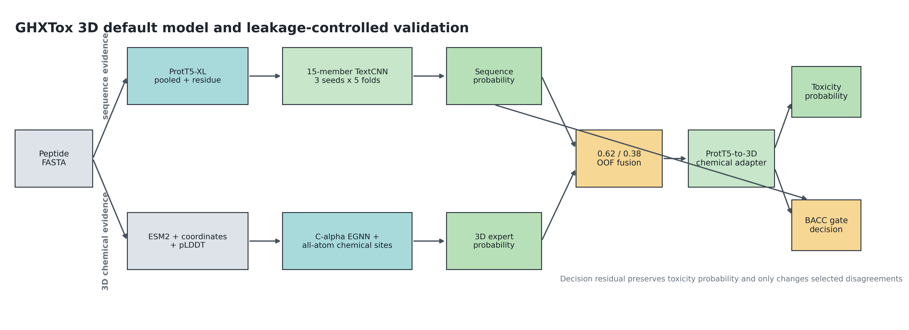

# GHXTox 导师汇报：默认模型结果、创新点与论文图表

更新时间：2026-08-02
汇报模型：**ProtT5-BSMOTE-TextCNN-3Seed（简称 ProtT5-3Seed）**

## 一、汇报范围与核心结论

本报告只使用当前公开默认模型的 Test1/Test2 预测数据进行论文对比。历史联合模型和实验候选不进入主表、测试曲线或结论，以免产生“默认模型不唯一”的歧义。训练集 OOF 中保留必要的组件消融，用于证明默认模型各设计的作用。

默认模型使用 ProtT5-XL-UniRef50 的 1024 维均值表征、每个训练折内部的 1:1 Borderline-SMOTE、`4/5/6` 并行 TextCNN，以及 3 个随机种子乘 5 折得到的 15 成员概率平均。阈值 `0.45` 只由训练 OOF-BACC 平台规则冻结，Test1/Test2 标签未用于选模型、调权重或调阈值。

主要结论如下：

1. Test1 上，默认模型相对 ToxPLTC 的七项可比指标全部更高；相对 ToxMSRC，除 SP 外其余六项可比指标更高。
2. Test2 上，默认模型相对 ToxPLTC 的 SN 按四位小数持平，其余六项可比指标更高；相对 ToxMSRC，BACC、SN、AUROC 更高，MCC 低 `0.0024`。
3. 默认模型在 Test1/Test2 的 BACC 分别为 `0.9342/0.8860`，AUROC 为 `0.9802/0.9588`，AUPRC 为 `0.9578/0.7495`。
4. Test2 阳性率只有 `46/582=7.90%`。其 AUROC 仍高，但 AUPRC 和 MCC 的 bootstrap 区间明显更宽，论文中必须结合类别不平衡解释。
5. 消融显示三随机种子稳定化是最完整、最一致的性能来源；ProtT5 在相同三种子协议下优于 ESM2；Borderline-SMOTE 改善 MCC 和排序，但不是所有指标同步提升。



**图 1. 默认模型与无泄漏验证流程。** 黄色表示训练折内部的数据增强或阈值冻结，绿色表示多折多种子集成。Borderline-SMOTE 不接触 held-out fold。

## 二、九项核心指标

`ACC、BACC、SN、SP、MCC、AUROC、AUPRC` 越高越好；`Brier、ECE-10` 越低越好。参考论文未报告的指标记为 `NR`，不进行推测或补算。

### Test1

| 模型 | ACC | BACC | SN | SP | MCC | AUROC | AUPRC | Brier↓ | ECE-10↓ |
|---|---:|---:|---:|---:|---:|---:|---:|---:|---:|
| ToxMSRC | 0.9405 | 0.9217 | 0.8781 | **0.9653** | 0.8520 | 0.9650 | NR | NR | NR |
| ToxPLTC | 0.9378 | 0.9302 | 0.9125 | 0.9479 | 0.8496 | 0.9709 | 0.9426 | NR | NR |
| **ProtT5-3Seed（本项目）** | **0.9423** | **0.9342** | **0.9156** | 0.9529 | **0.8598** | **0.9802** | **0.9578** | 0.0447 | 0.0226 |

默认模型混淆矩阵：`TP=293、TN=768、FP=38、FN=27`。

### Test2

| 模型 | ACC | BACC | SN | SP | MCC | AUROC | AUPRC | Brier↓ | ECE-10↓ |
|---|---:|---:|---:|---:|---:|---:|---:|---:|---:|
| ToxMSRC | **0.9416** | 0.8689 | 0.7826 | **0.9552** | **0.6550** | 0.9430 | NR | NR | NR |
| ToxPLTC | 0.9261 | 0.8804 | **0.8261** | 0.9347 | 0.6197 | 0.9295 | 0.7353 | NR | NR |
| **ProtT5-3Seed（本项目）** | 0.9364 | **0.8860** | **0.8261** | 0.9459 | 0.6526 | **0.9588** | **0.7495** | 0.0484 | 0.0473 |

默认模型混淆矩阵：`TP=38、TN=507、FP=29、FN=8`。


**图 2. 同一 Train/Test1/Test2 划分上的点估计比较。** 只有 ToxMSRC 和 ToxPLTC 与本项目使用相同基础数据和测试划分。StrucToxNet、PeptiTox、ToxiPep 等数据组成或划分不同，不进入直接数值排名。

## 三、相对论文的指标增益

下表为默认模型减去参考论文的百分点差值。

| 对照 | ACC | BACC | SN | SP | MCC | AUROC | AUPRC |
|---|---:|---:|---:|---:|---:|---:|---:|
| Test1 vs ToxMSRC | +0.18 | +1.25 | +3.75 | -1.24 | +0.78 | +1.52 | NR |
| Test1 vs ToxPLTC | +0.45 | +0.40 | +0.31 | +0.50 | +1.02 | +0.93 | +1.52 |
| Test2 vs ToxMSRC | -0.52 | +1.71 | +4.35 | -0.93 | -0.24 | +1.58 | NR |
| Test2 vs ToxPLTC | +1.03 | +0.56 | 0.00 | +1.12 | +3.29 | +2.93 | +1.42 |


**图 3. 默认模型相对参考论文的百分点增益。** 绿色为提升，橙色为下降，`NR` 表示原论文未报告。由于参考论文没有公开逐样本预测，本图只能比较点估计，不能计算跨论文的配对显著性。

## 四、默认模型不确定性

使用固定种子、5,000 次类别分层 bootstrap 计算默认模型自身的 95% percentile CI。类别分层保持每次重采样中的正负样本数量不变。

| 指标 | Test1：估计值 [95% CI] | Test2：估计值 [95% CI] |
|---|---:|---:|
| ACC | 0.9423 [0.9281, 0.9556] | 0.9364 [0.9158, 0.9553] |
| BACC | 0.9342 [0.9168, 0.9505] | 0.8860 [0.8270, 0.9388] |
| SN | 0.9156 [0.8844, 0.9469] | 0.8261 [0.7174, 0.9348] |
| SP | 0.9529 [0.9380, 0.9665] | 0.9459 [0.9272, 0.9646] |
| MCC | 0.8598 [0.8257, 0.8921] | 0.6526 [0.5573, 0.7467] |
| AUROC | 0.9802 [0.9722, 0.9873] | 0.9588 [0.9334, 0.9799] |
| AUPRC | 0.9578 [0.9397, 0.9732] | 0.7495 [0.6303, 0.8623] |
| Brier↓ | 0.0447 [0.0356, 0.0541] | 0.0484 [0.0349, 0.0626] |
| ECE-10↓ | 0.0226 [0.0168, 0.0381] | 0.0473 [0.0364, 0.0670] |

Test2 的 SN、MCC 和 AUPRC 区间较宽，主要原因是只有 46 个阳性样本。论文中宜写“点估计优于 ToxPLTC”，不宜写成未经逐样本检验的“统计显著全面优于所有方法”。

## 五、ROC、PR 与概率校准


**图 4. 默认模型 ROC 与 precision-recall 曲线。** Test1 阳性率为 28.42%，Test2 为 7.90%。Test2 的 AUPRC `0.7495` 显著高于随机排序的阳性率基线 `0.0790`，说明高 AUROC 并非完全由多数类造成。


**图 5. 默认模型 reliability diagram。** Test1 的 Brier/ECE-10 为 `0.0447/0.0226`，概率可靠性较好。Test2 为 `0.0484/0.0473`，中间概率箱波动较大，符合少数类样本稀疏和外部域变化的特征。Brier 受阳性率影响，不能直接用其绝对值比较 Test1 与 Test2 的任务难度。

校准指标作为本项目的补充统计优势：ToxMSRC 和 ToxPLTC 均未报告 Brier/ECE，本项目同时给出分类、排序和概率可靠性，能支撑风险筛选场景中“概率是否可信”的讨论。

## 六、默认模型核心消融

所有消融只使用训练集 group-aware OOF，不读取 Test1/Test2 标签进行选择。

| 设置 | ACC | BACC | SN | SP | MCC | AUROC | AUPRC | Brier↓ | ECE-10↓ |
|---|---:|---:|---:|---:|---:|---:|---:|---:|---:|
| ProtT5，无 BSMOTE | 0.9286 | 0.9208 | 0.9026 | 0.9389 | 0.8282 | 0.9624 | 0.9167 | 0.0589 | 0.0445 |
| ProtT5 + BSMOTE，1 seed | 0.9335 | 0.9215 | 0.8938 | 0.9492 | 0.8377 | 0.9657 | 0.9254 | 0.0601 | 0.0523 |
| ESM2 + BSMOTE，3 seeds | 0.9382 | 0.9208 | 0.8806 | **0.9610** | 0.8472 | 0.9698 | 0.9408 | 0.0526 | 0.0345 |
| **ProtT5 + BSMOTE，3 seeds（默认）** | **0.9421** | **0.9317** | **0.9076** | 0.9558 | **0.8586** | **0.9724** | **0.9436** | **0.0489** | **0.0344** |


**图 6. 默认模型组件 OOF 消融。** 每一列独立按优劣着色；Brier/ECE 已反向处理，因此颜色只能在同一指标列内比较。

消融结论：

1. 从单种子增加到三种子后，ProtT5 的 BACC/MCC/AUPRC 分别提高 `0.0102/0.0209/0.0182`，Brier/ECE-10 分别降低 `0.0112/0.0180`。这是最完整的正向贡献。
2. 在相同 BSMOTE 和三种子协议下，ProtT5 相对 ESM2 的 BACC、SN、MCC 分别提高 `0.0109、0.0270、0.0114`，仅 SP 下降 `0.0053`。
3. 单种子条件下，BSMOTE 相对无增强提高 ACC、SP、MCC、AUROC 和 AUPRC，但 SN、Brier 和 ECE 回退。因此论文应表述为“改善少数类边界与综合排序”，不能写成“所有指标均改善”。
4. 当前消融已经覆盖参考论文常见的表征模型、类别增强和集成稳定性。投稿前若补实验，优先补 `4 only / 5 only / 6 only / 4+5+6` 卷积窗口，以及参数量匹配的 Linear/MLP/TextCNN 分类头对照；本报告不虚构尚未运行的结果。

## 七、可主张的创新点

需要明确：ProtT5、Borderline-SMOTE 和 TextCNN 单独都不是新算法，且 ToxPLTC 已使用相近的基础模块。项目的新颖性应放在以下可验证组合上，而不是笼统宣称“首次使用 ProtT5”。

### 创新点 1：无泄漏的折内边界增强

Borderline-SMOTE 只在每个训练 fold 内拟合和生成样本，held-out fold 保持真实分布。该设计避免“先对全数据增强、再交叉验证”造成的邻域泄漏，是当前不平衡肽毒性预测中更严格的验证实现。

### 创新点 2：同源组隔离的多种子稳定集成

项目使用 CD-HIT 0.8 同源组感知五折，而不是普通随机划分；三个固定随机种子在完全相同的组折上训练，最终对 15 个 held-out/full-fit 成员做概率平均。消融证明多种子同时改善分类、排序和校准，创新重点是稳定性设计而非单次最优 checkpoint。

### 创新点 3：平台式 OOF 阈值冻结

阈值不是在 Test1/Test2 上调到最优，而是选择训练 OOF 中距离最大 BACC 不超过 `0.0005` 的最大阈值，最终冻结为 `0.45`。这在维持 BACC 的同时偏向更保守的阳性决策，减少阈值对微小 OOF 波动的敏感性。

### 创新点 4：分类、排序、校准和不确定性统一评价

项目在 ACC/BACC/SN/SP/MCC 之外同时报告 AUROC、AUPRC、Brier、ECE-10、ROC/PR、可靠性曲线和类别分层 bootstrap CI。相比只给单次 ACC/AUROC，这套证据能够区分“分类阈值是否合适”“少数类能否正确排序”和“概率能否解释”。

### 创新点 5：性能主模型与机制研究边界分离

论文主结果只采用真正表现最稳定的默认序列模型，不因 2D/3D 模块更复杂就强行并入分类器。结构和化学位点路线可在机制解释或补充材料中单独讨论，但不混入导师版性能主张。这种正、负消融边界增强了结果可信度。

## 八、可直接用于论文的结果分析与讨论

### 结果段落

在与 ToxMSRC 和 ToxPLTC 相同的 Train/Test1/Test2 划分上，ProtT5-3Seed 在 Test1 获得 `ACC=0.9423、BACC=0.9342、SN=0.9156、SP=0.9529、MCC=0.8598、AUROC=0.9802、AUPRC=0.9578`；在类别更不平衡的 Test2 上获得 `0.9364、0.8860、0.8261、0.9459、0.6526、0.9588、0.7495`。相对 ToxPLTC，模型在 Test1 的七项可比指标全部提高，在 Test2 的 SN 持平，其余可比指标均提高。相对 ToxMSRC，模型在两个测试集均提高 BACC、SN 和 AUROC，但 Test2 MCC 仍低 0.0024。

### 讨论段落

默认模型的主要优势集中在 BACC、SN 和排序指标，说明其更适合漏检成本较高的毒性肽初筛。Test2 上 SN 相对 ToxMSRC 提高 4.35 个百分点，同时 SP 降低 0.93 个百分点，体现了明确的灵敏度—特异度权衡，而不是所有决策指标同步增加。由于 Test2 仅包含 46 条毒性肽，单个 FN 的变化即可改变 SN 约 2.17 个百分点，因此 MCC 和 AUPRC 必须结合 bootstrap 区间解释。

ProtT5 相对 ESM2 的 OOF 优势表明，ProtT5-XL-UniRef50 的表示更适合当前肽毒性数据；三种子集成进一步降低了单次初始化和少数类边界采样的方差。Borderline-SMOTE 对 SP、MCC 和排序有帮助，但单种子校准有所下降，说明合成边界样本主要改善决策面，而不会自然保证概率可靠。多种子平均在后续同时降低 Brier 和 ECE，表明稳定集成在本项目中兼具分类与校准价值。

### 限制

1. ToxMSRC/ToxPLTC 未公开逐样本预测，跨论文只能比较点估计，不能进行公平的配对显著性检验。
2. Test1/Test2 在项目历史开发中已被查看多次，应称为“同数据历史对照”，不能再称为新的盲外部验证。
3. Test2 正样本很少，SN、MCC、AUPRC 具有较大采样不确定性。
4. 默认模型依赖 2.42 GB ProtT5 编码器和 15 个小型分类 checkpoint，需在论文效率表中分别报告 embedding 与分类推理成本。
5. 当前默认模型的直接生物学归因仍应补充跨种子一致的序列 motif/残基归因；结构路线的解释不能代替默认模型解释。

## 九、复现与交付

复现命令：

```powershell
D:\anaconda3\envs\dachuang-26\python.exe -m ghxtox.mentor_report `
  --bootstrap-iterations 5000 `
  --bootstrap-seed 20260802 `
  --output-dir reports/mentor_report
```

本次复现清单共审计 23 个输入/模型文件，缺失数为 0，包括：

- 默认配置与 CD-HIT 分组 fold manifest；
- 默认 OOF、Test1、Test2 逐样本预测；
- 3 个随机种子乘 5 折的 15 个 checkpoint；
- ToxMSRC/ToxPLTC 参考文档；
- 导师报告生成源码及 Python/NumPy/scikit-learn/Matplotlib 版本。

机器可读文件：

- `core_metrics_default_only.csv`：默认模型与两篇同数据论文的九项主表；
- `default_bootstrap_ci.csv`：默认模型 5,000 次 bootstrap CI；
- `paper_deltas.csv`：相对参考论文的逐指标差值；
- `default_oof_ablation.csv`：默认架构核心消融；
- `default_calibration_bins.csv`：可靠性曲线分箱；
- `mentor_summary.json`：全部统计结果；
- `reproducibility_manifest.json`：路径、文件大小和 SHA256；
- 六张图均同时提供 300 dpi PNG 和矢量 PDF。
