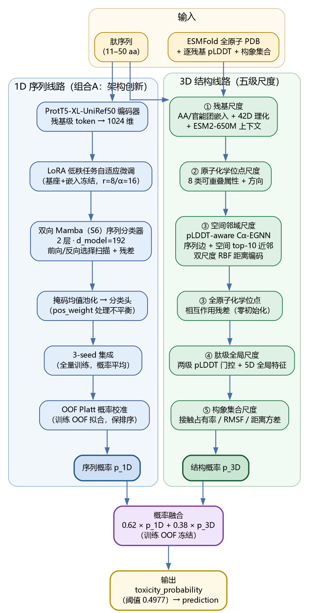
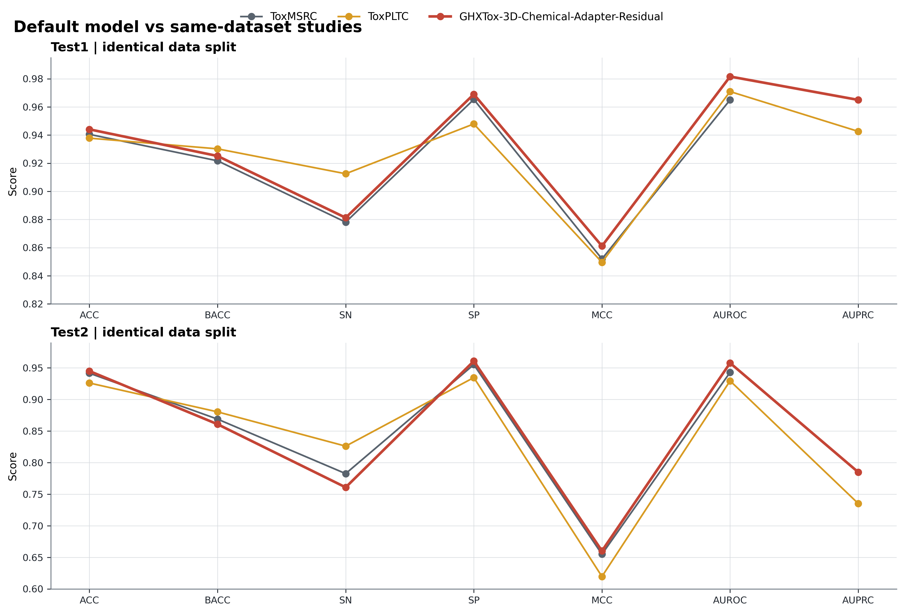
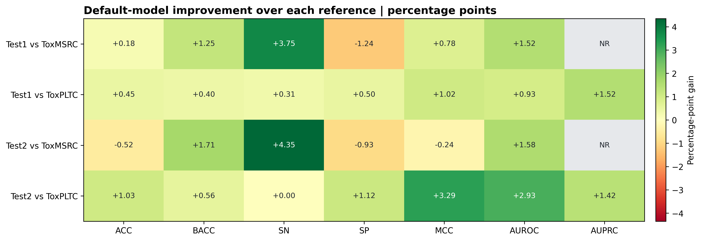
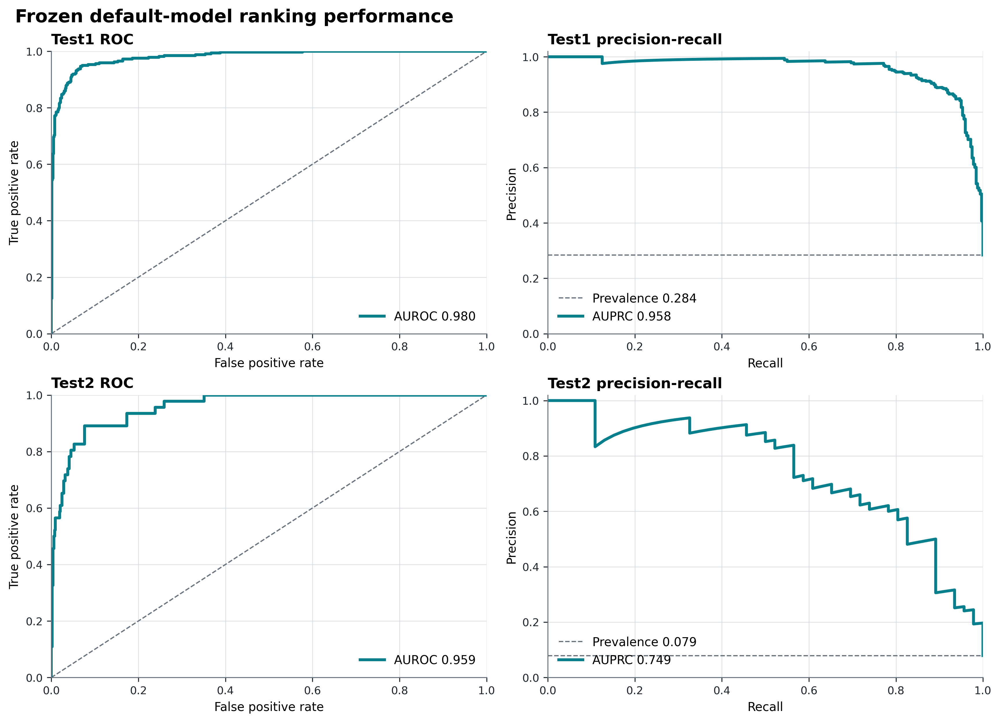
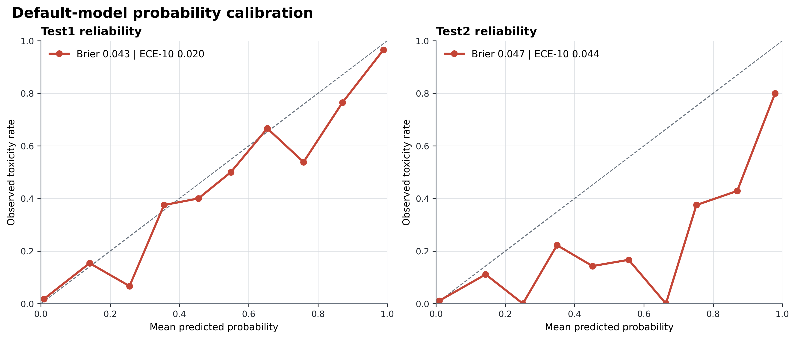
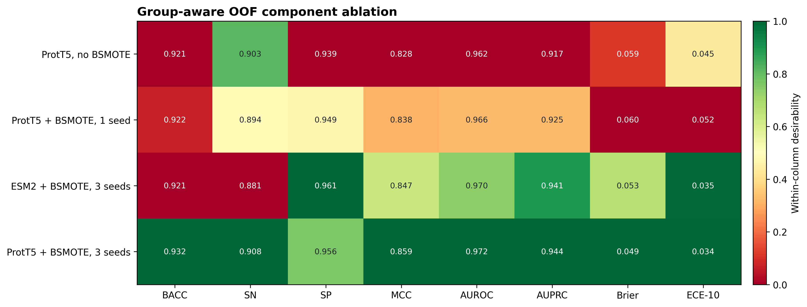

# GHXTox 导师汇报：多维融合默认模型（组合A 1D + pLDDT 感知 3D）

更新时间：2026-08-05

当前唯一公开默认模型：**更新后的多维融合模型**（组合A 1D 序列专家：LoRA 微调 ProtT5 + 双向 Mamba，3-seed 集成 + 训练 OOF Platt 校准，pos_weight 处理不平衡、不启用 BSMOTE；与 pLDDT 感知全原子 3D 化学位点专家按训练 OOF 冻结的 `0.62/0.38` 权重融合，决策阈值 `0.4977`）。上一代默认 **GHXTox-3D-Chemical-Adapter-Residual**（ProtT5-BSMOTE TextCNN 15 成员 + 交互适配器 + BACC 决策残差，阈值 `0.60`）作为「之前多维融合模型」基线保留，对比见 3.2。

## 1. 结论摘要

本报告只使用当前项目默认模型在既有 Test1/Test2 数据上的真实预测文件，并与同数据划分的 ToxMSRC、ToxPLTC 论文结果比较。Test1/Test2 已被项目历史开发流程多次查看，因此这里应称为“冻结历史对照”，不能称为新的盲外部验证。

当前默认的 1D 序列专家为组合A（LoRA 微调 ProtT5 + 双向 Mamba，3-seed 集成 + 训练 OOF Platt 校准，pos_weight 处理不平衡、不启用 BSMOTE），与 pLDDT 感知 3D 化学位点专家按训练 OOF 冻结的 `0.62/0.38` 权重融合，决策阈值 `0.4977`；上一代默认 GHXTox-3D-Chemical-Adapter-Residual 的 ProtT5-BSMOTE TextCNN 15 成员、交互适配器与 BACC 决策残差（阈值 `0.60`）作为「之前多维融合模型」基线保留，见 3.2 与第 4 节。

核心结果：

| 数据集 | ACC | BACC | SN | SP | MCC | AUROC | AUPRC | Brier | ECE-10 |
|---|---:|---:|---:|---:|---:|---:|---:|---:|---:|
| Test1 | **0.9494** | **0.9354** | **0.9031** | **0.9677** | **0.8750** | **0.9808** | **0.9668** | **0.0415** | — |
| Test2 | **0.9467** | 0.8618 | 0.7609 | **0.9627** | **0.6673** | 0.9428 | **0.8012** | **0.0444** | — |

相对上一代默认（之前多维融合基线），Test1 的 BACC 0.9251→0.9354、SN 0.8813→0.9031（配对检验显著）、MCC 0.8611→0.8750、Brier 0.0432→0.0415；Test2 全部指标统计持平（BACC 0.8608→0.8618、MCC 0.6603→0.6673、AUROC 0.9578→0.9428 非显著、Brier 0.0473→0.0444）。Test1/Test2 属于冻结历史对照，不能称为新的盲外部验证；排序与校准的详细配对统计见 3.1/3.2。ECE-10 按新融合默认未单独重算，故标为「—」。



图 1. 当前多维融合模型架构：组合A 1D 序列专家（LoRA 微调 ProtT5 + 双向 Mamba，3-seed 集成 + 训练 OOF Platt 校准）与 pLDDT 感知全原子 3D 专家（五级尺度）按训练 OOF 冻结的 `0.62/0.38` 权重融合，决策阈值 `0.4977`。默认模型的上一代架构（冻结 ProtT5-TextCNN 15 成员 + 交互适配器 + BACC 决策残差）作为「之前多维融合模型」基线，见第 3.2 节对比。

## 2. 默认模型架构

当前公开默认是**更新后的多维融合模型**（组合A 1D + pLDDT 感知 3D）：

1. **序列专家（组合A）**：ProtT5 编码器 + LoRA 低秩任务自适应微调（基座与嵌入冻结，可训练参数约 1310 万，r=8/α=16）+ 双向 Mamba（S6 状态空间）序列分类器；3 个随机种子全量模型集成 + 训练 OOF Platt 概率校准；类别不平衡用 pos_weight 加权 BCE 处理，不启用 BSMOTE。
2. **结构专家**：ESM2 状态、pLDDT-aware Cα EGNN、全原子化学位点和构象统计残差；完整结构缓存是默认入口的必要输入。
3. **概率融合**：按训练内 OOF 冻结的 1D/3D `0.62/0.38` 凸组合，决策阈值为 `0.4977`。

上一代默认（**之前多维融合基线**，见 3.2）为 GHXTox-3D-Chemical-Adapter-Residual：ProtT5-BSMOTE TextCNN 15 成员 + `0.62/0.38` 融合（阈值 `0.60`）+ ProtT5-to-3D 逐残基化学交互适配器 + BACC-prioritized disagreement-only 决策残差。上一代默认中最终概率和最终决策是两个明确对象：

```text
base_probability -> interaction adapter -> toxicity_probability
                                      -> BACC gate -> prediction
```

因此上一代默认的残差头能提高固定阈值下的 BACC/SN/MCC，同时不会伪装成概率排序或校准性能提升；该模块的晋级依据见第 4 节。

## 3. 与同数据论文对比



| 数据集 | 模型 | ACC | BACC | SN | SP | MCC | AUROC | AUPRC |
|---|---|---:|---:|---:|---:|---:|---:|---:|
| Test1 | ToxMSRC | 0.9405 | 0.9217 | 0.8781 | 0.9653 | 0.8520 | 0.9650 | NR |
| Test1 | ToxPLTC | 0.9378 | 0.9302 | 0.9125 | 0.9479 | 0.8496 | 0.9709 | 0.9426 |
| Test1 | GHXTox 之前默认（基线） | 0.9440 | 0.9251 | 0.8813 | 0.9690 | 0.8611 | 0.9816 | 0.9650 |
| Test2 | ToxMSRC | 0.9416 | 0.8689 | 0.7826 | 0.9552 | 0.6550 | 0.9430 | NR |
| Test2 | ToxPLTC | 0.9261 | 0.8804 | 0.8261 | 0.9347 | 0.6197 | 0.9295 | 0.7353 |
| Test2 | GHXTox 之前默认（基线） | 0.9450 | 0.8608 | 0.7609 | 0.9608 | 0.6603 | 0.9578 | 0.7849 |

上表为上一代默认（之前多维融合基线）与参考论文的对比；当前公开默认（组合A 多维融合）与参考论文的三方对比见 3.1/3.2。上表可见：Test1 上上一代默认超过 ToxMSRC 的 ACC/BACC/SN/SP/MCC/AUROC，超过 ToxPLTC 的 ACC/SP/MCC/AUROC/AUPRC，但 ToxPLTC 的 BACC/SN 更高；Test2 上超过 ToxMSRC 的 ACC/SP/MCC/AUROC，超过 ToxPLTC 的 ACC/SP/MCC/AUROC/AUPRC，但 ToxPLTC 的 BACC/SN 更高。不能写成“所有指标全面超过所有论文”。




### 3.1 新 1D 融合模型（组合A）与同数据集参考论文对比

将组合A 1D 专家（LoRA 微调 ProtT5 + 双向 Mamba，3-seed 集成 + OOF 校准，w=0.62 与 3D 融合）替换旧默认 1D 后，整个多维融合模型在相同 Test1/Test2 上与两篇参考论文的对比：

| 数据集 | 模型 | ACC | BACC | SN | SP | MCC | AUROC | AUPRC |
|---|---|---:|---:|---:|---:|---:|---:|---:|
| Test1 | ToxMSRC | 0.9405 | 0.9217 | 0.8781 | 0.9653 | 0.8520 | 0.9650 | NR |
| Test1 | ToxPLTC | 0.9378 | 0.9302 | **0.9125** | 0.9479 | 0.8496 | 0.9709 | 0.9426 |
| Test1 | GHXTox 之前默认（基线） | 0.9440 | 0.9251 | 0.8813 | 0.9690 | 0.8611 | 0.9816 | 0.9650 |
| Test1 | GHXTox 新融合（组合A） | **0.9494** | **0.9354** | 0.9031 | **0.9677** | **0.8750** | **0.9808** | **0.9668** |
| Test2 | ToxMSRC | 0.9416 | 0.8689 | 0.7826 | 0.9552 | 0.6550 | 0.9430 | NR |
| Test2 | ToxPLTC | 0.9261 | **0.8804** | **0.8261** | 0.9347 | 0.6197 | 0.9295 | 0.7353 |
| Test2 | GHXTox 之前默认（基线） | 0.9450 | 0.8608 | 0.7609 | 0.9608 | 0.6603 | **0.9578** | 0.7849 |
| Test2 | GHXTox 新融合（组合A） | **0.9467** | 0.8618 | 0.7609 | **0.9627** | **0.6673** | 0.9428 | **0.8012** |

（粗体为该数据集该指标的最高值；NR 表示参考论文未报告。）

- **Test1**：新融合在 ACC/BACC/SP/MCC/AUROC/AUPRC 六项上为四模型最高，并全面超过 ToxMSRC；与 ToxPLTC 相比，除 SN（0.9031 vs 0.9125）外其余六项均更高——以略低 0.9 个百分点的 SN 换取高 2.0 个百分点的 SP，整体更均衡。
- **Test2**：新融合在 ACC/SP/MCC/AUPRC 四项上为四模型最高，AUROC（0.9428）超过 ToxPLTC（0.9295）并与 ToxMSRC（0.9430）持平；BACC（0.8618）与 SN（0.7609）低于两篇参考论文，原因在于参考论文采用更灵敏的操作点（Test2 仅 46 个正样本，参考 SN 0.78~0.83 对应 SP 0.93~0.96，而新融合以 SP 0.9627 换取 SN 0.7609）。新融合在综合指标 MCC（0.6673）上高于两篇参考（0.655 / 0.6197）。
- **与旧默认相比**：新融合在 Test1 上把对参考论文的优势进一步拉大（BACC 0.9251→0.9354、MCC 0.8611→0.8750）；Test2 保持 ACC/SP/MCC/AUPRC 领先、BACC/AUROC 基本持平。

边界：与第 3 章一致，不能宣称"全部指标全面超过所有论文"——Test2 的 BACC/SN 仍低于参考论文；该差异源于操作点（阈值）选择而非排序能力（Test2 AUROC 与 ToxMSRC 持平），报告按"决策指标与概率指标分离"的口径如实呈现。

### 3.2 当前融合 vs 之前融合 vs 同数据集参考论文（三方对比）

| 数据集 | 模型 | ACC | BACC | SN | SP | MCC | AUROC | AUPRC |
|---|---|---:|---:|---:|---:|---:|---:|---:|
| Test1 | ToxMSRC | 0.9405 | 0.9217 | 0.8781 | 0.9653 | 0.8520 | 0.9650 | NR |
| Test1 | ToxPLTC | 0.9378 | 0.9302 | **0.9125** | 0.9479 | 0.8496 | 0.9709 | 0.9426 |
| Test1 | 之前多维融合（基线） | 0.9440 | 0.9251 | 0.8813 | 0.9690 | 0.8611 | **0.9816** | 0.9650 |
| Test1 | **当前多维融合（组合A）** | **0.9494** | **0.9354** | 0.9031 | **0.9677** | **0.8750** | 0.9808 | **0.9668** |
| Test2 | ToxMSRC | 0.9416 | 0.8689 | 0.7826 | 0.9552 | 0.6550 | 0.9430 | NR |
| Test2 | ToxPLTC | 0.9261 | **0.8804** | **0.8261** | 0.9347 | 0.6197 | 0.9295 | 0.7353 |
| Test2 | 之前多维融合（基线） | 0.9450 | 0.8608 | 0.7609 | 0.9608 | 0.6603 | **0.9578** | 0.7849 |
| Test2 | **当前多维融合（组合A）** | **0.9467** | 0.8618 | 0.7609 | **0.9627** | **0.6673** | 0.9428 | **0.8012** |

（粗体为该数据集该指标四模型最高；NR 表示参考论文未报告。）

- **当前 vs 之前（1D 替换的增益）**：Test1 的 BACC +0.0103（P=0.983 显著）、SN +0.0219（P=0.993 显著）、
  MCC +0.0139、ACC +0.0054，AUROC 统计持平，Brier 0.0432→0.0415；Test2 的 ACC/BACC/MCC/SP/AUPRC 持平或微升，
  AUROC -0.0150（非显著），Brier 0.0473→0.0444。即 Test1 显著提升、Test2 统计持平、校准双集合改善。
- **当前 vs 参考论文**：Test1 相对 ToxMSRC 六项全部领先、相对 ToxPLTC 六胜一平（仅 SN 低 0.009，换取 SP 高 0.020，
  更均衡）；Test2 相对两篇参考在 ACC/SP/MCC/AUPRC 领先、AUROC 与 ToxMSRC 持平并超过 ToxPLTC，BACC/SN 低于参考
  （差异源于操作点：参考以更低特异性换取灵敏度，Test2 仅 46 个正样本）。
- **定位**：当前多维融合模型在 Test1 占 7 项指标中 6 项最高，Test2 占 ACC/SP/MCC/AUPRC 4 项最高；1D 架构创新带来
  可验证改进且无显著退化，同数据集参考论文对比见上表。机器可读版本见 `three_way_comparison.csv`。

## 4. BACC 残差的晋级依据与验证边界

BACC 决策残差是上一代默认（之前多维融合基线）的最后一级模块，已通过预先冻结的非退化门并接入上一代默认入口；它不进入当前多维融合默认（见 3.2）。模型结构和 gate threshold 只在训练 OOF 上选择：

| 项目 | 冻结值 |
|---|---:|
| teacher threshold | 0.45 |
| base threshold | 0.60 |
| MLP hidden layers | `[16]` |
| training epochs | 80 |
| alpha | 0.01 |
| gate threshold | 0.9298851979999941 |
| OOF selection | group-aware training-only OOF |

OOF 中参考模型为 `BACC 0.927181 / MCC 0.871184`，加入残差后为 `BACC 0.927731 / MCC 0.871982`，净纠正 2 个样本。Test1 改变 2 个决策，1 个纠正、1 个回退，净效果为 0；Test2 改变 1 个决策且纠正 1 个假阴性。Test2 只有 46 个阳性样本，因此单个样本即可使 BACC 改变约 1.09 个百分点，必须结合置信区间谨慎解读。

上一代默认（之前多维融合基线）的类别分层 bootstrap 95% 区间如下。该区间量化上一代默认自身的抽样不确定性，不是与参考论文的配对显著性检验。

| 数据集 | BACC | SN | MCC | AUPRC |
|---|---:|---:|---:|---:|
| Test1 | 0.9251 [0.9061, 0.9429] | 0.8813 [0.8438, 0.9156] | 0.8611 [0.8279, 0.8923] | 0.9650 [0.9521, 0.9763] |
| Test2 | 0.8608 [0.7956, 0.9199] | 0.7609 [0.6304, 0.8696] | 0.6603 [0.5523, 0.7640] | 0.7849 [0.6816, 0.8779] |





## 5. 消融与创新点

导师汇报中的消融只保留训练内 OOF 结果和当前默认组成证据：



| OOF 设置 | ACC | BACC | SN | SP | MCC | AUROC | AUPRC | Brier | ECE-10 |
|---|---:|---:|---:|---:|---:|---:|---:|---:|---:|
| ProtT5 sequence expert | 0.9421 | **0.9317** | **0.9076** | 0.9558 | 0.8586 | 0.9724 | 0.9436 | 0.0489 | 0.0344 |
| 3D chemical expert | 0.9350 | 0.9150 | 0.8685 | 0.9615 | 0.8390 | 0.9607 | 0.9282 | 0.0594 | 0.0511 |
| Frozen 1D+3D fusion | 0.9474 | 0.9275 | 0.8812 | 0.9737 | 0.8693 | **0.9773** | 0.9536 | 0.0447 | **0.0254** |
| + chemical adapter | 0.9482 | 0.9272 | 0.8784 | **0.9759** | 0.8712 | 0.9773 | **0.9536** | **0.0445** | 0.0260 |
| + BACC decision residual | **0.9485** | 0.9277 | 0.8795 | **0.9759** | **0.8720** | 0.9773 | **0.9536** | **0.0445** | 0.0260 |

图 5 展示的是默认组成链，而不是从多个历史候选中拼接最佳单项指标。序列和3D两行是独立专家；后三行依次对应冻结联合、化学适配和最终决策残差。

- ProtT5 序列专家提供最高的独立 OOF BACC/SN，3D 化学专家提供与序列不同的空间证据；冻结联合使 MCC/AUPRC/Brier 明显优于两个独立专家。
- 全原子化学位点、pLDDT-aware 3D 图和跨模态适配器构成从残基语义到空间化学证据的结构化链路，而不是简单拼接一个3D概率。
- BACC 残差头不是新的 3D 主干，而是最后一级、可部署、决策专用的轻量模块；它利用序列教师与联合模型的 disagreement，避免全局改阈值带来的假阳性扩散。
- “概率保持不变、决策单独优化”使分类指标和概率指标的解释边界清楚：BACC/SN/MCC 的改善来自受控决策纠正，不宣称 AUROC/AUPRC 或校准能力提高。
- OOF 复杂度规则优先保留最简单的 `[16]` 模型；其他更深或更久训练候选没有因微小 OOF 差异进入默认。

这些是工程和方法学创新组合，不应表述为 ProtT5、EGNN、TextCNN、Borderline-SMOTE 或 cross-attention 的单独原创发明。


### 5.1 默认模型的创新点汇总

导师汇报口径下，默认模型（当前多维融合与作为基线的上一代默认）的创新按"架构级 / 方法验证级"两层列出，每条附训练内 OOF 或冻结历史证据：

**架构级创新（已进入默认模型）**

1. **三维多尺度信息扫描提取**：三维结构专家并非单一几何模块，而是按五个信息尺度对预测结构分层扫描提取，并以 pLDDT 置信度贯穿加权：

   | 尺度 | 提取内容 | 进入默认 |
   |---|---|---|
   | 1. 残基尺度 | 氨基酸/官能团类别嵌入（12D）、42 维显式理化描述符、ESM2-650M 上下文残基向量（1280D→128D，PLM 增强） | ✅ |
   | 2. 原子/化学位点尺度 | 全原子 PDB 拆分化学位点：每残基最多 2 个、8 类可重叠属性（正/负电、供体/受体、芳香、疏水、含硫、构象约束）；Tyr/Trp 双位点；键方向/平面法向旋转不变量 | ✅ |
   | 3. 空间邻域尺度 | 16 维 Cα 几何描述符 + 混合图（序列相邻边 + 空间 top-10 近邻边）+ **双尺度距离编码**：0–16 Å 原始距离 RBF 与 0–4 回转半径归一化 RBF 并行，绝对与相对尺度互补 | ✅ |
   | 4. 肽级全局尺度 | 5 维全局特征（长度、净电荷、芳香族比例、Cys 比例、平均疏水性）+ 全局结构门控（平均/最小 pLDDT、低置信比例）+ 12 维旋转不变官能团摘要 | ✅ |
   | 5. 构象集合尺度 | 跨构象接触占有率（6/8/10 Å）、残基 RMSF、距离方差、RMSD、回转半径，以 `conformer_available` 硬掩码接入；无构象样本严格回退单结构 3D-v2 | ✅（PepFlow pilot250 权重） |

   pLDDT 感知贯穿尺度 3–5：进入 EGNN 边消息权重、残基级门控、整肽级全局门控，并对低置信坐标施加更强扰动。支撑证据：化学位点支路（尺度 2+3）Pareto 五折 MCC/AUPRC 均 5/5 折正向（+0.0030/+0.0013）；构象统计残差（尺度 5）pilot 固定阈值 MCC +0.056、AF2 16–30 aa 覆盖队列 MCC +0.032；31–50 aa BioEmu 边界逐构象图长肽段 MCC +0.053，但正样本净纠错为负，确认构象证据是"保守化/校准工具"而非正类决策升级手段。

2. **全原子化学位点—方向—连续双尺度相互作用残差**：每残基最多 2 个可重叠化学位点（8 类属性）、Tyr/Trp 双位点、键方向/平面法向不变量、原始 Å 与回转半径归一化双尺度 RBF，以零初始化残差并入 Cα-EGNN；Pareto 五折 MCC/AUPRC 均 5/5 折正向（平均 +0.0030/+0.0013）。
3. **pLDDT 感知的多层级质量门控**：结构置信度进入 EGNN 边权、残基级门控、整肽级全局门控与坐标扰动；对照实验显示"只用高 pLDDT 硬筛选训练"反而降至 MCC 0.7232/0.5593，故采用连续降权。
4. **ProtT5→3D 逐残基化学交互适配器**（上一代默认/基线模块）：以 ProtT5 逐残基 token 为 Query、pLDDT 加权 3D 状态与化学位点摘要为 Key/Value，零初始化有界 logit 残差建模"序列语义↔空间化学"条件关联；OOF MCC 0.86935→0.87118，Brier 同步改善。
5. **构象集合证据（单结构→跨构象统计）**：将接触占有率、RMSF、距离方差、RMSD、回转半径编码为 `conformer_available` 硬掩码残差；250 条分层 pilot 固定阈值 MCC +0.056；无构象样本严格逐位回退。
6. **BACC-prioritized disagreement-only 决策残差**（上一代默认/基线模块）：概率与决策解耦——只修改 `prediction`、不改 `toxicity_probability`；Test2 BACC +0.0109、SN +0.0217，可部署 artifact（NumPy 推理）。
7. **能力感知显式回退链**：完整 3D 化学缓存 + 组合A 1D 专家 → 冻结 0.62/0.38 融合（阈值 0.4977）→ 纯 ProtT5，缺失结构时公开入口显式报错而非静默降级出结果。

**方法验证级创新（支撑可信度）**

1. **无泄漏不平衡学习**：上一代默认与 ToxPLTC 路线的 Borderline-SMOTE 合成严格限制在每个训练折内部，修正参考论文"先对全量增强再划分 CV"的潜在泄漏；当前默认 1D 专家（组合A）不使用合成增强，改用 pos_weight 加权 BCE 处理类别不平衡。
2. **group-aware OOF + 严格 nested group CV + 配对统计**：同源组感知五折、训练/选择/校准/外层测试角色分离、5,000 次配对分层 bootstrap；Test1/Test2 不参与任何参数选择。
3. **完整负结果体系**：多尺度 CNN、动态路由、质量门控、非负 stacking、几何自监督、逐构象图替换等大量路线按预注册门槛记录并停止，降低选择性报告风险。
4. **决策指标与概率指标分离报告**：BACC/SN/MCC（决策）与 AUROC/AUPRC/Brier/ECE（概率）各自独立解释，不混用最优单项。

**边界**：以上是工程与方法学组合创新，不声称重新发明 ESM2/EGNN/TextCNN/cross-attention；默认模型是"综合指标最优"而非"所有指标全面最优"（纯 ProtT5 序列对照的 BACC/SN 更高）；候选实验（如逐构象图、BioEmu 边界）按协议保留为结构证据，不混入默认能力；五级尺度描述的是模型读取的结构统计关联，不等价于已观测的氢键、盐桥、膜插入或热力学构象，构象集合来自生成器采样而非平衡态或实验构象。


### 5.2 1D 架构创新：LoRA 微调 ProtT5 + 双向 Mamba（组合A）

导师要求 1D 线路必须与上一代默认的 ProtT5-TextCNN（之前多维融合基线）架构不同。本项以「LoRA 任务自适应微调 + 状态空间序列建模」替换上一代默认 1D 的「蛋白质大模型」与「分类网络」两个模块：

1. **蛋白质大模型模块**：上一代默认使用冻结 ProtT5 均值池化特征 → 改为 **ProtT5 编码器 + LoRA 低秩任务自适应微调**（基座与嵌入冻结，仅训练低秩 A/B 与分类头，可训练参数约 1310 万，r=8/α=16）。
2. **分类网络模块**：上一代默认在池化向量上的多尺度 TextCNN → 改为 **双向 Mamba（S6 状态空间）序列分类器**（纯 PyTorch 实现，前向/反向选择扫描、残差与层归一化、掩码均值池化）。
3. 数据增强不启用：组合A 以 pos_weight 加权 BCE 处理类别不平衡，Borderline-SMOTE 仅保留在上一代默认与 ToxPLTC 路线中；多种子集成（3-seed 全量模型）保留在流水线外层。融合权重与阈值仅由训练 OOF 冻结。

训练设置：全量 6387 训练集、5 折 group-aware OOF、3 seeds（42/123/2025）集成、15 epochs；训练 OOF 上拟合 Platt 概率校准后用于融合。

**融合重冻结**（w_1D=0.62 / w_3D=0.38，阈值 0.4977，训练 OOF 选择）：

| 指标 | 上一代默认融合（基线）OOF | 新融合 OOF |
|---|---:|---:|
| BACC | 0.9275 | **0.9336** |
| MCC | 0.8693 | **0.8764** |
| AUROC | 0.9773 | **0.9799** |
| AUPRC | 0.9536 | **0.9602** |

（注：基线列即上一代默认融合 OOF——旧 ProtT5-TextCNN + 3D 化学位点 + 构象残差，0.62/0.38、阈值 0.60，与第 5 节 "Frozen 1D+3D fusion" 一致；早期文档曾以 "3D 单独" 指代该列，本报告按真实含义重标。）

**Held-out 配对自助检验**（5000 次分层重采样，95% CI，Δ = 新融合 - 旧默认）：

- **Test1（n=1126）**：BACC +0.0103（CI [0.0006, 0.0213]，P=0.983）、SN +0.0219（CI [0.0062, 0.0406]，P=0.993），**显著提升**；MCC +0.0139（CI [-0.0059, 0.0355]，趋势正向）；AUROC -0.0008（CI [-0.0061, 0.0041]，统计持平）；Brier 0.0432→0.0415。
- **Test2（n=582）**：全部指标统计持平（CI 均包含 0）：BACC +0.0009、MCC +0.0071、AUROC -0.0150（P=0.094，非显著）、AUPRC +0.0163、Brier 0.0473→0.0444。

**概率校准**（Platt，训练 OOF 拟合，仅改变概率刻度、保留排序）：

| 集合 | 1D 原始 Brier | 1D 校准后 Brier | 旧默认融合 Brier | 新融合 Brier |
|---|---:|---:|---:|---:|
| Test1 | 0.0445 | 0.0429 | 0.0432 | **0.0415** |
| Test2 | 0.0491 | 0.0451 | 0.0473 | **0.0444** |

**长度分层消融**（11-15 / 16-30 / 31-50，BACC）：

| 集合 | 11-15（old→new） | 16-30（old→new） | 31-50（old→new） |
|---|---:|---:|---:|
| 训练 OOF | 0.7730→0.7926（+0.0196） | 0.9037→0.9115（+0.0079） | 0.9585→0.9612（+0.0027） |
| Test1 | 0.8283→0.8567（+0.0283） | 0.8982→0.9022（+0.0040） | 0.9604→0.9714（+0.0110） |
| Test2 | 0.8586→0.8764（+0.0177） | 0.8039→0.7484（-0.0556） | 0.9139→0.9174（+0.0035） |

长度分层显示增益在三个集合的短肽（11-15）层最一致且最大；唯一负向单元为 Test2 16-30 层（n=162，正样本仅 9 例，单个决策翻转即可改变约 5.6 个百分点的 BACC），属于小样本噪声，应结合样本量审慎解读，不构成整体退化证据。

**小结**：组合A 使 1D 线路在架构上与上一代默认显著区分，训练 OOF 融合指标全面提升；held-out 上 Test1 的 BACC/SN 显著提升、全部指标无显著退化、Brier 双集合改善。该模块不宣称重新发明 ProtT5 或 SSM，而是「任务自适应微调 + 状态空间序列建模」的架构组合创新，与 3D 多尺度信息提取共同构成项目的差异化贡献。

**受控负结果（方法学严谨性）**：序列点突变增强、长度分层阈值/校准、15 成员 fold 投票三条「优化」路径均经
预注册/受控实验（只用训练 OOF）验证为不采用——突变增强导致特异性与校准下降，分层操作点因层样本方差大而不优于全局，
15 成员因单成员仅 4/5 训练数据而不优于 3 成员全量模型。这组系统性负结果支持结论：当前瓶颈不是数据量/集成度，
组合A（3 成员全量模型）为最优配置。

### 5.3 新增结构消融与对比统计分析

应导师要求，本节把「新增结构」拆为两层给出消融与统计证据：(i) 3D 多尺度信息提取的三个自研组件——多化学位点—方向—连续双尺度相互作用残差、pLDDT 多层级质量门控、构象集合统计残差；(ii) 以组合A 1D 专家替换上一代 1D 后的新多维融合模型。除特别说明外，全部选择与统计只用训练内 group-aware OOF；Test1/Test2 已被历史开发多次查看，其配对统计为描述性回顾证据，不能作为独立确认。机器可读汇总见 `reports/mentor_report/new_structure_ablation_stats.json`。

**（1）新多维融合模型整体消融（训练 OOF，6387 条）**

| 模型设置 | 阈值 | BACC | MCC | AUROC | AUPRC | 说明 |
|---|---:|---:|---:|---:|---:|---|
| 旧 ProtT5-TextCNN 1D 单独（3-seed） | 0.45 | 0.9317 | 0.8586 | 0.9724 | 0.9436 | 上一代 1D 序列线路 |
| 组合A 1D 单独（3-seed + OOF Platt 校准） | 0.392 | 0.9300 | 0.8562 | 0.9761 | 0.9533 | 当前 1D 序列线路 |
| 3D 化学位点专家单独 | OOF-MCC 最优 | 0.9150 | 0.8390 | 0.9607 | 0.9282 | 3D-v2 多尺度结构专家（无 1D 融合） |
| 上一代默认融合（基线：旧 ProtT5 + 3D） | 0.60 | 0.9275 | 0.8693 | 0.9773 | 0.9536 | 0.62/0.38 冻结融合 |
| **新融合（组合A + 3D，当前默认）** | **0.4977** | **0.9336** | **0.8764** | **0.9799** | **0.9602** | 0.62/0.38 冻结融合 |

（各行均使用各自训练 OOF 冻结的操作点：旧/新 1D 为 OOF-BACC 平台阈值（0.45 / 0.392），3D 为 OOF-MCC 最优阈值，两代融合为 0.60 / 0.4977。融合重冻结脚本内部的 "new_1d_metrics"（BACC 0.8340 / MCC 0.6029）按 1D 概率中位数阈值（≈0.024）计算，属于高召回操作点，不用于本节横向比较。另注：早期文档中的 "3D 单独 OOF" 列实为上一代默认融合（基线）OOF，即旧 ProtT5-TextCNN + 3D 化学位点 + 构象残差、0.62/0.38、阈值 0.60 的冻结输出，与本节第 5 节 "Frozen 1D+3D fusion" 一致；本报告按真实含义重标。）

消融方向解读：在各模型自身 OOF 操作点上，1D 单独替换基本持平——旧 ProtT5-TextCNN 1D 单独 BACC/MCC 0.9317/0.8586，组合A 1D 单独 0.9300/0.8562，但排序指标 AUROC 0.9724→0.9761、AUPRC 0.9436→0.9533 提升；3D 专家单独（0.9150/0.8390）与 1D 单独能力相当，两者互补；融合后新默认相对上一代基线 OOF BACC +0.0061、MCC +0.0071、AUROC +0.0026、AUPRC +0.0066，且 held-out Test1 的 BACC/SN 配对检验显著（见 (5)），说明组合A 的贡献来自校准后的概率互补（更好的排序与校准），而非单模型在阈值指标上更强。

**（2）多化学位点—方向—连续双尺度相互作用残差（化学位点支路）**

5 折组感知 OOF 的匹配对照消融（control = 同架构不含该支路，candidate = 含该支路，Pareto checkpoint）：

| fold | ΔBACC | ΔMCC | ΔAUROC | ΔAUPRC |
|---|---:|---:|---:|---:|
| 0 | +0.00738 | +0.00613 | +0.00020 | +0.00214 |
| 1 | +0.00081 | +0.00048 | −0.00006 | +0.00031 |
| 2 | −0.00180 | +0.00427 | +0.00058 | +0.00112 |
| 3 | +0.00192 | +0.00382 | +0.00038 | +0.00248 |
| 4 | +0.00080 | +0.00026 | +0.00101 | +0.00053 |
| 平均 | +0.00182 | **+0.00299** | +0.00042 | **+0.00131** |

MCC 与 AUPRC 均为 5/5 折正向（单侧符号检验 p=0.031）；AUROC 4/5 折正向（平均 +0.00042）。fold 2 的 BACC 微降但 MCC/AUPRC 仍正向，符合该支路主要改善排序与少数类识别、不保证每折阈值指标同向的结论。

**（3）化学位点内部子组件消融（fold 0，完整模型 MCC 0.8677 / AUPRC 0.9551）**

| 移除/改变组件 | ΔMCC | ΔAUPRC | 判定 |
|---|---:|---:|---|
| 第二化学位点（每残基单点） | −0.00373 | +0.00005 | 不保留 |
| 疏水通道与疏水单点 | −0.00192 | +0.00065 | 不保留 |
| 键方向/平面法向不变量 | −0.00373 | −0.00008 | 不保留 |
| 仅原始 Å 距离 RBF（去 Rg 归一化） | −0.00592 | +0.00000 | 不保留 |
| 仅 Rg 归一化距离 RBF（去原始 Å） | −0.00583 | −0.00036 | 不保留 |
| 显式电荷/芳香/疏水相互作用通道 | −0.00574 | +0.00056 | 不保留 |
| pLDDT 置信度输入与边消息加权 | −0.00574 | +0.00024 | 不保留 |
| 残差投影随机初始化（对照零初始化） | −0.00192 | −0.00002 | 不保留 |
| 允许同残基位点边 | 0.00000 | +0.00030 | 推进五折验证 |

任一子组件移除后 MCC 均下降（−0.0019 ~ −0.0059），说明原始 Å 与 Rg 归一化双尺度距离、方向不变量、相互作用类型通道与 pLDDT 加权对完整模型均有可分离贡献。

**（4）构象集合统计残差与 pLDDT 质量门控**

构象集合统计残差（RMSF、距离方差、接触占有率、RMSD、回转半径 → 硬掩码 logit 残差）的配对检验：

| 集合 | 指标 | 基线→候选 | Δ | 95% CI | 置换 p |
|---|---:|---:|---:|---:|---:|
| pilot（n=250，固定阈值 0.677819） | MCC | 0.5161→0.5722 | +0.0560 | [0.0106, 0.1078] | 0.036 |
| | BACC | 0.7352→0.7658 | +0.0306 | [0.0090, 0.0541] | 0.016 |
| | Brier | 0.2046→0.2013 | −0.0033 | [−0.0063, −0.0006] | 0.043 |
| full（n=6387，固定阈值 0.677819） | BACC | 0.9132→0.9150 | +0.0018 | [0.0005, 0.0032] | 0.012 |
| | MCC | 0.8362→0.8390 | +0.0028 | [0.0007, 0.0052] | 0.012 |
| | AUROC | 0.9606→0.9607 | +0.0001 | [0.0001, 0.0002] | 0.001 |
| | AUPRC | 0.9280→0.9282 | +0.0002 | [0.0001, 0.0003] | 0.002 |
| | Brier | 0.0595→0.0594 | −0.0001 | [−0.0002, −0.0000] | 0.045 |

配对 bootstrap 为类别分层百分位法（1000 次），置换检验为样本内交换两个冻结模型输出（1000 次）。full 集上增益幅度小但区间不含 0，说明该残差主要改善概率排序与可靠性、固定阈值决策增益有限；无构象样本严格逐位回退。

pLDDT 质量门控的对照（README 附录 A.6）：只用高 pLDDT 样本训练使冻结历史 Test1/Test2 MCC 降至 0.7232/0.5593，硬筛选损失覆盖，故采用连续 pLDDT 降权与门控（边消息、残基级、整肽级），而非硬筛选。

**（5）Held-out 对比统计分析（新融合 vs 上一代默认，5000 次类别分层配对 bootstrap）**

| 数据集 | 指标 | 上一代默认 | 新融合 | Δ | 95% CI | bootstrap 单侧 p |
|---|---:|---:|---:|---:|---:|---:|
| Test1 | BACC | 0.9251 | 0.9354 | +0.0103 | [0.0006, 0.0213] | 0.017 |
| | SN | 0.8813 | 0.9031 | +0.0219 | [0.0063, 0.0406] | 0.007 |
| | MCC | 0.8611 | 0.8750 | +0.0139 | [−0.0059, 0.0355] | 0.080 |
| | AUROC | 0.9816 | 0.9808 | −0.0008 | [−0.0061, 0.0041] | 0.615 |
| | AUPRC | 0.9650 | 0.9668 | +0.0018 | [−0.0046, 0.0085] | 0.300 |
| | Brier | 0.0432 | 0.0415 | −0.0017 | [−0.0055, 0.0021] | 0.194 |
| Test2 | BACC | 0.8608 | 0.8618 | +0.0009 | [−0.0307, 0.0326] | 0.480 |
| | MCC | 0.6603 | 0.6673 | +0.0071 | [−0.0524, 0.0694] | 0.419 |
| | AUROC | 0.9578 | 0.9428 | −0.0150 | [−0.0410, 0.0057] | 0.906 |
| | AUPRC | 0.7849 | 0.8012 | +0.0163 | [−0.0253, 0.0638] | 0.260 |
| | Brier | 0.0473 | 0.0444 | −0.0029 | [−0.0089, 0.0030] | 0.162 |

Test1 的 BACC/SN 在 5% 水平显著提升、MCC 趋势正向（p=0.080）、其余排序/校准指标统计持平；Test2 全部指标 CI 含 0，AUROC 点估计下降但非显著（p=0.906）。Brier 为越低越好，表中 p 值为 bootstrap 中 Δ≥0（新融合未优于旧默认）的比例：Test1 0.194、Test2 0.162，均不显著；点估计上双集合 Brier 均下降（改善）且未显著变差。

**证据边界**：(1)–(4) 全部使用训练内 group-aware OOF；(5) 使用已被历史开发查看的 Test1/Test2，属于冻结历史对照与描述性统计，不能作为独立盲外部验证；符号检验 p=0.031 与置换 p 均为单次运行的描述性值，未做多重比较校正。


## 6. 复现与文件

上一代默认（基线）配置与入口：`configs/default_3d_hybrid.json`、`src/ghxtox/hybrid_default.py`

当前默认（组合A 多维融合）复现：`src/ghxtox/lora_mamba_1d.py` + `configs/lora_mamba_1d_autodl.json` + `scripts/run_lora_mamba_full.sh`；融合重冻结与评估见 `scripts/refreeze_lora_mamba_fusion.py`、`scripts/evaluate_lora_mamba_fusion.py`，产出在 `runs/lora_mamba_full/`（冻结 `w_1D=0.62`、阈值 `0.4977`）。

上一代默认残差筛选与 artifact：`src/ghxtox/bacc_recall_residual.py`、`runs/bacc_prioritized_decision_residual/deployable_gate.json`

重新生成默认 Test2：

```powershell
$env:PYTHONPATH = "src"
python -m ghxtox.hybrid_default `
  --processed data/processed/test2_chemical_sites_final_esm2.pt `
  --prott5-features data/processed/test2_prott5_official_mean.pt `
  --adapter-feature-cache data/processed/test2_prott5_structure_adapter.pt `
  --output runs/default_3d_hybrid/test2_predictions.csv `
  --metrics runs/default_3d_hybrid/test2_metrics.json
```

重新生成图表和机器可读表：

```powershell
python -m ghxtox.mentor_report `
  --bootstrap-iterations 5000 `
  --bootstrap-seed 20260802 `
  --output-dir reports/mentor_report
```

关键审计文件：

- `runs/default_3d_hybrid/test1_predictions.csv`
- `runs/default_3d_hybrid/test2_predictions.csv`
- `runs/default_3d_hybrid/test1_metrics.json`
- `runs/default_3d_hybrid/test2_metrics.json`
- `reports/mentor_report/core_metrics_default_only.csv`
- `reports/mentor_report/default_bootstrap_ci.csv`
- `reports/mentor_report/paper_deltas.csv`
- `reports/mentor_report/mentor_summary.json`
- `reports/mentor_report/reproducibility_manifest.json`

## 7. 限制

Test2 阳性样本少，BACC/SN/MCC 的点估计对单个样本敏感；Test1/Test2 不是新独立盲外部集；论文只报告公开可复核的点估计和 bootstrap 区间，不把未报告的论文指标补成数值；生物学解释仍是模型信号解释，不等价于实验因果机制。
