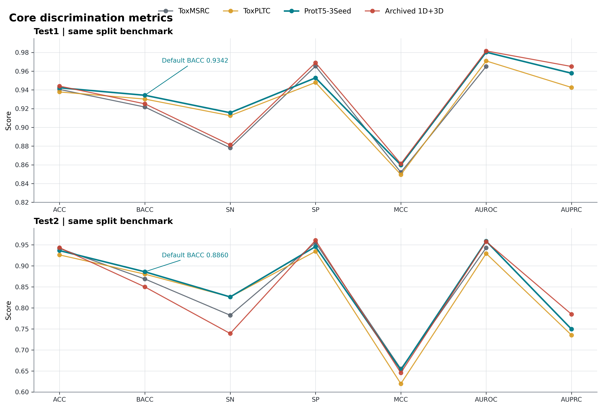
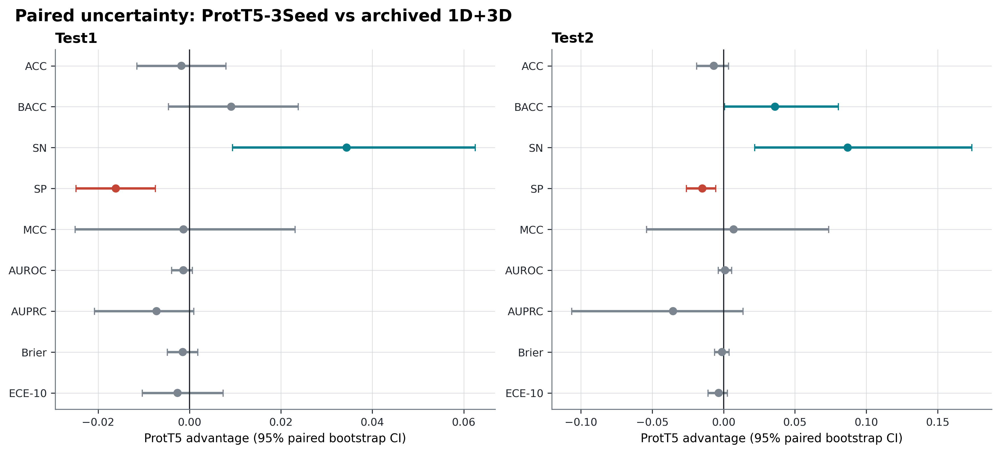
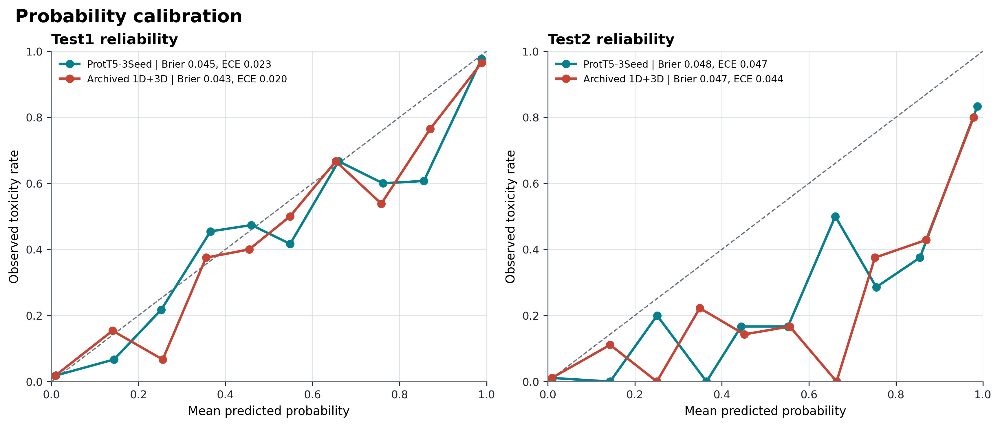
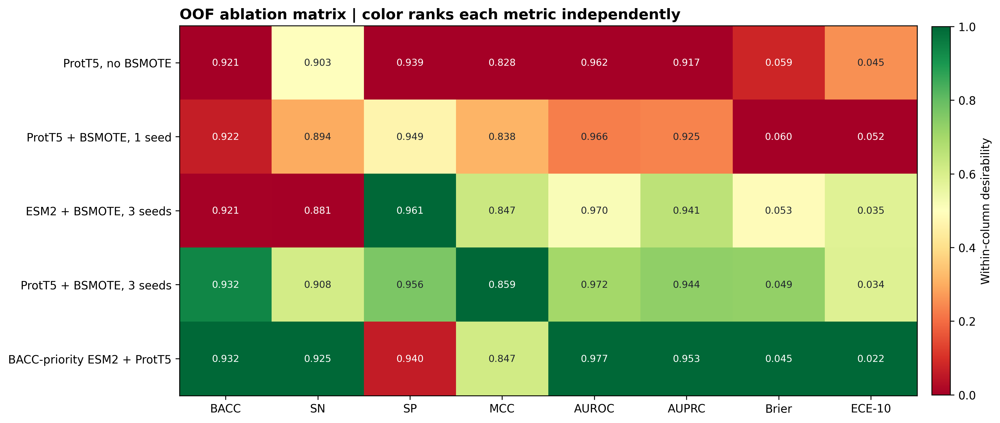
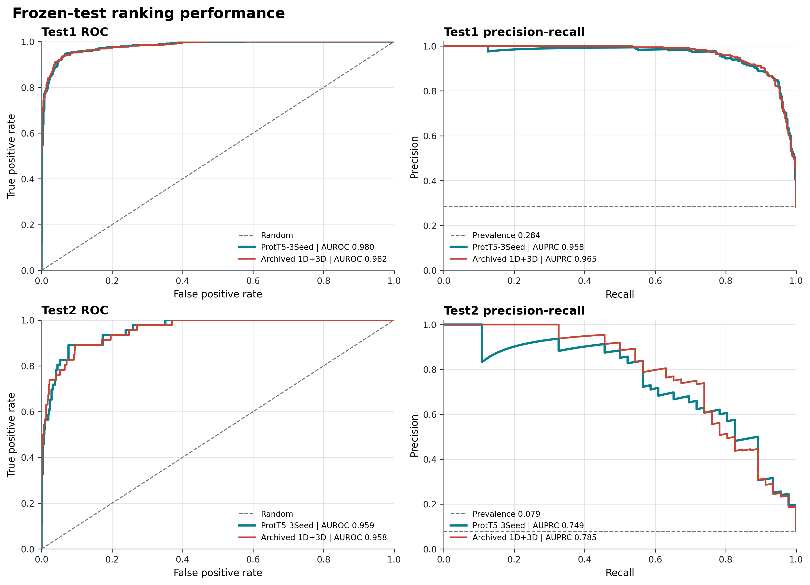

# GHXTox 论文结果、统计分析与消融审计

更新时间：2026-08-02

本报告是当前论文结果的统一统计口径。主模型为 **ProtT5-3Seed**：pooled ProtT5-XL-UniRef50 表征、训练折内 1:1 Borderline-SMOTE、`4/5/6` 窗口 TextCNN，以及 3 个随机种子乘 5 折的 15 成员等权集成。分类阈值 `0.45` 只由训练集 OOF-BACC 冻结。原 ProtT5→3D 化学交互模型在本报告中统一称为 **Archived 1D+3D**，仅用于结构消融和机制解释。

## 1. 评价协议

- 核心指标固定为 `ACC / BACC / SN / SP / MCC / AUROC / AUPRC / Brier / ECE-10`。
- `ACC、BACC、SN、SP、MCC、AUROC、AUPRC` 越高越好；`Brier、ECE-10` 越低越好。
- `SN=TP/(TP+FN)`，`SP=TN/(TN+FP)`，`BACC=(SN+SP)/2`。
- Brier 为概率与标签之间的均方误差；ECE-10 为 10 个概率区间的样本量加权置信度误差。
- Test1/Test2 标签不参与本轮模型、阈值或校准器选择，只用于对冻结预测的统一重算。
- 模型间不确定性使用 5,000 次配对、类别分层 percentile bootstrap；分类错误差异另用双侧精确 McNemar 检验。
- 论文未报告的指标统一标为 `NR`，不补算、不推测。
- Test1/Test2 已在历史开发中被多次查看，因此适合做同数据集复现比较，但不能再被描述成新的无偏外部验证。

## 2. 九项核心指标

### 2.1 Test1

| 模型 | ACC | BACC | SN | SP | MCC | AUROC | AUPRC | Brier↓ | ECE-10↓ |
|---|---:|---:|---:|---:|---:|---:|---:|---:|---:|
| ToxMSRC | 0.9405 | 0.9217 | 0.8781 | 0.9653 | 0.8520 | 0.9650 | NR | NR | NR |
| ToxPLTC | 0.9378 | 0.9302 | 0.9125 | 0.9479 | 0.8496 | 0.9709 | 0.9426 | NR | NR |
| **ProtT5-3Seed（默认）** | 0.9423 | **0.9342** | **0.9156** | 0.9529 | 0.8598 | 0.9802 | 0.9578 | 0.0447 | 0.0226 |
| Archived 1D+3D | **0.9440** | 0.9251 | 0.8812 | **0.9690** | **0.8611** | **0.9816** | **0.9650** | **0.0432** | **0.0200** |

默认模型混淆矩阵为 `TP=293, TN=768, FP=38, FN=27`。相对 ToxPLTC，默认模型在其报告的七项指标上均更高：BACC、MCC 和 AUPRC 分别提高 `0.0040、0.0102、0.0152`。相对 ToxMSRC，默认模型提高 BACC、SN、MCC 和 AUROC，但 SP 低 `0.0124`。

### 2.2 Test2

| 模型 | ACC | BACC | SN | SP | MCC | AUROC | AUPRC | Brier↓ | ECE-10↓ |
|---|---:|---:|---:|---:|---:|---:|---:|---:|---:|
| ToxMSRC | 0.9416 | 0.8689 | 0.7826 | 0.9552 | **0.6550** | 0.9430 | NR | NR | NR |
| ToxPLTC | 0.9261 | 0.8804 | **0.8261** | 0.9347 | 0.6197 | 0.9295 | 0.7353 | NR | NR |
| **ProtT5-3Seed（默认）** | 0.9364 | **0.8860** | **0.8261** | 0.9459 | 0.6526 | **0.9588** | 0.7495 | 0.0484 | 0.0473 |
| Archived 1D+3D | **0.9433** | 0.8500 | 0.7391 | **0.9608** | 0.6456 | 0.9578 | **0.7849** | **0.0473** | **0.0438** |

默认模型混淆矩阵为 `TP=38, TN=507, FP=29, FN=8`。相对 ToxPLTC，默认模型的 SN 在四位小数下持平，其余六项已报告指标均更高，其中 BACC、MCC、AUROC 和 AUPRC 分别提高 `0.0056、0.0329、0.0293、0.0142`。相对 ToxMSRC，默认模型的 BACC、SN、AUROC 更高，但 MCC 仍低 `0.0024`，ACC 和 SP 也略低。

论文间只能比较点估计，因为 ToxMSRC/ToxPLTC 没有提供逐样本预测，不能为差值计算配对置信区间。StrucToxNet、PeptiTox 和 ToxiPep 的数据组成或划分不同，不进入上述数值排名。



**图 1.** 同一 Train/Test1/Test2 划分上的核心分类与排序指标。Brier/ECE 因参考论文未报告而单独在本项目模型间分析。

## 3. 配对统计与操作点权衡

下表的差值统一定义为“正值有利于 ProtT5-3Seed”；Brier/ECE 已反向处理。区间为配对类别分层 bootstrap 95% CI。

| 数据集 | 指标 | 默认模型优势 | 95% CI | 结论 |
|---|---|---:|---:|---|
| Test1 | BACC | +0.0091 | [-0.0046, +0.0238] | 区间跨 0 |
| Test1 | SN | +0.0344 | [+0.0094, +0.0625] | 默认模型召回优势明确 |
| Test1 | SP | -0.0161 | [-0.0248, -0.0074] | Archived 1D+3D 特异度更高 |
| Test1 | MCC | -0.0013 | [-0.0250, +0.0231] | 无明确差异 |
| Test1 | AUPRC | -0.0072 | [-0.0208, +0.0009] | 无明确差异 |
| Test2 | BACC | +0.0360 | [+0.0006, +0.0804] | 默认模型优势窄但为正 |
| Test2 | SN | +0.0870 | [+0.0217, +0.1739] | 默认模型召回优势明确 |
| Test2 | SP | -0.0149 | [-0.0261, -0.0056] | Archived 1D+3D 特异度更高 |
| Test2 | MCC | +0.0070 | [-0.0540, +0.0737] | 正样本少，区间很宽 |
| Test2 | AUPRC | -0.0354 | [-0.1064, +0.0136] | 无明确差异 |

Test1 的 McNemar 不一致对为 `15 vs 17`，`p=0.8601`；Test2 为 `4 vs 8`，`p=0.3877`。因此不能宣称默认模型在总体正确率上显著优于存档联合模型。可支持的结论是：**ProtT5-3Seed 选择了更重视毒性肽召回和 BACC 的操作点，而 Archived 1D+3D 更保守，偏向 SP、AUPRC 和概率校准。**



**图 2.** 默认模型相对 Archived 1D+3D 的配对效应量及 95% CI。Test2 仅 46 个正样本，SN、MCC 和 AUPRC 的区间必须作为正文限制项说明。

## 4. 概率校准

Test1 上两种模型的 Brier/ECE-10 都较低，默认模型为 `0.0447/0.0226`。Test2 上默认模型为 `0.0484/0.0473`，校准误差明显增大；这与 Test2 的低阳性率（46/582）和概率箱中正样本稀疏一致。Brier 受类别流行率影响，不能直接把 Test1 与 Test2 的绝对值当成跨数据集优劣。

现有结果支持报告原始校准质量，但尚不支持把“校准方法”作为完成的默认模型贡献：若加入 temperature 或 Platt scaling，必须在训练集的独立 calibration 角色中拟合，再一次性应用到测试集，不能直接用 Test1/Test2 拟合。



**图 3.** 两个冻结测试集的 reliability diagram。Test2 的部分概率箱样本很少，曲线波动应解释为估计不稳定，而不是确定的系统性失准。

## 5. OOF 消融结果

所有数值来自训练集 group-aware OOF。它们用于架构选择和机制判断，不与冻结 Test1/Test2 主表混算。

| 消融设置 | ACC | BACC | SN | SP | MCC | AUROC | AUPRC | Brier↓ | ECE-10↓ |
|---|---:|---:|---:|---:|---:|---:|---:|---:|---:|
| ProtT5，无 BSMOTE | 0.9286 | 0.9208 | 0.9026 | 0.9389 | 0.8282 | 0.9624 | 0.9167 | 0.0589 | 0.0445 |
| ProtT5 + BSMOTE，1 seed | 0.9335 | 0.9215 | 0.8938 | 0.9492 | 0.8377 | 0.9657 | 0.9254 | 0.0601 | 0.0523 |
| ESM2 + BSMOTE，3 seeds | 0.9382 | 0.9208 | 0.8806 | **0.9610** | 0.8472 | 0.9698 | 0.9408 | 0.0526 | 0.0345 |
| **ProtT5 + BSMOTE，3 seeds** | **0.9421** | 0.9317 | 0.9076 | 0.9558 | **0.8586** | 0.9724 | 0.9436 | 0.0489 | 0.0344 |
| BACC-priority ESM2 + ProtT5 | 0.9358 | **0.9324** | **0.9246** | 0.9402 | 0.8470 | **0.9767** | **0.9535** | **0.0448** | **0.0216** |

消融支持四点：

1. 三种子稳定化是当前分类性能最清楚的贡献，ProtT5 三种子相对单种子同时提高 BACC、SN、MCC、AUROC、AUPRC 和校准。
2. 在相同三种子方案下，ProtT5 相对 ESM2 提高 BACC `0.0109`、MCC `0.0114`，但降低 SP `0.0053`。
3. 1:1 Borderline-SMOTE 在单种子比较中改善 MCC 与排序指标，但 SN、Brier 和 ECE 并非同步改善，不能写成“对所有指标均有效”。
4. BACC-priority 融合进一步提高 SN、BACC、排序和校准，但牺牲 ACC、SP 和 MCC，因此只应作为高召回辅助操作点。



**图 4.** 训练 OOF 消融矩阵。每列独立排序；Brier/ECE 使用反向 desirability，颜色不能跨指标比较绝对大小。



**图 5.** 两个冻结测试集上的 ROC 与 precision-recall 曲线。PR 图同时给出各数据集阳性率基线；Test2 类别不平衡明显，因此 AUPRC 比 AUROC 更能反映少数类排序质量。

## 6. 消融完整性审计

### 已完成，可进入论文

| 论文问题 | 当前证据 | 状态 |
|---|---|---|
| ProtT5 是否优于 ESM2 | 同为 BSMOTE、3 seeds 的 OOF 对照 | 完成 |
| Borderline-SMOTE 是否必要 | 无增强与 1:1 增强对照 | 基本完成 |
| 多随机种子是否必要 | 1 seed 与 3 seeds 对照 | 完成 |
| 综合默认与高召回操作点如何取舍 | 默认与 BACC-priority 对照 | 完成 |
| 1D、2D、3D 及融合是否总能增益 | 大量同折 OOF、冻结测试和负结果 | 完成，但正文需压缩 |
| 3D 置信度、pLDDT 和化学位点的作用 | 固定/可学习门控、内部组件、跨模态与构象消融 | 完成，作为机制子研究 |
| 结果是否稳定 | group-aware OOF、多种子、配对 bootstrap、McNemar | 完成 |
| 概率是否可靠 | Brier、ECE-10、reliability diagram | 已报告 |

### 投稿前仍应补齐

| 优先级 | 缺失实验 | 最小充分设计 | 原因 |
|---|---|---|---|
| P0 | 新的预冻结外部验证 | 先固定模型、阈值、统计方案，再一次性评估 | Test1/Test2 已多次查看，是目前最大审稿风险 |
| P0 | TextCNN 头必要性 | 参数量尽量匹配的线性/MLP/TextCNN，同折 3 seeds | 当前主头的独立贡献未被干净隔离 |
| P0 | 卷积窗口消融 | `4 only / 5 only / 6 only / 4+5+6`，其余设置完全一致 | ToxMSRC/ToxPLTC 都强调多尺度，必须证明窗口组合不是照搬 |
| P1 | BSMOTE 强度 | `none / 0.75 / 1.0`，统一 ProtT5、折和 3 seeds | 当前无增强与增强的种子数不完全对称 |
| P1 | 默认模型校准干预 | raw/temperature/Platt 的 nested calibration 对照 | 把“报告校准”升级为“验证校准方法” |
| P1 | 计算效率 | 参数量、15 成员推理时间、显存、embedding 时间和磁盘 | 多种子集成的性能代价需要量化 |
| P1 | 默认模型生物解释 | 序列归因、稳定 motif、跨种子一致性、错误亚组 | 现有解释以 3D-v2 为主，未直接解释真正的默认模型 |

不建议继续在当前 Test1/Test2 上进行大规模超参数搜索。上述实验应预先固定配置、成功判据和统计方法，只用训练 OOF 决定是否保留。

## 7. 新颖性评估

仅把“ProtT5 + Borderline-SMOTE + TextCNN”列为创新不足以支撑论文，因为它与 ToxPLTC 的技术路线接近。更可信的贡献边界是：

1. **无泄漏不平衡学习**：合成样本只在每个训练折内部生成，避免先增强再交叉验证造成信息泄漏。
2. **稳定性而非单次最优**：使用 group-aware OOF、3 seeds × 5 folds 和逐样本配对统计，证明收益来自稳定化而非幸运随机种子。
3. **操作点显式分离**：默认模型追求综合 BACC/MCC，高召回辅助模型服务于更高 SN，不把不同目标下的结果混成一个“最优模型”。
4. **概率可靠性与不确定性**：在分类、排序之外同时报告 Brier、ECE-10、可靠性曲线、bootstrap CI 和 McNemar。
5. **结构路线的诚实边界**：2D/3D、pLDDT 门控、全原子化学位点和多构象路线提供机制解释与负消融，而不被包装成性能获胜模块。

这种定位的新颖性主要是**验证与证据体系**，不是单个全新神经网络模块。若目标期刊强烈要求架构创新，最有价值的下一步不是再次堆叠 2D/3D，而是将“跨种子一致的毒性序列基序 + 置信度校准”做成可检验的解释层，并在新的预冻结外部集验证。

## 8. 可直接用于论文的结果与讨论

在相同 Train/Test1/Test2 划分上，ProtT5-3Seed 在 Test1 获得 `ACC=0.9423、BACC=0.9342、SN=0.9156、SP=0.9529、MCC=0.8598、AUROC=0.9802、AUPRC=0.9578`，在 Test2 获得 `0.9364、0.8860、0.8261、0.9459、0.6526、0.9588、0.7495`。相对 ToxPLTC，Test1 的全部七项可比指标更高；Test2 的 SN 按四位小数持平，其余可比指标更高。相对 ToxMSRC，模型在两个测试集均提高 BACC、SN 和 AUROC，但 Test2 MCC 仍低 0.0024，说明高召回操作点尚未完全转化为不平衡场景下的整体相关性优势。

配对分析进一步表明，默认模型相对 Archived 1D+3D 的主要稳定变化是 SN 上升和 SP 下降，而不是所有指标同时提高。Test2 上 BACC 优势的 95% CI 为 `[0.0006, 0.0804]`，但 MCC、AUPRC 和总体正确性的区间均跨 0。该结果说明 1D+3D 模型提供了更保守的正类判断和略好的概率排序，而 ProtT5-3Seed 更适合漏检成本较高的毒性筛查。二者应被解释为操作点权衡，不应写成默认模型在所有统计意义上全面优于联合模型。

消融实验显示，多种子集成和 ProtT5 表征是默认模型最稳定的增益来源；Borderline-SMOTE 改善了单种子 MCC 与排序，但对召回和校准存在权衡。更复杂的 2D/3D、置信度门控、化学位点和多构象模块虽然产生了一些训练 OOF 或解释性信号，却没有在两个历史测试集上形成一致的综合优势。这一负结果提示当前瓶颈更可能来自外部域偏移、Test2 少数类样本量和序列同源结构，而不是分类头容量不足。

## 9. 文件与复现入口

- `core_metrics.csv`：论文主表的机器可读九项指标。
- `paired_bootstrap.csv`：默认模型与 Archived 1D+3D 的配对效应量和置信区间。
- `calibration_bins.csv`：可靠性曲线分箱数据。
- `oof_ablation_metrics.csv`：训练 OOF 消融矩阵。
- `analysis_summary.json`：完整协议、混淆矩阵、bootstrap 和 McNemar 结果。
- `figure1_core_benchmark.pdf` 至 `figure5_roc_pr_curves.pdf`：投稿用矢量图。

复现命令：

```powershell
ghxtox-publication-analysis --bootstrap-iterations 5000 --output-dir reports/publication_analysis
```
